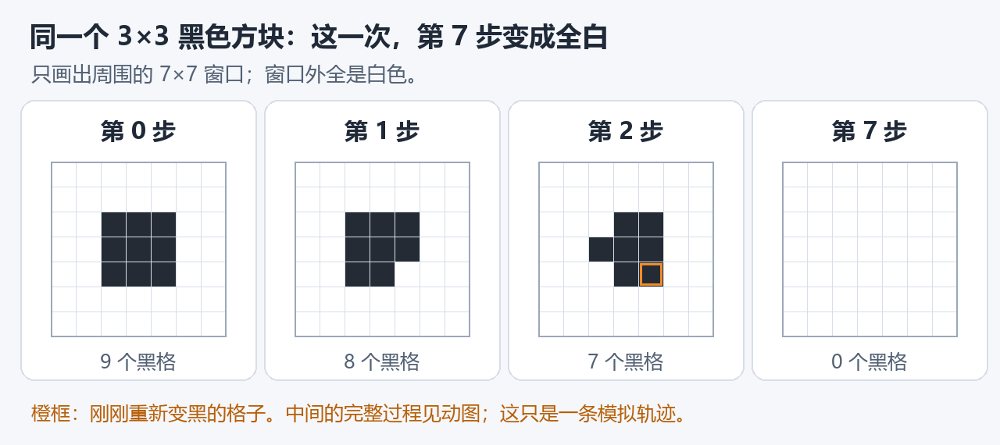
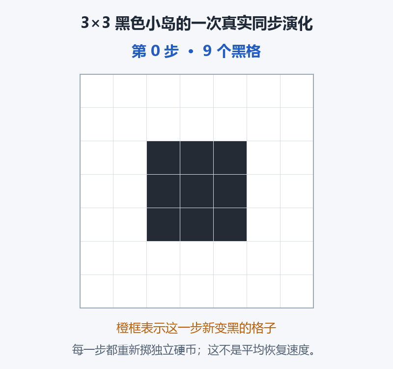
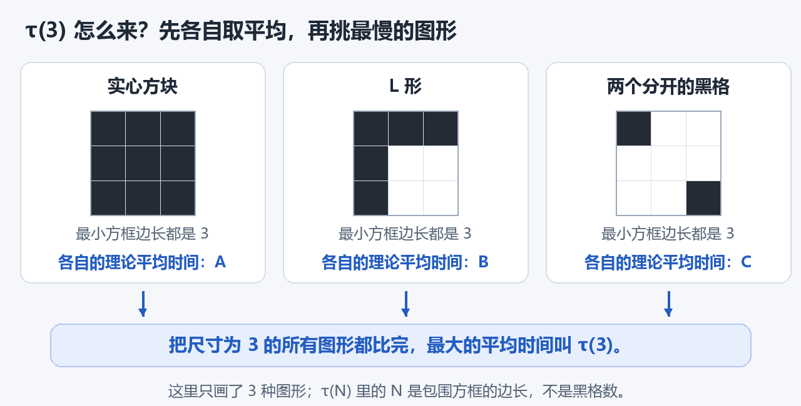
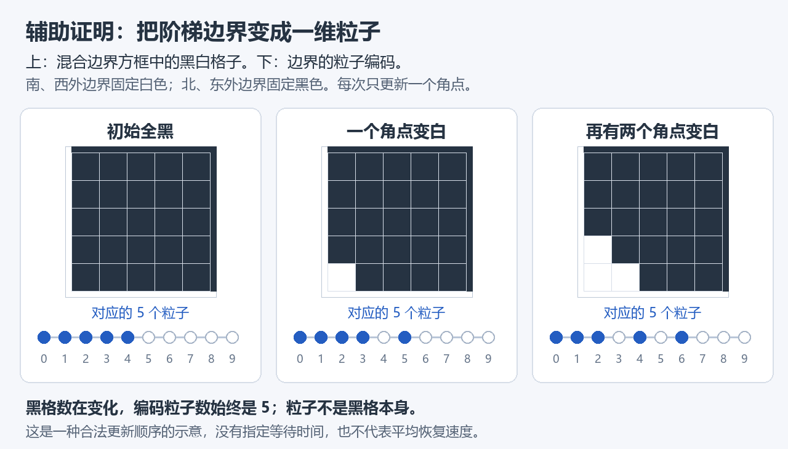

# 随机多数投票：一块黑色图形要多久才会消失？

在无限大的白色方格纸上涂黑一些格子。此后，每个格子根据邻居的颜色，决定自己下一步变黑还是变白。我们想证明：**初始图形的尺寸为 N 时，最坏平均消失时间与 N² 同阶。**

这个仓库记录我们用 Lean 编写、检查这项证明的过程。完整主定理尚未证明。

## 格子怎样变色？

每个格子只看上、下、左、右四个邻居。黑色占多数就变黑，白色占多数就变白；两黑两白时，掷公平硬币决定。不同格子、不同轮次的硬币彼此独立。

所有格子同时更新，读取的都是上一轮的颜色。中心格自己的旧颜色不参加投票。

## 这次演化，7 步后全白

下面从同一块 3×3 黑色方块出发，实际模拟了一次演化。

这一次，第 7 步首次变成全白，因此恢复时间是 7。橙框中的格子曾经变白，后来又变黑：图形并不是一层层擦掉的。

看完整的 7 步动图

只换硬币结果，同一个初态的另外两次模拟分别用了 4 步和 10 步。三次模拟能说明恢复时间有随机性，不能给出所有随机结果下的理论平均，更不能证明平方尺度。

## “最坏平均时间”是什么意思？

先固定初始黑色图形 S，把首次全白的步数记作 T(S)。我们关心它对所有硬币结果的平均，也就是期望 E[T(S)]；若始终不恢复，则恢复时间记为无穷。

再比较不同初始图形。这里的尺寸 N 是能包住所有黑格的、沿横竖格线放置的最小正方形边长，单位是格。它不是黑格总数。例如，下图三种图形的尺寸都是 3。

先对硬币结果取平均，再对尺寸恰好为 N 的所有初始图形取最大值，得到

$$
\tau(N)=\max_{S:\,\mathrm{size}(S)=N}\mathbb{E}[T(S)].
$$

目标是找到与 N 无关的正常数 c、C，使所有足够大的 N 都满足

$$
cN^2\leq\tau(N)\leq CN^2.
$$

两边要求不同：下界要找出平均至少要这么久才能恢复的图形；上界要保证所有同尺寸图形的平均恢复时间都不超过这个量级。黑白互换后问题相同，因此也涵盖白色扰动落在全黑背景上的情形。

## 现在证明到了哪里？

**已经完成主定理的下界：确实存在需要平方量级时间才能恢复的图形。** 对所有足够大的边长 N，初态取一整块 N×N 黑色方块，它的平均恢复时间至少是 cN²，其中 c 是一个与 N 无关的正数。

这是原题中所有格子同步更新的结论。证明保留了永不恢复时的无穷值，也处理了边长的奇偶；完整主定理还差二次上界。

下界是怎样得到的？我们先给辅助时钟过程中的黑格记分：靠外的格子分值低，某些难处理的边界变化恰好发生在零分位置。然后严格计算平均失分速度，证明图形没有足够时间失去保护。最后，用已经证明的更新方式比较，把这个结论接回原同步过程：经过平方量级的轮数，方块仍至少有四分之一概率没有恢复。这个概率就给出了平均时间的下界。

**现在要补的是另一半：保证任何同尺寸图形的平均恢复时间都不超过 CN²。** 我们用一个保留更多黑格的辅助过程来控制原过程。它的边界始终呈阶梯形，因此能改写成一排粒子；边界的一次有效变色，恰好对应粒子和旁边空位交换。

图中粒子表示边界形状，不是黑格本身。这只是合法更新顺序的示意，没有指定随机等待时间。

现在已经证明真实时钟下粒子平均占据概率的演化方程，还证明：任意两个不同位置同时有粒子的概率，不大于两处分别有粒子的概率之积。我们也得到平均分布不均匀程度如何变化的精确能量公式。

接下来要从这些公式估计扩散速度与清空概率，再补齐不同大小区域的时钟对应，接回原同步模型。**二次上界仍未完成。**

| 证明部分 | 当前状态 |
| --- | --- |
| 原规则、尺寸、真实随机分布和含无穷的恢复时间 | 已核验 |
| 至少有一种图形，平均恢复时间达到 cN² | **已核验：原同步、恰 N 尺寸的二次下界** |
| 所有同尺寸图形，平均恢复时间不超过 CN² | 尚未完成 |
| 合并得到 τ(N)=Θ(N²) | 尚未完成 |

## 怎样核查这些成果？

Lean 是证明检查工具：我们把每个推导写清楚，由它的逻辑内核逐步核验。已完成部分有实际构建和公理审计记录；这不表示整条证明已经完成，也不等于人类专家认证。

- [当前进度与下一步](STATUS.md)
- [源码、工具链及验证记录](docs/VERIFICATION.md)
- [图像、随机种子与逐帧数据](docs/images/README.md)：投票图和最坏情形图是示意，演化图来自模拟，均不替代证明。

问题来源：Fatès、Marcovici、Taati，[*Self-stabilisation of Cellular Automata on Tilings*，Question 7.4](https://arxiv.org/html/2101.12682v3)。本页报告本项目进展，不据此判断该问题最新的公开解决状态。

[26日：真实随机时间下的平均变化公式](formal/PROGRESS_2026-10-26_FINITE_MACHINE_DYNKIN.md)。

[26日最新：真实矩演化、异点关联和扩散能量](formal/PROGRESS_2026-10-26_MOMENTS_COVARIANCE.md)。
