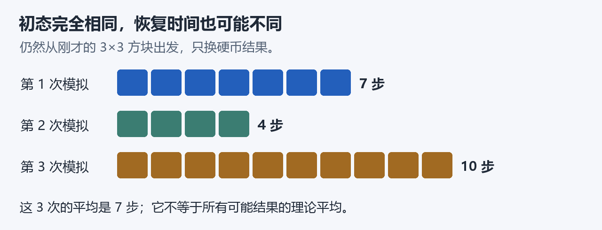

# 一块黑色区域，要经过多少步才会消失？

想象一张无限大的白色方格纸。我们在中央涂黑一个 **3×3 方块**，然后让每个格子反复按下面的规则变色。

先跟着这个具体例子走一遍，再看我们想证明什么。**完整数学证明仍在进行中。**

## 1. 先只看一个格子

一个格子只看上、下、左、右四个邻居：多数是黑就变黑，多数是白就变白；两黑两白时，掷一枚公平硬币。

每一步，**所有格子一起更新，读取的都是上一步的颜色**。每格每步使用独立硬币。中心格自己的旧颜色不参加投票。

## 2. 再看整块图怎样变化

下面是按这条规则实际模拟出的一次演化。

从左往右读：最初有 9 个黑格；第 1 步少了一个；第 2 步，橙框那个格子又变黑了；直到第 7 步，第一次变成全白。

我们把**第一次全白时的步数**叫作“恢复时间”。这次的恢复时间就是 **7 步**。中间的黑格会来回变色，不能把过程想成一层层擦除。

播放这一次演化的完整 7 步动图

## 3. 为什么不能直接回答“需要 7 步”

因为换一批硬币结果，答案就会变。仍从同一个 3×3 方块出发，这三次模拟分别花了 **7、4、10 步**。

我们关心的是一个图形在**所有可能随机结果下的平均恢复时间**。这三次的样本平均是 7，但它还不是理论平均。

然后还要换不同的初始图形。把能包住黑格的**最小方框边长**记作 N。下图的三个图形都有 N=3，虽然黑格总数并不相同。

**先对硬币结果取平均，再对初始图形取最大值。** 这样得到的“最坏平均恢复时间”，记作 τ(N)。

我们要证明：能找到两个与 N 无关的正常数 c、C，使所有足够大的 N 都满足

**c·N² ≤ τ(N) ≤ C·N²。**

这就是 **τ(N)=Θ(N²)**：恢复时间的增长尺度是尺寸的平方。它要求控制所有尺寸、所有初态，不能靠这几次模拟证明。

## 4. 我现在究竟在证明哪一步

为了分析面积怎样变化，我们引入一个辅助过程：各格有独立闹钟，**每响一次只更新一格**。原问题仍是“所有格子同时更新”；两者之间的比较需要数学证明。

单次更新比较容易算。例如，一个黑色角点恰好有两个黑邻居：更新它时，一半机会不变，一半机会变白。因此，这一处更新平均少半个黑格。

**难点是：下一次更新可能发生在别处，图形也已经变了。** 不能把“平均少半个”直接乘以时间，就说整块图会以这个速度缩小。

当前还缺的桥梁是：把各次局部更新的平均影响，正确累积成一段时间里整块图的平均变化，再证明足够强的收缩概率界。这座桥还没完成，所以二次恢复时间定理也还没完成。

## 5. 已有成果怎样检查

这个项目用 **Lean** 写证明。你可以把它理解为：把数学推导写得足够精确，让计算机的逻辑内核逐步检查。

已经核验的部分包括原规则和尺寸定义、多种更新方式的比较工具、辅助图形的边界与面积性质，以及在只使用过去信息的有限观察时刻之后，固定格点的等待规律和下一枚硬币的公平性。

- [最近的证明思路，用配对图说明](docs/PROOF_GUIDE.md)：为什么“下一枚硬币仍公平”也需要证明。
- [验证记录](docs/VERIFICATION.md)：已经检查的源码、工具链和审计；这些记录不表示主定理已经完成。
- [图像和模拟怎样生成](docs/images/README.md)：代码、随机种子、逐帧数据及复现方式。图解和模拟用于解释，不替代数学证明。

问题来源：[Fatès–Marcovici–Taati，Question 7.4](https://arxiv.org/html/2101.12682v3)。本页只报告本项目进展，不判断该问题最新的公开解决状态。
