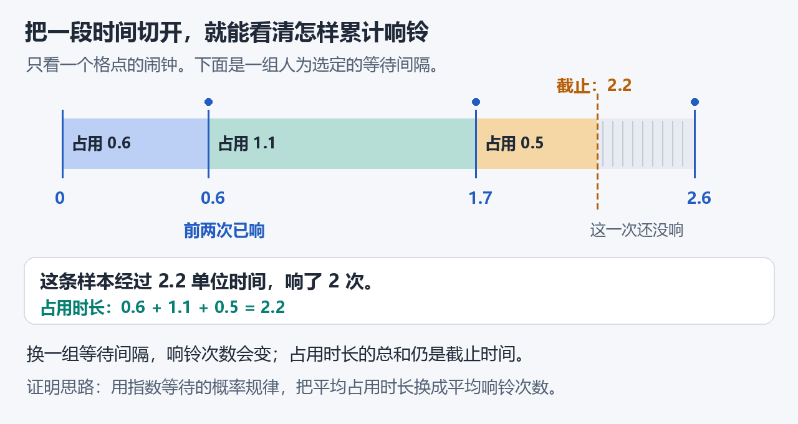

# 当前进度：正在把“一次变化”接到“一段时间”

**主定理还没有完成，证明正在继续。** 目标是：尺寸为 N 的扰动，其最坏平均恢复时间与 N² 同阶。对每种初态先取所有随机结果的平均，再比较同尺寸的全部初态；几次模拟不能代替这个结论。

## 已经证明，可以往下使用

- 原四邻同步规则、扰动尺寸和恢复时间已有精确定义，允许恢复时间为无穷。
- 已建立原同步过程与辅助随机时钟过程之间的比较工具。辅助过程每次只更新一个格点。
- 辅助图形的边界和面积已有证明：保护区一旦失守，就会出现足够大的缺失面积。不过，这还没有说明失守要等多久。
- 在只用过去信息决定的有限观察时刻之后，固定格点还要等多久、下一枚随机标记是什么颜色，已有完整联合规律，并与此前记录独立。
- 辅助过程的每个格点，在 t 单位时间内平均恰好响铃 t 次。此结论对真实时钟证明；即使根据过去记录提前结束观察，平均响铃次数也已证明有限。
- 每种颜色的预配随机标记，平均出现 t/2 次。这里数的是硬币标记，实际改成黑色或白色的次数还取决于邻居投票。

这些结论已通过实际构建和标准逻辑内核检查。它们完善累计面积变化所需的工具，仍不是整个小岛的恢复时间界。

## 刚刚补上的一步

前一步只计算“从开始到现在，一共平均响了几次”。现在已经进一步证明：**即使先看过此前全部记录，后面一段时间的平均新增响铃次数，仍等于这段时间的长度。** 每种颜色的预配标记，平均各占一半。

例如，在时刻1查看已经发生的响铃和硬币记录，再观察到时刻2.2。按过去记录选择任何一组有正概率的样本，这组样本之后平均仍新增1.2次响铃。这里说的是所有随机结果的平均，单条样本可能只新增1次，也可能更多。

这让后续计算可以根据当时已经知道的图形，给未来更新安排不同的权重。下一步还要把固定区间的公式推广到每一次更新之前，才能累计面积变化。

还已把真实响铃整理成可积分的事件清单，并证明对清单求和就是对原过程逐次求和。它准备记录每次更新的面积变化，还没有给出整个小岛的恢复时间界。

## 现在继续做什么

下一步把上述区间公式推广到随时间变化、只依赖更新前信息的权重，再结合每响一次之前的图形，正确累计面积变化。辅助过程还限制了部分边界更新，这些限制带来的累计影响必须另行控制。

最后还需证明足够强的小岛收缩概率，再接回原同步过程，得到完整的二次上下界。这些是主定理尚缺的核心部分。

目前没有可靠的完成百分比。辅助定理数量表示已核验材料的规模，不能表示剩余数学难点已经完成多少。独立 AI 审查也不等于人类专家确认。

[从同一个3×3例子理解问题](README.md) · [最近的配对证明思路](docs/PROOF_GUIDE.md) · [源码与验证记录](docs/VERIFICATION.md)
