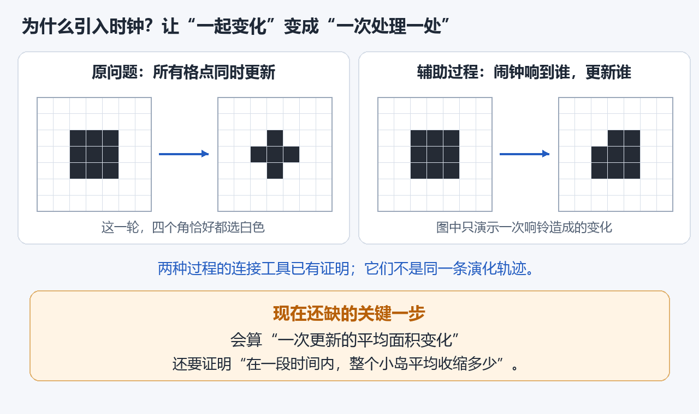
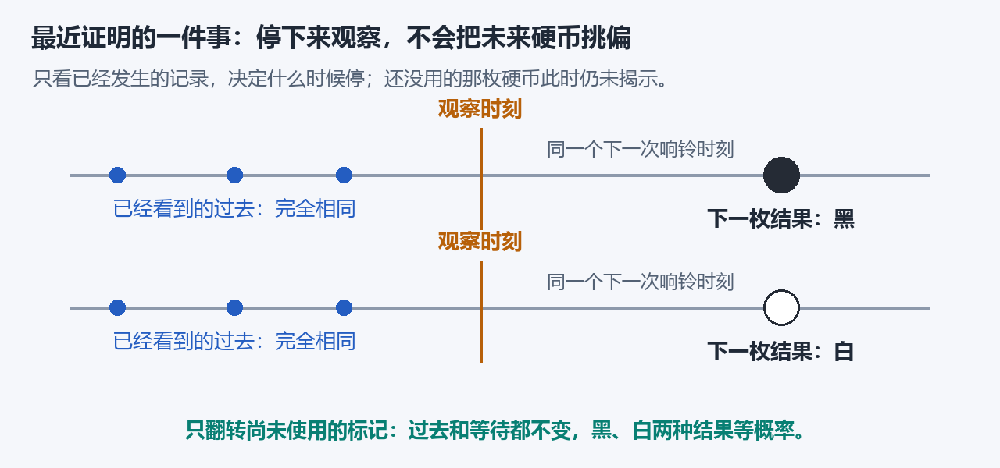
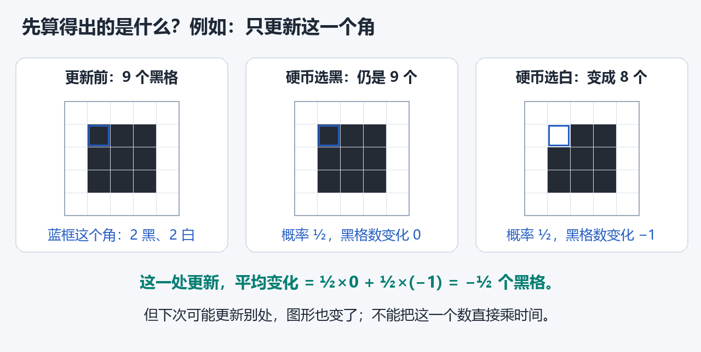

# 为什么“下一枚硬币仍公平”也需要证明？

[首页](../README.md)已经用一个 3×3 方块展示了更新、恢复时间和研究目标。这里接着解释最近真正完成的一项证明，以及它为什么对下一步有用。

## 1. 闹钟让我们能一次分析一处变化

在原问题中，所有格子一起更新。为了分析，我们另外研究每次只更新一格的随机时钟过程：每格有独立闹钟，平均每单位时间响一次，响到谁就更新谁。

图左边的一轮中，四个角恰好都变白了；右边只演示一个角的闹钟响起、随后变白。它们是不同的过程，需要用已经建立的一批比较工具连接，不能把右边的一次响铃直接当成左边的一轮。

## 2. 观察时刻也可能是随机的

例如，我们约定：“第一次发现某个保护格变白时，停下来观察。”这个时刻由已经发生的事决定，我们并不知道它会落在什么时候。

证明里还有许多这样的观察规则。共同要求是：**决定是否停下时，只能使用已经看到的信息。** 这种规则在概率论中叫“停时”。

如果先偷看后面的硬币，再挑一个“下一枚正好是黑色”的时刻，就会挑偏。这种选择不能用来宣称未来硬币仍然公平。

目前的证明先给观察设置有限截止时间：要么先看到指定事件，要么到截止时间就停。这样，观察时刻确实有限，不需要先假定保护区最终一定失守。

## 3. 用一张配对图看最近的证明

现在固定一个格点，考虑它在观察之后的下一次响铃。

上、下两行只差一件事：下一次响铃所用的那枚标记，一个是黑，一个是白。其余随机输入都保持原样。

这次响铃还没有发生，所以翻转标记不会改动已看到的过去。观察规则只看过去，因此观察时刻也不变。闹钟的输入没改，下一次响铃的时刻也不变。

于是，我们可以把“下一枚结果为黑”的演化，与“下一枚结果为白”的演化一一配对。两种输入的机会相等，过去的记录相同，因此按过去决定何时观察，不会把这枚硬币挑偏。

真正的形式化还要处理“到底哪一次响铃是观察后的第一响”：对每个可能的编号分别配对，再把互不重叠的情况相加。这个连接已经通过 Lean 检查。

已有证明还给出了等待时间的规律，并直接计算了等待、下一枚标记与过去记录的联合尾概率。**这是固定一个格点的结论**，不能凭此跳到所有格点未来共同独立。现在完整的等待/标记联合分布也已通过内核检查：任意可测的等待条件，都可与尚未揭示标记的配对一起处理。

## 4. 这项证明怎样帮助研究收缩速度

我们想在这样的随机观察时刻之后，继续计算更新的平均影响。首先必须知道，接下来使用的硬币和等待规律确实还是所需的规律，不能因观察方式而改变。

有了这类保证，局部计算才有可靠的概率基础。例如，更新一个两黑两白邻居支持的黑色角点：

这只能说明**在图中的状态、选定这个角点更新一次**时，黑格数平均减少半个。它还没有回答：一秒内会发生多少次有关的更新？更新后图形改变，下一次的平均变化又是多少？

现在已证明其中一项：辅助过程每个格点在 t 单位时间内平均响铃 t 次。它来自真实等待间隔的计算，不能读成“每条样本都恰好响 t 次”。

上图把时间分成三段，合计2.2。对所有随机样本取平均以后，指数等待的概率规律才把总占用时长换成平均响铃次数。下一步还须考虑过去记录和每次更新前的图形。

我们正在补的真实时间公式，就是要把这些变化放进同一条严格的累计关系中。技术记录里把这称为“补偿公式”或“Dynkin 公式”。记住它的作用即可：**连接一次更新与一段时间。**

## 5. 为什么这座桥仍然难

辅助证明还会对过程作改造，例如禁止某些区域外的出生，并进行几何清理。这样做有利于控制图形，却会改变面积的变化率。算式里必须记下这些改动，不能把原过程的面积公式直接搬过来。

此前已找到一个反例，否定了把实际辅助过程的面积漂移当成固定常数的简化路线。因此，现在保留了正确的边界修正项，下一步还要控制它随时间的累积。

即使完成累计公式，仍需证明小岛在平方时间内有足够强的收缩概率，再接回原同步过程的上下界。**所以，已有的局部规律和比较工具，并不等于完整主定理已经证明。**

Lean 负责核查我们已经写出的逻辑推导；原问题与定义是否对应、剩余步骤是否齐全，也必须分别检查。独立 AI 审查不能冒充人类专家确认。

[返回图文首页](../README.md) · [核查技术记录](VERIFICATION.md)
