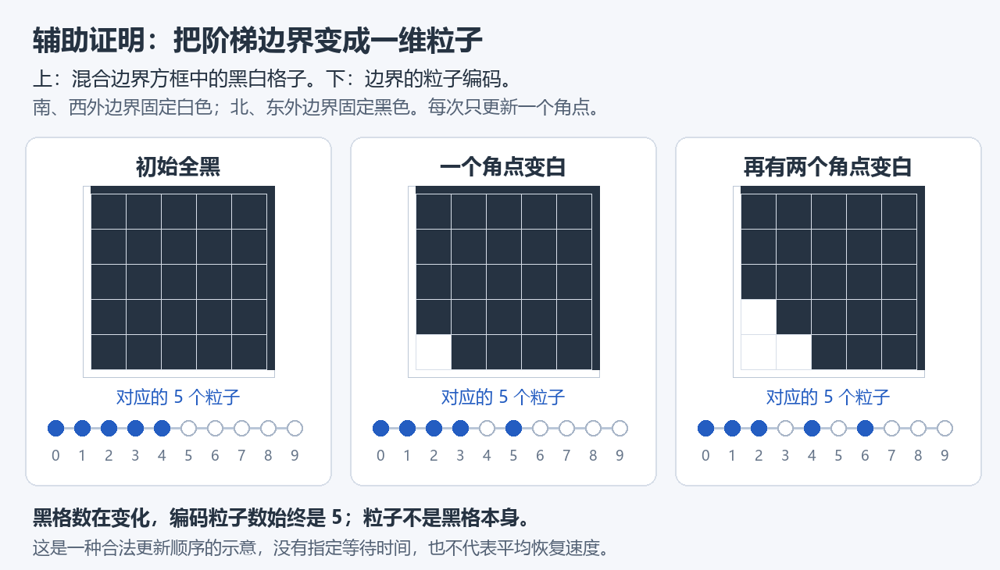
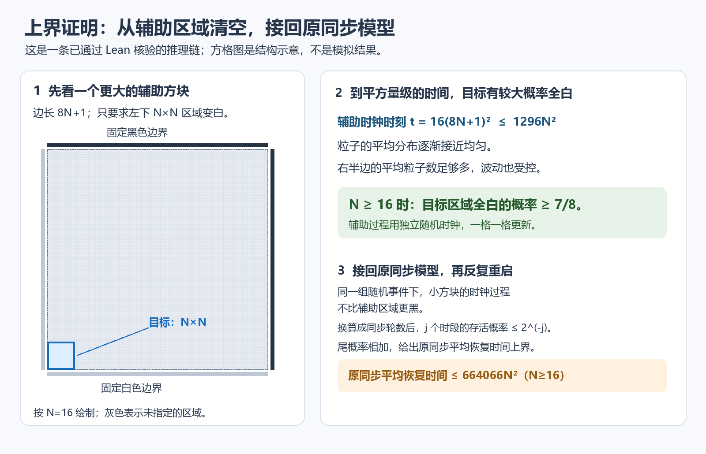

# 二次恢复时间的证明纲要

本节给出原显示上下界的主要约减、概率估计与常数。基本模型、恢复时间和尺寸按[模型与记号](NOTATION.md)定义。下文列出的几何引理、时钟耦合和排斥过程矩估计均作为已证引理使用，其完整证明由相应形式数学源给出；本文展开它们如何组成原同步模型的结论。

## 1. 有限方形归约与时钟比较

颜色取 $0<1$。在同一平票标记下，四邻多数更新对四个输入单调。因此，在固定零边界的 $N\times N$ 方形内，任意初态的同步恢复时间不超过全 $1$ 初态的恢复时间。初始包围方形外始终为背景色：方形外的每个格点最多只有一个邻居在方形内，不能产生异色。

平移与黑白互换保持随机标记律及恢复时间分布。由此，无限格点上的两背景、任意平移问题可归约到有限零边界方形，且尺寸恰为 $N$ 的约束在归约中保留。相关声明为 [OriginalRecoveryProfile.lean](../formal/analysis/MathResearchAnalysis/OriginalRecoveryProfile.lean) 的 `tau_eq_normalizedTau` 及 [SquareRecoveryTime.lean](../formal/analysis/MathResearchAnalysis/SquareRecoveryTime.lean) 的 `synchronous_le_top`。

辅助时钟过程给每个格点配置独立的速率 $1$ 泊松时钟，每次响铃只更新该格点，平票使用独立公平标记。其连续时间记为 $t$，原同步时间仍按整数轮计。两过程的联系通过调度比较建立，而非逐步等同。

对 $N\ge2$、$t\ge0$，记 $q_N(t)$ 为边长 $N$、零边界、全 $1$ 初态的时钟过程在时刻 $t$ 尚未清空的概率。对整数 $k\ge0$，定义

$$
t_k=8\log2\,(k+1),\quad r_k=128(k+1),\quad
\epsilon_N(k)=\frac65N^2\,2^{-(k+1)}.
$$

若 $T_N$ 表示相同方形全 $1$ 初态的同步恢复时间，则

$$
q_N(t_k)\le\mathbb P(T_N>k)+\epsilon_N(k),
$$

$$
\mathbb P(T_N>2r_k+1)
\le2q_N(t_k)+2\epsilon_N(k).
$$

第二式的因子 $2$ 来自两个棋盘相位。调度失败概率 $\epsilon_N(k)$ 同时控制依赖任务尚未完成和更新次数过多的事件。两个方向的比较均见 [SquareRecoveryTime.lean](../formal/analysis/MathResearchAnalysis/SquareRecoveryTime.lean) 的 `two_way_clock_tail`，尺度及失败事件见 [SchedulingFailure.lean](../formal/analysis/MathResearchAnalysis/SchedulingFailure.lean)。

## 2. 加权面积与下界

### 2.1 辅助区域与退出估计

取整数 $L\ge2$。在边长 $2L+1$ 的方形中，定义截角区域与保护区域

$$
D_L=\{z\in\mathbb Z^2:|z_1|,|z_2|\le L,\ |z_1|+|z_2|\le L+1\},
$$

$$
I_L=\{z\in\mathbb Z^2:10(|z_1|+|z_2|)\le9L\},\qquad
P_L=I_L\cup\partial_4 I_L.
$$

这里 $\partial_4 I_L$ 是 $I_L$ 外、与其中至少一个格点四邻相接的格点集。辅助过程从 $D_L$ 全部占据出发：禁止 $D_L$ 外出生，每次随机更新后反复删除不足两个占据邻居的格点，并在 $P_L$ 首次不再完全占据时冻结。删除操作按有限迭代稳定化定义；所得过程的几何性质及与原时钟过程的序关系是下界所用的比较引理。

占据表示颜色 $1$，未占据表示颜色 $0$；域内随机更新沿用第1节的速率1泊松四邻多数更新及公平平票标记。

令 $U_t$ 为该冻结过程的占据集，$\sigma$ 为保护区域首次失守的时刻。使用线性权重

$$
w_L(z)=L+2-|z_1|-|z_2|,\qquad
W_t=\sum_{z\in D_L\setminus U_t}w_L(z).
$$

$W_t$ 是丢失的加权面积，在 $D_L$ 上权重为正。对占据集包含于 $D_L$ 的构形，$D_L$ 外能发生出生的位置只能在 $|z_1|+|z_2|=L+2$ 层上；这一层的权重为零，因此禁止这些出生不增加加权漂移修正。

下列两项是几何与补偿公式给出的估计：

$$
\mathbb E[W_t]\le(18L+12)t+(L+2)(4L+2)\qquad(L\ge2),
$$

$$
\mathbb P(\sigma\le t)
\le\frac{\mathbb E[W_t]}{L^3/128000}\qquad(L\ge80).
$$

第一式中，$(18L+12)t$ 来自原始单格更新的加权漂移；$(L+2)(4L+2)$ 支付附加删除的总损失。其时间积分针对实际更新前的状态。第二式使用退出时必然丢失的加权面积阈值 $L^3/128000$，再应用非负随机变量的 Markov 不等式。完整证明见 [WeightedAreaTail.lean](../formal/analysis/MathResearchAnalysis/WeightedAreaTail.lean)、[WeightedExitArea.lean](../formal/analysis/MathResearchAnalysis/WeightedExitArea.lean) 与 [PhysicalWeightedDrift.lean](../formal/analysis/MathResearchAnalysis/PhysicalWeightedDrift.lean)。

原时钟过程若已清空，保护区域必已在上述比较过程中失守。因此

$$
1-q_{2L+1}(t)
\le\frac{(18L+12)t+(L+2)(4L+2)}{L^3/128000}.
$$

取 $h_L=L^2/12288000$。当 $L\ge12288000$ 时，右侧在 $t\le h_L$ 不超过 $1/2$，从而 $q_{2L+1}(t)\ge1/2$。

### 2.2 同步尾界与原尺寸

取

$$
k_L=\left\lfloor\frac{L^2}{196608000}\right\rfloor-1.
$$

当 $L\ge196608000$ 时，尺度估计给出

$$
k_L\ge\frac{L^2}{393216000},\quad
t_{k_L}\le h_L,\quad
\epsilon_{2L+1}(k_L)\le\frac14.
$$

由第一方向的时钟比较，

$$
\mathbb P(T_{2L+1}>k_L)
\ge q_{2L+1}(t_{k_L})-\epsilon_{2L+1}(k_L)
\ge\frac14.
$$

尺度估计见 [SyncLowerScale.lean](../formal/analysis/MathResearchAnalysis/SyncLowerScale.lean)，同步尾界见 [SynchronousQuadraticTail.lean](../formal/analysis/MathResearchAnalysis/SynchronousQuadraticTail.lean) 的 `synchronous_tail_ge_quarter`。

对原尺寸 $N\ge786432000$，取 $L=\lfloor(N-1)/2\rfloor$，则 $2L+1\le N$、$L\ge196608000$ 且 $L\ge N/6$。实心小方块与实心 $N\times N$ 方块的单调比较给出

$$
\mathbb P(T_{Q_N}>k_L)\ge\frac14.
$$

非负扩展期望满足 $\mathbb E[T]\ge k\mathbb P(T>k)$，即使允许 $T=\infty$ 也成立。因此

$$
\tau(N)\ge\mathbb E[T_{Q_N}]
\ge\frac{k_L}{4}
\ge\frac{L^2}{1572864000}
\ge\frac{N^2}{56623104000}.
$$

奇偶尺寸处理、尾概率转期望及精确尺寸见证见 [OriginalQuadraticLower.lean](../formal/analysis/MathResearchAnalysis/OriginalQuadraticLower.lean)。

## 3. 排斥过程与上界

### 3.1 阶梯边界的粒子表示

取 $M=8N+1$ 的辅助方形，南、西外边界固定为 $0$，北、东外边界固定为 $1$，初态全 $1$。该时钟过程保持坐标单调的阶梯形，即两坐标都增大时颜色值不减。边界编码为长度 $2M$ 的路径上的 $M$ 个粒子；一次角点变化对应邻位粒子与空位的交换，总粒子数保持为 $M$。

图 1. 混合边界辅助过程的三种构形及对应粒子编码。图中 $M=5$，粒子数始终为 $5$；粒子编码边界而非占据格点。图示更新序列不指定连续时间。

记 $\eta_i(t)\in\{0,1\}$ 为第 $i$ 个路径位置的粒子占据变量，$\rho_i(t)=\mathbb E[\eta_i(t)]$，$0\le i<2M$。定义

$$H(t)=\sum_{i=0}^{2M-1}(\rho_i(t)-1/2)^2.$$

一阶矩的离散热方程及路径 Poincaré 不等式给出

$$
H'(t)\le-\frac{H(t)}{4M^2},\qquad H(0)=M/2,
$$

故

$$H(t)\le\frac M2\exp\!\left(-\frac{t}{4M^2}\right).$$

在 $t_0=16M^2$ 时，有 $H(t_0)\le M/16$。对应声明为 [MixedHeatDecay.lean](../formal/analysis/MathResearchAnalysis/MixedHeatDecay.lean) 的 `squareMass_le_exponential`、`squareMass_at_mixingTime`。

### 3.2 局部清空概率

令 $J_t=\sum_{i=M}^{2M-1}\eta_i(t)$ 为右半路径的粒子数。Cauchy–Schwarz 不等式给

$$
|\mathbb E[J_{t_0}]-M/2|^2\le M H(t_0)\le M^2/16,
$$

所以 $\mathbb E[J_{t_0}]\ge M/4$。另一方面，不同占据变量的协方差非正，因此

$$
\operatorname{Var}(J_{t_0})
\le\sum_{i=M}^{2M-1}\operatorname{Var}(\eta_i(t_0))\le M/4.
$$

此处不要求占据变量独立。由于 $N\le M/8$，切比雪夫不等式给

$$
\mathbb P(J_{t_0}<N)
\le\frac{M/4}{(M/8)^2}=\frac{16}{M}\le\frac18
\qquad(N\ge16).
$$

阶梯构形的几何关系保证：$J_{t_0}\ge N$ 时，辅助方形西南角的 $N\times N$ 区域全为 $0$。均值、方差、清空事件的连接分别见 [MixedRightCountHeat.lean](../formal/analysis/MathResearchAnalysis/MixedRightCountHeat.lean)、[MixedRightCountMoments.lean](../formal/analysis/MathResearchAnalysis/MixedRightCountMoments.lean)、[MixedLocalClearing.lean](../formal/analysis/MathResearchAnalysis/MixedLocalClearing.lean) 与 [MixedClearingProbability.lean](../formal/analysis/MathResearchAnalysis/MixedClearingProbability.lean)。

### 3.3 跨尺寸比较、同步尾界与重启

将辅助方形中目标 $N\times N$ 区域的时钟及标记限制到该区域，得到的联合分布正是边长 $N$ 的小方形所需分布。在相同内部随机输入下，零边界小方形的状态逐点不超过辅助过程。因此辅助区域全 $0$ 蕴含小方形清空，得到

$$q_N(t_0)\le1/8.$$

跨尺寸限制及逐点比较见 [ClockSampleRestriction.lean](../formal/analysis/MathResearchAnalysis/ClockSampleRestriction.lean)、[ClockRestrictedExecution.lean](../formal/analysis/MathResearchAnalysis/ClockRestrictedExecution.lean) 和 [CrossSquareClockBound.lean](../formal/analysis/MathResearchAnalysis/CrossSquareClockBound.lean)。

取 $k=1296N^2$ 以及同步块长度

$$b_N=2\cdot128(k+1)+1.$$

当 $N\ge16$ 时，$t_0\le k\le t_k$，$\epsilon_N(k)\le1/8$。小方形的清空态吸收，故 $q_N(t_k)\le q_N(t_0)$。第二方向的时钟比较给

$$
\mathbb P(T_N>b_N)\le2\cdot\frac18+2\cdot\frac18=\frac12.
$$

任意块结束后，给定此前历史，未使用的同步平票标记仍服从原独立公平律。当前构形不超过全 $1$ 构形，故同一上界可逐块应用。对初始异色集合包含于该零边界方形的任意初态 $x$，以及整数 $j\ge0$，

$$\mathbb P(T_x>jb_N)\le2^{-j}.$$

由非负扩展期望的尾和公式，按长度 $b_N$ 分块求和，

$$
\mathbb E[T_x]
=\sum_{t=0}^{\infty}\mathbb P(T_x>t)
\le b_N\sum_{j=0}^{\infty}2^{-j}
=2b_N\le664066N^2.
$$

最后一个数值界使用 $b_N\le332033N^2$。尺度、重启和尾和证明见 [SyncUpperScale.lean](../formal/analysis/MathResearchAnalysis/SyncUpperScale.lean)、[SquareRandomRestart.lean](../formal/analysis/MathResearchAnalysis/SquareRandomRestart.lean)、[ExtendedBlockTail.lean](../formal/analysis/MathResearchAnalysis/ExtendedBlockTail.lean)。对归一化的全部精确尺寸图形取上确界，再还原平移与背景色，得到 [OriginalQuadraticUpper.lean](../formal/analysis/MathResearchAnalysis/OriginalQuadraticUpper.lean) 的 `tau_quadratic_upper_bound`。

图 2. 上界的几何比较与时间尺度。辅助方形边长为 $8N+1$，仅要求其西南 $N\times N$ 区域在指定时刻全为背景色；该事件经跨尺寸比较与调度估计转为同步块尾界。图示为证明结构，非模拟数据；图中所标内核检查对应2026-10-26的归档版本。

## 4. 定理合并与独立改进

第 2 节给出 $N\ge786432000$ 时的下界，第 3 节给出 $N\ge16$ 时的上界。合并后取

$$c=1/56623104000,\quad C=664066,\quad N_0=786432000,$$

即得 $\tau(N)=\Theta(N^2)$；形式声明见 [OriginalQuadraticRecovery.lean](../formal/analysis/MathResearchAnalysis/OriginalQuadraticRecovery.lean)。

后续独立证明 [ImprovedOriginalLower.lean](../research/exploration/phase2/lean/ImprovedOriginalLower.lean) 使用更强的辅助时钟退出估计与调度尺度，得到 $N\ge500001$ 时的 $\tau(N)\ge N^2/576000000$。该文件另行保存，不替换上述原证明的常数与版本。

原证明的构建、工具链和审计记录见[验证方法](VERIFICATION.md)。相关比较方法与算例见[证明方法说明](proof-discovery/README.md)。按日期形成的进展及原稿由[归档索引](ARCHIVAL_RECORD.md)定位，其阶段性表述按原日期理解。
