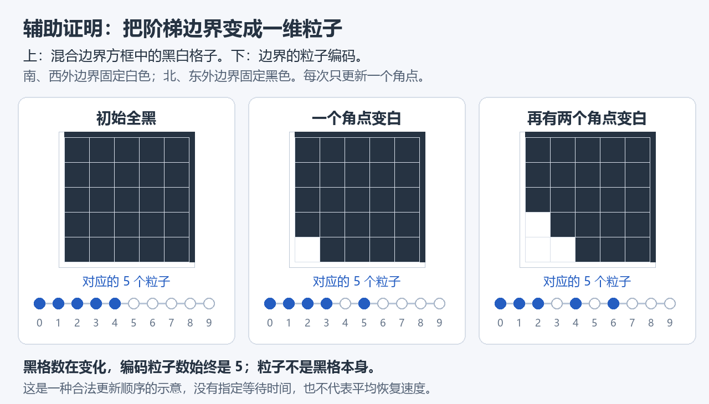

# Proof outline for quadratic recovery time

**English** · [简体中文](PROOF_GUIDE.zh-CN.md)

The detailed estimates below follow the explicit bounds from 26 October 2026. The later revision strengthens the lower bound and uses the full failure-probability estimate from the upper-bound proof.

## Improvements in the later revision

The [revision 6 manuscript](../research/revision-ab-2026-11-17/paper/paper.md) gives the full mathematical argument. The lower bound still uses the weighted area lost when the protected region is first breached. Summing the weights of the missing sites in a square of side $\lfloor L/20\rfloor$ raises the loss threshold to $L^3/12500$. Together with the original weighted drift and the bound on the cost of additional deletions, this gives $\tau(N)\ge N^2/576000000$ for $N\ge500001$. See Lemma 3 and Sections 5–6 of the manuscript.

For the upper bound, Section 3 gives the local clearing failure probability $16/(8N+1)$. The factor of $2$ in the clock comparison and its two scheduling error terms give the bound

$$a_N=32/(8N+1)+(12/5)N^2 2^{-(1296N^2+1)}.$$

For $N\ge16$, restarting conditionally on the configuration at each synchronous block boundary, with block length $b_N=331776N^2+257$, gives $\mathbb P(T_x>jb_N)\le a_N^j$ and $\tau(N)\le b_N/(1-a_N)$. The bound $a_N\le\min(1/2,5/N)$ gives a geometric tail and bounds the probability of failure after one block by $5/N$. Summing over the blocks also bounds positive-order and exponential moments. The constants are given in [Research results](RESEARCH_RESULTS.md).

Monotonicity in Section 1 also identifies the filled square as an extremizer, giving $\tau(N)=\mathbb ET_{Q_N}$ for $N\ge2$. The later quantitative estimates appear in [the A/B revision source](../research/revision-ab-2026-11-17/lean/OriginalConsequences.lean).

## Detailed derivation of the original bounds

[Model and notation](NOTATION.md) defines the synchronous model, the recovery time and the perturbation size. The outline below uses results on geometry, clock coupling and exclusion-process moments whose full proofs are in the linked formal sources. It shows how they combine to give bounds for the original synchronous model.

## 1. Reduction to a finite square and clock comparison

Order the colours by $0<1$. With the same tie-breaking mark, the four-neighbour majority update is monotone in the four inputs. Thus inside an $N\times N$ square with zero boundary, the recovery time from any initial state is at most that from the all-$1$ state. The background outside the initial enclosing square stays fixed, since each exterior site has at most one neighbour inside the square and hence retains the background colour.

Translation and swapping the colours preserve the law of the random marks and the distribution of the recovery time. We can therefore work on a finite square with zero boundary and keep the requirement that the initial perturbation has size exactly $N$. See `tau_eq_normalizedTau` in [OriginalRecoveryProfile.lean](../formal/analysis/MathResearchAnalysis/OriginalRecoveryProfile.lean) and `synchronous_le_top` in [SquareRecoveryTime.lean](../formal/analysis/MathResearchAnalysis/SquareRecoveryTime.lean).

In the auxiliary clock process, every site has an independent rate-$1$ Poisson clock. A ring updates only that site and uses an independent fair mark for ties. Write $t$ for continuous clock time. The comparison with the integer rounds of the synchronous process uses the random update schedule.

For $N\ge2$ and $t\ge0$, let $q_N(t)$ be the probability that the clock process on a square of side length $N$, with zero boundary and all-$1$ initial state, has yet to clear at time $t$. This clock survival probability is distinct from the earliest-round atom denoted by $q_N$ on the results page. For an integer $k\ge0$, define

$$
t_k=8\log2\,(k+1),\quad r_k=128(k+1),\quad
\epsilon_N(k)=\frac65N^2\,2^{-(k+1)}.
$$

Writing $T_N$ for the synchronous recovery time from the same filled square gives

$$
q_N(t_k)\le\mathbb P(T_N>k)+\epsilon_N(k),
$$

$$
\mathbb P(T_N>2r_k+1)
\le2q_N(t_k)+2\epsilon_N(k).
$$

The factor of $2$ in the second inequality comes from the two possible starting parities of the checkerboard scan, in which sites with even and odd coordinate sum are updated in alternating phases. The scheduling failure bound $\epsilon_N(k)$ controls both the event that tasks with dependencies have yet to finish and the event that too many updates have occurred. See `two_way_clock_tail` in [SquareRecoveryTime.lean](../formal/analysis/MathResearchAnalysis/SquareRecoveryTime.lean) for both comparisons and [SchedulingFailure.lean](../formal/analysis/MathResearchAnalysis/SchedulingFailure.lean) for the time scales and failure events.

## 2. Weighted area and the lower bound

### 2.1 Auxiliary regions and the exit estimate

Fix an integer $L\ge2$. In the square of side length $2L+1$, define the truncated region $D_L$ and the protected region $P_L$ by

$$
D_L=\{z\in\mathbb Z^2:|z_1|,|z_2|\le L,\ |z_1|+|z_2|\le L+1\},
$$

$$
I_L=\{z\in\mathbb Z^2:10(|z_1|+|z_2|)\le9L\},\qquad
P_L=I_L\cup\partial_4 I_L.
$$

Here $\partial_4 I_L$ consists of the sites outside $I_L$ with at least one of their four neighbours in $I_L$. The auxiliary process starts with every site of $D_L$ occupied. It suppresses births outside $D_L$, repeatedly removes occupied sites with fewer than two occupied neighbours after each random update, and freezes when the first site of $P_L$ becomes unoccupied. The removal step iterates until no more sites can be removed. Before the first loss of a site in $P_L$, the auxiliary occupied set is contained in that of the original clock process under the same clocks and tie-breaking marks.

Occupied sites have colour $1$, and unoccupied sites have colour $0$. Inside $D_L$, random updates use the rate-$1$ Poisson clocks and the fair tie-breaking marks of Section 1.

Let $U_t$ denote the occupied set in this process, and let $\sigma$ be the time at which it first loses a site of $P_L$. Define the weight and the weighted area lost by

$$
w_L(z)=L+2-|z_1|-|z_2|,\qquad
W_t=\sum_{z\in D_L\setminus U_t}w_L(z).
$$

The weight is positive on $D_L$. When the occupied set is contained in $D_L$, births outside $D_L$ are possible only on the layer $|z_1|+|z_2|=L+2$. Its weight is zero, so suppressing these births adds no correction to the weighted drift.

The geometry and the compensation formula give

$$
\mathbb E[W_t]\le(18L+12)t+(L+2)(4L+2)\qquad(L\ge2),
$$

$$
\mathbb P(\sigma\le t)
\le\frac{\mathbb E[W_t]}{L^3/128000}\qquad(L\ge80).
$$

In the first bound, $(18L+12)t$ comes from the weighted drift of the single-site updates, integrated using the state just before each update. The term $(L+2)(4L+2)$ bounds the total weighted loss from the added removals. For the second bound, by the time the protected region is breached, the process has lost at least $L^3/128000$ in weighted area. Since the process freezes there, Markov's inequality gives the bound. See [WeightedAreaTail.lean](../formal/analysis/MathResearchAnalysis/WeightedAreaTail.lean), [WeightedExitArea.lean](../formal/analysis/MathResearchAnalysis/WeightedExitArea.lean) and [PhysicalWeightedDrift.lean](../formal/analysis/MathResearchAnalysis/PhysicalWeightedDrift.lean).

Before the first loss, the auxiliary set still contains the nonempty protected region, so the original process cannot have cleared. Thus extinction of the original clock process by time $t$ implies loss of a protected site by that time. Hence

$$
1-q_{2L+1}(t)
\le\frac{(18L+12)t+(L+2)(4L+2)}{L^3/128000}.
$$

Take $h_L=L^2/12288000$. For $L\ge12288000$ and $t\le h_L$, the right-hand side is at most $1/2$, so $q_{2L+1}(t)\ge1/2$.

### 2.2 Synchronous tail bound and transfer to size N

Take

$$
k_L=\left\lfloor\frac{L^2}{196608000}\right\rfloor-1.
$$

For $L\ge196608000$, the scale estimates give

$$
k_L\ge\frac{L^2}{393216000},\quad
t_{k_L}\le h_L,\quad
\epsilon_{2L+1}(k_L)\le\frac14.
$$

The first clock comparison gives

$$
\mathbb P(T_{2L+1}>k_L)
\ge q_{2L+1}(t_{k_L})-\epsilon_{2L+1}(k_L)
\ge\frac14.
$$

See [SyncLowerScale.lean](../formal/analysis/MathResearchAnalysis/SyncLowerScale.lean) for the scale estimates and `synchronous_tail_ge_quarter` in [SynchronousQuadraticTail.lean](../formal/analysis/MathResearchAnalysis/SynchronousQuadraticTail.lean) for the synchronous tail bound.

For $N\ge786432000$, take $L=\lfloor(N-1)/2\rfloor$. Then $2L+1\le N$, $L\ge196608000$ and $L\ge N/6$. Comparing the smaller filled square with the filled $N\times N$ square by monotonicity gives

$$
\mathbb P(T_{Q_N}>k_L)\ge\frac14.
$$

The inequality $\mathbb E[T]\ge k\mathbb P(T>k)$ holds for nonnegative extended recovery times, including when $T=\infty$ is possible. Thus

$$
\tau(N)\ge\mathbb E[T_{Q_N}]
\ge\frac{k_L}{4}
\ge\frac{L^2}{1572864000}
\ge\frac{N^2}{56623104000}.
$$

See [OriginalQuadraticLower.lean](../formal/analysis/MathResearchAnalysis/OriginalQuadraticLower.lean) for the even and odd cases, the passage from a probability bound to an expectation bound, and the initial state of exact size $N$.

## 3. Exclusion process and the upper bound

### 3.1 Particle representation of the staircase boundary

Take an auxiliary square of side length $M=8N+1$. Fix the south and west exterior boundaries to $0$ and the north and east exterior boundaries to $1$. Start with every site inside the square equal to $1$. The clock process preserves a staircase configuration, with colours nondecreasing along each coordinate. For each row $y=0,\ldots,M-1$, numbered from south to north, let $\lambda_y$ be the length of the run of white sites (colour $0$) starting at the west end. The staircase property gives $\lambda_0\ge\cdots\ge\lambda_{M-1}$. Place $M$ particles on the path $\{0,\ldots,2M-1\}$ at positions

$$p_r=r+\lambda_{M-1-r},\qquad r=0,\ldots,M-1.$$

The positions are strictly increasing. The all-$1$ square fills the left half of the path, and the all-$0$ square fills the right half. A corner flip exchanges a particle with a neighbouring vacancy at rate $1/2$, keeping the particle count at $M$.

Figure 1. Three configurations of the mixed-boundary process and their particle encodings, with Chinese labels. The panels show the all-black square, one corner flipped to white, and two further flips to white. With $M=5$, each encoding has five particles and records the staircase boundary. The sequence illustrates the order of the updates, with no specific continuous times attached.

Let $\eta_i(t)\in\{0,1\}$ be the occupation variable at position $i$ on the path, and write $\rho_i(t)=\mathbb E[\eta_i(t)]$ for $0\le i<2M$. Define

$$H(t)=\sum_{i=0}^{2M-1}(\rho_i(t)-1/2)^2.$$

The discrete heat equation for the first moments and the path Poincaré inequality give

$$
H'(t)\le-\frac{H(t)}{4M^2},\qquad H(0)=M/2,
$$

so

$$H(t)\le\frac M2\exp\!\left(-\frac{t}{4M^2}\right).$$

At $t_0=16M^2$, we have $H(t_0)\le M/16$. See `squareMass_le_exponential` and `squareMass_at_mixingTime` in [MixedHeatDecay.lean](../formal/analysis/MathResearchAnalysis/MixedHeatDecay.lean).

### 3.2 Local clearing probability

Let $J_t=\sum_{i=M}^{2M-1}\eta_i(t)$ be the particle count in the right half of the path. Cauchy–Schwarz gives

$$
|\mathbb E[J_{t_0}]-M/2|^2\le M H(t_0)\le M^2/16,
$$

so $\mathbb E[J_{t_0}]\ge M/4$. Distinct occupation variables have nonpositive covariances, which gives the variance bound

$$
\operatorname{Var}(J_{t_0})
\le\sum_{i=M}^{2M-1}\operatorname{Var}(\eta_i(t_0))\le M/4.
$$

Since $N\le M/8$, Chebyshev's inequality gives

$$
\mathbb P(J_{t_0}<N)
\le\frac{M/4}{(M/8)^2}=\frac{16}{M}\le\frac18
\qquad(N\ge16).
$$

If $J_{t_0}\ge N$, the rightmost $N$ particles all lie in the right half of the path, so $p_{M-N}\ge M$. By the encoding formula, $\lambda_{N-1}\ge N$. Every row below row $N-1$ then begins with at least as many white sites, so the southwest $N\times N$ region is entirely $0$. See [MixedRightCountHeat.lean](../formal/analysis/MathResearchAnalysis/MixedRightCountHeat.lean), [MixedRightCountMoments.lean](../formal/analysis/MathResearchAnalysis/MixedRightCountMoments.lean), [MixedLocalClearing.lean](../formal/analysis/MathResearchAnalysis/MixedLocalClearing.lean) and [MixedClearingProbability.lean](../formal/analysis/MathResearchAnalysis/MixedClearingProbability.lean).

### 3.3 Comparison between squares, synchronous tail bound and restart

The clocks and marks restricted to the target $N\times N$ region have the joint distribution required for the smaller square. Using the same random inputs inside that region, the state of the smaller square with zero boundary is pointwise at most the state of the auxiliary process there. Clearing the target region therefore clears the smaller square and gives

$$q_N(t_0)\le1/8.$$

See [ClockSampleRestriction.lean](../formal/analysis/MathResearchAnalysis/ClockSampleRestriction.lean), [ClockRestrictedExecution.lean](../formal/analysis/MathResearchAnalysis/ClockRestrictedExecution.lean) and [CrossSquareClockBound.lean](../formal/analysis/MathResearchAnalysis/CrossSquareClockBound.lean).

Take $k=1296N^2$ and let the length of a synchronous block be

$$b_N=2\cdot128(k+1)+1.$$

For $N\ge16$, we have $t_0\le k\le t_k$ and $\epsilon_N(k)\le1/8$. The cleared state of the smaller square is absorbing, so $q_N(t_k)\le q_N(t_0)$. The second clock comparison gives

$$
\mathbb P(T_N>b_N)\le2\cdot\frac18+2\cdot\frac18=\frac12.
$$

At the end of each block, conditional on the history so far, the unused synchronous tie-breaking marks are still independent and fair. The current configuration is pointwise at most the all-$1$ configuration, so the same recovery bound applies in each block. For any initial state $x$ whose perturbation is contained in the square with zero boundary and any integer $j\ge0$,

$$\mathbb P(T_x>jb_N)\le2^{-j}.$$

Summing the tails in blocks of length $b_N$ gives the bound on the nonnegative extended expectation

$$
\mathbb E[T_x]
=\sum_{t=0}^{\infty}\mathbb P(T_x>t)
\le b_N\sum_{j=0}^{\infty}2^{-j}
=2b_N\le664066N^2.
$$

The last inequality uses $b_N\le332033N^2$. See [SyncUpperScale.lean](../formal/analysis/MathResearchAnalysis/SyncUpperScale.lean), [SquareRandomRestart.lean](../formal/analysis/MathResearchAnalysis/SquareRandomRestart.lean) and [ExtendedBlockTail.lean](../formal/analysis/MathResearchAnalysis/ExtendedBlockTail.lean) for the time scales, restart and tail sum. Taking the supremum over normalized patterns of exact size $N$, then applying translation and colour symmetry, gives `tau_quadratic_upper_bound` in [OriginalQuadraticUpper.lean](../formal/analysis/MathResearchAnalysis/OriginalQuadraticUpper.lean).

Figure 2. Geometry and time scales for the upper bound, with Chinese labels. The diagram uses $N=16$ and highlights the southwest $N\times N$ region in blue. The grey area does not specify the states of the other sites. For $N\ge16$, the probability that the entire target region is white at time $t_0=16(8N+1)^2$ is at least $7/8$. The comparison between squares and the scheduling estimates give a synchronous block tail at most $2^{-j}$. The kernel check labelled in the diagram refers to the archived version of 26 October 2026.

## 4. Quadratic order and the independent improvement

Section 2 gives the lower bound for $N\ge786432000$, and Section 3 gives the upper bound for $N\ge16$. Together they yield $\tau(N)=\Theta(N^2)$ with

$$c=1/56623104000,\quad C=664066,\quad N_0=786432000,$$

where $c$ and $C$ are the lower and upper constants and $N_0$ is the common size threshold. See [OriginalQuadraticRecovery.lean](../formal/analysis/MathResearchAnalysis/OriginalQuadraticRecovery.lean).

A separate later proof uses a stronger exit estimate for the auxiliary clock process and a different scheduling scale to obtain $\tau(N)\ge N^2/576000000$ for $N\ge500001$. See [ImprovedOriginalLower.lean](../research/exploration/phase2/lean/ImprovedOriginalLower.lean).

The build, toolchain and audit records for the original proof are in [Verification](VERIFICATION.md). Related comparison methods and worked examples are in the [proof method notes](proof-discovery/README.md) in Chinese. The [archival index](ARCHIVAL_RECORD.md) locates dated progress reports and the original drafts.
