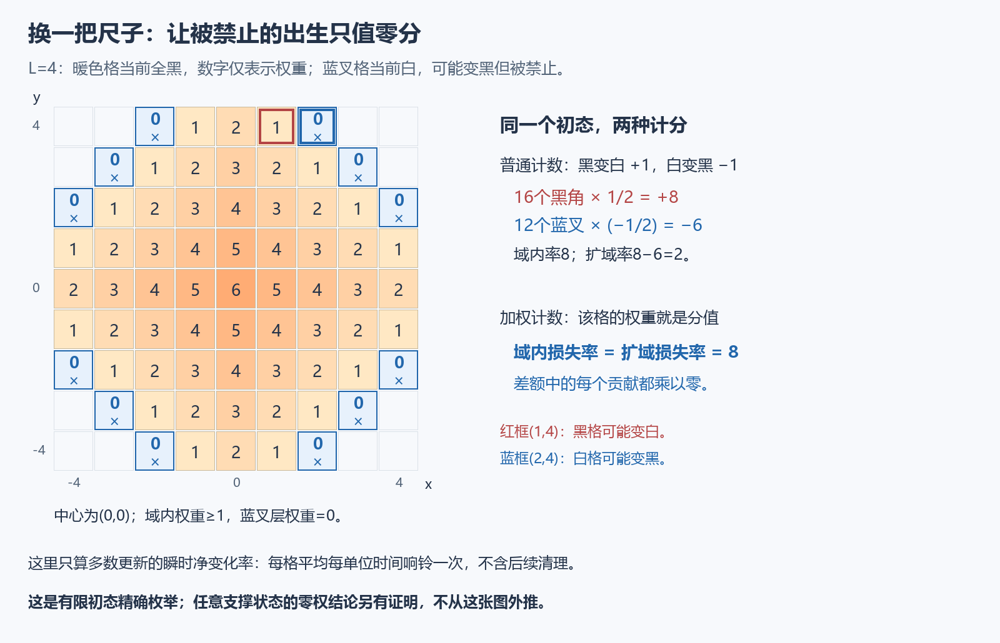
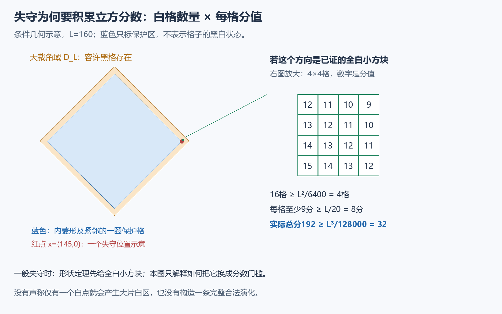

# 第一课：让麻烦的边界项变成零

这一课想解释：当一种记账方式让边界误差难以控制时，可以根据误差发生的位置，重新设计每个格子的分值。

最终问题是：无限白色方格纸上有有限多个黑格，每轮所有格子同时看上下左右四邻，多数决定颜色、平局独立掷公平硬币；第一次全白的时间记为恢复时间。N 是包住初始黑格的最小平移正方形边长，不是黑格总数。本课服务于时间的**下界**：有些尺寸为 N 的初态，平均不会比常数乘 N² 更快恢复。

## 为什么先分析一个更容易变白的过程

先暂时换成一次只更新一个格子的辅助时钟：每格独立等待一个均值为1的指数时间，再更新自己，并重新等待。因此每格平均每单位时间响铃一次。更新仍服从四邻多数，平局仍公平。这个物理时间与原来的同步轮数不同，最后需要另一段证明连接。

我们再让辅助过程更容易变白：只允许一个裁角区域里的格点更新，禁止黑色向外出生；每次域内更新以后，反复删除只有0个或1个黑邻居的黑格，直到不能再删。这一步叫“清理”。

为什么主动加速消失？因为多数规则具有单调性。让原时钟过程与这个辅助过程使用相同的响铃与硬币，辅助过程的黑格一直包含在原时钟过程的黑格中，至少直到下面定义的观察终点。如果较容易变白的一方还保留着黑格，原时钟过程就没有全白。**要证明原过程不可能太快消失，可以先证明这个更容易消失的过程也得等。**

本课细讲怎样估计辅助过程，暂不推导时钟与同步之间的比较。不要把它们当作同一条演化。

## 普通面积的账，哪里出了问题

允许黑格存在的裁角区域是

\[
D_L=\{(x,y)\in\mathbb Z^2: |x|\leq L,\ |y|\leq L,\ |x|+|y|\leq L+1\}.
\]

它位于边长2L+1的居中方框内。用于比较的原时钟过程从整个方框全黑开始，辅助过程只从 D_L 全黑开始，外部均为白色；这保证起初的黑格包含关系。辅助黑格集合记为 S。普通记账量是 A(S)=|D_L|−|S|；当 S⊆D_L 时，它就是域内已经变白的格数。黑变白记 +1，白变黑（也叫“出生”）记 −1。

为了利用轮廓上的正负抵消，我们想把“一次更新的平均净变化”在整个居中方框上求和。这叫扩域计算：**保持当前状态 S 不变，只是假想域外也能进行下一次更新。** 同时把公式 A(S)=|D_L|−|S|延伸到这一假想状态。域外出生使总黑格数增加，因此给这个延伸公式贡献 −1；它不是说域内某个白格真的少了。

实际过程禁止这些域外出生，便少了一些负贡献。于是扩域算出的增长率偏小，不能直接用来给实际白格增长率作上界。这里的“率”指瞬时平均净变化，正负都要相加；以下先只算一次多数更新，暂不加清理。

亲手算 L=4 的实心初态：暖色域里16个黑格各有两个黑邻居，响铃时各以1/2概率变白，其余黑格不会立刻变白，所以普通域内增长率为16×1/2=8。蓝叉有12个，每个有两个黑邻居；如果准许它们响铃，各有1/2概率变黑，贡献12×(−1/2)=−6。扩域率因此是8−6=2。

例如蓝叉 v=(2,4)，它的两个黑邻居是 (1,4)、(2,3)。域内格 u=(1,4) 的两个黑邻居是 (0,4)、(1,3)。这两个点分别演示一次出生和一次消失。图中的数字不是颜色，所有暖色格当前都是黑格。

这个例子足以说明“直接把2当成实际域内增长率”不成立，不说明所有状态都具有8或2的率。[此前记录](../../formal/audit/forbidden-birth-source-comparison.json)中的 L=40 同类例子是80与2。

## 先找误差在哪，再选权重

为什么域外还可能出生的点都在同一层？有黑邻居，就离 D_L 至多一步，所以 |x|+|y|≤L+2。若点落在正方框外，则至多一个四邻能落回方框，不可能有两个黑邻居。因此，有至少两个黑邻居的域外点仍在居中方框内；它不属于 D_L，只能因为 |x|+|y|>L+1。两条整数界合起来得到

\[
|x|+|y|=L+2.
\]

至少两个黑邻居，正是白格有可能变黑的必要条件。以上推理适用于任意 S⊆D_L，不只适用于实心初态；[对应定理](../../formal/analysis/MathResearchAnalysis/ForbiddenBirthControl.lean)证明了这一点。

现在给每格赋分

\[
w_L(x,y)=L+2-|x|-|y|.
\]

域内权重≥1；所有可能发生被禁止出生的域外点，权重恰好为0。把普通账本换成

\[
W_L(S)=\sum_{u\in D_L\setminus S}w_L(u).
\]

在域内状态，这等于“D_L 初始总分−现有黑格总分”。扩域比较时也使用后一个公式。这样每个域外出生的贡献都是 −w_L(v)=−0，域内更新的分值又完全一样：**在同一个 S 上，准许和禁止域外更新的加权净变化率严格相等。**

没有改变实际过程，也没有把一个正误差丢掉，只是给产生误差的位置赋了零分。域外更远处权重可能为负，但实际 W_L 只对 D_L 求和，仍然非负。

## 账本必须还能看见“快要消失”

如果所有位置都赋零分，边界误差当然没了，账本却也没有用途。我们还要证明：变白侵入内部时，W 必须已经很大。

在 D_L 内，取 |x|+|y|≤0.9L 的内菱形，连同紧邻它的一圈格点，作为保护区。起初它全黑。第一次有保护格变白，称为“失守”，时间记为 σ；永不失守则 σ=∞。失守以后让辅助过程停在那一状态，叫“冻结”，以免后来重新变黑抹掉我们要观察的事件。

辅助形状保持行、列截面都是区间，并保持四邻连通。利用这些形状性质，已有几何证明给出：一旦保护区失守，就有一个边长为 ⌊L/40⌋ 的小方块全白，且每格权重至少 L/20。这里不会从一个孤立白点推出大片白区；形状性质是必要前提。完整几何证明留到后续章节，本课明确把它作为已证输入。

L≥80 时，⌊L/40⌋≥L/80，所以小方块至少有 L²/6400 格。面积乘每格分值，得到

\[
\sigma\leq T\quad\Longrightarrow\quad W_L(S_T)\geq
\frac{L^2}{6400}\frac L{20}=\frac{L^3}{128000}.
\]

S_T 表示时刻 T 的冻结辅助状态。冻结保证“截至 T 已失守”仍能由 T 时刻的分数检出。立方门槛的来源就是：平方数量的白格，且每格还有线性大小的分值。

## 平方时间从哪里出现

另一条已证输入是平均增长预算：

\[
\mathbb E W_L(S_T)\leq(18L+12)T+(L+2)(4L+2),\qquad L\geq2.
\]

第一项控制多数更新。证明把轮廓凸角和相邻凹谷配对，抵消它们的正负贡献，余下的权重差由边界长度支付，最后只剩 O(L) 的率。第二项控制清理：整个观察期间最多清理4L+2个黑格，每格权重≤L+2。这不是说“每一步清理都很少”。配对和累计预算在本课中也作为已证输入，不伪装成零权重自动带来的结论。

W 非负，失守又要求它超过上述门槛，故 Markov 不等式给

\[
\mathbb P(\sigma\leq T)
\leq\frac{(18L+12)T+(L+2)(4L+2)}{L^3/128000}.
\]

将 T=cL² 代进去，右边的第一部分趋向128000×18c，第二部分趋向0。因此先选足够小的固定 c>0，再取足够大 L，就能让右边≤1/2。于是至少一半概率到 T 仍未失守，而且

\[
\mathbb E\sigma\ \geq\ T\,\mathbb P(\sigma>T)\ \geq\ T/2=cL^2/2.
\]

第一条不等式只是逐条轨迹上 σ≥T·1_{σ>T} 再取期望，允许 σ=∞。在失守前，保护区还有黑格，原时钟过程不可能已经全白，所以这给原时钟恢复时间的下界。

原同步过程还需单独的调度比较，不能凭时间名字相同就套用。尺寸方面，辅助方框边长为2L+1；最终在原 N 方框里取不超过 N 的大奇数方框，使 L 与 N 相差常数倍，再处理同步比较的误差。完整连接见[原尺寸下界](../../formal/analysis/MathResearchAnalysis/OriginalQuadraticLower.lean)；本课完成的是权重设计及其为何能产生平方尺度的解释。

## 这是什么样的方法候选

这次选择可以概括为：先定位边界修改影响哪些事件，再设计一个在这些位置为零、在目标区域仍有分量的观察量。

它不是随处可用的诀窍。若坏事件遍布内部，令它们都取零可能把目标也抹掉；若新权重的正常漂移更难控制，改账本没有省事。本项目中，零边界修正、线性增长率、立方失守门槛三件事同时匹配，才留下平方时间。这是否构成新的专门方法，还要做文献和迁移检验。

实际公式见 [PhysicalWeightedDrift](../../formal/analysis/MathResearchAnalysis/PhysicalWeightedDrift.lean)，图与有限算例见 [render_figures.py](render_figures.py) 和 [toy-checks.json](toy-checks.json)。它们用于核查，不要求读者先看 Lean 才能理解本课。
