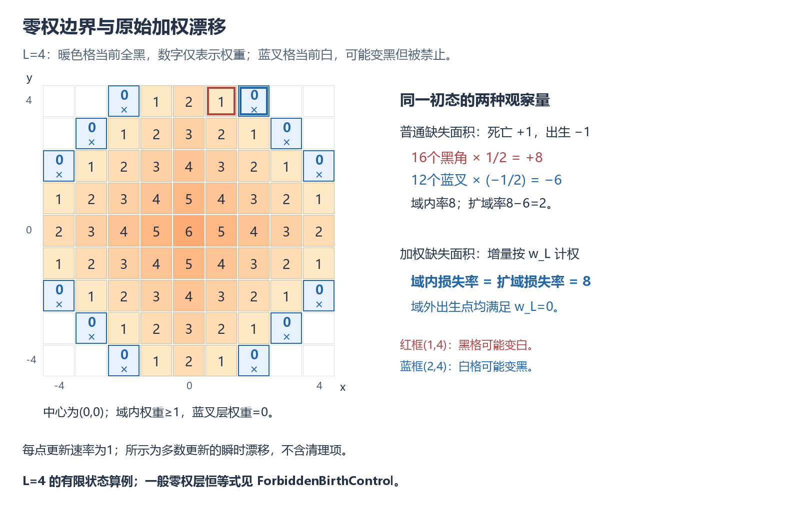
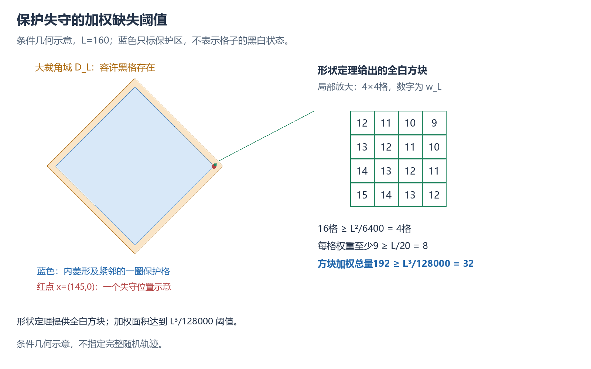

# 零权边界与加权面积

## 区域与辅助过程

令整数 $L\ge2$，并定义
$$
D_L=\{(x,y)\in\mathbb Z^2:|x|\le L,\ |y|\le L,\ |x|+|y|\le L+1\}.
$$
记居中方框为 $B_L=\{-L,\ldots,L\}^2$。

辅助过程从 $D_L$ 全黑出发，只允许域内多数更新；每次更新后递归删除黑邻居数至多1的黑格，直至状态稳定。各点更新由独立速率1时钟驱动。该过程的黑集在相同标记耦合下受原时钟过程支配。同步轮次的比较另由 [OriginalQuadraticLower](../../formal/analysis/MathResearchAnalysis/OriginalQuadraticLower.lean)处理。

以下原始漂移只对一次多数更新的增量求平均，不含随后清理；清理对完整过程的贡献由累计预算单独计入。

记当前黑集为 $S\subseteq D_L$。普通缺失面积为 $|D_L|-|S|$，黑变白增量为1，白变黑增量为−1。若保持 $S$ 不变并将下一次更新的允许域扩到 $B_L$，域外出生将贡献负项；禁止这些出生会增大实际域内漂移。因此扩域的普通面积漂移不能直接充当域内漂移的上界。

在 $L=4,S=D_4$ 时，域内16个平票黑格贡献 $16/2=8$；12个可能域外出生点贡献 $-12/2=-6$，故扩域漂移为2。以下恒等式针对同一状态上的两种更新算子，不是在二者之间改变初态。

## 零权层

只要 $S\subseteq D_L$，域外白点若可能出生，至少有两个黑邻居。该点距 $D_L$ 至多一步，故 $|x|+|y|\le L+2$；它若在居中方框外，则至多有一个框内四邻，不能出生。因它不属于 $D_L$，必有
$$
|x|+|y|=L+2.
$$
取
$$
w_L(x,y)=L+2-|x|-|y|,
\qquad
W_L(S)=\sum_{u\in D_L\setminus S}w_L(u).
$$
域内 $w_L\ge1$，所有可能被禁止出生的域外点上 $w_L=0$。将 $W_L$ 按“初始总权重减当前黑格总权重”延伸到一次扩域更新后，域外出生的增量均为零。域内与扩域的加权原始漂移因而严格相等。

图1．$L=4$ 实心初态的有限算例。普通漂移分别为8与2，加权漂移均为8；图中数字为权重，非状态颜色。一般状态结论见 [ForbiddenBirthControl](../../formal/analysis/MathResearchAnalysis/ForbiddenBirthControl.lean)。

## 保护失守与期望预算

取内菱形 $10(|x|+|y|)\le9L$ 及其外四邻作为保护集合。令 $\sigma$ 为保护点首次变白的时刻，未失守取 $\infty$，并在该时刻后冻结过程。行列凸性与四邻连通性的保持给出如下几何结论：失守输出中存在边长 $\lfloor L/40\rfloor$ 的全白方块，每格权重至少 $L/20$。对 $L\ge80$，
$$
\sigma\le T\quad\Longrightarrow\quad
W_L(S_T)\ge\frac{L^3}{128000}.
$$
几何前提包含行列凸性和四邻连通性；首次失守输出仍满足所需形状结论。

图2．$L=160$ 的条件几何示意。所画 $4\times4$ 方块的权重总和为192，阈值 $L^3/128000=32$；图未指定完整随机轨迹。

轮廓角谷配对与累计清理预算进一步给出
$$
\mathbb E W_L(S_T)
 \le(18L+12)T+(L+2)(4L+2),\qquad L\ge2,\ T\ge0.
$$
第一项为多数更新的累计期望；第二项使用整个观察期间至多 $4L+2$ 个清理删除及每格权重上界 $L+2$。它并非逐步清理数的统一小界。具体概率恒等式及漂移估计见 [PhysicalWeightedDrift](../../formal/analysis/MathResearchAnalysis/PhysicalWeightedDrift.lean)。

非负性与 Markov 不等式给
$$
\mathbb P(\sigma\le T)
\le\frac{128000}{L^3}
 \bigl((18L+12)T+(L+2)(4L+2)\bigr).
$$
取 $T=cL^2$，先固定充分小的 $c>0$，再取充分大的 $L$，右端至多为 $1/2$。于是
$$
\mathbb E\sigma\ge T\,\mathbb P(\sigma>T)\ge T/2.
$$
该不等式适用于扩展首达时间。保护未失守即仍有黑格，故辅助失守时间受原时钟恢复时间控制；与原同步过程比较并校准 $N$ 与 $2L+1$ 后，得到原模型的二次期望下界。

零权层消除了边界算子差，但仍须分别证明形状保持、立方阈值、线性漂移和累计清理预算。上述四项是该下界论证的共同条件。
