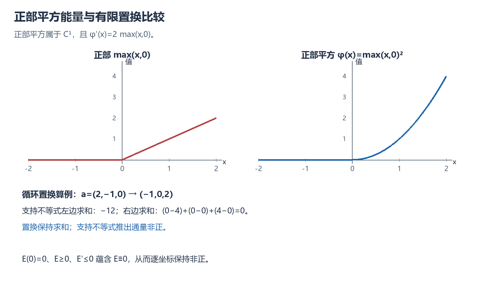

# 有限置换系统的比较原理

设 $I,E$ 为有限集合，$\sigma_e:I\to I$ 为置换。设 $c_i:[0,\infty)\to\mathbb R$ 连续，在正时间可微，满足
$$
c_i'(t)=\frac12\sum_{e\in E}
   (c_{\sigma_e(i)}(t)-c_i(t))-s_i(t),
\qquad s_i(t)\ge0,\qquad c_i(0)\le0.
$$
则 $c_i(t)\le0$ 对所有 $i,t\ge0$ 成立。

## 正部平方能量

记 $x^+=\max(x,0)$，$\phi(x)=(x^+)^2$，并令
$$
\mathcal E(t)=\sum_{i\in I}\phi(c_i(t)).
$$
函数 $\phi$ 在0处可微，且 $\phi'(x)=2x^+$。对任意 $a,b\in\mathbb R$，
$$
2a^+(b-a)\le\phi(b)-\phi(a).
$$
若 $a,b\ge0$，两侧之差是 $(b-a)^2$；若 $a\le0$，左端为0；若 $a>0>b$，两侧之差为 $a^2-2ab\ge0$。这也可视为凸函数的支持不等式。

对正时间使用链式法则，
$$
\begin{aligned}
\mathcal E'(t)
&=\sum_{e\in E}\sum_{i\in I}
 c_i^+(c_{\sigma_e(i)}-c_i)-2\sum_i c_i^+s_i\\
&\le\frac12\sum_{e\in E}\sum_{i\in I}
 \bigl(\phi(c_{\sigma_e(i)})-\phi(c_i)\bigr)
 -2\sum_i c_i^+s_i
\le0.
\end{aligned}
$$
有限性与每个 $\sigma_e$ 的双射性保证内和相消。因此 $\mathcal E$ 在正时间不增，由0处连续性可得 $\mathcal E(t)\le\mathcal E(0)=0$。又 $\mathcal E\ge0$，故每个 $c_i(t)\le0$。

图2．正部与正部平方，以及固定向量 $(2,-1,0)$ 的循环置换算例。图下的数值为支持不等式的有限求和，不是微分方程的模拟。

标量微积分见 [PositivePartSquare](../../formal/analysis/MathResearchAnalysis/PositivePartSquare.lean)，有限比较结论见 [FinitePermutationComparison](../../formal/analysis/MathResearchAnalysis/FinitePermutationComparison.lean) 的 `nonpos`。

## 异点协方差

对于从确定的单调阶梯构形出发的混合边界时钟过程，令 $\eta_i(t)\in\{0,1\}$ 为其编码粒子的占据变量，定义
$$
c_{ij}(t)=\mathbb E(\eta_i\eta_j)
 -\mathbb E\eta_i\,\mathbb E\eta_j,\qquad i\ne j.
$$
实际一、二点矩方程将这些量写成上述比较系统，其中源项非负，确定初态给初值0。同时交换两个指标是异点有序对集合上的置换，故得到 $c_{ij}(t)\le0$。

这一应用需要先推导矩方程与源项，见 [MixedClockCovariance](../../formal/analysis/MathResearchAnalysis/MixedClockCovariance.lean)。对角项为 Bernoulli 方差，通常非负，不能纳入异点结论。此比较原理也没有将不同槽位假设为独立。
