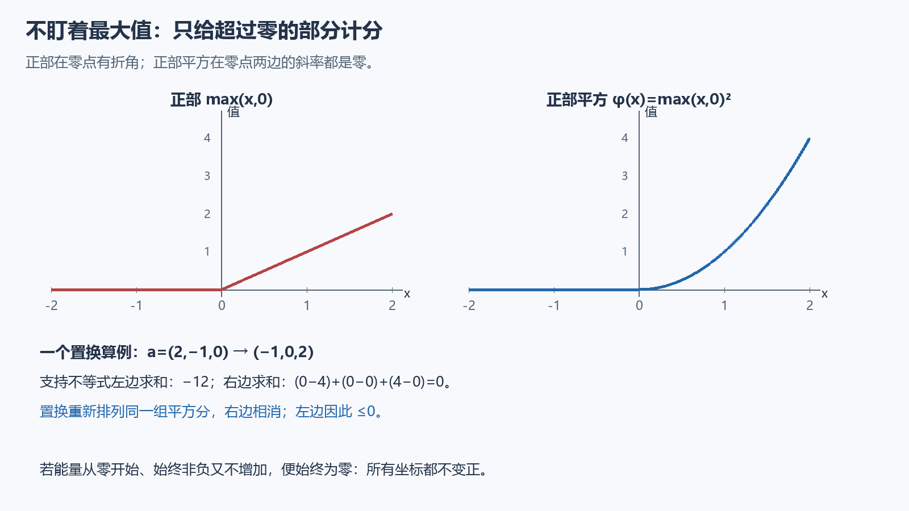

# 第二课：只给越界的部分记分

我们想证明一组随时间变化的数 c_i(t) 一直不大于0。最直接的想法是盯着最大的那个数：只要最大值不变正，全部都安全。

困难是，谁最大会变。两个坐标交叉时，最大值函数可能不可微。在证明助手里，不小心写下“对最大值求导”，就可能把真正需要处理的步骤跳过去。

## 换一个不挑赢家的量

给每个坐标的正部记平方分：

\[
\phi(x)=\max(x,0)^2,\qquad E(t)=\sum_i\phi(c_i(t)).
\]

非正坐标不计分，正坐标才计分。E≥0；且 E=0 恰好表示所有坐标都≤0。与正部本身不同，正部平方在0也可微：左导数和右导数都是0，而且导数连续。

图的下方是一个固定数值例子，说明怎样求和，不是 ODE 的数值模拟，也没有提供额外概率证据。

## 为什么交换不会增加这种能量

本项目证明的比较系统具有有限个坐标、有限个置换 σ_e，且

\[
c_i'(t)=\frac12\sum_e[c_{\sigma_e(i)}(t)-c_i(t)]-s_i(t),
\qquad s_i(t)\geq0.
\]

连续性要求到 t=0，导数方程要求在 t>0；初值 c_i(0)≤0。这里每个 σ_e 必须是真正的双射，不能只是一个可能漏点或合点的映射。

对任意实数 a,b，有

\[
2\max(a,0)(b-a)\leq\phi(b)-\phi(a).
\]

这是凸函数 φ 的切线位于图像下方的不等式，也可以直接验证。若 a,b≥0，两边之差是 (b−a)²≥0；若 a≤0，左边为0，右边是 φ(b)≥0；剩下 a>0、b<0 时，两边之差为 a²−2ab≥0。

将 a=c_i、b=c_{σ(i)} 代入并求和，右边为0，因为置换只重新排列同一组 φ(c_i)。用 c_i⁺=max(c_i,0) 简写，链式法则把这件事接到能量导数：

\[
\begin{aligned}
E'(t)
&=\sum_e\sum_i c_i^+\bigl(c_{\sigma_e(i)}-c_i\bigr)
   -2\sum_i c_i^+s_i\\
&\leq\tfrac12\sum_e\sum_i
  [\phi(c_{\sigma_e(i)})-\phi(c_i)]-2\sum_i c_i^+s_i\\
&=-2\sum_i c_i^+s_i\leq0.
\end{aligned}
\]

所有 c、s 都取同一个时刻 t。原方程里的1/2与 φ′ 中的2抵消，才有第一行；第二行又因支持不等式出现1/2。

先在任意正时间区间上由 E′≤0 得不增，再由0处连续把左端送到0。因此 E(t)≤E(0)=0；又有 E≥0，只能一直为0，每个 c_i≤0。我们不必知道谁是最大坐标，也没有对一个不可微的最大值偷偷求导。

完整标量微积分见 [PositivePartSquare](../../formal/analysis/MathResearchAnalysis/PositivePartSquare.lean)，完整有限比较原理见 [FinitePermutationComparison](../../formal/analysis/MathResearchAnalysis/FinitePermutationComparison.lean) 的 `nonpos`。它们不依赖本题的几何、格点或随机硬币。

## 在这次证明中，它处理了什么

令 η_i 表示槽位 i 是否有粒子：有则为1，无则为0。槽位 i,j 的协方差是

\[
c_{ij}=\mathbb E[\eta_i\eta_j]-\mathbb E[\eta_i]\mathbb E[\eta_j].
\]

在实际概率分布下，从一、二点期望随时间变化的方程，可以推出异点协方差服从上述比较形式，减掉的源项是非负平方项。确定初态使初始协方差为0，因此不同槽位的协方差始终≤0。并没有假设粒子独立。本课当场证明的是一般比较原理，协方差方程及平方源项的推导暂作已证输入，没有在这里展开。

必须排除 i=j：对角线上是 Bernoulli 方差，通常为正。源码把坐标集合严格定义成 {(i,j):i≠j}，并证明同时交换两指标仍是这个集合上的置换。[MixedClockCovariance](../../formal/analysis/MathResearchAnalysis/MixedClockCovariance.lean) 才把一般引理的所有前提接到真实概率分布。

## 一次纸面迁移：比较两组扩散量

设 u、v 在同一有限置换系统上扩散，额外外力分别为 f、g。若起初 u≤v，且始终 f≤g，令 c=u−v、s=g−f，就正好落入上面的比较原理，推出所有时刻 u≤v。

这说明同一引理可以解释为“更小初值、更小外力不会得到更大的解”。随后我们把三格有向环的这一实例实际写入独立 Lean 教程文件，见[第一次复用](06-first-reuse.md)；它仍不是已经验收的现实应用。若换成一般有权或不守恒的网络，还要核对它能否表示成这些有限置换之和；当前定理没有自动覆盖任意系统。

正部能量和比较原理属于已有的数学思想。这里值得继续检验的是这个有限置换版本能否降低其他形式化任务的证明成本，而不是把它命名为新物理规律。
