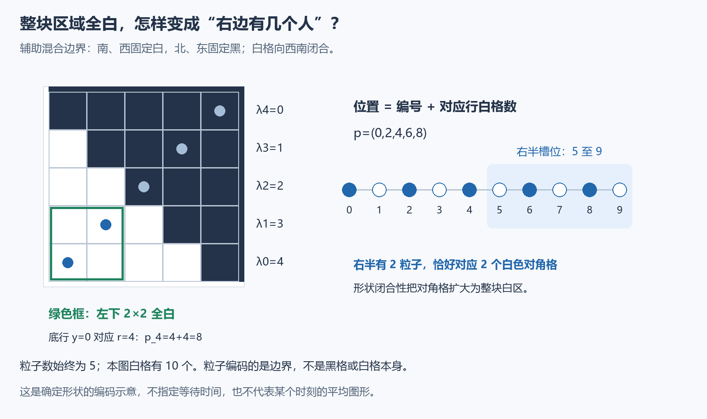

# 第三课：先问目标到底需要多强的结论

我们要证明平均恢复时间不超过常数乘 N²。这里 N 仍是初始图形的包围方框边长，恢复时间 R 是第一次全白的同步轮数。一个看起来顺理成章的计划是：先证明“超过平方时间还不消失”的概率随尺寸指数衰减，再对尾部积分。

但是这个目标可能比最终定理需要的强得多。另一种计划是：先证明原过程每经过 b=O(N²) 轮，失败概率至多再乘一个固定 q<1。这样重复 j 段以后失败概率≤q^j，期望就≤b/(1−q)。

这里 q^j 随段数下降，不是随空间尺寸指数下降。能否重新开始、同样的界是否适用于后来的状态，必须另证，不能从一次成功概率自行推得。

## 一个形状，怎样变成一个人数门槛

在辅助 M×M 方框中，南、西边界固定白，北、东边界固定黑。白格保持“向西南闭合”：某格白，则它西南方向的格也白。这是辅助混合边界过程的已证形状性质，不是所有原同步图形都有的性质。

各行白格数记为 λ_y，y 从下向上数。用 M 个粒子占据 2M 个槽位，定义

\[
p_r=r+\lambda_{M-1-r},\qquad r=0,\ldots,M-1.
\]

这里用独立时钟一次更新一个格子，每格平均每单位时间响铃一次，不是原模型的同步轮数。粒子编码的是边界，粒子数始终为 M，白格数却可以增减。一个合法角点翻转，对应一个粒子和相邻空位交换；因平局硬币各一半，交换速率为1/2。动态双向编码和更新系数的完整证明，本课暂作已证输入；下面展开静态编码怎样检测白块。不能只凭图像宣布两个随机过程等价。

这个 M=5 的示意取从下往上的行长 (4,3,2,1,0)，得到粒子位置 (0,2,4,6,8)。右半槽位5至9有两个粒子，恰好对应两个白色对角格，也保证左下2×2全白。图中不指定随机时间。

右半指编号 M 至2M−1的槽位，人数记为 J。令 y=M−1−r，直接代入可得

\[
p_r\geq M\quad\Longleftrightarrow\quad
\lambda_y\geq y+1\quad\Longleftrightarrow\quad (y,y)\text{ 为白格}.
\]

最后一步是因为行长 λ_y 表示该行从 x=0 开始连续有多少个白格。反转行编号是一一对应，所以 J 就是白色对角格的个数。

又因向西南闭合，白色对角格一定从 (0,0) 连续出现；第 N 个对角格 (N−1,N−1) 白，恰好保证整个左下 N×N 块白。因此 J≥N 等价于该块全白（N≤M），不是等于白格总数。[YoungParticles](../../formal/analysis/MathResearchAnalysis/YoungParticles.lean) 和 [MixedLocalClearing](../../formal/analysis/MathResearchAnalysis/MixedLocalClearing.lean) 核查了这个一般关系。

## 均值和方差已经给出够用的概率

令 η_i(t) 在槽位 i 有粒子时为1，否则为0；其平均值 ρ_i(t)=E[η_i(t)] 就是该位置被占据的概率。此时 J(t)=Σ_{i=M}^{2M−1}η_i(t)。

这些概率满足有限热方程，也就是每个位置的变化由相邻位置的平均差决定。此前已从实际更新规则证明了该方程，再由能量耗散与路径 Poincaré 不等式得到

\[
H(t)=\sum_{i=0}^{2M-1}(\rho_i(t)-1/2)^2
\leq(M/2)e^{-t/(4M^2)}.
\]

本课把热衰减式作为已证输入，接下来当场推导它怎样帮助清空。由期望的可加性和 Cauchy–Schwarz，

\[
\left|\mathbb EJ-\frac M2\right|^2
=\left|\sum_{i=M}^{2M-1}(\rho_i-1/2)\right|^2
\leq M\sum_{i=M}^{2M-1}(\rho_i-1/2)^2\leq M H(t).
\]

在 t=16M² 时，H(t)≤(M/2)e⁻⁴≤M/16，所以 |EJ−M/2|≤M/4，得 EJ≥M/4。这就是研究热能量能够帮助我们控制人数的连接。

第二课的比较原理应用到实际矩方程，已得不同槽位协方差非正。将方差展开，求和只取右半的 M 个槽位：

\[
\operatorname{Var}(J)
=\sum_i\operatorname{Var}(\eta_i)+2\sum_{i<j}\operatorname{Cov}(\eta_i,\eta_j)
\leq\sum_i\tfrac14=M/4.
\]

这里每个0/1变量的方差≤1/4；没有假设槽位独立。固定总粒子数恰好提醒我们，不能把所有位置想成独立掷币。

若 N≤M/8，J<N 时，它离均值至少 M/8。Chebyshev 不等式直接给

\[
\mathbb P(J<N)\leq\frac{M/4}{(M/8)^2}=\frac{16}{M}.
\]

取 M=8N+1，便有 N≤M/8；N≥16 时，M≥129，失败概率16/M<1/8，已经足够后续比较使用。这个常数检查来自 [MixedClearingProbability](../../formal/analysis/MathResearchAnalysis/MixedClearingProbability.lean)，不是模拟的拟合。M 是辅助边长，原尺寸 N 没有改变。

## 便宜的局部结论，还要付出连接的成本

这时只知道辅助大方框在一个固定物理时刻、一个目标子块全白。它的全白状态不是吸收态，也就是说之后还可能变黑。接下来必须证明：用同一批响铃和硬币构造大小过程时，辅助子块白能保证原小方框白；再证明辅助物理时间的估计能换成原同步轮数。完整构造与调度误差另有证明，本课不展开。

最终这些连接给原过程一个 b=O(N²) 的块长，以及每段仍未恢复条件下的统一失败率 q=1/2。统一是指界适用于每段开始时可能出现的所有状态：多数更新不会让黑格逃出原包围方框，再用全黑方框作最坏支配并使用尚未揭示的公平硬币。这个重启性质已经单独证明，不是从辅助过程的单次概率自动得到的。

具体说，当条件事件有正概率时，

\[
\mathbb P(R>(j+1)b\mid R>jb)\leq q
\quad\Longrightarrow\quad\mathbb P(R>jb)\leq q^j.
\]

若条件事件概率为零，所需尾界也自动成立。各段不必独立。对取整数轮数、允许∞的 R，用尾和公式分块：

\[
\mathbb ER=\sum_{k\geq0}\mathbb P(R>k)
\leq b\sum_{j\geq0}\mathbb P(R>jb)
\leq b\sum_{j\geq0}q^j=\frac b{1-q}=2b.
\]

单次成功率≥1/2本身不够：剩余的一半轨迹可能拖延极久甚至永不恢复。真正得到期望上界的是每段都能统一重启，而不是假设每段独立。

这条路线的可迁移候选是：**先算清重启需要多大成功率，再决定局部分析需要多强的集中不等式。** 本题用到的排斥编码、热方程和 Chebyshev 都有经典前身；值得提炼的是目标强度与证明成本的配合。若下一题不允许重启、没有均匀成功率，或者需要极端小概率，均值和方差就可能不够。
