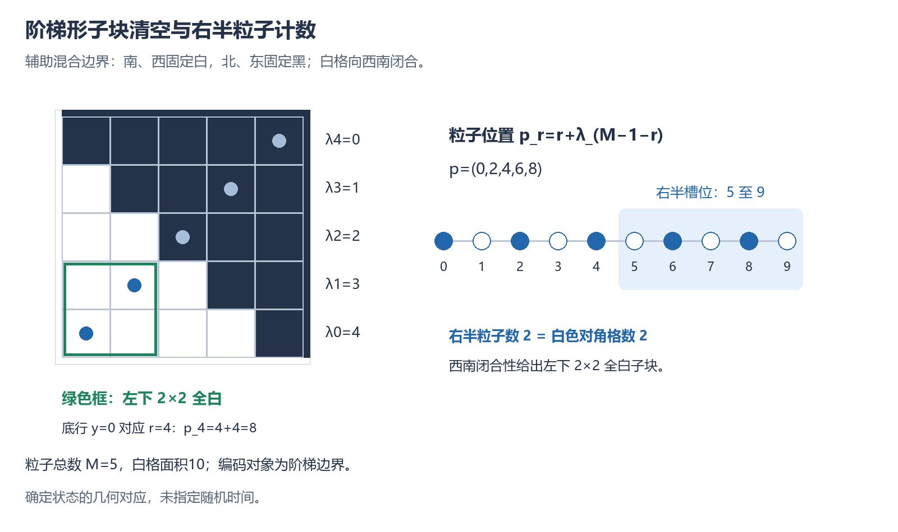

# 局部清空概率与重启估计

## 阶梯形与粒子编码

令整数 $M\ge2$。在 $M\times M$ 辅助方框中，南、西边界固定白，北、东边界固定黑。过程从确定的单调阶梯构形出发；主证明取全黑初态。该过程保持白集向西南闭合：若 $(x,y)$ 为白格，则每个满足 $0\le x'\le x$、$0\le y'\le y$ 的 $(x',y')$ 也为白格。各行由 $x=0$ 起连续的白格数从下向上记为 $\lambda_y$，因此 $M\ge\lambda_0\ge\cdots\ge\lambda_{M-1}\ge0$。将边界编码为 $2M$ 个槽位中的 $M$ 个粒子，位置为

$$
p_r=r+\lambda_{M-1-r},\qquad r=0,\ldots,M-1.
$$

合法角翻转对应粒子与相邻空位的交换；在速率1单点时钟及公平平票标记下，交换速率为 $1/2$。编码双射、生成元与实际过程的连接分别由相应正式模块证明。

图3．行长 $(4,3,2,1,0)$ 对应粒子位置 $(0,2,4,6,8)$；右半槽位内有两个粒子，白格总数为10。

令 $J(t)$ 为槽位 $M,\ldots,2M-1$ 的粒子数。置 $y=M-1-r$，则

$$
p_r\ge M\iff\lambda_y\ge y+1\iff(y,y)\text{为白格}.
$$

西南闭合性保证白色对角格从原点连续出现，故对整数 $1\le N\le M$，

$$
J(t)\ge N\iff\text{左下 }N\times N\text{子块全白}.
$$

该量计数边界粒子，不等于白格面积。一般对应见 [YoungParticles](../../formal/analysis/MathResearchAnalysis/YoungParticles.lean)和[MixedLocalClearing](../../formal/analysis/MathResearchAnalysis/MixedLocalClearing.lean)。

## 一、二点矩给出的清空概率

记 $\rho_i(t)=\mathbb E\eta_i(t)$。从实际时钟过程的矩方程得到有限热方程，路径 Poincaré 不等式及能量耗散给

$$
H(t)=\sum_{i=0}^{2M-1}(\rho_i(t)-1/2)^2
 \le (M/2)e^{-t/(4M^2)}.
$$

Cauchy–Schwarz 不等式推出

$$
|\mathbb EJ(t)-M/2|^2
 \le M\sum_{i=M}^{2M-1}(\rho_i(t)-1/2)^2
 \le M H(t).
$$

在 $t=16M^2$ 时，$H(t)\le M/16$，从而 $\mathbb EJ(t)\ge M/4$。

由[异点协方差非正](03-positive-energy.md)及 Bernoulli 方差上界，

$$
\operatorname{Var}J(t)
=\sum_i\operatorname{Var}\eta_i(t)
  +2\sum_{i<j}\operatorname{Cov}(\eta_i(t),\eta_j(t))
\le M/4,
$$

其中求和限于右半槽位。若 $N\le M/8$，Chebyshev 不等式给

$$
\mathbb P(J(t)<N)\le\frac{M/4}{(M/8)^2}=\frac{16}{M}.
$$

取 $M=8N+1$；当 $N\ge16$，$M\ge129$，故失败率小于 $1/8$。这是辅助过程在固定物理时刻的局部结论，完整常数见 [MixedClearingProbability](../../formal/analysis/MathResearchAnalysis/MixedClearingProbability.lean)。

## 原同步过程的块尾

跨尺寸支配和同步调度比较将上述事件传递到原过程。该步骤需要校准辅助物理时间、原同步轮次及两个棋盘子过程；它不把混合边界全白状态假设为吸收态。

设原同步恢复时间为 $T$。其重启界在同尺寸后续状态上一致成立：存在块长 $b=O(N^2)$，使在条件事件概率为正时

$$
\mathbb P(T>(j+1)b\mid T>jb)\le q,\qquad q=1/2.
$$

条件事件概率为零时，所需尾界自动成立。因此

$$
\mathbb P(T>jb)\le q^j,\qquad
\mathbb ET=\sum_{k\ge0}\mathbb P(T>k)
\le b\sum_{j\ge0}q^j=\frac b{1-q}=2b.
$$

这一推导允许 $T=\infty$，并不要求各块相互独立。原包围方框的不变性、全黑状态的单调支配与未来公平标记提供统一重启的依据，见 [SquareRandomRestart](../../formal/analysis/MathResearchAnalysis/SquareRandomRestart.lean)及[ExtendedBlockTail](../../formal/analysis/MathResearchAnalysis/ExtendedBlockTail.lean)。

源码所构造的块长满足 $b\le332033N^2$，由此得到 $\tau(N)\le664066N^2$，适用于 $N\ge16$。平方尺度局部概率和统一重启已足以推出该期望界，不需要先证明一个随空间尺寸指数衰减的强尾结论。
