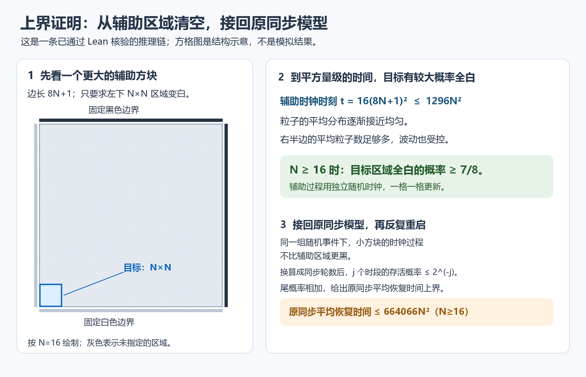

# 原问题的二次尺度定理：完整 Lean 形式化

已经把最后的概率界接回原来的同步模型。对最小平移包围方形边长恰为 N 的初态，先平均所有随机硬币，再取最坏初态，所得 τ(N) 满足

$$\frac{N^2}{56623104000}\leq\tau(N)\leq664066N^2\qquad(N\geq786432000).$$

上界单独对 N≥16 成立。两个常数都为正，且不依赖 N；这就是标准的渐近 Θ(N²)。不声称这组常数覆盖所有正尺寸，也没有优化常数。

## 最后一环怎样闭合

取边长 M=8N+1 的辅助方块。它的阶梯边界可以编码成一条有 2M 个位置的轨道上的 M 个粒子。把第 i 个位置在辅助物理时刻 t 被占据的概率记为 ρᵢ(t)。已证的能量公式和路径 Poincaré 不等式给

$$H(t)=\sum_i(\rho_i(t)-1/2)^2\leq(M/2)e^{-t/(4M^2)}.$$

右半轨道的粒子数记为 J。它的方差至多 M/4，这不要求各位置独立。在辅助物理时刻 t=16M²，E[J]≥M/4；Chebyshev 不等式给 P(J<N)≤16/M。N≥16 时，此概率≤1/8。阶梯形保证 J≥N 就意味着左下 N×N 区域全白。

从大方块中保留小方块对应的响铃与硬币标记，得到的正是小方块所需的联合随机分布，事件先后顺序也保持。每次匹配更新后，零边界小方块都不比辅助区域更黑。因此，辅助方块中目标 N×N 区域全白的概率，给出了原小方块在随机时钟下的清空概率。

接着把随机时钟换算成同步轮数。取 k=1296N²，对应同步轮数 b=2·128(k+1)+1。调度时间覆盖上述辅助时刻，调度误差≤1/8；计入两个棋盘相位带来的因子 2 后，原同步恢复时间 T 满足 P(T>b)≤1/2。

已经证明的重启性质进一步给 P(T>jb)≤2⁻ʲ。对这些尾概率求和，严格保留恢复时间可能取∞的定义，得到 E[T]≤2b≤664066N²。最后通过平移、黑白互换和尺寸恰为 N 的归约，得到原 τ 的上界，再与已证明的下界合并。

## 可直接检查的主定理

- [OriginalQuadraticRecovery.tau_theta_quadratic](analysis/MathResearchAnalysis/OriginalQuadraticRecovery.lean)：两个正常数和一个有限阈值的完整两侧界。
- [OriginalQuadraticUpper.tau_quadratic_upper_bound](analysis/MathResearchAnalysis/OriginalQuadraticUpper.lean)：N≥16 时的原 exact-N 上界。
- [OriginalQuadraticLower.tau_quadratic_lower_bound](analysis/MathResearchAnalysis/OriginalQuadraticLower.lean)：N≥786432000 时的原下界。

最终定理不以概率尾界、矩方程、耦合或几何核心结论作输入。最坏期望仍取恰 N 的初态，目标仍为两个齐次背景；∞没有先被转成0。每个尺寸 N≥16 的初态都有有限期望，这是上界的推论。

## 实际验证

分析258个证明模块、3280条辅助定理、259份分析源；核心旧125条定理与1模型、8源仅回核指纹未重编。共267份正式源、3406项实际公理输出。最新分析统一构建及标准Lean --trust=0审计实际退出0（2026-10-26T14:53:59.002869+08:00），仅三个标准公理，零新增Lean警告。

本次分两阶段新增18模块107条定理：热衰减/清空/时钟限制阶段11模块65条，最终跨尺寸/同步上界/主定理阶段7模块42条。所有新增具名声明另有专项 build 与标准 --trust=0 审计；统一审计只见 Classical.choice、Quot.sound、propext，无占位、自定义公理、unsafe、native_decide 或内核绕过。固定分析 Lean4.35.0-rc4 和 mathlib54c01c3314d33d15d77893cbe4e0472ff26bb34d，核心工具链不混用。

[统一验收](audit/analysis-validation.json) · [最终独立语义](audit/original-theta-independent-review.md) · [最终完整源及实际输出绑定](audit/original-theta-independent-final-binding-evidence.json) · [热概率阶段独立复核](audit/mixed-heat-independent-review.md)。历史249与260验收已单独归档，不能替代267源的最终验收。

独立复核者为未撰写本轮这些证明的 AI，不是人类专家。本结果也不自行认证 Question7.4 截至今天的全球公开解决状态或新颖性。原文语义按[作者论文](https://marcovici.perso.math.cnrs.fr/Publications/Fates_Marcovici_Taati_FI2022.pdf)的§1.2、§4.1、§4.2式(36)及Q7.4核对。

## 本次源指纹

| 模块 | theorem | SHA256 |
| --- | ---: | --- |
| [FiniteSlotPoincare](analysis/MathResearchAnalysis/FiniteSlotPoincare.lean) | 5 | b0ba240acf3637175fb4de31322287a50facd55aa268ee58591171051b06a43c |
| [MixedMomentPoincare](analysis/MathResearchAnalysis/MixedMomentPoincare.lean) | 1 | e909f7316635d2957484773a7efd6a20f85894e4a0066106d01299432ca1df1d |
| [ScalarHeatDecay](analysis/MathResearchAnalysis/ScalarHeatDecay.lean) | 2 | bc5f3a9b844f563fbc0c711f2a18c65f6ef06aa0b24faea1965361775715b9b6 |
| [CountLowerTail](analysis/MathResearchAnalysis/CountLowerTail.lean) | 2 | e514a50e94a0830339b0d23398f7b31525653cd30896f42943f8651c8bdbd51f |
| [MixedHeatDecay](analysis/MathResearchAnalysis/MixedHeatDecay.lean) | 5 | 1b6190111d5df196beba4ee4a7c168260bcbca71448e6c2327174914034c76c9 |
| [MixedRightCountMoments](analysis/MathResearchAnalysis/MixedRightCountMoments.lean) | 18 | 16bb567486301f4da60c38577c4e3ffcc248b646b7288c1ebd729a536b49cce7 |
| [MixedRightCountHeat](analysis/MathResearchAnalysis/MixedRightCountHeat.lean) | 3 | 692240c36accdc663d54beb9eb6660a9ec47f55dab9499baf00bef5c4564c4d4 |
| [MixedLocalClearing](analysis/MathResearchAnalysis/MixedLocalClearing.lean) | 3 | 0d1763b9198374a29439304d700503bb6ca778d7143616f459ad83d634b152c1 |
| [MixedClearingProbability](analysis/MathResearchAnalysis/MixedClearingProbability.lean) | 6 | 448ac959d73c44f25af90475874ba12b452f755d6eca2ed4779c2491390172c8 |
| [ClockSampleRestriction](analysis/MathResearchAnalysis/ClockSampleRestriction.lean) | 15 | 4cbc584816e306a679ee3af0fcf407710c6b6cec6f334995a7e10cc33e3587ce |
| [ClockWordRestriction](analysis/MathResearchAnalysis/ClockWordRestriction.lean) | 5 | 1279fb3e22fe009ea2177300ae68378398f39b54602b7fea4fc94d4e22a8edfa |
| [SquareInclusion](analysis/MathResearchAnalysis/SquareInclusion.lean) | 10 | 9a94bbc0b71dd3cdb26dcf1aee7965f96f867950a86ea567c03bc849c73c664b |
| [ClockRestrictedExecution](analysis/MathResearchAnalysis/ClockRestrictedExecution.lean) | 4 | 0057322ee1490001d9b4e92eabd3c4d3b526c9b0477476b08f69753b7d716324 |
| [ClockEndpointSurvival](analysis/MathResearchAnalysis/ClockEndpointSurvival.lean) | 4 | f9315ff33ab2cee211cb52d14ff3a5efb3c4bcc9a969bd39d0faa93fa9787031 |
| [CrossSquareClockBound](analysis/MathResearchAnalysis/CrossSquareClockBound.lean) | 4 | 3d5d343a63aa0e48288457f05824f5509dd9860d8112ca88b500d5d7faf0158a |
| [SyncUpperScale](analysis/MathResearchAnalysis/SyncUpperScale.lean) | 10 | c757120c711baddd9ddaf5865ed0b0bbbe694c6456aa11aa722f5984407ae39a |
| [OriginalQuadraticUpper](analysis/MathResearchAnalysis/OriginalQuadraticUpper.lean) | 7 | 6411173cd853ec57417b799a5aeeda6d316490453a31a18cf9c07296efbf5c3f |
| [OriginalQuadraticRecovery](analysis/MathResearchAnalysis/OriginalQuadraticRecovery.lean) | 3 | 27e11b9ce8afaa9d41b41f001b51444a19d293dcaf880eba2064457dfb9d758b |
