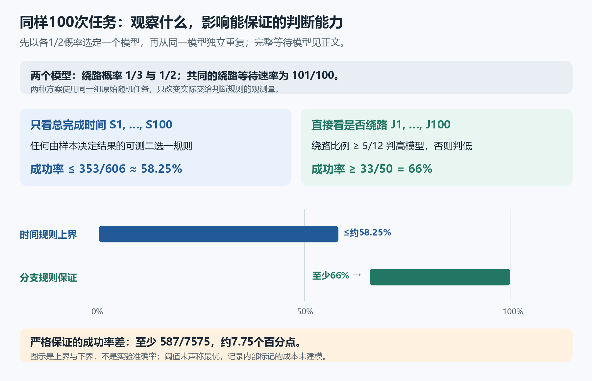

# 后续探索：比较、等待网络与观测

原自动机主定理之后，这里沿两条线继续：改进原模型的定量下界，以及研究比较方法在独立的有向网络中的应用。网络模型与二维自动机不同，网络结果不自动成为自动机结果。

## 原模型：更强的下界

对尺寸恰为 $N$ 的有限扰动，$\tau(N)$ 是首达纯色背景时间的最坏扩展期望。已证明当 $N\ge500001$ 时，

$$\tau(N)\ge\frac{N^2}{576000000}.$$

证明入口为 [ImprovedOriginalLower.lean](phase2/lean/ImprovedOriginalLower.lean)，范围与验证见[下界说明](phase2/README.md)和[验证记录](phase2/validation.json)。这个后续证明不修改[原主定理](../../formal/analysis/MathResearchAnalysis/OriginalQuadraticRecovery.lean)。

## 网络：出口与随机等待

对固定参数 $a,b>0$，$e,f\ge0$ 且 $e+f>0$，取相互独立的

$$W_a\sim\mathrm{Exp}(a),\quad W_b\sim\mathrm{Exp}(b),\quad W_c\sim\mathrm{Exp}(e+f),\quad \mathbb P(J=1)=\frac{f}{e+f},$$

其中 $J\in\{0,1\}$，并令 $S=W_c+W_a+JW_b$。$\mathrm{Exp}(r)$ 表示速率为 $r$、均值为 $1/r$ 的指数分布。

令 $x_0,x_1,x_2$ 为三箱的浓度。持续单位输入、零初值下，方程为

$$
\begin{aligned}
x_0'&=a(1-x_0),\\
x_1'&=b(x_0-x_1),\\
x_2'&=e(x_0-x_2)+f(x_1-x_2),
\end{aligned}
\qquad x_0(0)=x_1(0)=x_2(0)=0.
$$

对 $t\ge0$，出口 $x_2(t)=\mathbb P(S\le t)$；对 $t<0$，该分布函数为零。这里没有验证真实设备符合这些假设。平均等待为

$$\mathbb E S=\frac1a+\frac{b+f}{b(e+f)}.$$

对应的概率构造和均值见[推导](phase5/README.md)、[源码](phase5/lean/ActualTankCdf.lean)与[验证](phase5/validation.json)，一般参数表示见[后续推导](phase6/README.md)和[源码](phase6/lean/GeneralTankCdf.lean)。

固定 $a,b,e$ 时，$e<b$ 则增大 $f$ 不降低任何时刻的完成概率，$e>b$ 则不提高；$e=b$ 时整个输出分布与 $f$ 无关。已知 $a,b,e$ 且 $b\ne e$，均值足以唯一恢复 $f$；固定 $a,b,e$ 的两个模型输出分布相同，当且仅当两个 $f$ 相同或 $b=e$。见[参数恢复推导](phase7/README.md)、[分布可辨识源码](phase7/lean/LawIdentifiability.lean)与[验证](phase7/validation.json)。

若四个速率分别在可独立组合的固定区间内，$a,b,e$ 的上限记作 $A,B,E$，$a,b,e$ 的下端点分别记作 $a_-,b_-,e_-$，$f$ 的端点记作 $f_-,F$；区间非空，$a_-,b_->0$，$e_-,f_-\ge0$，$e_-+f_->0$。一个角点同时最大化每个时刻的完成概率：取 $(a,b,e)=(A,B,E)$，若 $E\le B$ 取 $f=F$，否则取 $f=f_-$。[证明与算例](phase8/README.md) · [源码](phase8/lean/RateBoxMaximum.lean) · [验证](phase8/validation.json)。

## 同一任务的两种观测

取 $a=e=1$、$b=1+\varepsilon$、$\varepsilon>0$，比较 $f=1/2$ 与 $f=1$。它们的路线概率分别为 $1/3$、$1/2$。两个完成时间分布对任意可测事件的概率差至多

$$\delta=\frac{\varepsilon}{6(1+\varepsilon)}.$$

这里控制的是所有可测事件上的概率差，而不只是每个截止时间的差；见[共同子测度推导](phase10/README.md)、[源码](phase10/lean/ActualCompletionEventBound.lean)与[验证](phase10/validation.json)。

先以各半概率选一次模型，再在该模型条件下独立生成 $n$ 次任务。任何只使用这些完成时间的可测确定性二选一规则，其平均成功率至多

$$1-\frac{(1-\delta)^n}{2}\le\frac12+\frac{n\delta}{2}.$$

见[推导](phase11/README.md)、[源码](phase11/lean/ActualCompletionTesting.lean)和[验证](phase11/validation.json)。当 $\varepsilon=0.01$、$n=100$，上界为 $353/606\approx58.25\%$。

同一组任务若能观察实际 $J$，令 $N_n=\sum_i J_i$，当 $N_n\ge5n/12$ 判高 $f$，否则判低。对 $n>0$，这条规则成功率至少 $1-34/n$；在上述 100 次例子中至少 $33/50=66\%$，比任意完成时间规则高至少 $587/7575\approx7.749$ 个百分点。见[推导](phase12/README.md)、[源码](phase12/lean/ObservationContrast.lean)和[验证](phase12/validation.json)。

这些是给定模型、等先验、条件独立样本和确定性规则下的界；这里未讨论随机化或自适应规则，不是最优成功率或对其他采样设计的结论。四个等待及分支变量的独立性只在给定所选模型后成立；混合模型下不能直接假定无条件独立。两个模型的 $W_a,W_b$ 分布相同，但 $W_c$ 的速率和 $J$ 的概率不同。

下一步拟证明实际分支向量及计数的分布，进而收紧有限尾界；它目前是研究计划，不是已证结论。首次探索的原始说明保留在[历史页](phase1-overview.md)；其中的阶段状态和数值反映当时进度。最新状态见[当前状态](../../STATUS.md)。
