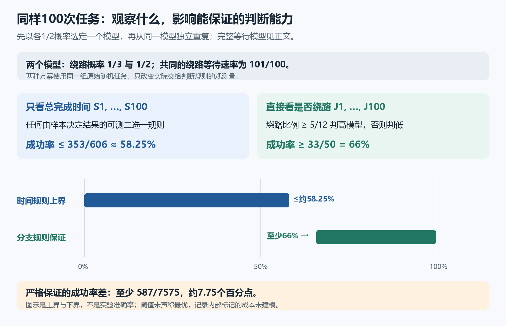

# 比较原理、等待网络与观测辨识

本目录的结果分属两个模型：同步四邻多数自动机的最坏恢复时间，以及三节点线性网络的响应与随机完成时间。前者给出更强的显式二次下界；后者给出比较定理、参数辨识条件及两类观测的检验保证。网络的随机完成时间与自动机恢复时间是不同的随机变量。

## 自动机恢复时间的下界

设 $N$ 为包住有限扰动的最小平移轴平行格点方框边长，按格点列数计。对尺寸恰为 $N$ 的确定初态，先对同步四邻多数更新中的独立公平平局硬币取扩展期望，再取初态间的最坏值，记为 $\tau(N)$。永不恢复的轨迹，其恢复时间记为 $\infty$。对 $N\ge500001$，已有

$$
\frac{N^2}{576000000}\le\tau(N)\le664066N^2.
$$

下界由实心方块见证，并覆盖平移及黑白背景互换；它是最坏初态下的界，不是每个初态的寿命下界。证明及条件见[下界说明](phase2/README.md)、[源码](phase2/lean/ImprovedOriginalLower.lean)与[验证记录](phase2/validation.json)。该证明不修改[原主定理](../../formal/analysis/MathResearchAnalysis/OriginalQuadraticRecovery.lean)。

## 有向网络比较与参数上界

[顺序保持原理](NETWORK_PROOF.md)处理固定非负边权、非负泄漏和有序输入下的给定经典解。[phase2](phase2/README.md)用区间矩阵给出保守上包络；[phase3](phase3/README.md)给出比例上限下的可达最大轨迹；[phase4](phase4/README.md)证明一般上端最大轨迹的充分条件 $B\ge E$，并给出该条件之外的恒定入口反例。三者比较的对象与参数集合各有明确限定。

## 三节点网络的概率表示

对固定速率 $a,b>0$、$e,f\ge0$、$e+f>0$，取相互独立的随机量

$$
W_a\sim\mathrm{Exp}(a),\quad W_b\sim\mathrm{Exp}(b),\quad
W_c\sim\mathrm{Exp}(e+f),\quad J\in\{0,1\},\quad
\mathbb P(J=1)=\frac f{e+f},
$$

并定义 $S=W_a+W_c+J W_b$。每组速率确定一个联合分布，$S$ 的分布为该联合分布经总等待映射得到的输出分布。这里 $\mathrm{Exp}(r)$ 按速率参数化，均值为 $1/r$。$J$ 是原模型的分支标记；$J=0$ 时预先抽取的 $W_b$ 不进入 $S$。

持续单位输入、零初值下，浓度响应满足

$$
x_0'=a(1-x_0),\qquad x_1'=b(x_0-x_1),\qquad
x_2'=e(x_0-x_2)+f(x_1-x_2).
$$

对 $t\ge0$，有 $x_2(t)=\mathbb P(S\le t)$；负时间的分布函数为零。此外，

$$
\mathbb E[S]=\frac1a+\frac{b+f}{b(e+f)}.
$$

概率构造、可积性和均值见[phase5](phase5/README.md)、[源码](phase5/lean/BranchedLaw.lean)及[验证](phase5/validation.json)；一般参数的浓度—分布等式见[phase6](phase6/README.md)、[源码](phase6/lean/GeneralTankCdf.lean)及[验证](phase6/validation.json)。这些结果针对所定义的理想模型，不包含真实设备符合模型假设的判断。

固定 $a,b,e$，增大 $f$ 时，完成概率在 $b\ge e$ 情形下不减，在 $b\le e$ 情形下不增；$b=e$ 时输出分布与 $f$ 无关。若 $a,b,e$ 已知且 $b\ne e$，总体均值唯一确定 $f$。更一般地，两个允许的 $f$ 产生同一输出分布，当且仅当它们相等或 $b=e$。见[参数恢复](phase7/README.md)、[源码](phase7/lean/LawIdentifiability.lean)及[验证](phase7/validation.json)。

若四个速率在可独立组合的非空区间中变化，端点写为 $[a_-,A]$、$[b_-,B]$、$[e_-,E]$、$[f_-,F]$，并满足 $a_-,b_->0$、$e_-,f_-\ge0$、$e_-+f_->0$，则同一个角点同时最大化全部截止时间的完成概率：取 $(a,b,e)=(A,B,E)$，并在 $E\le B$ 时取 $f=F$，在 $E>B$ 时取 $f=f_-$。见[参数盒定理](phase8/README.md)、[源码](phase8/lean/RateBoxMaximum.lean)及[验证](phase8/validation.json)。

## 完成时间与分支观测的辨识保证

取 $a=e=1$、$b=1+\varepsilon$、$\varepsilon>0$，比较 $f_L=1/2$ 与 $f_H=1$。两个模型的分支概率分别为 $1/3$ 与 $1/2$，但完成时间分布对任意可测事件的概率差至多

$$
\delta=\frac{\varepsilon}{6(1+\varepsilon)}.
$$

共同子测度证明见[phase10](phase10/README.md)、[源码](phase10/lean/ActualCompletionEventBound.lean)及[验证](phase10/validation.json)。它控制所有可测完成时间事件，强于[phase9](phase9/README.md)对单个截止事件的界。

先以各半概率选定一个模型，再在该模型条件下独立生成 $n$ 次任务。任何仅使用完成时间的可测确定性二选一规则，其平均成功率满足

$$
p_{\mathrm{time}}\le1-\frac{(1-\delta)^n}{2}
\le\frac12+\frac{n\delta}{2}.
$$

取 $\varepsilon=1/100$、$n=100$，后一个界为 $353/606\approx58.25\%$。见[phase11](phase11/README.md)、[源码](phase11/lean/ActualCompletionTesting.lean)及[验证](phase11/validation.json)。

对同一组原始任务，若可记录实际分支标记 $J_i$，令 $N_n=\sum_iJ_i$，并在 $N_n\ge5n/12$ 时判高模型，否则判低模型。这条规则在 $n>0$ 时的平均成功率至少为 $1-34/n$。在上述100次实验中，

$$
p_{\mathrm{branch}}\ge\frac{33}{50}=66\%,\qquad
p_{\mathrm{branch}}-p_{\mathrm{time}}\ge\frac{587}{7575}\approx0.07749.
$$

图中两端分别为上界和下界，不能读作两种规则的实测准确率。约7.749个百分点的差值保证，由分支下界减去完成时间的统一上界得到。原始联合分布到两类观测的连接见[phase12](phase12/README.md)、[源码](phase12/lean/ObservationContrast.lean)及[验证](phase12/validation.json)。

这些界适用于等先验、一次选模后的条件独立重复和确定性规则。四个任务内随机量的独立性及任务间的独立性均以模型已选定为条件；混合模型下不能直接假定无条件独立。公开结果在此止于phase12的矩与切比雪夫界，不包含更紧的实际分支计数尾界。探索已暂停。新稿与原验证绑定版本的关系见[归档说明](../../docs/ARCHIVAL_RECORD.md)。[首次说明](phase1-overview.md)保留历史阶段状态，[仓库状态](../../STATUS.md)记录当前范围。
