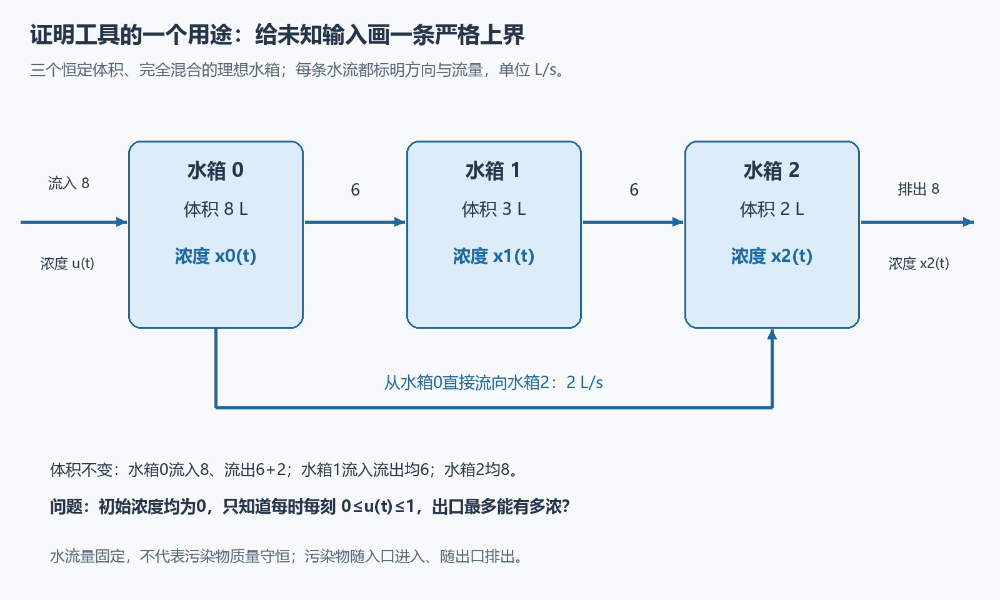
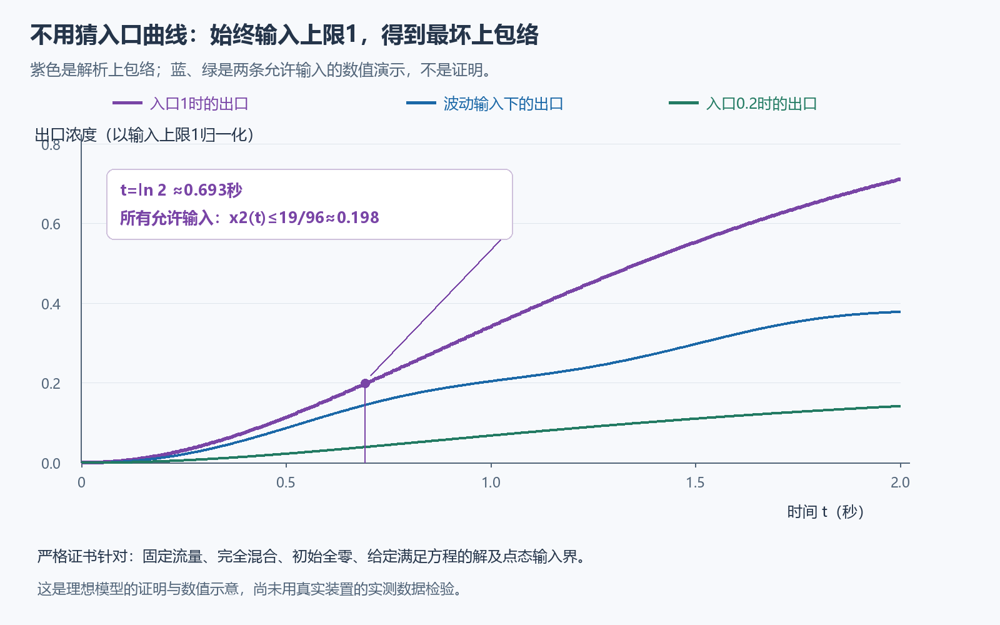

# 证明之后的第一次探索：从格子到有输入的水箱

本轮不再重复原来的二次恢复时间定理，而是做两件可以检验的事：加强原证明的一条中间估计；把其中一个工具拿去处理不同的对象。

已经得到一个有向加权网络的比较定理，并做出了面向所有允许输入的精确出口浓度上界。它们都在独立探索目录中，旧267份正式源和材料包保持原样。下面先讲这个用途，再说原结果加强了哪里。

## 不知道入口怎么变，能知道出口最多多浓吗？

有三个体积固定、完全混合的理想水箱，水流按图中方向流动。入口浓度 u(t) 可以随时间变化，只知道每个时刻都在0与1之间；三个箱子最初浓度都是0。以下比较针对给定、连续且在正时间可微并满足方程的浓度函数；本轮没有形式化一般输入下解的存在性。

我们问的不是某条给定入口曲线的模拟结果，而是：**所有允许的入口曲线里面，在某个时刻最坏的出口浓度是多少？**

记三个箱子的浓度为 x₀、x₁、x₂。每箱污染物质量的变化等于流入减流出。例如水箱1的体积为3升，质量变化为6x₀−6x₁，因此浓度变化率为2(x₀−x₁)。三个方程是

\[
x_0'=-x_0+u(t),\qquad
x_1'=2(x_0-x_1),\qquad
x_2'=(x_0-x_2)+3(x_1-x_2).
\]

体积和水流量固定，浓度才是随时间变化的量。这个模型把混合、流量等当作精确假设，尚未用真实装置数据检验。

## 不必逐条枚举入口：持续输入1就是最坏情形

这个网络只有正向影响：上游浓度增加，不会直接降低下游的变化率。两组系统从相同初态开始，若一组的入口在所有时刻都较大，它在各箱的浓度就不会较小。这叫比较原理。

因此，任意 0≤u(t)≤1 的解，都夹在入口始终为0和入口始终为1的两组解之间。入口始终为0时三箱保持0；入口始终为1时，显式解为

\[
\begin{aligned}
z_0(t)&=1-e^{-t},\\
z_1(t)&=1-2e^{-t}+e^{-2t},\\
z_2(t)&=1-\tfrac73e^{-t}+\tfrac32e^{-2t}-\tfrac16e^{-4t}.
\end{aligned}
\]

这些公式可以直接代回方程，并检查 t=0 时为0。比较定理于是给出所有 t≥0 的逐箱上界 xᵢ(t)≤zᵢ(t)，而不要求 u 单调。

在 t=ln2≈0.693秒时，e⁻ᵗ=1/2、e⁻²ᵗ=1/4、e⁻⁴ᵗ=1/16，所以

\[
x_2(\ln2)\leq z_2(\ln2)
=1-\frac76+\frac38-\frac1{96}
=\frac{19}{96}<\frac15.
\]

这个上界可以达到：直接选择允许的入口 u(t)≡1。它不是从若干条模拟曲线中猜出的上界。图中的蓝绿线只帮助理解，严格保证来自方程和比较证明。上包络 xᵢ(t)≤zᵢ(t) 对所有非负时间成立；这里的数值结论19/96<1/5针对时刻 ln2，不能读成任意时间都低于1/5。

## 原来证明里的工具，为什么不能直接照搬？

原工具处理的是有限个位置之间的置换，把同一组数重排后求和，正负项恰好相消。水箱影响有方向、权重不同，并不满足这类平衡结构。

这一点不能靠“看起来也是扩散”糊弄过去。设没有外加污染输入，某一时刻浓度向量取 (5,4,2)，三个变化率为 (−5,2,9)。普通平方和的导数是

\[
2[5(-5)+4\cdot2+2\cdot9]=2>0.
\]

所以旧的“这个未加权能量不增加”不能直接用到新系统。该向量只是一个代数检验点，不是上述零初值、入口≤1问题中的状态；它用来否定一个对任意状态的能量耗散断言。

推广后的办法不再要求能量下降。对于两组解的差 c，只给它的正部平方记分 E=Σᵢmax(cᵢ,0)²，证明 E′≤KE，其中 K 是从网络系数算出的有限常数。于是 e⁻ᴷᵗE 不增加；如果起初 E=0，它就永远为0，顺序仍然保持。

[网络比较的推导](NETWORK_PROOF.md)展开这一步。它不要求边权对称、网络平衡或每一步为置换。新增形式化对**给定、满足方程的可微解**证明比较与水箱上界，没有在本轮形式化任意输入下解的存在性。

## 原来的结果也加强了一小步

这里回到原来的黑白格问题，和水箱是两个模型。L 是辅助方框的半边长：横纵坐标各从−L到L，共2L+1格。辅助过程初始黑格占据裁角区域；变白格按所在位置记不同分数，越深入内部得分越高。内部选定区域首次有格变白叫“保护区失守”，随后停止更新以保留这次失守的证据，称为冻结。

已证的形状性质保证：失守时会出现一个全白方块。旧证明只从该方块中取一半边长的小块，得到分数至少 L³/128000。本页不重证这段形状几何，只比较同一已证输入下的新旧记账门槛；背景可另读[零权边界教程](../../docs/proof-discovery/02-boundary-weight.md)。

本轮对整个全白方块直接求权重和，证明 L≥80 时门槛至少为 L³/12500，是旧粗门槛的10.24倍。该结论已接到辅助模型中定义的冻结过程与失守事件。

再接上已经证明的平均分数预算，新增形式化给出：L≥250000、辅助物理时刻 t=L²/1000000 时，失守概率≤1/2，原时钟过程的灭绝概率也≤1/2。这比只改善静态门槛又前进了一步；**仍未把新常数沿同步时间转换和原尺寸N归约传播完**。不能把中间门槛提高10倍说成最终恢复时间下界也已提高10倍。

这个改进没有新建模型或假设更强的形状性质，只是少丢弃了一块原本可用的信息。后续还可以检验是否值得把更精确的门槛传到最终结论。

## 这是不是一个新领域？

目前不是。有输入的比较原理属于经典单调控制系统理论，直接前身见 Angeli–Sontag（2003）的[作者论文](https://www.sontaglab.org/FTPDIR/angeli-sontag-monotone-TAC03.pdf)，Definition II.1 和 Proposition III.2。不能因为这次从元胞自动机工具走到了水箱，就把已有理论重新命名。

本轮实际增加的是：一个摆脱置换限制的形式化接口，一个有精确最坏输入的完整小应用，以及原证明更强的中间估计。这让我们能具体比较“工具迁移后省了什么、还缺什么”，而不是只说它可能有用。

一个值得继续的方向是：能否把输入范围、模型系数和观测目标，自动转成可检查的上下界证书？先处理具体网络和系数误差，再看是否会形成更通用的工具。这是下一步研究问题，不是已经创造出的领域。

正式源码在 [DirectedNetworkComparison.lean](lean/DirectedNetworkComparison.lean) 与 [FullBlockThreshold.lean](lean/FullBlockThreshold.lean)。实际检查范围、独立复核和读者反馈集中在 [本轮验证记录](validation.json)。旧教程仍在 [证明复盘入口](../../docs/proof-discovery/README.md)。
