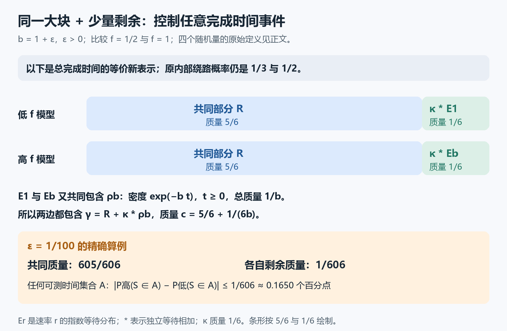

# 完成时间分布的共同子测度与全事件界

固定 $\varepsilon>0$，令 $b=1+\varepsilon$，比较 $f_L=1/2$ 与 $f_H=1$。在每个模型内，相互独立地取

$$
W_a\sim\mathrm{Exp}(1),\quad W_b\sim\mathrm{Exp}(b),\quad
W_c\sim\mathrm{Exp}(1+f),\quad J\in\{0,1\},\quad
\mathbb P(J=1)=\frac f{1+f},
$$

并定义 $S=W_a+W_c+J W_b$。$\mathrm{Exp}(r)$ 按速率参数化，均值为 $1/r$；速率固定，时间已归一化。记 $\mu_L,\mu_H$ 为两个实际完成时间分布。

**命题。** 对每个可测时间集合 $A\subseteq\mathbb R$，

$$
|\mu_H(A)-\mu_L(A)|\le\delta,
\qquad\delta=\frac{\varepsilon}{6(1+\varepsilon)}.
$$

这里 $A$ 仅使用总完成时间，例如 $[1,2]$ 或 $[0,1/2]\cup[2,3]$，不包括不可见的内部事件 $\{J=1\}$。两模型的原分支概率仍分别为 $1/3$ 与 $1/2$。取 $\varepsilon=1/100$，$\delta=1/606\approx0.001650$，即约0.1650个百分点。

## 正测度分解

记 $E_r$ 为 $\mathrm{Exp}(r)$ 的概率测度，卷积 $*$ 表示独立等待相加的分布。非负测度的和表示混合；例如 $(1/3)E_r$ 总质量为 $1/3$，不是概率测度。卷积同样用于有限非负测度，其总质量相乘；$\eta\le\nu$ 表示对每个可测集合 $A$ 都有 $\eta(A)\le\nu(A)$。

由原模型的分支混合，

$$
\begin{aligned}
\mu_L&=\frac23(E_{3/2}*E_1)+\frac13(E_{3/2}*E_b*E_1),\\
\mu_H&=\frac12(E_2*E_1)+\frac12(E_2*E_b*E_1).
\end{aligned}
$$

对 $0<r<s$，有指数测度恒等式

$$
E_r=\frac r s E_s+\frac{s-r}{s}(E_s*E_r).
$$

其密度证明为：$E_s*E_r$ 在 $t\ge0$ 的密度等于

$$
\int_0^t s e^{-su}r e^{-r(t-u)}\,du
=\frac{rs}{s-r}(e^{-rt}-e^{-st}).
$$

代入右侧得到 $re^{-st}+r(e^{-rt}-e^{-st})=re^{-rt}$；负时间密度均为零。

定义

$$
Q_L=\frac13(E_{3/2}*E_1),\quad
Q_H=\frac12(E_2*E_1),\quad
\kappa=\frac16(E_{3/2}*E_2).
$$

将恒等式的 $(r,s)=(1,2)$ 代入 $Q_L$，将 $(1,3/2)$ 代入 $Q_H$，并用卷积交换、结合律，得

$$
Q_L=\kappa+\kappa*E_1,\qquad
Q_H=2\kappa+\kappa*E_1.
$$

故 $Q_H=Q_L+\kappa$、$2Q_L=Q_H+\kappa*E_1$。令 $R=Q_H+Q_L*E_b$，原模型分布可写为

$$
\mu_L=R+\kappa*E_1,\qquad\mu_H=R+\kappa*E_b.
$$

这里 $R$ 质量为 $5/6$，$\kappa$ 质量为 $1/6$：低模型使用 $\mu_L=2Q_L+Q_L*E_b$，高模型使用 $\mu_H=Q_H+Q_H*E_b$ 即可核对。这是输出测度的等价分解，不改变原模型的分支概率。

## 共同子测度

定义有限非负测度 $\rho_b$，其在 $t\ge0$ 的密度为 $e^{-bt}$，负时间为零。因 $b\ge1$，该密度同时不超过 $e^{-t}$ 和 $be^{-bt}$，故

$$
\rho_b\le E_1,\qquad\rho_b\le E_b,\qquad
\rho_b(\mathbb R)=\frac1b.
$$

因此

$$
\gamma=R+\kappa*\rho_b\le\mu_L,\mu_H,\qquad
c:=\gamma(\mathbb R)=\frac56+\frac1{6b}.
$$

$\gamma$ 是共同子测度，即从两概率测度中减去它后均剩非负测度。写 $\mu_L=\gamma+\alpha_L$、$\mu_H=\gamma+\alpha_H$，两剩余测度质量均为 $1-c$，故对每个可测 $A$，$\alpha_L(A),\alpha_H(A)\in[0,1-c]$。于是每个可测 $A$ 满足

$$
|\mu_H(A)-\mu_L(A)|=|\alpha_H(A)-\alpha_L(A)|\le1-c
=\frac{\varepsilon}{6(1+\varepsilon)}.
$$

按 $\sup_A|\mu_H(A)-\mu_L(A)|$ 定义总变差距离，该式也给出其上界。此处采用事件差的约定，不采用两倍该值的约定；未声明所构造的共同质量最大或所得界可达到。

在 $\varepsilon=1/100$ 时，$c=605/606$。例如 $A=[1,2]$ 时，共同子测度相消后两剩余事件概率均在 $[0,1/606]$ 内，故事件差也不超过 $1/606$，但不声称该区间达到上界。本节为单次完成时间观测的结果；独立重复及决策规则的分析见[phase11](../phase11/README.md)。

源码：[正测度分解](lean/PositiveWaitingDecomposition.lean)、[指数共同子测度](lean/ExponentialMinorization.lean)、[一般事件差界](lean/CommonSubmeasureBound.lean)、[实际完成时间事件界](lean/ActualCompletionEventBound.lean)。[既有验证记录](validation.json)。
