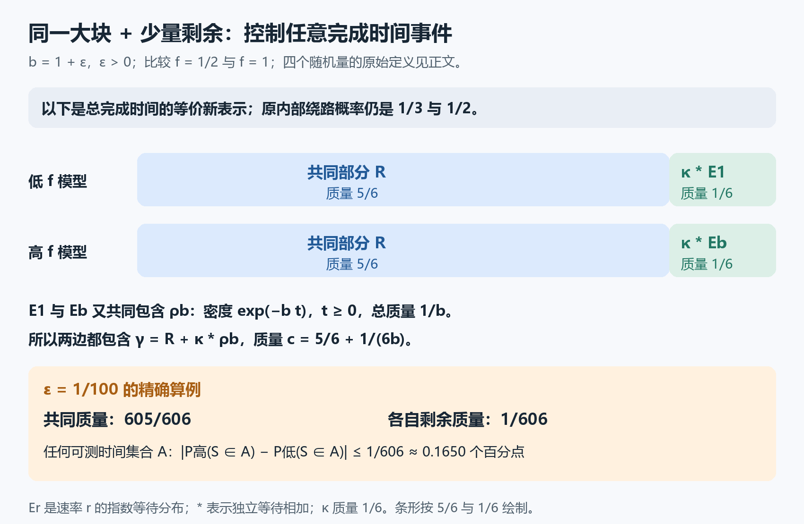

# 找到分布共同的那一大块，就能控制任何完成时间事件

上一种观测是“是否在时间 $t$ 之前完成”。现在允许更复杂的观测：是否在1到2秒之间完成？是否落在几个不相连的时间段里？对于同一组两个小网络，本轮把概率差的控制扩大到了任何可以计算概率的完成时间集合。

结果仍有一个鲜明对照：**两个模型的绕路概率相差 $1/6$，但只看总完成时间时，任何事件的概率差都不超过 $\varepsilon/[6(1+\varepsilon)]$。**

这里比较的是总完成时间，不能把“是否绕路”本身也塞进同一个事件。内部路线和输出时间是两种不同的观测。

## 两个模型，只改变参数 $f$

设四个随机量相互独立，总等待为

$$
S=W_c+W_a+J W_b,
$$

其中 $J$ 只取0、1：$J=1$ 时多等 $W_b$。固定 $\varepsilon>0$，取

$$
W_a\sim\mathrm{Exp}(1),\quad W_b\sim\mathrm{Exp}(1+\varepsilon),\quad
W_c\sim\mathrm{Exp}(1+f),\qquad \mathbb P(J=1)=\frac f{1+f}.
$$

$\mathrm{Exp}(r)$ 表示速率为 $r$ 的指数等待，平均时长为 $1/r$。时间已归一化，速率固定。分别把 $f$ 取为 $1/2$ 和1，得到低、高两个模型。它们的绕路概率分别为 $1/3$、$1/2$，差为 $1/6$。

记 $b=1+\varepsilon$，用 $\mu_L,\mu_H$ 表示两模型总等待 $S$ 的概率分布。若 $A$ 是一个可计算概率的时间集合，也就是可测集合，$\mu_L(A)$ 就是低模型的 $S$ 落进 $A$ 的概率。例如 $A=[1,2]$，或 $A=[0,1/2]\cup[2,3]$。

本轮证明的是

$$
\boxed{|\mu_H(A)-\mu_L(A)|\le\frac{\varepsilon}{6(1+\varepsilon)}
\quad\text{对每个可测时间集合 }A.}
$$

$\varepsilon=1/100$ 时，右边是 $1/606\approx0.001650$，即约0.1650个百分点的绝对概率差。这个同一个上界适用于所有 $A$，不用为每个区间重新估计。

## 第一件事：重新表示输出分布

记 $E_r$ 为 $\mathrm{Exp}(r)$ 的概率分布，$E_r*E_s$ 表示两个独立等待相加后的分布。分布相加表示混合：例如 $(1/3)E_r+(2/3)E_s$，就是先以 $1/3$、$2/3$ 的概率选一种等待。

推导中也会单独使用 $(1/3)E_r$ 这样的分量。它的总质量是 $1/3$，不是一个已经归一化的概率分布。所有分量都非负；把总质量加到1，才是完整的概率分布。卷积 $*$ 对这些分量同样表示等待相加，总质量相乘。

从原来的两条路线，直接得到

$$
\begin{aligned}
\mu_L&=\frac23(E_{3/2}*E_1)+\frac13(E_{3/2}*E_b*E_1),\\
\mu_H&=\frac12(E_2*E_1)+\frac12(E_2*E_b*E_1).
\end{aligned}
$$

接下来用一个指数等待恒等式。对 $0<r<s$，

$$
E_r=\frac r s E_s+\frac{s-r}{s}(E_s*E_r).
$$

它可以直接由密度检查。$E_r$ 的密度在 $t\ge0$ 时为 $r\exp(-rt)$；两个独立指数等待之和的密度是

$$
\int_0^t s\exp(-su)\,r\exp[-r(t-u)]\,du
=\frac{rs}{s-r}\bigl[\exp(-rt)-\exp(-st)\bigr].
$$

代进恒等式右边，密度成为

$$
r\exp(-st)+r[\exp(-rt)-\exp(-st)]=r\exp(-rt),
$$

与左边相同；负时间密度都为0。

只用它的两种取值 $(r,s)=(1,2)$、$(1,3/2)$，定义

$$
Q_L=\frac13(E_{3/2}*E_1),\quad
Q_H=\frac12(E_2*E_1),\quad
\kappa=\frac16(E_{3/2}*E_2).
$$

把 $E_1=\frac12E_2+\frac12(E_2*E_1)$ 代进 $Q_L$，把 $E_1=\frac23E_{3/2}+\frac13(E_{3/2}*E_1)$ 代进 $Q_H$。利用独立等待之和的顺序不影响分布，就有

$$
Q_L=\kappa+\kappa*E_1,\qquad
Q_H=2\kappa+\kappa*E_1.
$$

所以 $Q_H=Q_L+\kappa$，$2Q_L=Q_H+\kappa*E_1$。再令

$$
R=Q_H+Q_L*E_b.
$$

原模型的两个分布便可以写成

$$
\boxed{\mu_L=R+\kappa*E_1,\qquad \mu_H=R+\kappa*E_b.}
$$

请检查这一步：$\mu_L=2Q_L+Q_L*E_b$，替换 $2Q_L$ 即得左式；$\mu_H=Q_H+Q_H*E_b$，替换 $Q_H=Q_L+\kappa$ 即得右式。$R$ 的总质量为 $1/2+1/3=5/6$，$\kappa$ 的质量为 $1/6$。

这是一种**等价的输出分布表示**，不是说原来的任务改成以 $1/6$ 的概率绕路。原模型的 $J$ 概率仍是 $1/3$ 和 $1/2$；这个重新表示只保留总完成时间的分布。

## 第二件事：剩下的两种等待也有共同部分

$b\ge1$ 时，$E_b$ 的密度是 $b\exp(-bt)$，$E_1$ 的密度是 $\exp(-t)$。对 $t\ge0$，它们都不小于

$$
\rho_b(t)=\exp(-bt).
$$

这是因为 $b\ge1$，且 $\exp(-bt)\le\exp(-t)$。负时间把 $\rho_b(t)$ 定为0。把这个非负函数当作一个分量的密度，其总质量是

$$
\int_0^\infty\exp(-bt)\,dt=\frac1b.
$$

所以在共同的 $R$ 之外，两边的 $\kappa*E_1$ 和 $\kappa*E_b$ 又有共同部分 $\kappa*\rho_b$。两个完整输出分布共同包含

$$
\gamma=R+\kappa*\rho_b,
\qquad \text{总质量 }c=\frac56+\frac1{6b}.
$$

这里也用 $\rho_b$ 表示由该密度得到的分量；它质量只有 $1/b$，没有把它当成概率为1的新等待分布。

## 共同质量为什么能控制每一个事件？

把两边各自剩下的非负部分记为 $\alpha_L,\alpha_H$，那么

$$
\mu_L=\gamma+\alpha_L,\qquad
\mu_H=\gamma+\alpha_H.
$$

两边原来总质量都是1，共同部分质量是 $c$，所以两块剩余部分的质量都为 $1-c$。对任何可测 $A$，

$$
\mu_H(A)-\mu_L(A)=\alpha_H(A)-\alpha_L(A).
$$

右边两个数都在 $[0,1-c]$ 中，因此其差的绝对值不超过 $1-c$。代入 $b=1+\varepsilon$，

$$
1-c=\frac16\left(1-\frac1b\right)
=\frac{\varepsilon}{6(1+\varepsilon)}.
$$

这就给出了对所有可测时间事件同时有效的界。按“所有可测事件概率差的上确界”定义，它也是总变差距离的上界；这里不采用把总变差定义成上述数值两倍的另一种约定。

请做两个小检查：$\varepsilon=1/100$ 时，证明中的共同质量是多少？若 $A=[1,2]$，剩余质量又能给出什么？答案是 $c=605/606$、$|\mu_H(A)-\mu_L(A)|\le1/606$。这是一个保证，不声称这个区间真的达到上界。

现在已经能控制一次总完成时间观测中任何事件，而不只是截止事件。不过，要讨论多次观测后能否可靠区分两个机制，仍需处理独立样本的联合分布和具体决策规则；本轮没有把这些统计结论当成已经证明的结果。

这次有用的步骤是：先用指数等待恒等式改写两个输出分布，露出共同的正分量，再把剩余质量变成对所有事件的统一保证。它是这个小网络的可验证方法迁移，不是原二维自动机的新结论，也不构成新领域或首创性认证。

实际数学源、标准内核审计与独立AI核查见[验证记录](validation.json)。图文另交给无项目历史的本科背景模拟读者复述和计算；模拟通过不等于人类测试或专家评审。
