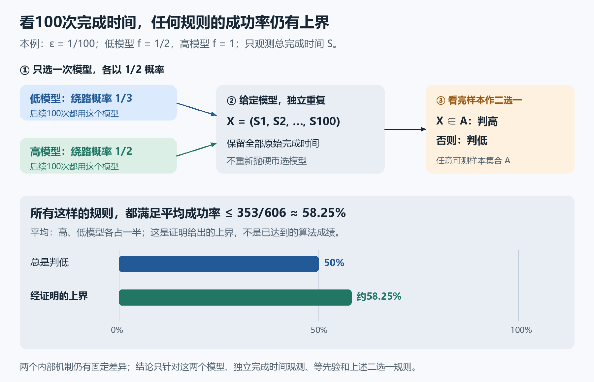

# 看了100次完成时间，为什么判断仍可能只比猜硬币好一点？

有两个已知的任务处理机制，内部绕路概率分别为 $1/3$、$1/2$。现在只能看到完成时间，看不到路线。我们先用公平硬币选择其中一个机制，再由选定的同一个机制独立生成100次任务。看完全部完成时间后，能不能判断这次选中了哪一个？

对下面这组具体模型，已经证明：**任何可测的二选一规则，平均判断成功率都不超过 $353/606\approx58.25\%$。** 这不是某个算法的实验成绩，而是同时约束所有这类判断规则的上界。

这也不是普遍的“100个样本不够用”：结论依赖这里明确给出的两个模型、独立观测方式，以及各一半的模型选择概率。

## 两个模型到底是什么？

一次任务的总等待为

$$
S=W_c+W_a+J W_b.
$$

四个随机量相互独立，$J$ 只取0、1，$J=1$ 时额外等待 $W_b$。固定一个 $\varepsilon>0$，

$$
W_a\sim\mathrm{Exp}(1),\qquad W_b\sim\mathrm{Exp}(1+\varepsilon),\qquad
W_c\sim\mathrm{Exp}(1+f),\qquad \mathbb P(J=1)=\frac f{1+f}.
$$

$\mathrm{Exp}(r)$ 是速率为 $r$ 的指数等待，平均时长为 $1/r$；时间已归一化。低模型取 $f=1/2$，高模型取 $f=1$。所以原内部绕路概率分别是 $1/3$、$1/2$，始终相差 $1/6$。

以下用 $\mu_L,\mu_H$ 表示两模型一次总完成时间的概率分布。低、高只是 $f$ 较低、较高的名字。两个模型的 $W_a$ 速率都为1，$W_b$ 速率都为 $1+\varepsilon$；$W_c$ 的速率 $1+f$ 与绕路概率则都随 $f$ 改变。

选定模型后，样本是

$$
X=(S_1,\ldots,S_n).
$$

给定低模型，这些时间独立且都服从 $\mu_L$；给定高模型，独立且都服从 $\mu_H$。分别记联合分布为 $P_L^{(n)}=\mu_L^{\otimes n}$、$P_H^{(n)}=\mu_H^{\otimes n}$，其中 $\otimes n$ 表示 $n$ 次独立重复的乘积分布。这里没有在每次任务之前重新选择模型。

## 为什么两个不同机制的输出，会共享那么大一块？

先给出本轮要用的共同分量，并说明它来自哪里。记 $b=1+\varepsilon$，$E_r$ 为指数等待 $\mathrm{Exp}(r)$ 的分布；$*$ 表示独立等待相加后的分布。像 $(1/3)E_r$ 这样的非负分量，总质量是 $1/3$，不是完整的概率分布。

定义

$$
Q_L=\frac13(E_{3/2}*E_1),\qquad Q_H=\frac12(E_2*E_1),\qquad
\kappa=\frac16(E_{3/2}*E_2),\qquad R=Q_H+Q_L*E_b.
$$

原来的分支混合给出 $\mu_L=2Q_L+Q_L*E_b$、$\mu_H=Q_H+Q_H*E_b$。两个指数等待恒等式

$$
E_1=\frac12E_2+\frac12(E_2*E_1),\qquad
E_1=\frac23E_{3/2}+\frac13(E_{3/2}*E_1)
$$

分别代入 $Q_L,Q_H$，得到 $Q_L=\kappa+\kappa*E_1$、$Q_H=2\kappa+\kappa*E_1$，因此

$$
\mu_L=R+\kappa*E_1,\qquad \mu_H=R+\kappa*E_b.
$$

指数等待恒等式可由密度直接检查：$E_r*E_s$ 在非负时间的密度是 $rs[\exp(-rt)-\exp(-st)]/(s-r)$（$0<r<s$）。代入 $r=1,s=2$ 或 $3/2$，混合后的密度正是 $\exp(-t)$。它们只改写输出分布，没有把原来的绕路概率改成 $1/6$。

$R$ 的质量是 $5/6$，$\kappa$ 的质量是 $1/6$。$E_1$ 和 $E_b$ 又共同包含一个分量 $\rho_b$：其密度在 $t\ge0$ 时为 $\exp(-bt)$，负时间为0。因为 $b\ge1$，这个密度不大于两者的密度 $\exp(-t)$ 和 $b\exp(-bt)$，而且总积分为 $1/b$。

因此两个输出分布都包含

$$
\gamma=R+\kappa*\rho_b,
\qquad c=\gamma(\mathbb R)=\frac56+\frac1{6(1+\varepsilon)}.
$$

“都包含”指可以从两者中分别减去同一个非负分量 $\gamma$，剩下的仍是非负分量；两边剩余的总质量都是

$$
\delta=1-c=\frac{\varepsilon}{6(1+\varepsilon)}.
$$

## 独立重复后，共同部分的质量怎样变化？

每次观测都能保留共同分量 $\gamma$，所以 $n$ 次独立观测的两个联合分布都包含 $\gamma^{\otimes n}$，质量为 $c^n$。

也可以直接看展开式：把每个 $\mu_L$ 写成“$\gamma$ 加上自己的剩余部分”，再把 $n$ 个因子相乘。所有项都非负，其中一项就是每次都取 $\gamma$，即 $\gamma^{\otimes n}$。高模型的展开式也包含完全相同的一项。

于是对任何可测的样本集合 $A\subseteq\mathbb R^n$，

$$
|P_H^{(n)}(A)-P_L^{(n)}(A)|\le1-c^n.
$$

理由是两边的共同部分抵消后，各自剩余的质量都为 $1-c^n$；两个处在 $[0,1-c^n]$ 内的数，差的绝对值不超过 $1-c^n$。这里的 $A$ 可以依赖整个样本，远比“每次只看一个截止时间”更一般。

一个便于手算的稍松上界是

$$
1-c^n=(1-c)(1+c+\cdots+c^{n-1})\le n(1-c)=n\delta,
$$

因为 $0\le c\le1$。$n=0$ 时直接是 $1-c^0=0$，不需要使用这串求和。

## 把概率差变成判断成功率

一条固定的判断规则，相当于指定一个样本集合 $A$：若 $X\in A$ 就判高模型，否则判低模型。要求 $A$ 可测，只是为了让这些概率有定义；规则可以使用整个样本的均值、分位数、全部原始数值或其他组合。它不能额外看到原内部路线或重新安排实验。这里讨论这种由样本唯一决定判断结果的规则。

两个模型事先各以 $1/2$ 的概率被选中，所以平均成功率是

$$
\begin{aligned}
p_{\mathrm{success}}
&=\frac12P_H^{(n)}(A)+\frac12P_L^{(n)}(A^c)\\
&=\frac12+\frac12\bigl[P_H^{(n)}(A)-P_L^{(n)}(A)\bigr].
\end{aligned}
$$

代入事件差界，得到

$$
\boxed{p_{\mathrm{success}}\le1-\frac{c^n}{2}
\le\frac12+\frac{n\delta}{2}.}
$$

等价地，平均错误率至少为 $c^n/2$。即使知道这两个候选模型的全部参数，也绕不开这个界；没有把某个算法训练不充分当成证明。

## 100次观测的精确算例

取 $\varepsilon=1/100$，此时 $b=101/100$，

$$
c=\frac{605}{606},\qquad \delta=\frac1{606}.
$$

取 $n=100$，便于手算的界是

$$
p_{\mathrm{success}}\le\frac12+\frac{100}{2\cdot606}
=\frac{353}{606}\approx0.582508.
$$

所以成功率不超过约58.25%，错误率至少为 $253/606\approx41.75\%$。更紧的已证公式是

$$
p_{\mathrm{success}}\le1-\frac12\left(\frac{605}{606}\right)^{100},
$$

其上界数值约为57.61%；这一小数只用于阅读，精确结论保留幂的形式。两个界都是保证，不声称最好的规则真的能达到它们。图中的50%基线是完全不看数据、总是判低模型；因模型选择各占一半，它的成功率恰为50%。

请做两个检查：零次观测时，公式给多少？把100次观测的成功率上界与错误率下界相加是多少？答案是 $1/2$ 和 $(353+253)/606=1$。还可以重算 $c=5/6+100/606=605/606$。

这里说明了一种具体的观测困难：内部路线差异固定，但只看完成时间，即使重复100次，信息仍可能很弱。它不适用于随意选择的模型、依赖样本、观测内部路线、改变速率来主动探测，或不等概率的模型选择。它也没有给出足够多少样本就一定能识别的算法。

本轮实际概率构造、标准内核审计与独立AI核查见[验证记录](validation.json)。正文配图另交无项目历史的本科背景模拟读者复述和计算；模拟通过不等于人类测试、专家评审或创新性认证。
