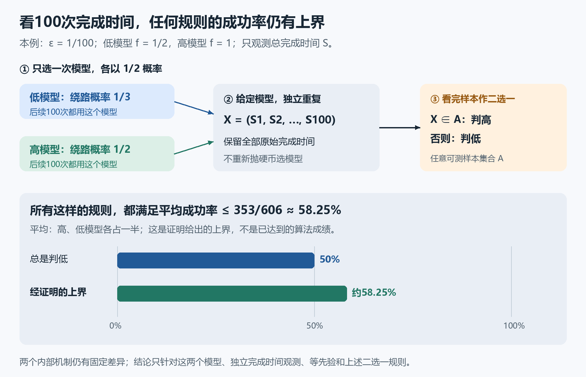

# 条件独立完成时间观测的二元检验上界

先以各 $1/2$ 的概率选定低模型或高模型一次，再在该模型条件下独立生成 $n$ 次任务。对每个模型，单次任务由相互独立的

$$
W_a\sim\mathrm{Exp}(1),\quad W_b\sim\mathrm{Exp}(1+\varepsilon),\quad
W_c\sim\mathrm{Exp}(1+f),\quad J\in\{0,1\},\quad
\mathbb P(J=1)=\frac f{1+f}
$$

构成，$\varepsilon>0$，总完成时间为 $S=W_a+W_c+J W_b$。低模型取 $f_L=1/2$，高模型取 $f_H=1$。$\mathrm{Exp}(r)$ 的速率为 $r$、均值为 $1/r$，时间已归一化。两模型的 $W_a,W_b$ 分布相同，$W_c$ 的速率与原分支概率不同；分支概率分别为 $1/3$ 和 $1/2$。

## 采样与规则

记一次完成时间分布为 $\mu_L,\mu_H$。观测为 $X=(S_1,\ldots,S_n)$，给定模型后的联合分布分别是

$$
P_L^{(n)}=\mu_L^{\otimes n},\qquad P_H^{(n)}=\mu_H^{\otimes n}.
$$

这里 $\otimes n$ 为独立重复的乘积测度；没有逐次重新选模。条件独立不能换成混合模型下的无条件独立；未条件化时，样本联合分布为 $\tfrac12P_L^{(n)}+\tfrac12P_H^{(n)}$，通常不等于单次混合分布的 $n$ 重乘积。

一条可测确定性二选一规则由可测集合 $A\subseteq\mathbb R^n$ 表示：$X\in A$ 时判高，否则判低。规则可使用全部完成时间，但不能观察内部路线、另行随机化或自适应改变试验。

## 单次共同质量

令 $b=1+\varepsilon$，$E_r$ 为速率 $r$ 的指数概率测度，$*$ 为卷积。定义

$$
Q_L=\frac13(E_{3/2}*E_1),\quad
Q_H=\frac12(E_2*E_1),\quad
\kappa=\frac16(E_{3/2}*E_2),\quad R=Q_H+Q_L*E_b.
$$

由原分支混合，$\mu_L=2Q_L+Q_L*E_b$、$\mu_H=Q_H+Q_H*E_b$。指数恒等式

$$
E_1=\tfrac12E_2+\tfrac12(E_2*E_1),\qquad
E_1=\tfrac23E_{3/2}+\tfrac13(E_{3/2}*E_1)
$$

给出 $Q_L=\kappa+\kappa*E_1$、$Q_H=2\kappa+\kappa*E_1$，从而

$$
\mu_L=R+\kappa*E_1,\qquad\mu_H=R+\kappa*E_b.
$$

这些恒等式可由卷积密度 $rs(e^{-rt}-e^{-st})/(s-r)$（$0<r<s,t\ge0$）核对。定义 $\rho_b$ 的非负时间密度为 $e^{-bt}$、负时间为零。它质量为 $1/b$，同时小于 $E_1,E_b$。因此两模型共同包含

$$
\gamma=R+\kappa*\rho_b,\qquad
c=\gamma(\mathbb R)=\frac56+\frac1{6(1+\varepsilon)},\qquad
\delta=1-c=\frac{\varepsilon}{6(1+\varepsilon)}.
$$

此处 $R,\kappa$ 的质量分别为 $5/6,1/6$。共同部分是输出测度分解，不把原分支概率改为 $1/6$。详细构造见[phase10](../phase10/README.md)。

## 乘积共同质量与检验界

在每个条件模型内独立重复，两个乘积测度均包含 $\gamma^{\otimes n}$，质量为 $c^n$。将各因子写为 $\gamma$ 加非负剩余测度并展开，取每一因子的共同项即可得到该包含关系。

于是对任意可测 $A$，共同部分相消后，两剩余测度质量均为 $1-c^n$，故

$$
|P_H^{(n)}(A)-P_L^{(n)}(A)|\le1-c^n\le n\delta.
$$

最后一步对 $n>0$ 由 $1-c^n=(1-c)(1+c+\cdots+c^{n-1})$ 及 $0\le c\le1$ 得到；$n=0$ 时两边直接为零。

等先验平均对选模随机性取平均；条件样本概率分别在低、高模型下计算。因此规则的平均成功率为

$$
p_{\mathrm{success}}=\frac12P_H^{(n)}(A)+\frac12P_L^{(n)}(A^c)
=\frac12+\frac12[P_H^{(n)}(A)-P_L^{(n)}(A)].
$$

所以

$$
p_{\mathrm{success}}\le1-\frac{c^n}{2}\le\frac12+\frac{n\delta}{2},
\qquad p_{\mathrm{error}}\ge\frac{c^n}{2}.
$$

该界同时约束所有上述规则，即使规则已知两个候选模型的全部参数，该界仍成立；不声明最优规则达到此上界。

## 一百次观测的算例

取 $\varepsilon=1/100,n=100$，则 $c=605/606$、$\delta=1/606$，

$$
p_{\mathrm{success}}\le\frac12+\frac{100}{1212}
=\frac{353}{606}\approx58.25\%,\qquad
p_{\mathrm{error}}\ge\frac{253}{606}\approx41.75\%.
$$

更紧的已证形式为 $p_{\mathrm{success}}\le1-\tfrac12(605/606)^{100}$，其上界数值约57.61%。该数值小于线性估计的58.25%，两个结论均保留相应的精确表达式。图中50%是总判低模型的等先验成功率。$n=0$ 时上界为 $1/2$；分数界满足 $(353+253)/606=1$，共同质量也可核对为 $5/6+100/606=605/606$。

结论依赖所列模型、等先验、一次选模后的条件独立样本和确定性规则。不包括依赖采样、观测内部路线、自适应探测、不等先验，也未给出保证识别的充分样本数。

源码：[乘积共同质量](lean/CommonIIDBound.lean)、[一般二元检验界](lean/BinaryTestingBound.lean)、[实际完成时间检验](lean/ActualCompletionTesting.lean)。[既有验证记录](validation.json)。
