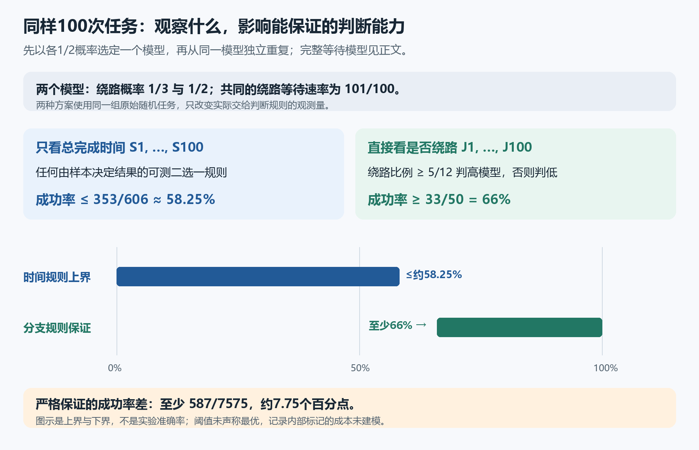

# 同一原始任务下两种观测的辨识保证

对同一对模型、等先验和100次条件独立任务，任何仅使用完成时间的可测确定性规则，平均成功率至多 $353/606\approx58.25\%$；直接使用实际分支标记的一条阈值规则，平均成功率至少 $33/50=66\%$。因此，这条分支规则的成功率比任意完成时间规则至少高 $587/7575\approx0.07749$，即约7.75个百分点。

图中58.25%为一类规则的统一上界，66%为一条规则的下界，均不是实测准确率，也未声明最优。

## 原始概率模型与两类观测

先以各 $1/2$ 的概率选定低模型或高模型一次。给定模型后，各次任务独立；每次任务内部取四个独立随机量

$$
W_a\sim\mathrm{Exp}(1),\quad W_b\sim\mathrm{Exp}(101/100),\quad
W_c\sim\mathrm{Exp}(1+f),\quad J\in\{0,1\},\quad
\mathbb P(J=1)=\frac f{1+f},
$$

并定义 $S=W_a+W_c+J W_b$。$\mathrm{Exp}(r)$ 按速率参数化，均值为 $1/r$；时间已归一化。低模型 $f=1/2$，高模型 $f=1$，原分支概率分别为 $1/3$ 与 $1/2$，$W_c$ 的速率也随模型变化。

对同一组原始任务，分别向规则提供 $(S_1,\ldots,S_n)$ 或 $(J_1,\ldots,J_n)$。形式化的观测映射证明，逐次取 $S_i$ 得到[phase11](../phase11/README.md)的完成时间乘积分布；逐次取 $J_i$ 得到原任务中的实际分支标记。并非另行假设一组与任务无关的伯努利数据。此处假定内部标记可以记录，不估计工程成本。独立性均在给定模型后成立，不能视为等先验混合后的无条件独立。

## 分支阈值规则

对正整数 $n$，记 $Z_i=J_i\in\{0,1\}$、$N_n=\sum_{i=1}^nZ_i$，规定

$$
N_n\ge\frac{5n}{12}\ \text{时判高模型，否则判低模型}.
$$

阈值 $5/12$ 为 $1/3$ 与 $1/2$ 的中点，两侧距离均为 $1/12$：$5/12-1/3=1/2-5/12=1/12$。在 $n>0$ 时，该规则等价于 $N_n/n\ge5/12$；等号时判高。

## 原分支标记的矩

对取1概率为 $p$ 的0、1变量，$Z^2=Z$，故 $\mathbb E[Z]=p$、$\operatorname{Var}(Z)=p(1-p)$。给定模型后各次独立，所以不同次数的协方差为零，均值和方差分别相加：

$$
\begin{array}{c|cc|cc}
&\mathbb E[Z_i]&\operatorname{Var}(Z_i)&\mathbb E[N_n]&\operatorname{Var}(N_n)\\\hline
\text{低模型}&1/3&2/9&n/3&2n/9\\
\text{高模型}&1/2&1/4&n/2&n/4
\end{array}
$$

这些矩由实际原始分布与独立乘积样本推出，不作为额外概率假设。

## 切比雪夫误差界

对有限方差随机变量 $Y$ 和 $r>0$，

$$
\mathbb P(|Y-\mathbb E[Y]|\ge r)\le\frac{\operatorname{Var}(Y)}{r^2}.
$$

记偏差事件为 $B$，则 $r^2\mathbf1_B\le(Y-\mathbb E[Y])^2$；取期望并除以 $r^2$ 即得此式。低模型误判事件为 $N_n\ge5n/12$，距均值 $n/3$ 至少 $n/12$，所以

$$
\mathbb P_L(\mathrm{error})\le\frac{2n/9}{(n/12)^2}=\frac{32}{n}.
$$

高模型误判事件为 $N_n<5n/12$，距均值 $n/2$ 大于 $n/12$，包含在绝对偏差至少 $n/12$ 的事件内，故

$$
\mathbb P_H(\mathrm{error})\le\frac{n/4}{(n/12)^2}=\frac{36}{n}.
$$

这分别保留了阈值处的 $\ge$ 和 $<$。等先验下平均错误率至多 $34/n$，成功率满足

$$
p_{\mathrm{branch}}\ge1-\frac{34}{n}\qquad(n>0).
$$

小 $n$ 时下界可能为负，结论仍成立但没有区分力。这一矩与切比雪夫论证也适用于同类 $b=1+\varepsilon,\varepsilon>0$ 的模型，分支概率并不随 $\varepsilon$ 改变；本节观测对照固定 $\varepsilon=1/100$。

## 一百次任务的严格对照

$n=100$ 时，低、高模型误判率分别至多 $8/25$、$9/25$。平均错误率至多 $(8/25+9/25)/2=17/50$，所以

$$
p_{\mathrm{branch}}\ge\frac{33}{50}.
$$

同一原始任务的完成时间观测由[phase11](../phase11/README.md)给出

$$
p_{\mathrm{time}}\le1-\frac12\left(\frac{605}{606}\right)^{100}
\le\frac{353}{606}.
$$

其中单次共同质量为 $605/606$，条件独立100次后的共同质量为其100次幂。两界均已通过观测映射接回同一组原始任务，故

$$
p_{\mathrm{branch}}-p_{\mathrm{time}}
\ge\frac{33}{50}-\frac{353}{606}=\frac{587}{7575}.
$$

这是成功率的绝对差，不能读为相对提高7.75%，也不把分支规则的成功率认定为恰等于66%。阈值规则只使用实际观测到的 $J_i$；完成时间规则则只使用 $S_i$。这种比较不声明阈值最优、不包括随机化或自适应规则，也不推广到任意现实系统。公开证明在本节止于实际观测连接、矩和切比雪夫保证，不包含精确计数尾概率或更紧有限尾界。

源码：[实际观测映射](lean/ObservationMaps.lean)、[分支矩](lean/ActualBranchMoments.lean)、[阈值检验](lean/BranchThresholdTesting.lean)、[观测对照](lean/ObservationContrast.lean)。[既有验证记录](validation.json)。
