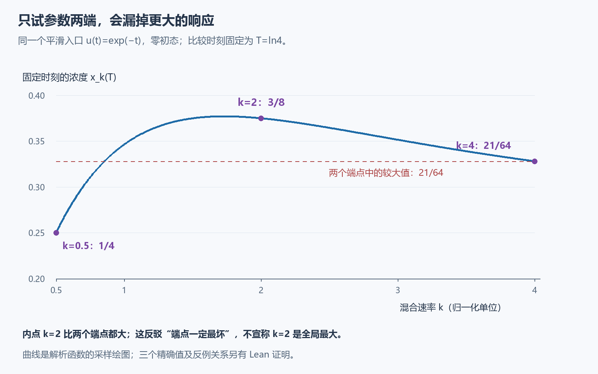
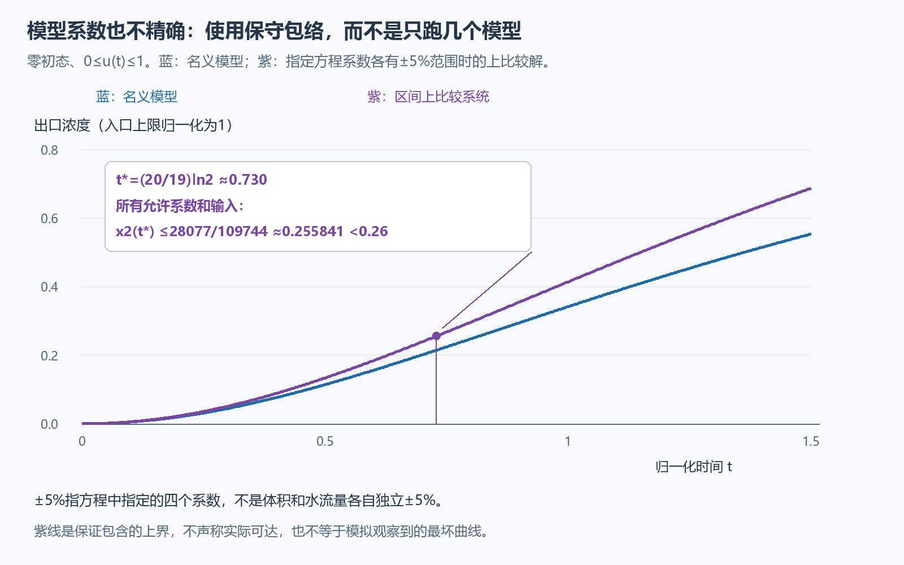

# 第二轮探索：参数不知道，怎样给出仍然可靠的结论？

上一轮可以处理“模型准确，但入口浓度会变”。这轮继续问：**如果模型系数也只知道一个范围，原来的保证还成立吗？**

先做了一次反例检验，再写正确的包络证明。同时，原格子问题的新估计也已接回同步模型，得到更强的显示下界。四个新模块都独立存放，旧正式证明、第一轮源码和封存材料包没有修改。

## 先排除一个很自然的错误办法

只有一个完全混合的理想水箱，浓度 x 满足

\[
x'=k(u-x),\qquad x(0)=0.
\]

k 是水箱替换液体的速率，固定但未知，范围为 [1/2,4]。给它相同的平滑入口浓度 u(t)=e⁻ᵗ：污染输入开始较大，之后逐渐减小。观察时刻固定为 T=ln4。时间按入口的衰减尺度归一化；本页后面的三水箱图也使用归一化时间，不对应一个已经实测的装置。

最省事的尝试是只计算 k=1/2 与 k=4，拿较大值当作整个参数范围的上界。可是三个精确结果为

| 混合速率 k | 观察时刻的浓度 x(T) |
| --- | --- |
| 1/2，左端点 | 1/4=0.25 |
| 2，区间内部 | 3/8=0.375 |
| 4，右端点 | 21/64=0.328125 |

内点比两个端点都大，超过较大端点3/64。**只检查参数区间的两端，不能保证覆盖中间的响应。** 我们没有声称 k=2 是全区间真正的最大值。

为什么会这样？更快替换既让早期的污染更快进入，又让后来的清洗更快发生。固定观察时刻的浓度，是这两个作用共同留下的结果。“入口越大，响应越大”的比较原理，不能直接换成“速率越大，响应越大”。

这不是数值模拟发现后就停止。新增 Lean 模块证明了对应公式确实满足方程和共同初值，也处理了 k=1 时公式表面分母为零的分支；三个值及非单调性都由内核检查。该现象属于经典参数敏感性，不因此自称新发现。

## 正确做法：让一个比较系统包住所有允许模型

回到上一轮三水箱方程，但四个系数不再精确已知：

\[
\begin{aligned}
x_0'&=k_0(u-x_0),\\
x_1'&=k_{10}(x_0-x_1),\\
x_2'&=k_{20}(x_0-x_2)+k_{21}(x_1-x_2).
\end{aligned}
\]

名义值为 (1,2,1,3)，每个固定系数落在名义值的95%至105%之间。入口仍满足0≤u(t)≤1，初态全零。这里的5%直接针对**方程系数**，不是说体积与水流量各自独立有5%误差；后者取比值后范围会不同。以下结论针对给定的经典解：在非负时间连续，在每个正时刻可微并满足所列方程，本轮不证明一般输入的解存在性。

构造上比较系统：每个正耦合项取最大系数，每个负衰减项取最弱衰减，入口也取最大值。这与“找一个真实模型，把它的所有参数同时设到某一端”不同：同一参数在正项和负项中可被分别放宽，所得上系统不必是任何一个真实模型。

例如第二行的真实项是 k₁₀x₀−k₁₀x₁。上系统用2.1y₀−1.9y₁，不能对应某一个 k₁₀。允许这种放宽，换来的正是对全部允许模型的包含保证，代价是可能比较松。

新模块已经证明该比较在所有非负时间都成立。得到的具体数值证书是

\[
t_*=(20/19)\ln2\approx0.730,
\qquad x_2(t_*)\leq\frac{28077}{109744}\approx0.255841<0.26.
\]

它同时覆盖所有允许的固定系数和满足条件的入口，而不是只覆盖画过的几条曲线。[包络的具体推导](INTERVAL_CERTIFICATE.md)说明矩阵不等式如何给出这个保证。

紫线不声称可达到，也不能把0.255841与上一轮在ln2时刻的0.198相减，解释成“5%误差造成的实际增量”：它们时刻不同，而且一个是保守界。当前形式化证明的是函数上包络和 t_* 的数值界，没有声称所有时间都小于0.26。

## 原格子问题的下界也真正变强了

原问题是有限黑格在无限方格上的同步四邻多数更新，平局独立掷公平硬币。白背景下，“恢复”就是第一次所有黑格消失；一旦全白，之后始终全白。全黑背景的有限白色扰动也同样处理。

N 是包住初始扰动的最小平移轴平行格点方框边长，按容纳的格点列数计，不是坐标差：例如扰动在(0,0)和(2,1)，需3列、3行的方框，所以N=3。τ(N)先对一个确定初态的硬币随机性求平均，再在尺寸恰为N的初态中取最坏值；永不恢复的单条演化先记为∞。

第一轮改进只到了辅助随机时钟的概率界。这轮把它传过调度比较、奇偶尺寸、平移和黑白背景对称，真正得到

\[
\frac{N^2}{576000000}\leq\tau(N)\leq664066N^2,
\qquad N\geq500001.
\]

旧版本下界分母是56623104000，门槛是786432000。因此新下界系数是旧显示系数的98.304倍，适用的尺寸门槛也大幅下降。上界没有改变；这仍是十分粗松的渐近估计，不能拿来预测一个小图形的寿命。

下界是“最坏初态可以这么慢”，不是“每个尺寸N的图形都这么慢”。新证明给出实心方块见证，并覆盖平移和黑白互换。它没有换掉原同步规则、原尺寸或无穷恢复时间。

## 这一轮究竟增加了什么

- 一个精确反例，阻止我们把输入比较错用到参数端点。
- 一套适用于固定区间矩阵的上下比较接口，以及有5%系数范围的三水箱证书。
- 原问题的更强显示下界，已接到原τ，而不只停留在辅助过程。

矩阵区间比较已有明确前身，例如[2011年的正系统区间论文](https://skoge.folk.ntnu.no/prost/proceedings/ifac11-proceedings/data/html/papers/3682.pdf)。本轮没有发现可认证为新领域的理论。它的收获更具体：把一个错误推广排除了，把一个正确用途做成了可检查的证明，并加强了原成果。

下一步值得试的是：能否在保留保证的同时减少包络的松弛，例如保留同一参数在多个位置的关联，或细分参数区间再组合证书。那需要新的实际检验，不能因为当前区间上界正确，就自动宣称它准确或最优。

[本轮验证与读者记录](validation.json) · [上一轮成果](../README.md)。新源分别为 [参数反例](lean/ParameterCounterexample.lean)、[一般区间比较](lean/RobustNetworkBounds.lean)、[三水箱证书](lean/RobustTankCertificate.lean)、[原尺寸下界](lean/ImprovedOriginalLower.lean)。
