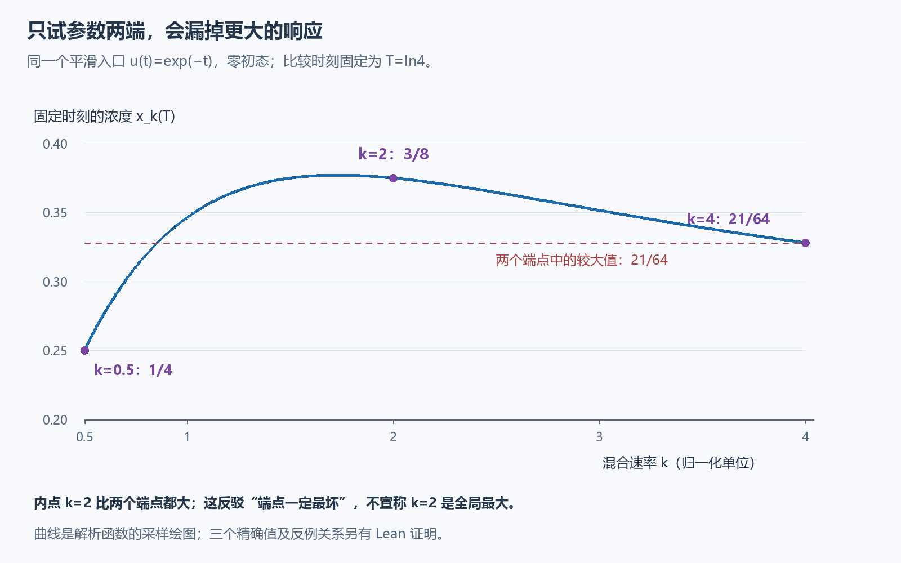
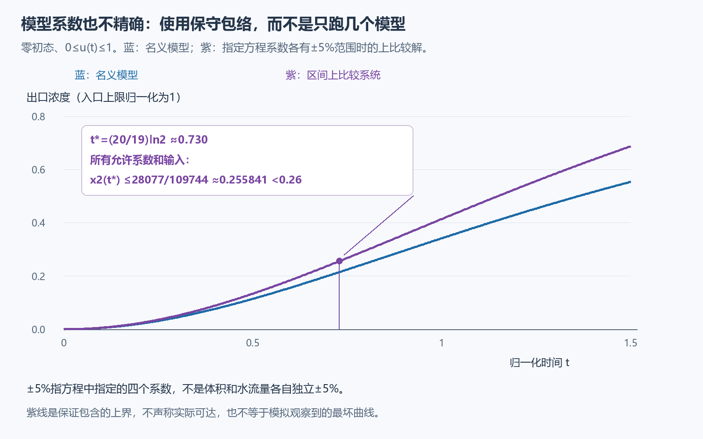

# 区间系数比较与自动机恢复时间下界

本节包含三个结果：固定衰减输入下参数端点法的反例、系数区间内三箱系统的比较证书，以及原同步自动机的改进下界。各结果沿用原模型，数学源与既有核验分别链接于文末。

## 参数端点法的反例

单箱系统满足

$$
x'=k(u-x),\qquad x(0)=0,\qquad u(t)=e^{-t},\qquad k\in[1/2,4].
$$

$k$ 为固定速率。取共同观察时刻 $T=\ln4$，精确值为

| $k$ | $x(T)$ |
|---|---|
| $1/2$ | $1/4=0.25$ |
| $2$ | $3/8=0.375$ |
| $4$ | $21/64=0.328125$ |

内点 $k=2$ 的响应超过较大端点值 $3/64$，因此只比较参数两端不能给出全区间响应上界。这不包含 $k=2$ 为全区间最大点的断言。解可写为 $x(t)=k(e^{-t}-e^{-kt})/(k-1)$（$k\ne1$），而 $k=1$ 时为 $te^{-t}$。相同初值和方程的验证及表中有理数值见[ParameterCounterexample.lean](lean/ParameterCounterexample.lean)。

速率增大会同时加快早期输入和后期清洗；输入的顺序比较不能直接替代参数的顺序比较。

## 固定区间矩阵的上下比较

一般接口处理有限维固定Metzler矩阵（非对角元素非负的实矩阵）$L\le M\le H$，其中不等式逐元素成立。设真实系统为 $x'=Mx+v$，$x(0)\ge0$、$v\ge0$，并给定下系统 $y_-'=Ly_-+w_-$ 与上系统 $y_+'=Hy_++w_+$。若 $w_-\le v\le w_+$、$y_-(0)\le x(0)\le y_+(0)$，且三者均为所列经典解，则 $y_-\le x\le y_+$。非负真实状态保证矩阵区间可转为微分不等式；下系统的输入本身不要求非负。

## 固定区间内的三箱上包络

考虑零初值的给定经典解

$$
\begin{aligned}
x_0'&=k_0(u-x_0),\\
x_1'&=k_{10}(x_0-x_1),\\
x_2'&=k_{20}(x_0-x_2)+k_{21}(x_1-x_2),
\end{aligned}
$$

其中 $0\le u(t)\le1$，固定系数依次位于 $[0.95,1.05]$、$[1.9,2.1]$、$[0.95,1.05]$、$[2.85,3.15]$。经典解在非负时间连续、正时间可微并满足方程。这里的5%直接作用于方程系数；体积和流量各自的5%误差并不自动给出相同比率范围。时间及浓度均已归一化。

逐元素放宽矩阵的非对角项及衰减项，可构造上系统。例如实际第二行 $k_{10}x_0-k_{10}x_1$ 被 $2.1y_0-1.9y_1$ 替代；同一系数的两个出现位置分别取界，所得系统通常不对应任何允许的真实参数。真实系统的非负性与一般区间比较定理保证该上系统包住全部允许解。具体矩阵、残差和显式上解见[区间证书](INTERVAL_CERTIFICATE.md)。

在

$$
t_*=(20/19)\ln2\approx0.730
$$

时，该证书给出

$$
x_2(t_*)\le\frac{28077}{109744}\approx0.255841<0.26.
$$

图中紫线为保守比较系统的响应，不主张可达到。数值0.255841也不能与名义系统在另一时刻 $\ln2$ 的约0.198相减，解释为5%误差的实际效应。证书是给定时刻的界，不是所有时间均低于0.26的断言。

## 原同步自动机的改进下界

原模型在无限方格上同步作四邻多数更新，平局时各点独立掷公平硬币。初态为单色背景的有限异色扰动；恢复时间是首次回到纯色背景的时刻，永不恢复时记为 $\infty$。纯色背景为吸收态。

$N$ 是包住扰动的最小平移轴平行格点方框边长，按格点列数计。例如包含 $(0,0)$ 和 $(2,1)$ 的最小此类方框有三列三行，故 $N=3$。$\tau(N)$ 先对一个确定初态的硬币随机性取扩展期望，再在尺寸恰为 $N$ 的初态间取最坏值。

对 $N\ge500001$，有

$$
\frac{N^2}{576000000}\le\tau(N)\le664066N^2.
$$

下界证明由辅助随机时钟的概率估计，经调度比较、奇偶尺寸、平移及黑白对称传回原同步模型，实心方块给出见证。它是最坏初态下界，不是所有尺寸为 $N$ 的图形都具有该寿命。

旧显示下界的分母为56623104000，适用门槛为786432000；新下界系数为旧下界系数的98.304倍，上界保持不变。这些常数仍较粗，不能用于预测小图形的实际寿命。

区间正系统方法的背景文献见[2011年论文](https://skoge.folk.ntnu.no/prost/proceedings/ifac11-proceedings/data/html/papers/3682.pdf)。本节不以该应用或反例主张新的理论领域。

源码：[参数反例](lean/ParameterCounterexample.lean)、[一般区间比较](lean/RobustNetworkBounds.lean)、[三箱证书](lean/RobustTankCertificate.lean)、[原尺寸下界](lean/ImprovedOriginalLower.lean)。[既有验证记录](validation.json) · [目录总览](../README.md)。
