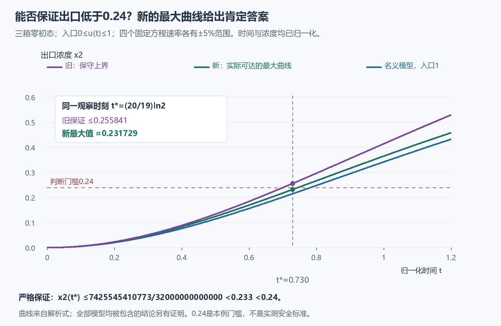
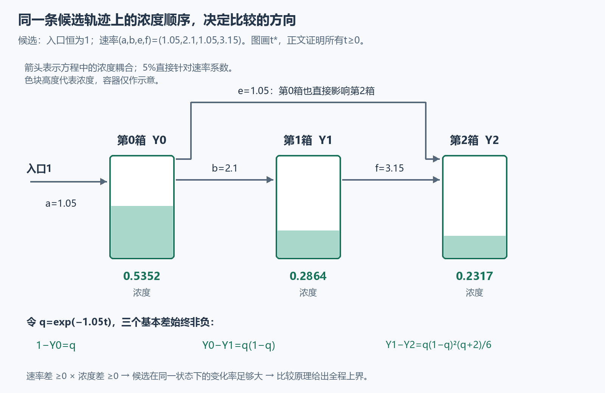

# 三箱系统的可达最大轨迹与端点证书

对下述固定系数范围和允许输入，单位入口及四个上端速率产生一条可达最大轨迹。在共同观察时刻 $t_*=(20/19)\ln2\approx0.730$，其出口值约为0.231729。[phase2](../phase2/README.md)在同一时刻给出的保守界为 $28077/109744\approx0.255841$；以下有理数证书将统一上界降至0.233以下，因而小于0.24。0.24是算例中的比较门槛，不对应实测安全标准。

## 模型与参数域

考虑零初值的三箱系统

$$
x_0'=a(u-x_0),\qquad x_1'=b(x_0-x_1),\qquad
x_2'=e(x_0-x_2)+f(x_1-x_2),
$$

其中 $0\le u(t)\le1$，固定速率满足

| 速率 | 名义值 | 允许范围 |
|---|---|---|
| $a$ | 1 | $[0.95,1.05]$ |
| $b$ | 2 | $[1.9,2.1]$ |
| $e$ | 1 | $[0.95,1.05]$ |
| $f$ | 3 | $[2.85,3.15]$ |

浓度按入口上限归一化，时间亦已归一化。5%作用于方程系数。比较对象为在非负时间连续、正时间可微并满足方程的给定经典解；不据此断言任意不规则输入下解的存在性。

## 上端轨迹及浓度顺序

令 $Y$ 为参数 $(1.05,2.1,1.05,3.15)$、入口 $u=1$ 的轨迹。设

$$
q=e^{-1.05t},\qquad p(q)=1-\frac73q+\frac32q^2-\frac16q^4.
$$

其显式表达式为 $Y_0=1-q$、$Y_1=(1-q)^2$、$Y_2=p(q)$。由 $q'=-1.05q$ 可验证方程和零初值。对 $t\ge0$，$0<q\le1$，且

$$
1-Y_0=q,\qquad Y_0-Y_1=q(1-q),\qquad
Y_1-Y_2=\frac{q(1-q)^2(q+2)}6.
$$

这些恒等式在整个非负时间轴上成立，因而得到 $1\ge Y_0\ge Y_1\ge Y_2$；残差比较所需的状态顺序由此确定。

记 $F_i(X,u)$ 为第 $i$ 个方程在状态 $X$ 下的右边。对任意允许参数，在同一状态 $Y$ 上有

$$
\begin{aligned}
R_0:=Y_0'-F_0(Y,u)&=(1.05-a)(1-Y_0)+a(1-u),\\
R_1:=Y_1'-F_1(Y,u)&=(2.1-b)(Y_0-Y_1),\\
R_2:=Y_2'-F_2(Y,u)&=(1.05-e)(Y_0-Y_2)+(3.15-f)(Y_1-Y_2).
\end{aligned}
$$

每一乘积均非负，因此 $R_i\ge0$。这些方程的非对角耦合系数均非负，因此正系统比较原理适用，给出

$$
x_i(t)\le Y_i(t)\qquad(t\ge0,\ i=0,1,2).
$$

[比较证明](PROOF.md)处理首次接触时导数相等的情形。由于 $Y$ 本身来自允许参数和允许入口，它是该比较集合中的可达最大轨迹：每个坐标、每个非负时刻的上界均由同一允许模型同时达到。该结论同时优化输入与参数；不等同于固定任意一条输入后，上端参数仍最坏。[phase2反例](../phase2/README.md)已排除后一个一般断言。

## 共同观察时刻的有理数界

在 $t_*$ 处，$q_*=2^{-21/19}$。精确幂比较给出 $q_*\ge929/2000$，而 $p$ 在 $[0,1]$ 上不增，故

$$
x_2(t_*)\le p(q_*)\le
\frac{7425545410773}{32000000000000}
\approx0.2320483<0.233<0.24.
$$

十九次幂比较及 $p'$ 的符号见[证明](PROOF.md)。约0.231729是最大轨迹的数值；约0.2320483是略松的严格有理数上界，二者不应混同。

在另一个便于核算的时刻 $q=1/2$，有 $Y_0=1/2$、$Y_1=1/4$、$Y_2=19/96$，从而 $Y_0-Y_1=1/4$、$Y_1-Y_2=5/96$。该时刻不等于 $q_*=2^{-21/19}$ 对应的 $t_*$。

## 比例上限的一般形式

固定 $C\ge0$，允许

$$
0\le a\le C,\quad0\le b\le2C,\quad
0\le e\le C,\quad0\le f\le3C.
$$

在相同的输入、初值和经典解条件下，最大轨迹仍由上述三个公式给出，只需令 $q=e^{-Ct}$。上端参数 $(C,2C,C,3C)$ 与单位入口达到该轨迹。$C=0$ 时三坐标恒为零。取 $C=1.05$，即使允许某些速率降为零，上界仍成立；结论仍限固定系数。

与区间矩阵放宽相比，该证明保留同一参数在流入与流出中的关联，通过候选轨迹上的浓度顺序确定残差符号。它给出此系统的可达见证和更紧证书，采用的是经典比较方法。

源码：[端点轨迹](lean/EndpointTank.lean)、[比例推广](lean/ScaledEndpointEnvelope.lean)、[幂与多项式计算](lean/EndpointArithmetic.lean)、[数值证书](lean/EndpointCertificate.lean)。[既有验证记录](validation.json)。
