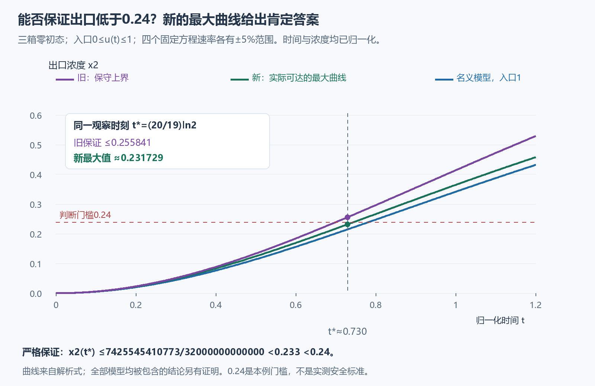
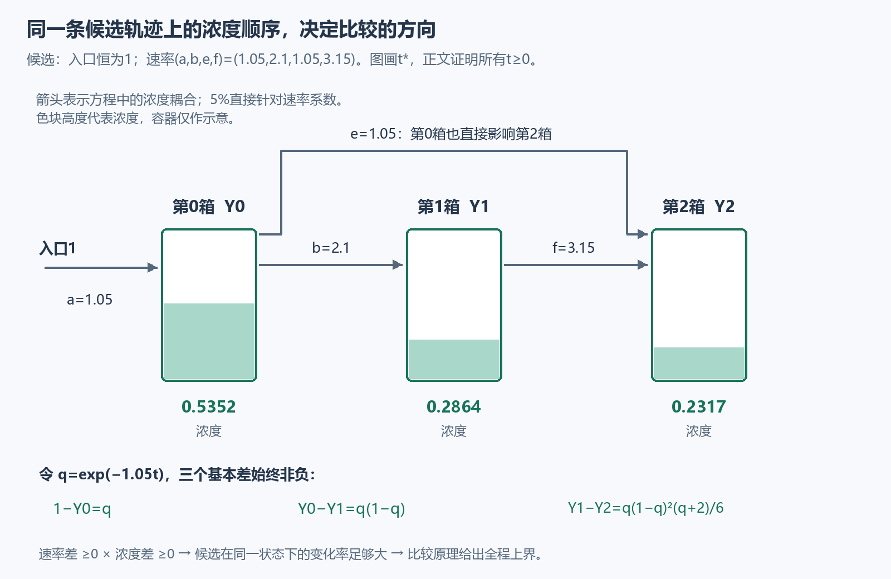

# 找到真正的最坏模型，而不只给一个偏松的上界

假设你要判断：**在指定时刻，三个相连的理想混合水箱，最后一个的污染浓度能否保证低于0.24？**

水箱开始都没有污染。入口浓度可能随时间变化，只知道始终在0和1之间。模型的四个速率也不精确，各有5%的范围。上一轮的保证是“出口不超过约0.255841”，因此还回答不了这个问题。

这一轮找到并证明了真正的最坏情形：**入口一直保持1，四个速率都取允许的最大值。** 它的出口浓度在该时刻约为0.231729。进一步的精确分数界证明，全部允许模型的出口浓度都小于0.233，因此也小于0.24。

图中的小数用来读图。证明使用的是明确公式和精确不等式；它覆盖全部允许参数和入口，不靠有限条模拟曲线代替保证。0.24只是本例选的判断门槛，没有对应一个已经实测的安全标准。

## 先看清我们允许哪些情况

用 $x_0,x_1,x_2$ 表示三个水箱的浓度，入口浓度是 $u(t)$。浓度以入口上限为1归一化。方程是

$$
\begin{aligned}
x_0'&=a(u-x_0),\\
x_1'&=b(x_0-x_1),\\
x_2'&=e(x_0-x_2)+f(x_1-x_2).
\end{aligned}
$$

例如 $b(x_0-x_1)$ 的意思是：当第0箱比第1箱浓时，第1箱浓度上升；差越大、速率 $b$ 越大，上升越快。

初值全为0，入口满足 $0\le u(t)\le1$。四个**固定**速率的允许范围是

| 速率 | 名义值 | 允许范围 |
| --- | --- | --- |
| $a$ | 1 | [0.95,1.05] |
| $b$ | 2 | [1.9,2.1] |
| $e$ | 1 | [0.95,1.05] |
| $f$ | 3 | [2.85,3.15] |

5%针对方程系数。时间也已归一化，不直接解释为秒。本节讨论给定的经典解：在非负时间连续，在每个正时刻可微并满足这些方程；没有额外宣称任意不规则入口都存在这样的解。

统一观察时刻为

$$
t_* =\frac{20}{19}\ln2\approx0.730.
$$

## 为什么这一次可以认定“全部取最大”最坏？

不能只凭直觉认为速率越大越坏。更快替换液体，也可能更快把污染洗掉。上一轮的单箱反例已经说明：入口固定为一个逐渐衰减的函数时，区间内部的速率能比两个端点都产生更高的浓度。

这里要比较的集合同时允许入口变化。我们选择入口恒为1的候选最坏轨迹，并检查它是否确实压住所有允许情况。检查依靠的是这条轨迹上的浓度顺序。

把四个速率设为最大值 $(1.05,2.1,1.05,3.15)$，入口设为1。记得到的轨迹为 $Y_0,Y_1,Y_2$，并令

$$
q=e^{-1.05t},\qquad
p(q)=1-\frac73q+\frac32q^2-\frac16q^4.
$$

它有显式公式

$$
Y_0=1-q,\qquad Y_1=(1-q)^2,\qquad Y_2=p(q).
$$

使用 $q'=-1.05q$ 求导，这些式子代回三个方程和初值都成立。对 $t\ge0$，有 $0<q\le1$，并且

$$
1-Y_0=q,\quad
Y_0-Y_1=q(1-q),\quad
Y_1-Y_2=\frac{q(1-q)^2(q+2)}6.
$$

右边都非负，所以整条轨迹始终满足

$$
1\ge Y_0\ge Y_1\ge Y_2.
$$

现在检查任意允许参数在**同一状态 $Y$** 下，会让浓度变化得多快。以第二箱为例，它的实际变化率为 $b(Y_0-Y_1)$。因为 $b\le2.1$、浓度差非负，所以它不超过候选轨迹的变化率 $2.1(Y_0-Y_1)$。另外两行也有同样的明确计算。

为了把这一步写全，令 $F_i(Y,u)$ 表示把状态 $Y$ 和入口 $u$ 代进第 $i$ 个方程右边得到的数，并定义“候选轨迹多出的变化率”

$$
R_i=Y_i'-F_i(Y,u).
$$

三个差恰好是

$$
\begin{aligned}
R_0&=(1.05-a)(1-Y_0)+a(1-u),\\
R_1&=(2.1-b)(Y_0-Y_1),\\
R_2&=(1.05-e)(Y_0-Y_2)+(3.15-f)(Y_1-Y_2).
\end{aligned}
$$

每一项都是非负数的乘积，因此 $R_i\ge0$。这证明候选轨迹在它经过的每个状态，都有足够大的变化率。

还需要从“变化率比较”走到“整个解的比较”。这里用到正系统的比较原理：这组三个方程中，一个箱子浓度升高，不会直接降低另一个箱子的变化率。因此，从相同零初值出发，具有上述非负差的轨迹 $Y$ 能一直压住实际轨迹 $x$。[完整的越界反证](PROOF.md)给出这一步，包含导数恰好相等时的处理。

于是，所有允许参数和入口都满足

$$
x_i(t)\le Y_i(t)\qquad(t\ge0,\ i=0,1,2).
$$

而 $Y$ 本身就来自一组允许参数和允许入口。因此它既是上界，又确实能够达到：这是这个模型和这个比较范围内的真正最大曲线。没有据此声称：给定每一条入口曲线后，把参数都设到最大仍然最坏。

## 不依赖小数的0.24判断

在观察时刻，$q_*=2^{-21/19}$，所以最大出口浓度的精确表达式是 $p(q_*)$。为得到易检查的分数上界，只需

$$
q_*\ge\frac{929}{2000},\qquad
p\text{ 在 }[0,1]\text{ 上递减}.
$$

前一个不等式由十九次幂的精确有理数比较得到；后一个由求导得到。详细步骤也在[完整推导](PROOF.md)中。最终有

$$
x_2(t_*)\le p(q_*)\le
\frac{7425545410773}{32000000000000}
\approx0.2320483<0.233<0.24.
$$

真正最大值约为0.231729；上面的0.2320483仍略大一些，是为了方便严格验证而选的分数界。两者都有不同用途：前者描述最坏轨迹，后者直接完成0.24门槛的判定。

可以自己检验一个小例子：在任意满足 $q=1/2$ 的时刻，上述三个公式给出 $Y_0=1/2$、$Y_1=1/4$、$Y_2=19/96$。因此 $Y_0-Y_1=1/4$、$Y_1-Y_2=5/96$。这里是在另一个简单时刻检查公式；观察时刻 $t_*$ 对应的仍是 $q_*=2^{-21/19}$。

## 速率范围更宽时，同一工具还能使用

这个证明其实只需要速率非负，以及它们的上限。我们也证明了一个一般版本：任取固定常数 $C\ge0$，允许

$$
0\le a\le C,\quad 0\le b\le2C,\quad
0\le e\le C,\quad0\le f\le3C.
$$

保持入口范围、零初值和经典解条件不变，真正最大曲线仍是上面的三个公式，只需把 $q$ 改为 $e^{-Ct}$。上端参数 $(C,2C,C,3C)$ 和入口1同时达到这条曲线。$C=0$ 时所有速率为0，浓度一直为0；证明也覆盖了这个边界情况。

取 $C=1.05$ 时，范围甚至允许某条耦合速率降到0，而不仅是下调5%，上界仍成立。这项扩展针对固定方程系数，没有加入随时间变化的参数。

## 可以带走的方法

上一轮把同一速率在“流入”和“流出”两处分别放宽，得到了可靠但偏松的比较系统。这一轮保留了它们的关联，用候选轨迹上可以证明的浓度顺序，确定所有差项的符号，找到了实际可达到的最坏模型。

这给出一个可复用的检查顺序：选一个允许的候选模型，写出它的轨迹，计算它与其他模型在同一状态下的变化率差；若这些差有确定的非负号，就用比较原理得到整个时间范围的保证。计算不出这个符号时，应继续寻找证据。

比较原理属于经典方法。本轮的成果是这个具体系统的更紧证书、可达见证和可检查推导，目前没有依据称它开创了新领域。

[本轮验证与读者记录](validation.json) · [上一轮及其参数反例](../phase2/README.md)
