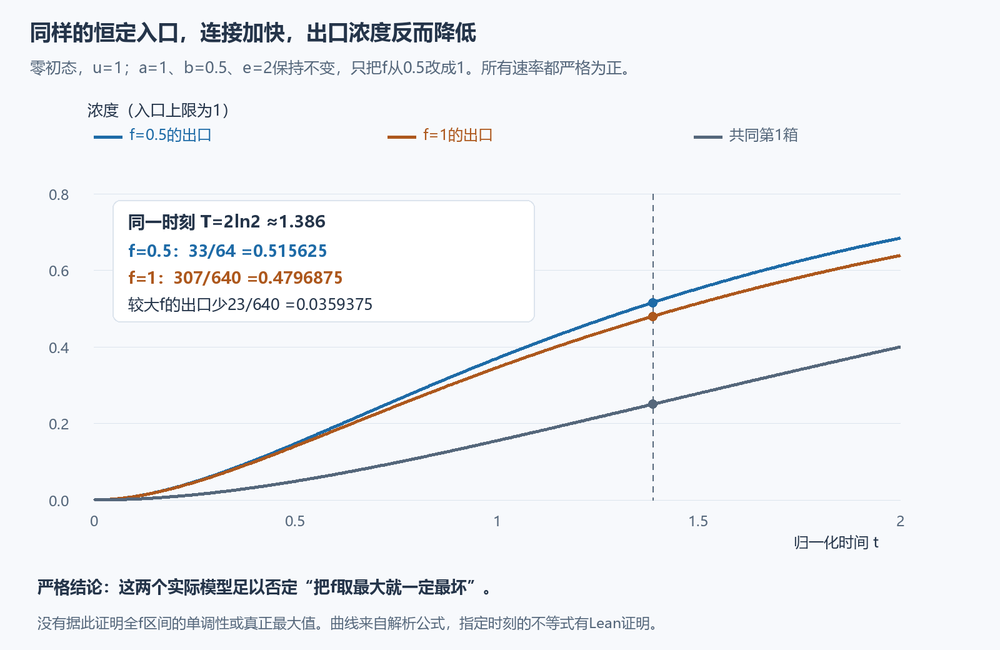
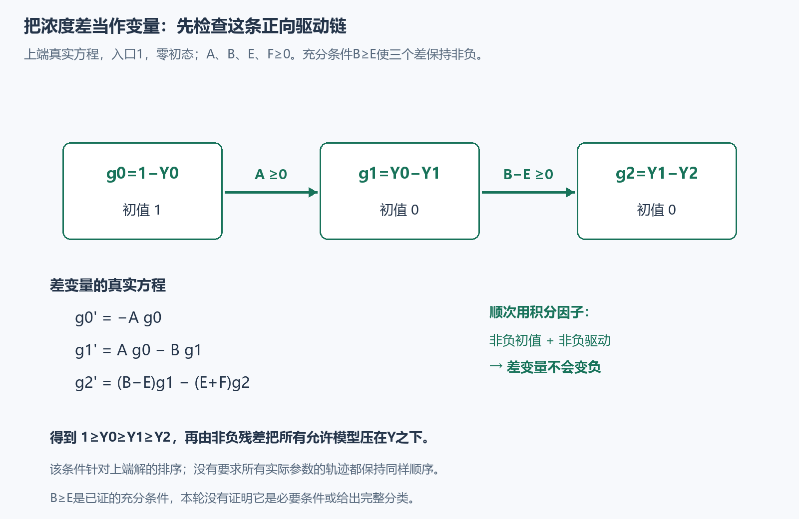

# 上端参数的充分条件及恒定入口反例

对三箱系统

$$
x_0'=a(u-x_0),\qquad x_1'=b(x_0-x_1),\qquad
x_2'=e(x_0-x_2)+f(x_1-x_2),
$$

本节给出参数上端产生可达最大轨迹的一条充分条件，以及全部速率严格为正、入口恒为1时的反例。充分条件针对同时允许输入和参数变化的比较集合；反例固定同一条单位输入，仅改变 $f$。时间与浓度均已归一化。

## 恒定入口下的反例

取零初值、$u=1$，固定 $a=1$、$b=1/2$、$e=2$，比较 $f=1/2$ 与 $f=1$。令 $r=e^{-t/2}$，共同上游响应为

$$
x_0=1-r^2,\qquad x_1=(1-r)^2,
$$

出口分别为

$$
\begin{aligned}
x_{2,f=1/2}&=1-r^2-\frac r2+\frac{r^5}{2},\\
x_{2,f=1}&=1-\frac{r^2}{2}-\frac45r+\frac3{10}r^6.
\end{aligned}
$$

由 $r'=-r/2$ 可验证两组公式满足相应方程和零初值。在 $T=2\ln2$ 时，$r=1/2$，故

$$
x_{2,f=1/2}(T)=\frac{33}{64},\qquad
x_{2,f=1}(T)=\frac{307}{640},\qquad
x_{2,f=1/2}(T)-x_{2,f=1}(T)=\frac{23}{640}>0.
$$

因此，在允许范围 $f\in[1/2,1]$ 内取最大 $f$，不能代表出口最大响应。这两个点尚不确定整个区间的单调性或真正最大点。此时 $x_1(T)=1/4<307/640$；增加 $f$ 会加强出口向较低浓度 $x_1$ 靠近的作用。

## 有序上限定理

设固定非负上限 $A,B,E,F$ 满足 $B\ge E$。允许

$$
0\le a\le A,\quad0\le b\le B,\quad
0\le e\le E,\quad0\le f\le F,
$$

入口满足 $0\le u(t)\le1$，初值为零。解在非负时间连续、正时间可微并满足方程。给定上端参数 $(A,B,E,F)$、单位入口下的一个零初值经典解 $Y$，则任意允许的给定经典解 $x$ 满足

$$
x_i(t)\le Y_i(t)\qquad(t\ge0,\ i=0,1,2).
$$

由于 $Y$ 自身允许，它是比较集合中的可达最大轨迹。定理以给定上端解为对象，不在此另证任意上限下的解存在性。$B\ge E$ 是充分条件，未声明其必要性。

## 浓度差与残差证明

令 $g_0=1-Y_0$、$g_1=Y_0-Y_1$、$g_2=Y_1-Y_2$，由上端方程得到

$$
\begin{aligned}
g_0'&=-Ag_0,&g_0(0)&=1,\\
g_1'&=Ag_0-Bg_1,&g_1(0)&=0,\\
g_2'&=(B-E)g_1-(E+F)g_2,&g_2(0)&=0.
\end{aligned}
$$

对连续驱动 $v\ge0$，积分因子公式给出

$$
h'=-dh+v,\quad h(0)\ge0
\quad\Longrightarrow\quad
h(t)=e^{-dt}\left(h(0)+\int_0^t e^{ds}v(s)\,ds\right)\ge0.
$$

三个差的驱动连续，因为 $Y$ 连续。依次应用该公式，并使用 $A\ge0$、$B-E\ge0$，得到 $1\ge Y_0\ge Y_1\ge Y_2$。任意允许模型在同一状态 $Y$ 上的残差为

$$
\begin{aligned}
R_0&=(A-a)g_0+a(1-u),\\
R_1&=(B-b)g_1,\\
R_2&=(E-e)(g_1+g_2)+(F-f)g_2.
\end{aligned}
$$

三者均非负。令 $Z_i=Y_i+\varepsilon e^t$，则导数残差依次变为 $R_0+(1+a)\varepsilon e^t$、$R_1+\varepsilon e^t$、$R_2+\varepsilon e^t$，均严格为正，且初始时 $x_i(0)=0<Z_i(0)=\varepsilon$。首次接触时，接触坐标的差 $x_i-Z_i$ 导数应非负；非负耦合与严格残差却使该导数为负。由此 $x<Z$，再令 $\varepsilon\downarrow0$ 得 $x\le Y$。

[phase3](../phase3/README.md)的上限 $(1.05,2.1,1.05,3.15)$ 满足条件；其比例推广为 $(C,2C,C,3C)$，包含 $C=0$。反例中 $B=1/2<E=2$，指定时刻的 $Y_1<Y_2$ 使 $f(Y_1-Y_2)$ 为负。增大 $f$ 的作用方向因此与有序上限定理中的情形相反；两个精确出口值直接否定无条件的上端最大规则。

源码：[有序参数盒](lean/GeneralOrderedBox.lean)、[恒定入口反例](lean/ConstantInletCounterexample.lean)。[既有验证记录](validation.json)。经典比较背景可参见[Angeli–Sontag（2003）](https://www.sontaglab.org/FTPDIR/angeli-sontag-monotone-TAC03.pdf)；本页不主张该比较思想的新颖性。
