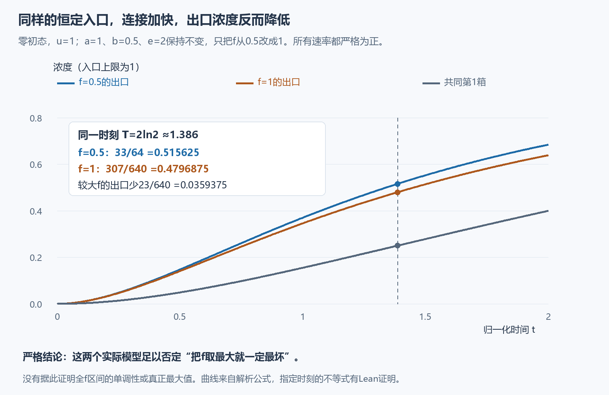
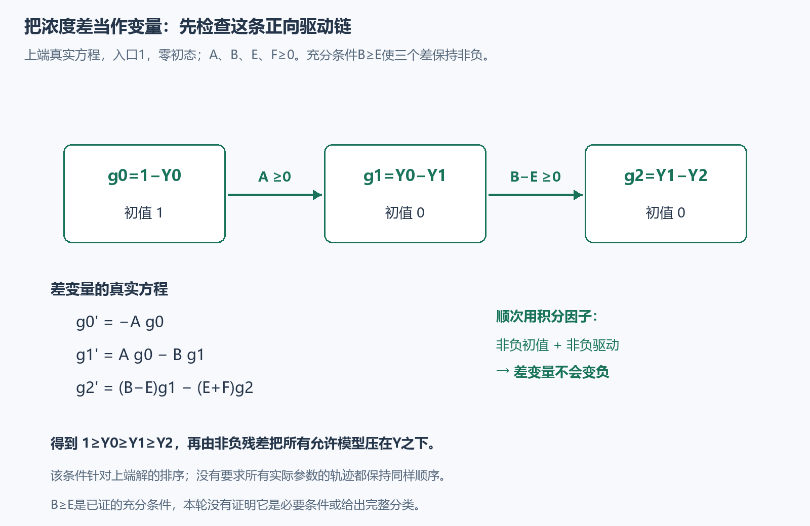

# 什么时候能把参数全部取最大？

上一轮找到了一个真正最坏的三水箱模型：入口恒为1，所有速率取上端。这一轮追问：**怎样提前检查这种做法有没有依据？**

结果有两部分。一条可检查的条件，保证上端模型足以代表整个参数范围；一个全部速率都严格为正、入口也恒为1的反例，说明这个条件背后的浓度顺序确实重要。这里没有给所有三水箱系统作完整分类。

## 一个很小的反例：连接更快，出口反而更低

仍用同样的三个浓度方程：

$$
x_0'=a(u-x_0),\qquad
x_1'=b(x_0-x_1),\qquad
x_2'=e(x_0-x_2)+f(x_1-x_2).
$$

初态全为0，入口始终是 $u=1$。固定 $a=1,\ b=1/2,\ e=2$，只让 $f$ 在 $[1/2,1]$ 内变化。所有系数都是固定的严格正数，时间和浓度均已归一化。

第0箱有一条较快的直接连接通往第2箱；第1箱自身补充得较慢。在我们观察的时刻，第1箱反而比第2箱干净。此时，加强从第1箱来的影响，会把第2箱的浓度向较低值拉。

这不只是一张数值图。令 $r=e^{-t/2}$，两个模型的共同上游轨迹是

$$
x_0=1-r^2,\qquad x_1=(1-r)^2.
$$

两个出口轨迹分别为

$$
\begin{aligned}
x_{2,\ f=1/2}&=1-r^2-\frac r2+\frac{r^5}{2},\\
x_{2,\ f=1}&=1-\frac{r^2}{2}-\frac45r+\frac3{10}r^6.
\end{aligned}
$$

用 $r'=-r/2$ 求导，代回相应方程；两组式子都满足实际方程和零初值。在同一个时刻 $T=2\ln2$，有 $r=1/2$，所以

$$
x_{2,\ f=1/2}(T)=\frac{33}{64},\qquad
x_{2,\ f=1}(T)=\frac{307}{640}.
$$

前者减后者等于 $23/640>0$。因此，选择最大的 $f=1$ 并不能给出整个允许范围的最大浓度。这两个点足以否定“大端总是最坏”的规则；我们没有据此证明整个 $f$ 区间的单调性或真正最大值。

请自己完成这个算例：把 $r=1/2$ 代入两条出口公式，并算出它们的差。共同的 $x_1(T)=1/4$，也确实小于较大 $f$ 的出口 $307/640$。

## 一条能够证明的检查条件

现在给四个速率分别规定固定上限 $A,B,E,F$，都非负：

$$
0\le a\le A,\quad 0\le b\le B,\quad
0\le e\le E,\quad0\le f\le F.
$$

入口允许随时间变化，满足 $0\le u(t)\le1$，初态仍全为0。比较对象是给定的经典解：在非负时间连续，在每个正时刻可微，并满足所写方程。

考虑上端参数 $(A,B,E,F)$、入口1的一个已给定经典解 $Y$。**如果 $B\ge E$，我们能证明这条 $Y$ 压住所有允许模型的解。** 这是一条充分条件：成立时可以使用；没有声称它也是必要条件。

条件的含义很具体：中间第1箱向第0箱浓度靠近的速率上限 $B$，至少不小于第2箱直接向第0箱浓度靠近的速率上限 $E$。它让上端轨迹保持入口到出口的浓度顺序。

为什么？定义三个差

$$
g_0=1-Y_0,\qquad g_1=Y_0-Y_1,\qquad g_2=Y_1-Y_2.
$$

直接用上端模型的方程相减，得到

$$
\begin{aligned}
g_0'&=-A g_0, &g_0(0)&=1,\\
g_1'&=A g_0-Bg_1, &g_1(0)&=0,\\
g_2'&=(B-E)g_1-(E+F)g_2, &g_2(0)&=0.
\end{aligned}
$$

这三行依次说明：$g_0$ 不会负；它用非负系数 $A$ 驱动 $g_1$；当 $B-E\ge0$ 时，$g_1$ 又用非负系数驱动 $g_2$。严格理由来自最简单的积分因子公式：

$$
h'=-dh+v,\quad h(0)\ge0,\quad v(t)\ge0
\quad\Longrightarrow\quad
h(t)=e^{-dt}\left(h(0)+\int_0^t e^{ds}v(s)\,ds\right)\ge0.
$$

这里 $d$ 是固定数，$v$ 是相应的连续驱动项。顺次应用三次，便得到 $g_0,g_1,g_2\ge0$，也就是 $1\ge Y_0\ge Y_1\ge Y_2$。这条顺序是从上端真实方程证明出来的。

## 从浓度差回到整个参数范围

把这同一个状态 $Y(t)$ 代入任意允许模型。上端轨迹的导数减去该模型在同一状态的变化率，三行分别为

$$
\begin{aligned}
R_0&=(A-a)g_0+a(1-u),\\
R_1&=(B-b)g_1,\\
R_2&=(E-e)(g_1+g_2)+(F-f)g_2.
\end{aligned}
$$

参数范围与三个差非负，保证了 $R_i\ge0$。这足以推出实际解 $x_i(t)\le Y_i(t)$。

为看清这最后一步，可把 $Y$ 每个坐标共同抬高 $\varepsilon e^t$，其中 $\varepsilon>0$。三个导数差就变为 $R_0+(1+a)\varepsilon e^t$、$R_1+\varepsilon e^t$、$R_2+\varepsilon e^t$，均严格为正。若实际解首次碰到抬高后的上界，接触坐标的差从负到零，导数应非负；但其余坐标都尚未超过抬高后的上界，方程中的耦合系数非负，导数比较又迫使它严格为负，矛盾。最后让 $\varepsilon$ 趋于0，就得到原上界。

上端参数和入口1本来就在允许范围中。所以，只要这个给定上端解存在，它就是所有这些给定经典解的可达最大轨迹。本轮一般定理没有额外证明任意 $A,B,E,F$ 的解存在性；[上一轮](../phase3/README.md)给出了 $A=E=C,\ B=2C,\ F=3C$ 时包含 $C=0$ 的显式实例。

## 两个结果怎样放在一起？

上一轮的上限 $(1.05,2.1,1.05,3.15)$ 满足 $B\ge E$，所以这条一般条件解释了那次端点证书为什么成立。

本页反例把另外三个速率固定为 $A=1,\ B=1/2,\ E=2$，并比较 $f=1/2$ 与 $f=1$。这里 $B<E$，上端轨迹在观察时刻也确实出现 $Y_1<Y_2$。增大 $f$ 会加强一个负的浓度差，原来的非负残差证明无法使用，而两条实际轨迹给出了严格反例。

因此，可复用的收获是一个明确的检查办法：**先从真实方程推导所需的状态顺序，再决定参数上端能否代表最坏情形。** 这个充分条件与反例都已用 Lean 检查；它们是经典比较思想在这个模型中的可复核整理，目前不作新颖性或新领域认证。

这类比较思想的经典背景可见 [Angeli–Sontag（2003），第三节](https://www.sontaglab.org/FTPDIR/angeli-sontag-monotone-TAC03.pdf)。本页给出了当前三箱系统所用的具体差方程和反例，阅读本页无需依靠那篇论文补全推导。

[本轮验证与读者记录](validation.json)

