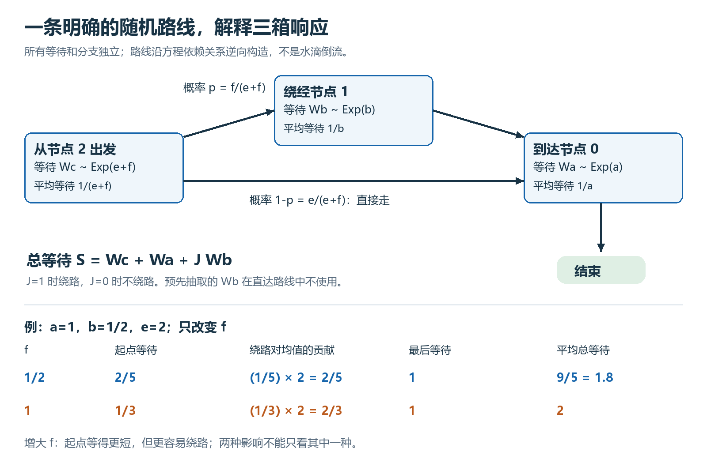
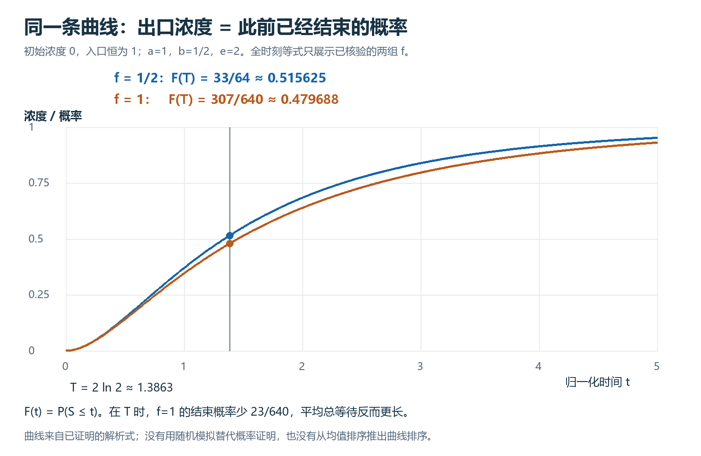

# 三箱响应的独立等待时间表示

本节构造三节点网络的实际概率分布，证明总等待可积及均值公式，并在两组参数上确定全实轴分布函数：非负时间等于出口浓度，负时间为零。网络模型独立于原二维自动机，所得均值不是自动机恢复时间公式。

## 概率模型与均值

固定 $a,b>0$、$e,f\ge0$、$c=e+f>0$。取相互独立的

$$
W_a\sim\mathrm{Exp}(a),\quad W_b\sim\mathrm{Exp}(b),\quad
W_c\sim\mathrm{Exp}(c),\quad J\in\{0,1\},\quad
\mathbb P(J=1)=p=\frac f c.
$$

$\mathrm{Exp}(r)$ 按速率参数化：$\mathbb P(W>t)=e^{-rt}$（$t\ge0$），$\mathbb E[W]=1/r$。时间均已归一化。定义

$$
S=W_a+W_c+J W_b.
$$

沿节点2出发的表示先等待 $W_c$；$J=1$ 时经节点1多等待 $W_b$，两条分支均以 $W_a$ 结束。该路线沿方程的依赖关系逆向构造，不是水滴的逆流轨迹。$J=0$ 时 $W_b$ 虽已抽取，但不进入总等待。

四个坐标的联合分布取为各自边缘分布的乘积。在该概率空间中，$S$ 可积，且

$$
\mathbb E[S]=\frac1a+\frac1{e+f}+\frac f{(e+f)b}
=\frac1a+\frac{b+f}{b(e+f)}.
$$

其中 $\mathbb E[JW_b]=\mathbb E[J]\mathbb E[W_b]=p/b$。取 $a=1,b=1/2,e=2$，有

$$
\begin{aligned}
f=1/2:&\quad\mathbb E[S]=\frac25+\frac15\cdot2+1=\frac95=1.8,\\
f=1:&\quad\mathbb E[S]=\frac13+\frac13\cdot2+1=2.
\end{aligned}
$$

增大 $f$ 缩短 $W_c$ 的平均等待，但同时提高进入额外等待的分支概率；本例总均值因此增大。

## 分布函数的积分表示

单位入口、零初值的三箱方程为

$$
x_0'=a(1-x_0),\qquad x_1'=b(x_0-x_1),\qquad
x_2'=e(x_0-x_2)+f(x_1-x_2).
$$

记 $F_0(t)=\mathbb P(W_a\le t)$、$F_1(t)=\mathbb P(W_b+W_a\le t)$、$F(t)=\mathbb P(S\le t)$。独立性及按第一段等待积分给出，对 $t\ge0$，

$$
\begin{aligned}
F_0(t)&=1-e^{-at},\\
F_1(t)&=\int_0^t b e^{-b(t-s)}F_0(s)\,ds,\\
F(t)&=\int_0^t e^{-c(t-s)}[eF_0(s)+fF_1(s)]\,ds.
\end{aligned}
$$

积分变量 $t-s$ 为首段已用时间，$s$ 为留给后续等待的时间。末式的系数为分支概率乘以起点等待密度中的速率：$(e/c)c=e$、$(f/c)c=f$。

另一方面，$y'=h-ky$、$y(0)=0$ 的经典解满足

$$
y(t)=\int_0^t e^{-k(t-s)}h(s)\,ds.
$$

因为 $(e^{kt}y(t))'=e^{kt}h(t)$，从0积至 $t$ 再乘以 $e^{-kt}$ 即得该式。依次用于中箱和出口，便将 $F_0,F_1,F$ 与 $x_0,x_1,x_2$ 对应起来。本阶段形式化的浓度—概率等式落实于 $a=1,b=1/2,e=2$、$f=1/2$ 或1的两组实例；一般参数的联合分布、可积性及均值公式则统一成立。[phase6](../phase6/README.md)另给出一般参数的等式。

## 两组实例的精确分布函数

令 $r=e^{-t/2}$。对 $t\ge0$，两组完成时间分布函数为

$$
\begin{aligned}
F_{f=1/2}(t)&=1-r^2-\frac r2+\frac{r^5}{2},\\
F_{f=1}(t)&=1-\frac{r^2}{2}-\frac45r+\frac3{10}r^6.
\end{aligned}
$$

负时间的完成概率为零，不将上述解析式延拓为负时间概率。在 $T=2\ln2$ 时，$r=1/2$，故

$$
\mathbb P(S_{f=1/2}\le T)=\frac{33}{64},\qquad
\mathbb P(S_{f=1}\le T)=\frac{307}{640}.
$$

前者减后者为 $23/640$，约3.59个百分点。这一截止概率比较与前述均值比较分别有证明；均值排序本身不能推出截止概率排序。

图中“全时刻等式”限于本节讨论的所有非负时刻 $t\ge0$；负时间的实际分布函数仍取零。

该构造属于有限状态吸收时间的经典相位型分布背景，原参考为[DTU文献，§2.2](https://www2.imm.dtu.dk/pubdb/edoc/imm6166.pdf)。对现实流程的应用仍以固定指数等待、独立分支等模型假设为前提。

源码：[实际联合分布与均值](lean/BranchedLaw.lean)、[分支混合](lean/BranchedCdfMixture.lean)、[两组浓度—概率等式](lean/ActualTankCdf.lean)。[既有验证记录](validation.json)。
