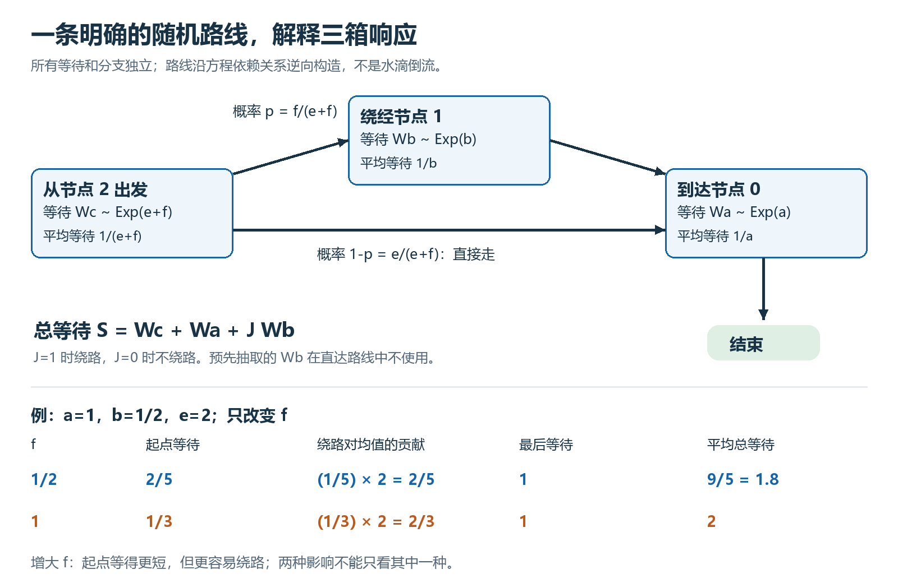
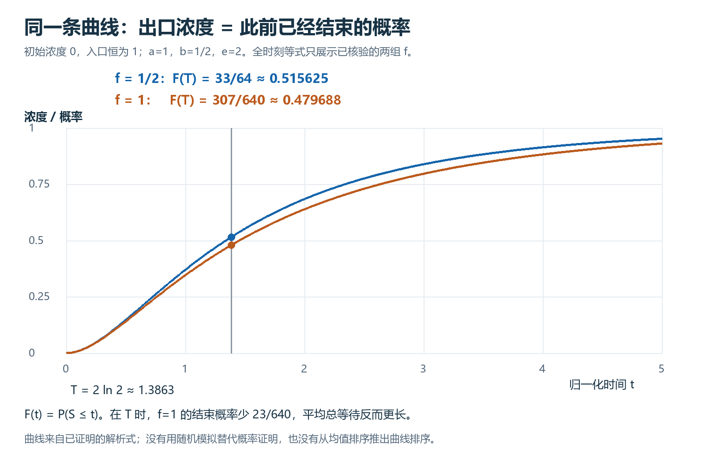

# 为什么连接更快，整体反而更慢？

上一轮发现：三个相连水箱中，增强一条连接，指定时刻的出口浓度反而更低。这一轮给它找到了一个直观解释：**同一条浓度曲线，也是一条随机路线“已经走完的概率”。** 增强连接虽然缩短一次等待，却可能让路线更容易绕远。

这是一个独立的小网络研究，不改变已完成的二维自动机主定理。下面的时间、浓度均已归一化。

## 先看路线，再算平均要等多久

图中的节点号对应下面的三个水箱。路线沿方程的依赖关系逆向构造：它帮助我们计算浓度，并不声称水滴会沿管道倒流。

先独立抽取四个随机量。前三个是等待时间：

$$
W_a\sim\mathrm{Exp}(a),\quad W_b\sim\mathrm{Exp}(b),\quad W_c\sim\mathrm{Exp}(e+f).
$$

这里 $\mathrm{Exp}(k)$ 表示速率为 $k$ 的指数分布：等待超过 $t\ge0$ 的概率是 $\exp(-kt)$，平均等待为 $1/k$。假设 $a,b>0$，$e,f\ge0$，且 $c=e+f>0$。所有速率都固定。

第四个量 $J$ 决定是否绕路：$J=1$ 的概率为 $p=f/(e+f)$，$J=0$ 的概率为 $1-p$。它与三个等待时间独立。

从节点2出发，先等 $W_c$。若 $J=1$，绕到节点1，多等 $W_b$；随后两条路线都到节点0，等完 $W_a$ 就结束。因此，总等待时间是

$$
S=W_c+W_a+J W_b.
$$

直达时，预先抽取的 $W_b$ 不使用。由独立性，$\mathbb E[JW_b]=p\mathbb E[W_b]$，所以

$$
\boxed{\mathbb E[S]=\frac1a+\frac1{e+f}+\frac{f}{(e+f)b}
=\frac1a+\frac{b+f}{b(e+f)}.}
$$

这里确实构造了四个独立量的联合分布，并证明 $S$ 可积；这不是只凭图形猜出的均值。

取 $a=1,b=1/2,e=2$。当 $f=1/2$ 时，起点平均等 $2/5$，绕路概率为 $1/5$，绕路后还需平均等2；最后等1。于是

$$
\mathbb E[S]=\frac25+\frac15\cdot2+1=\frac95=1.8.
$$

把 $f$ 增至1，起点平均等待缩短到 $1/3$，但绕路概率增至 $1/3$：

$$
\mathbb E[S]=\frac13+\frac13\cdot2+1=2.
$$

**起点等得更短，总等待反而更长。** 这说明只看某条连接的局部速度，会漏掉路线选择的变化。

## 为什么这真的在解释水箱？

水箱浓度 $x_0,x_1,x_2$ 满足

$$
x_0'=a(1-x_0),\qquad x_1'=b(x_0-x_1),\qquad
x_2'=e(x_0-x_2)+f(x_1-x_2),
$$

三个初始浓度都是0，外部入口始终保持浓度1。每项 $k(y-x)$ 表示本箱浓度以速率 $k$ 向另一浓度 $y$ 靠近。

定义 $F(t)=\mathbb P(S\le t)$，即在时刻 $t$ 之前已经走完的概率。我们需要证明 $F(t)=x_2(t)$，不能仅因两个模型画出来像，就把它们当成同一回事。

为此，把整条路线从末端往前分解。设

$$
F_0(t)=\mathbb P(W_a\le t),\qquad
F_1(t)=\mathbb P(W_b+W_a\le t).
$$

对 $t\ge0$，有 $F_0(t)=1-\exp(-at)=x_0(t)$。固定第一段等待时长并平均，再把该时长写成 $t-s$，得到

$$
F_1(t)=\int_0^t b \exp(-b(t-s))F_0(s)\,ds.
$$

这里 $t-s$ 是已经花在第一段上的时间，$s$ 是留给后续路线的时间；这是积分换元，不是把两段等待强行设为某个数。第一段的密度是 $b \exp(-b(t-s))$；独立性使后续完成概率就是 $F_0(s)$。第一段若已超过 $t$，就不可能结束，所以积分只到 $t$。

再按 $J$ 的两种取值分开算，同理得到

$$
F(t)=\int_0^t \exp(-c(t-s))\bigl[eF_0(s)+fF_1(s)\bigr]\,ds.
$$

系数 $e,f$ 来自两条路线的概率乘以起点等待密度：$(e/c)\,c=e$，$(f/c)\,c=f$。

另一方面，任何满足 $y'=h-ky$、$y(0)=0$ 的可微函数，都满足

$$
y(t)=\int_0^t \exp(-k(t-s))h(s)\,ds.
$$

只需把方程乘以 $\exp(kt)$，左边就变成 $(\exp(kt)y(t))'$；从0积到 $t$，再除以 $\exp(kt)$ 即得此式。先把它用于中箱，再用于出口，便分别得到上述 $F_1$ 和 $F$ 的积分。因此，沿着 $F_0=x_0$、$F_1=x_1$、$F=x_2$ 依次连接，不需要把目标等式作为假设。

上述推导说明一般结构。本轮机器核验的全时刻浓度—概率等式，具体落实在 $a=1,b=1/2,e=2$、$f=1/2$ 或1这两组；一般参数下的独立联合分布、可积性和均值公式则已统一证明。没有把两组实例写成任意参数的完整形式化等价定理。

## 同一时刻，两种含义读出同一个数

这两组实例的曲线可以直接写出。令 $r=\exp(-t/2)$，对于 $t\ge0$，

$$
\begin{aligned}
F_{f=1/2}(t)&=1-r^2-\frac r2+\frac{r^5}{2},\\
F_{f=1}(t)&=1-\frac{r^2}{2}-\frac45r+\frac3{10}r^6.
\end{aligned}
$$

这里下标只标记两种固定的 $f$。在同一个时刻 $T=2\ln2$，$r=1/2$，所以

$$
\mathbb P(S_{f=1/2}\le T)=\frac{33}{64},\qquad
\mathbb P(S_{f=1}\le T)=\frac{307}{640}.
$$

前者比后者多 $23/640$，约3.59个百分点。这是实际随机路线的事件概率，同时也是已证水箱方程的出口浓度。均值比较本身不能推出这一概率比较；两项结论各自有证明。对负时间，完成概率为0，不把上述解析式延伸过去作为概率。

请自己完成两个检查：分别算出图1两行的平均总等待；再把 $r=1/2$ 代入两条曲线，算出概率之差。只需要分数运算。

## 这条连接能用来做什么？

它让同一个模型可以换一种更合适的语言处理：浓度方程便于做比较和上界，随机路线则把“为什么变慢”拆成等待和绕路两部分。若一个分阶段任务确实符合固定指数等待、独立分支这些假设，就可以用类似构造计算平均完成时间或截止前完成概率；真实系统是否符合假设，需要另外验证。

这种有限状态吸收时间的背景是经典的“相位型分布”，不是本项目开创的新领域。可参看 [DTU 的公开讲义式学位论文，§2.2，纸面第11–13页](https://www2.imm.dtu.dk/pubdb/edoc/imm6166.pdf)。本文的价值在于把这条具体连接落实到明确的随机量、实际概率和逐步可检查的证明，而不是只停在“方程长得一样”。

本轮证据见 [验证记录](validation.json)。独立AI源码核对和模拟本科读者复读，分别用于查推理边界和查讲解缺口；两者都不等于人类专家评审或创新性认证。原自动机恢复时间没有因此得到新的均值公式。
