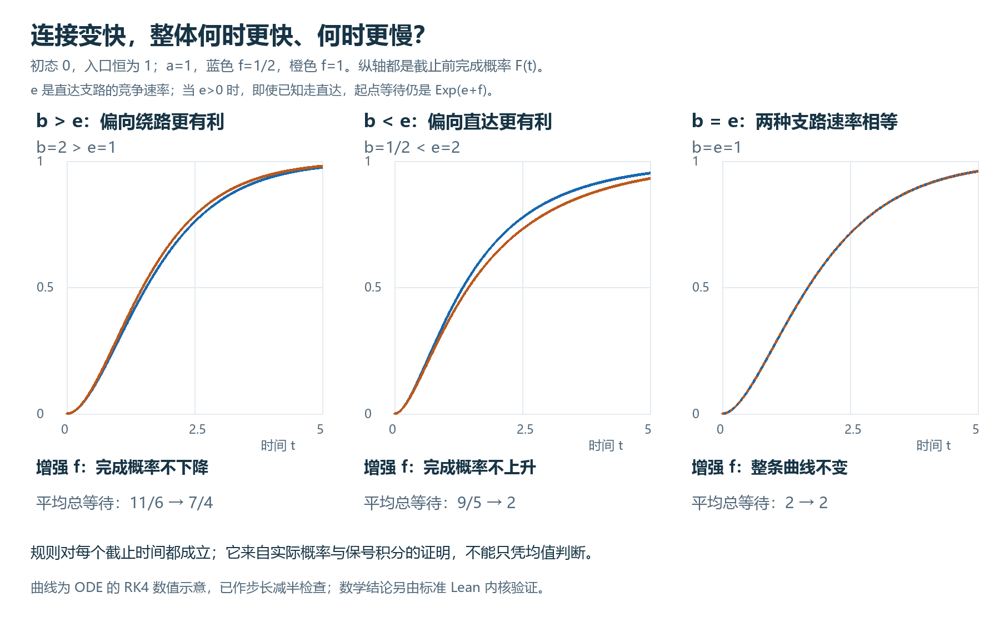

# 绕路速率的分布排序与退化情形

固定 $a,b>0$、$e\ge0$，比较允许的 $f_L\le f_H$，其中 $f_L\ge0$ 且 $e+f_L>0$。对每个固定 $f$，取相互独立的

$$
W_a\sim\mathrm{Exp}(a),\quad W_b\sim\mathrm{Exp}(b),\quad
W_c\sim\mathrm{Exp}(e+f),\quad J\in\{0,1\},\quad
\mathbb P(J=1)=\frac f{e+f},
$$

并令 $S_f=W_a+W_c+J W_b$、$F_f(t)=\mathbb P(S_f\le t)$。下标 $f$ 表示各参数模型中的总等待分布；不假定两个不同模型共享同一组实际等待样本。$\mathrm{Exp}(r)$ 的速率为 $r$、均值为 $1/r$。时间已归一化，所有速率固定。

## 分布排序定理

对每个 $t\ge0$，有以下非严格排序：

| 条件 | 增大 $f$ 后的 $F_f(t)$ | 增大 $f$ 后的 $\mathbb E[S_f]$ |
|---|---|---|
| $b\ge e$ | 不减 | 不增 |
| $b\le e$ | 不增 | 不减 |
| $b=e$ | 相等 | 相等 |

$f$ 同时影响 $W_c$ 的速率和分支概率。即使已知 $J=0$，起点等待仍服从 $\mathrm{Exp}(e+f)$，而不是 $\mathrm{Exp}(e)$。两条分支共享最后的 $W_a$。比较始终固定 $a,b,e$，不能用于同时改变其他速率的改造而不重验条件。

## 一般参数的概率—方程连接

对 $t\ge0$，独立等待与分支混合给出

$$
\begin{aligned}
C_0(t)&=\mathbb P(W_a\le t)=1-e^{-at},\\
C_1(t)&=\mathbb P(W_b+W_a\le t)
=\int_0^t b e^{-b(t-s)}C_0(s)\,ds,\\
F_f(t)&=\int_0^t e^{-(e+f)(t-s)}[eC_0(s)+fC_1(s)]\,ds.
\end{aligned}
$$

积分中 $t-s$ 为第一段已用时间，$s$ 为留给后续等待的时间。末式中 $e,f$ 由分支概率与起点密度中的 $e+f$ 相乘得到。

定义解析响应 $x_0,x_1,x_2$ 为上述指数积分函数。连续被积函数及积分因子公式证明它们满足零初值方程

$$
x_0'=a(1-x_0),\qquad x_1'=b(x_0-x_1),\qquad
x_2'=e(x_0-x_2)+f(x_1-x_2).
$$

实际分布函数满足

$$
F_f(t)=\begin{cases}x_2(t),&t\ge0,\\0,&t<0.\end{cases}
$$

解析响应可在全实轴上定义并满足方程；负时间的解析延拓不等于实际分布函数。实际分布函数所用的微分方程仅在正时间断言。

## 排序证明

对零初值的标量方程 $y'=H-ky$，

$$
y(t)=\int_0^t e^{-k(t-s)}H(s)\,ds\qquad(t\ge0).
$$

指数权为正，故 $H$ 的非负或非正符号传给 $y$。以下差方程针对非负时间上的解析响应，随后由概率—响应等式转成分布结论。令 $h=x_0-x_1$，由方程相减得

$$
h'=ae^{-at}-bh,\qquad h(0)=0,
$$

所以 $h\ge0$。再令 $g_f=x_1-x_2$，则

$$
g_f'=(b-e)h-(e+f)g_f,\qquad g_f(0)=0.
$$

因此 $b\ge e$ 时 $g_f\ge0$，$b\le e$ 时 $g_f\le0$。最后令 $\Delta=x_{2,H}-x_{2,L}$。两组响应共享 $x_0,x_1$，故

$$
\Delta'=-(e+f_H)\Delta+(f_H-f_L)g_{f_L},\qquad\Delta(0)=0.
$$

$f_H-f_L\ge0$，再次应用正权积分即得所列分布排序。这里只证明非严格比较，不以图中曲线分离代替严格不等式。

## 均值排序

由实际独立等待的均值公式，

$$
M(f)=\mathbb E[S_f]=\frac1a+\frac{b+f}{b(e+f)},
$$

且

$$
M(f_H)-M(f_L)=\frac{(e-b)(f_H-f_L)}{b(e+f_H)(e+f_L)},\qquad
M'(f)=\frac{e-b}{b(e+f)^2}.
$$

分母为正，均值方向因而与表中一致；导数式用于允许区间内部。取 $a=1,f_L=1/2,f_H=1$，在 $(b,e)=(2,1)$ 时均值从 $11/6$ 降至 $7/4$；在 $(b,e)=(1/2,2)$ 时从 $9/5$ 升至2。均值计算独立于截止概率证明。

## 分支不同而输出同分布

取 $a=b=e=1$，则 $b=e$，所有允许 $f$ 的总等待分布相同。特别地，$f=1/2$ 与 $f=1$ 的分支概率分别为 $1/3$ 与 $1/2$，而均值分别为

$$
\frac23+\frac13\cdot1+1=2,\qquad
\frac12+\frac12\cdot1+1=2.
$$

结论是整个输出分布相同，强于均值相同。同一事件 $\{J=1\}$ 在两模型下概率不同，所以底层四随机量的联合分布不同；总和映射可将不同的联合分布送到同一输出分布。完成时间作为观测不能辨识这些 $f$；若可观测实际 $J$，则其边缘概率含有区分信息。

源码：[一般浓度—概率等式](lean/GeneralTankCdf.lean)、[完成时间排序](lean/CompletionTimeOrder.lean)、[均值排序](lean/MeanRateOrder.lean)、[隐分支见证](lean/HiddenBranchWitness.lean)。[既有验证记录](validation.json)。图中ODE数值曲线用于展示，精确排序由上述实际概率证明支持。经典背景参考为[相位型分布文献，§2.2](https://www2.imm.dtu.dk/pubdb/edoc/imm6166.pdf)。
