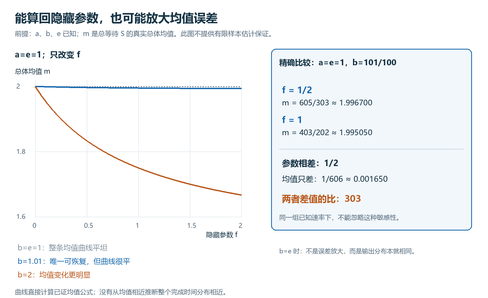

# 分支参数的可辨识性及均值反演敏感性

固定已知的 $a,b>0$、$e\ge0$，仅以 $f\ge0$、$e+f>0$ 为未知参数。各参数均固定。令四个随机量相互独立，

$$
S_f=W_a+W_c+J W_b,\quad
W_a\sim\mathrm{Exp}(a),\quad W_b\sim\mathrm{Exp}(b),\quad
W_c\sim\mathrm{Exp}(e+f),\quad
\mathbb P(J=1)=\frac f{e+f},\quad J\in\{0,1\}.
$$

$\mathrm{Exp}(r)$ 按速率参数化，均值为 $1/r$。这里 $J\in\{0,1\}$，$J=1$ 才使用额外等待 $W_b$。记 $m=\mathbb E[S_f]$ 为真实总体均值；它不是单次完成时间或有限样本均值。时间均已归一化。

## 均值反演命题

若 $b\ne e$，则 $m$ 唯一确定 $f$。由独立性，

$$
m=\frac1a+\frac{b+f}{b(e+f)}.
$$

令 $d=b(m-1/a)$，则

$$
d=\frac{b+f}{e+f},\qquad
d-1=\frac{b-e}{e+f}\ne0,
$$

故 $d(e+f)=b+f$ 等价于

$$
f=\frac{b-de}{d-1}.
$$

例如 $a=1,b=1/2,e=2$。当 $m=9/5$ 时，$d=2/5$，代入 $(1/2-2\cdot2/5)/(2/5-1)$ 得 $f=1/2$；当 $m=2$ 时，$d=1/2$，代入 $(1/2-2\cdot1/2)/(1/2-1)$ 得 $f=1$。

## 输出分布的完整判别

对固定的已知 $a,b,e$，任意两个允许参数有

$$
S_{f_L}\overset{d}=S_{f_H}
\quad\Longleftrightarrow\quad f_L=f_H\ \text{或}\ b=e.
$$

其中 $\overset{d}=$ 表示同分布。若 $b\ne e$ 而两者同分布，可积性使均值相同，再由反演式得 $f_L=f_H$。若 $f_L=f_H$，同分布直接成立。

对剩余的 $b=e$ 情形，令 $C_0(t)=\mathbb P(W_a\le t)$、$C_1(t)=\mathbb P(W_b+W_a\le t)$、$F_f(t)=\mathbb P(S_f\le t)$。在 $t\ge0$，

$$
\begin{aligned}
C_0(t)&=1-e^{-at},\\
C_1(t)&=\int_0^t b e^{-b(t-s)}C_0(s)\,ds,\\
F_f(t)&=\int_0^t e^{-(e+f)(t-s)}[eC_0(s)+fC_1(s)]\,ds.
\end{aligned}
$$

连续性和微积分基本定理给出正时间导数 $C_1'=b(C_0-C_1)$、$F_f'=eC_0+fC_1-(e+f)F_f$。若 $b=e$，相减得

$$
(F_f-C_1)'=-(b+f)(F_f-C_1),\qquad(F_f-C_1)(0)=0.
$$

乘以 $e^{(b+f)t}$ 后导数为零，故 $F_f=C_1$，与 $f$ 无关；负时间两者分布函数均为零。因而得到同分布，而非仅凭均值相同作出判断。

## 接近退化参数时的敏感性

固定 $a=e=1,b=101/100$，比较 $f_L=1/2,f_H=1$，总体均值分别为

$$
m_L=\frac{605}{303},\qquad m_H=\frac{403}{202},\qquad
m_L-m_H=\frac1{606}\approx0.001650.
$$

两组参数相差 $1/2$；这里的敏感性数值是两点之间的绝对差值比 $(1/2)/(1/606)=303$。该比值以当前归一化单位计，不是相对误差百分比的倍数。

一般地，固定 $a=e=1$，令已知的 $b=1+\varepsilon$、$\varepsilon>0$，保持两个 $f$ 不变，则

$$
0<m_L-m_H=\frac{\varepsilon}{6(1+\varepsilon)}<\varepsilon.
$$

因此，沿 $b\downarrow e$ 的模型族，相差 $1/2$ 的参数可产生任意小的均值差。每一对比较仍固定同一个 $b$；不是固定 $b=1.01$ 后还能任意缩小该差。

反演式只对模型总体均值及 $b\ne e$ 的情形作精确恢复承诺；任意带误差实数代入后未必仍对应允许的 $f$。这是总体均值下的唯一反演和两点敏感性结果，不包含有限样本置信区间或样本量保证，也不由均值接近推出整个分布接近。结论仅将 $f$ 作为未知量，未处理四个速率同时未知的恢复。

源码：[参数反演](lean/ParameterRecovery.lean)、[分布可辨识性](lean/LawIdentifiability.lean)、[敏感性算例](lean/MeanRecoverySensitivity.lean)。[既有验证记录](validation.json)。
