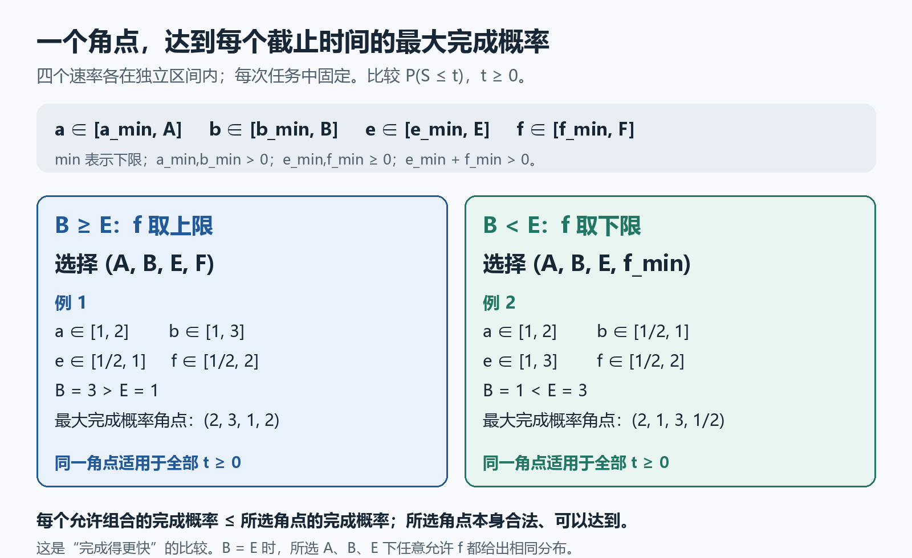
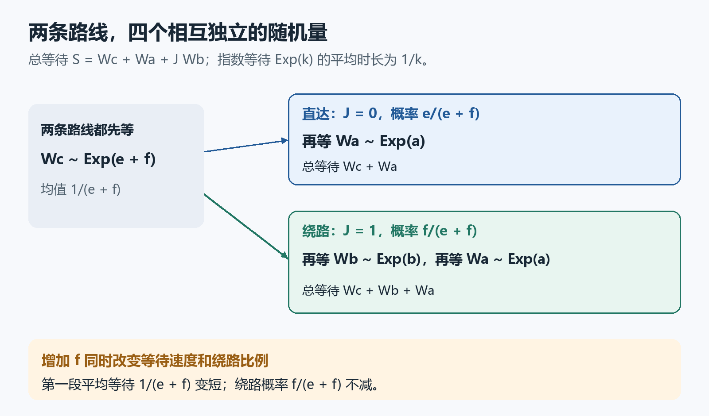

# 不必遍历所有参数：一个角点同时给出每个截止时间的最大完成概率

一个任务可以直达终点，也可能先绕一步。四个等待速率都只能确定一个范围。若要问“在时间 $t$ 之前完成的概率最多有多大”，看起来需要把整个参数范围搜索一遍，而且换一个截止时间，可能又得重算。

对下面这个小网络，已经证明：**只选一个固定的参数组合，就能同时达到所有截止时间的最大完成概率。** 三个速率取上限；第四个速率有时取上限，有时反而取下限。

图中的 min 表示下限，与下文的下标 $-$ 含义相同。“最大”始终指按时完成的概率最大，也就是任务更快完成。它不表示等待时间最长。

## 任务怎样完成？

先等一段随机时间 $W_c$，再作一次分支选择：直接进入最后一段，或先绕一步。总等待为

$$
S=W_c+W_a+J W_b.
$$

四个随机量相互独立，分布为

$$
W_c\sim\mathrm{Exp}(e+f),\qquad W_a\sim\mathrm{Exp}(a),\qquad W_b\sim\mathrm{Exp}(b),\qquad
\mathbb P(J=1)=\frac f{e+f}.
$$

$J$ 只取0和1两个值。$J=1$ 才需要额外等待 $W_b$；否则不需要。这里 $\mathrm{Exp}(k)$ 表示速率为 $k$ 的指数等待：平均时长 $1/k$，在时间 $t\ge0$ 内结束的概率为 $1-\exp(-kt)$。$a,b>0$，$e,f\ge0$，$e+f>0$。所有时间已归一化，速率在一次任务中保持不变。

特别要留意 $f$ 的双重作用：增加 $f$，会缩短第一段的平均等待 $1/(e+f)$，也可能提高绕路概率 $f/(e+f)$。因此，不能仅凭“速率变大”就断言完成更快。

把按时完成的概率记为

$$
F_{a,b,e,f}(t)=\mathbb P(S\le t).
$$

我们改变参数，比较的是各自模型的这个概率，不是把同一次试验里的等待时长直接相减。

## 四个参数分别落在一个区间里

用大写字母表示上限，下标 $-$ 表示下限：

$$
a\in[a_-,A],\quad b\in[b_-,B],\quad
 e\in[e_-,E],\quad f\in[f_-,F].
$$

四个区间都非空，且 $a_-,b_->0$、$e_-,f_-\ge0$、$e_-+f_->0$。四个区间可以独立组合；例如把 $a$ 取到上限，不会强迫另一个参数改变。这样的允许集合通常叫参数盒。

选择

$$
f_*=
\begin{cases}
F,&E\le B,\\
f_-,&E>B.
\end{cases}
$$

本轮证明的结论是：对盒内任何允许的 $(a,b,e,f)$，每个 $t\ge0$ 都有

$$
\boxed{F_{a,b,e,f}(t)\le F_{A,B,E,f_*}(t).}
$$

右边的组合本身也在允许范围内，所以这是能达到的最大值，不是一个无法实现的保守估计。选择不依赖 $t$：同一个角点同时适用于全部截止时间。当 $E=B$ 时，在 $a=A,b=B,e=E$ 下改变 $f$ 不会改变完成时间分布，选 $F$ 只是一个方便的约定，并不声称最大点唯一。

## 为什么这个选择有效？

证明用的是等待时间的真实概率分布。为了比较它们，先写成三个容易求导的函数。对 $t\ge0$，令

$$
C_0(t)=\mathbb P(W_a\le t),\qquad
C_1(t)=\mathbb P(W_b+W_a\le t),\qquad C_2(t)=F_{a,b,e,f}(t).
$$

对最后加入的等待时长积分，就得到

$$
\begin{aligned}
C_0(t)&=1-\exp(-at),\\
C_1(t)&=\int_0^t b\exp[-b(t-s)]C_0(s)\,ds,\\
C_2(t)&=\int_0^t\exp[-(e+f)(t-s)]\,[eC_0(s)+fC_1(s)]\,ds.
\end{aligned}
$$

例如第二式中，$t-s$ 是 $W_b$ 用掉的时间，$s$ 是留给 $W_a$ 的时间。第三式是把直达与绕路两种情况按概率加起来；$e$、$f$ 来自第一段的密度乘以各自的分支概率。

乘上对应的指数因子，再用微积分基本定理求导，得到

$$
C_0'=a(1-C_0),\qquad
C_1'=b(C_0-C_1),\qquad
C_2'=e(C_0-C_2)+f(C_1-C_2),
$$

三个初值都是0。这里先从实际概率得到方程，没有仅凭“方程长得一样”就把未知函数当成概率。

比较时反复使用一个小事实。如果 $D(0)=0$、$D'=G-kD$，那么乘以 $\exp(kt)$ 并积分，便有

$$
D(t)=\int_0^t\exp[-k(t-s)]G(s)\,ds.
$$

指数因子总为正。因此只要 $G(s)\ge0$，就有 $D(t)\ge0$；若 $G(s)\le0$，则同样得到 $D(t)\le0$。下文每次比较，都是把两个解相减，再检查这里的 $G$。

**先增加 $a,b,e$。** 增加 $a$ 会提高 $C_0=1-\exp(-at)$；这个变化通过两条非负加权积分继续提高 $C_1,C_2$。增加 $b$ 时，用下标 $H,L$ 分别表示较高、较低的速率及对应函数。两个 $C_1$ 的差 $D=C_{1,H}-C_{1,L}$ 满足 $D'=G-b_H D$，其中 $G=(b_H-b_L)(C_0-C_{1,L})$。由于 $W_a\le W_a+W_b$，有 $C_0\ge C_{1,L}$，所以差值非负，再传到 $C_2$。增加 $e$ 时，对应的是 $G=(e_H-e_L)(C_0-C_{2,L})\ge0$，因为 $S\ge W_a$。

因此，不管原来的 $f$ 是多少，都能依次把 $a,b,e$ 增加到 $A,B,E$，而不降低完成概率。

**再决定 $f$。** 此时 $b=B,e=E$ 已经固定。令 $H=C_1-C_2$，相减得到

$$
H'=(B-E)(C_0-C_1)-(E+f)H,\qquad H(0)=0.
$$

由于 $C_0-C_1\ge0$，上面的积分公式说明：$B\ge E$ 时 $H\ge0$，$B\le E$ 时 $H\le0$。

现在只比较 $f_H\ge f_L$，记 $D=C_{2,H}-C_{2,L}$。它满足

$$
D'=(f_H-f_L)(C_1-C_{2,L})-(E+f_H)D,\qquad D(0)=0.
$$

所以 $B>E$ 时，增加 $f$ 不会降低完成概率；$B<E$ 时，增加 $f$ 不会提高完成概率。于是前一种情况选上限 $F$，后一种选下限 $f_-$。若 $B=E$，则 $H$ 与 $D$ 都为0，改变 $f$ 不影响分布，约定选 $F$。

这个次序不能随意颠倒：我们先把前三个速率增加到上限，之后才在固定的 $B,E$ 下选择 $f$。即使原参数盒里有的点满足 $b>e$、有的点满足 $b<e$，比较链仍成立。

## 两个只需分数运算的检查

| 允许范围 | 比较两个上限 | 选出的最大完成概率角点 |
|---|---|---|
| $a\in[1,2],\ b\in[1,3],\ e\in[1/2,1],\ f\in[1/2,2]$ | $B=3>E=1$ | $(2,3,1,2)$ |
| $a\in[1,2],\ b\in[1/2,1],\ e\in[1,3],\ f\in[1/2,2]$ | $B=1<E=3$ | $(2,1,3,1/2)$ |

请先不看答案，按选择规则重做两行。作为额外的数值检查，由独立等待相加，

$$
\mathbb E[S]=\frac1a+\frac1{e+f}+\frac{f}{(e+f)b}.
$$

代入第一行角点，得到 $1/2+1/3+2/9=19/18$；第二行得到 $1/2+2/7+1/7=13/14$。这两次均值计算只是算例检查；“每个截止时间概率都最大”的证明来自上面的逐时比较，不能只用均值大小代替。

这个结果把本模型在连续参数范围内的完成概率最大值，化成了一个可直接选出的角点。适用范围是上述固定速率的等待模型，以及可独立组合的区间约束。若速率随时间改变，或实际流量与容积造成参数之间的联动，需要重新证明；这里也没有给出原二维自动机恢复时间的新公式。

数学源、实际标准内核验证与独立AI审查见[验证记录](validation.json)。正文配图还单独经过本科背景读者模拟；它检验解释是否讲清楚，不是人类专家评审或创新性认证。
