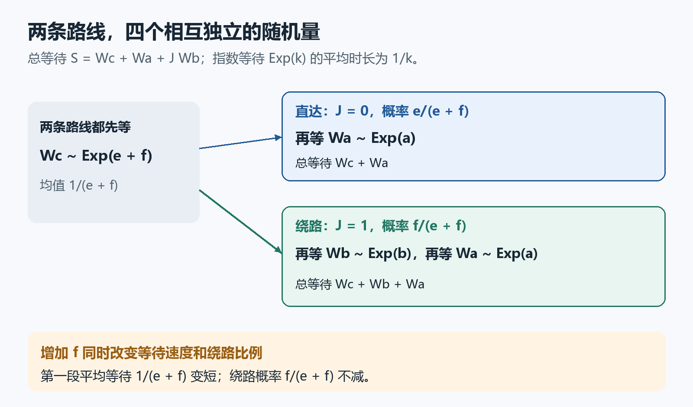
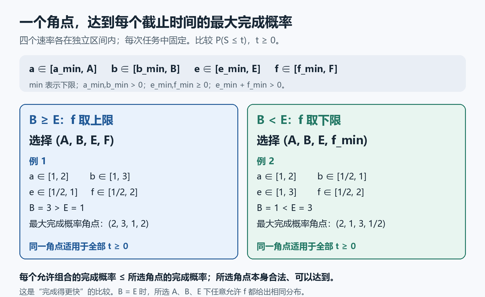

# 参数盒内完成概率的共同最大角点

对固定速率的独立等待模型，定义

$$
S=W_a+W_c+J W_b,
$$

其中 $W_a\sim\mathrm{Exp}(a)$、$W_b\sim\mathrm{Exp}(b)$、$W_c\sim\mathrm{Exp}(e+f)$，$J\in\{0,1\}$ 且 $\mathbb P(J=1)=f/(e+f)$，四者相互独立。$J=0$ 时不使用预先抽取的 $W_b$。$\mathrm{Exp}(r)$ 按速率参数化，均值为 $1/r$。$a,b>0$、$e,f\ge0$、$e+f>0$；时间均已归一化。记 $F_{a,b,e,f}(t)=\mathbb P(S\le t)$。

## 最大角点定理

允许参数集合为可独立组合的非空区间之积：

$$
a\in[a_-,A],\quad b\in[b_-,B],\quad
e\in[e_-,E],\quad f\in[f_-,F],
$$

其中 $a_-,b_->0$、$e_-,f_-\ge0$、$e_-+f_->0$。定义

$$
f_*=
\begin{cases}
F,&E\le B,\\
f_-,&E>B.
\end{cases}
$$

则对任意允许参数和每个 $t\ge0$，

$$
F_{a,b,e,f}(t)\le F_{A,B,E,f_*}(t).
$$

图中“独立区间”指参数集合为各区间的笛卡尔积，即端点及区间内取值可以任意组合；参数在本节为固定常数，并未赋予随机独立性。

右侧参数本身允许，因此同一个角点同时达到所有截止时间的最大完成概率。此处“最大”指完成概率最大，不指等待时间最长。$E=B$ 时，固定 $a=A,b=B,e=E$ 后，分布与 $f$ 无关，选择 $F$ 是约定，最大点不主张唯一。图中的min与下标 $-$ 均表示下限。

## 概率表示与坐标比较

对 $t\ge0$，令 $C_0=\mathbb P(W_a\le t)$、$C_1=\mathbb P(W_b+W_a\le t)$、$C_2=F_{a,b,e,f}$。独立性给出

$$
\begin{aligned}
C_0(t)&=1-e^{-at},\\
C_1(t)&=\int_0^t b e^{-b(t-s)}C_0(s)\,ds,\\
C_2(t)&=\int_0^t e^{-(e+f)(t-s)}[eC_0(s)+fC_1(s)]\,ds.
\end{aligned}
$$

积分中 $t-s$ 为首段等待时间，$s$ 为剩余时间。第三式按原分支概率混合。由连续性及积分因子公式，正时间上

$$
C_0'=a(1-C_0),\qquad C_1'=b(C_0-C_1),\qquad
C_2'=e(C_0-C_2)+f(C_1-C_2),
$$

且初值均为零。比较使用零初值方程 $D'=G-kD$ 的公式

$$
D(t)=\int_0^t e^{-k(t-s)}G(s)\,ds.
$$

非负的 $G$ 给出非负的 $D$。先固定 $b,e,f$。增大 $a$ 提高 $C_0$，两组 $C_1$ 的积分核相同且权非负，故 $C_1$ 不减；随后 $eC_0+fC_1$ 不减，故 $C_2$ 也不减。增大 $b$ 时，$D=C_{1,H}-C_{1,L}$ 满足

$$
D'=(b_H-b_L)(C_0-C_{1,L})-b_HD.
$$

由于 $W_a\le W_a+W_b$，$C_0\ge C_{1,L}$，故 $D\ge0$，再传至 $C_2$。固定 $a,b,f$ 增大 $e$ 时，上游 $C_0,C_1$ 不变，$D=C_{2,H}-C_{2,L}$ 满足

$$
D'=(e_H-e_L)(C_0-C_{2,L})-(e_H+f)D.
$$

由于 $S\ge W_a$，$C_0\ge C_{2,L}$，也得到 $D\ge0$。因此，可在保持 $f$ 不变时依次将 $a,b,e$ 增至 $A,B,E$，不降低完成概率。

## 最后一个坐标的选择

此时 $b=B,e=E$ 固定。令 $H=C_1-C_2$，则

$$
H'=(B-E)(C_0-C_1)-(E+f)H,\qquad H(0)=0.
$$

$C_0-C_1\ge0$，故 $H$ 的符号由 $B-E$ 决定。再比较 $f_H\ge f_L$，得到

$$
(C_{2,H}-C_{2,L})'
=(f_H-f_L)(C_1-C_{2,L})-(E+f_H)(C_{2,H}-C_{2,L}).
$$

于是 $B\ge E$ 时向上端 $F$ 移动不会降低完成概率，$B<E$ 时向下端 $f_-$ 移动不会降低完成概率。$B=E$ 时该差恒零。这个比较次序先提高前三个速率，再按最终的 $B,E$ 选择 $f$；原参数盒即使同时包含 $b>e$ 和 $b<e$ 的点，证明仍成立。

## 算例

| 参数范围 | 上限关系 | 最大完成概率角点 |
|---|---|---|
| $a\in[1,2],b\in[1,3],e\in[1/2,1],f\in[1/2,2]$ | $B=3>E=1$ | $(2,3,1,2)$ |
| $a\in[1,2],b\in[1/2,1],e\in[1,3],f\in[1/2,2]$ | $B=1<E=3$ | $(2,1,3,1/2)$ |

均值公式 $\mathbb E[S]=1/a+1/(e+f)+f/((e+f)b)$ 在两角点给出 $1/2+1/3+2/9=19/18$ 和 $1/2+2/7+1/7=13/14$。这些是算例核算；共同最大截止概率的证明依赖逐时比较，不能由均值大小替代。

结论限于固定速率、独立等待及可独立组合的区间；时变系数或由流量、容积造成的参数关联不在该参数盒结论内。

源码：[坐标排序](lean/CoordinateResponseOrder.lean)、[参数盒最大角点](lean/RateBoxMaximum.lean)。[既有验证记录](validation.json)。
