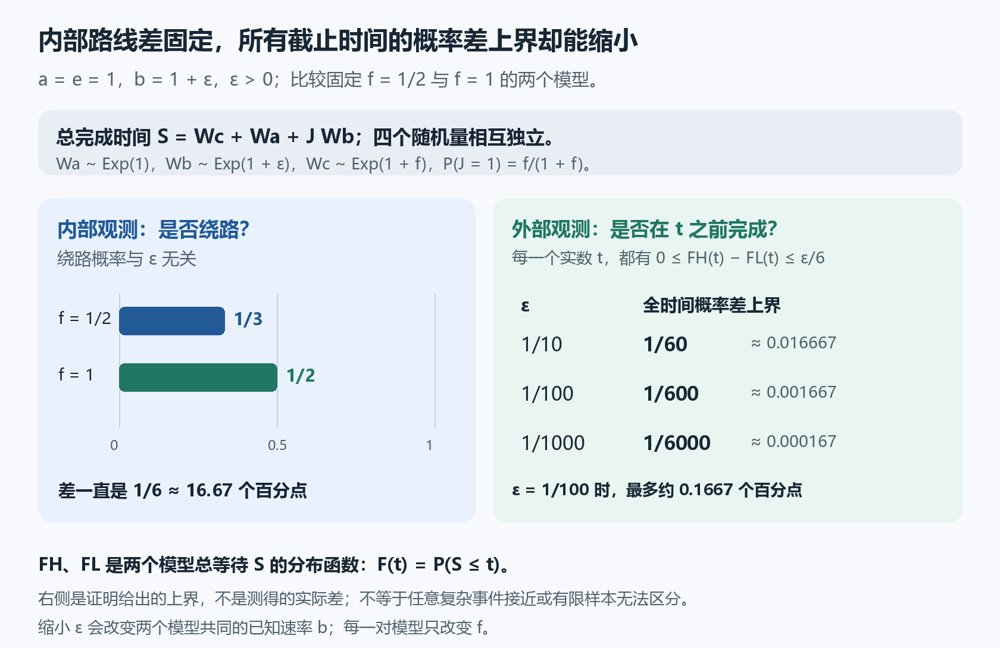

# 分支概率固定分离时的统一截止概率界

固定 $\varepsilon>0$，取 $a=e=1$、$b=1+\varepsilon$，比较 $f_L=1/2$ 与 $f_H=1$。对每个模型，独立取

$$
W_a\sim\mathrm{Exp}(a),\quad W_b\sim\mathrm{Exp}(b),\quad
W_c\sim\mathrm{Exp}(e+f),\quad J\in\{0,1\},\quad
\mathbb P(J=1)=\frac f{e+f},
$$

并定义 $S=W_a+W_c+J W_b$。$\mathrm{Exp}(r)$ 的速率为 $r$、均值为 $1/r$；速率固定，时间已归一化。一般允许域为 $a,b>0$、$e,f\ge0$、$e+f>0$。

## 统一界

记 $F_L(t)=\mathbb P_L(S\le t)$、$F_H(t)=\mathbb P_H(S\le t)$；下标指出所用概率模型。原分支概率为

$$
\mathbb P_L(J=1)=\frac13,\qquad\mathbb P_H(J=1)=\frac12,
$$

相差 $1/6$，两个 $f$ 相差 $1/2$，均与 $\varepsilon$ 无关。然而，对每个实数 $t$，

$$
0\le F_H(t)-F_L(t)\le\frac{\varepsilon}{6}.
$$

负时间两分布函数均为零。取 $\varepsilon=1/100$，上界为 $1/600\approx0.001667$，换成百分点时须乘100，故它约为0.1667个百分点的绝对概率差；分支概率差约16.67个百分点。

## 指数积分估计

对 $t\ge0$，实际概率函数 $C_0=\mathbb P(W_a\le t)$、$C_1=\mathbb P(W_b+W_a\le t)$、$C_2=\mathbb P(S\le t)$ 满足

$$
\begin{aligned}
C_0(t)&=1-e^{-at},\\
C_1(t)&=\int_0^t b e^{-b(t-s)}C_0(s)\,ds,\\
C_2(t)&=\int_0^t e^{-(e+f)(t-s)}[eC_0(s)+fC_1(s)]\,ds.
\end{aligned}
$$

积分按第一段等待条件化，并按分支概率混合。连续性及微积分基本定理给出正时间上的零初值方程

$$
C_0'=a(1-C_0),\quad C_1'=b(C_0-C_1),\quad
C_2'=e(C_0-C_2)+f(C_1-C_2).
$$

对 $c>0$ 定义 $K_c[G](t)=\int_0^t e^{-c(t-s)}G(s)\,ds$。若 $M\ge0$ 且在 $[0,t]$ 上 $|G|\le M$，则

$$
|K_c[G](t)|\le\frac M c(1-e^{-ct})\le\frac M c.
$$

令 $H_{01}=C_0-C_1$。由于 $W_a\le W_a+W_b$，有 $0\le H_{01}\le1$。令 $H_{12}=C_1-C_2$，则

$$
H_{12}'=(b-e)H_{01}-(e+f)H_{12},\quad H_{12}(0)=0,
$$

故 $H_{12}=K_{e+f}[(b-e)H_{01}]$，从而 $|H_{12}|\le|b-e|/(e+f)$。

固定一般的 $a,b,e$，比较 $0\le f_L\le f_H$ 且 $e+f_L>0$，两模型共享 $C_0,C_1$。对 $D=C_{2,H}-C_{2,L}$，

$$
D'=(f_H-f_L)(C_1-C_{2,L})-(e+f_H)D,\quad D(0)=0.
$$

先在非负时间再用一次积分估计，随后利用负时间的两个分布函数同为零，得到对所有实数截止时间的界

$$
|F_H(t)-F_L(t)|\le
\frac{(f_H-f_L)|b-e|}{(e+f_L)(e+f_H)}.
$$

本节参数代入后，分子为 $\varepsilon/2$，分母为3，故上界为 $\varepsilon/6$；$b-e>0$ 还给出差值非负。

## 任意接近的模型族及范围

给定 $\eta>0$，选 $\varepsilon=6\eta$，即得所有 $t$ 上 $|F_H(t)-F_L(t)|\le\eta$，而分支概率仍差 $1/6$。这是改变已知 $b$ 的模型族，每对比较共用同一个 $b$；固定 $b=1.01$ 时不据此断言该差仍可任意缩小。

例如 $\varepsilon=1/1000$ 时上界为 $1/6000$；$1/600$ 是约0.1667个百分点。该结论仅控制单个截止事件的概率差，不由此推出所有可测事件、总变差或有限样本检验成功率的界。[phase10](../phase10/README.md)与[phase11](../phase11/README.md)分别给出后两类扩展的独立证明。

源码：[积分核界](lean/KernelUniformBounds.lean)、[响应差界](lean/UniformCdfBound.lean)、[实际完成时间界](lean/NearBlindCompletion.lean)。[既有验证记录](validation.json)。
