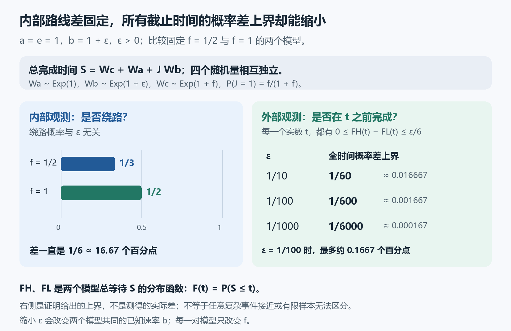

# 内部路线差很多，为什么每个截止时间的完成概率都能很接近？

两个系统选择绕路的概率分别是 $1/3$ 和 $1/2$，相差 $1/6$。如果看不到内部路线，只能问“它在某个截止时间前完成了吗”，这两个系统能有多接近？

本轮给出一个统一的界：**可以让每一个截止时间的完成概率之差都任意小，而内部绕路概率仍相差 $1/6$。** 这里的“每一个”很重要：不是只比较平均完成时间，也不是只试了几个时间点。

这是一组明确的小网络模型中的数学结论。它没有说有限次观察一定无法区分两个系统，也没有给出所需样本数。

## 先把两个系统定义清楚

一次任务先等 $W_c$，再直接进入最后一段，或先绕一步。总等待时间为

$$
S=W_c+W_a+J W_b.
$$

$J$ 只取0、1两个值；$J=1$ 时多等 $W_b$。四个随机量相互独立：

$$
W_a\sim\mathrm{Exp}(a),\quad W_b\sim\mathrm{Exp}(b),\quad
W_c\sim\mathrm{Exp}(e+f),\quad \mathbb P(J=1)=\frac f{e+f}.
$$

$\mathrm{Exp}(k)$ 是速率为 $k$ 的指数等待，平均时长为 $1/k$。所有速率固定，$a,b>0$，$e,f\ge0$，$e+f>0$；时间已归一化。下面比较不同参数模型的概率，不把不同模型当作同一次试验。

固定一个 $\varepsilon>0$，让两个系统共同取

$$
a=e=1,\qquad b=1+\varepsilon,
$$

只把 $f$ 分别取成 $f_L=1/2$、$f_H=1$。下标 $L,H$ 表示较低、较高的 $f$。绕路概率立即算出

$$
\mathbb P_L(J=1)=\frac{1/2}{1+1/2}=\frac13,\qquad
\mathbb P_H(J=1)=\frac1{1+1}=\frac12.
$$

它们相差 $1/6$，与 $\varepsilon$ 无关；两个 $f$ 也始终相差 $1/2$。

把总完成时间的分布函数记作

$$
F_L(t)=\mathbb P_L(S\le t),\qquad F_H(t)=\mathbb P_H(S\le t).
$$

现在要控制的是这两条函数在每个 $t$ 上的差。本轮证明

$$
\boxed{0\le F_H(t)-F_L(t)\le\frac{\varepsilon}{6}\quad\text{对所有实数 }t.}
$$

负时间两边的完成概率都为0。正时间里，提高 $f$ 虽会增加绕路机会，但也缩短第一段等待；在本例 $b>e$ 的条件下，合起来会让完成概率不降低。不过这个变化有上面的统一小界。

例如 $\varepsilon=1/100$ 时，所有截止时间的概率差都不超过 $1/600\approx0.001667$。用百分数说，这是最多约 **0.1667个百分点**，是概率的绝对差，不是相对变化率；绕路概率却仍相差约16.67个百分点。

## 用一个积分估计，把差异传过两层

以下给出统一界的推导。为了看清比较来自哪里，先定义

$$
C_0(t)=\mathbb P(W_a\le t),\qquad
C_1(t)=\mathbb P(W_b+W_a\le t),\qquad
C_2(t)=\mathbb P(S\le t).
$$

对于 $t\ge0$，独立等待相加与分支混合给出

$$
\begin{aligned}
C_0(t)&=1-\exp(-at),\\
C_1(t)&=\int_0^t b\exp[-b(t-s)]C_0(s)\,ds,\\
C_2(t)&=\int_0^t\exp[-(e+f)(t-s)]\,[eC_0(s)+fC_1(s)]\,ds.
\end{aligned}
$$

这些是实际等待时间的概率公式。例如第二式让 $W_b$ 用掉 $t-s$，其密度是 $b\exp[-b(t-s)]$；剩下的 $s$ 留给 $W_a$。第三式把两条路线的完成概率按分支概率相加。

对积分乘以相应的指数因子，再求导，得到

$$
C_0'=a(1-C_0),\quad C_1'=b(C_0-C_1),\quad
C_2'=e(C_0-C_2)+f(C_1-C_2),
$$

三个初值都是0。连续的被积函数保证这里可以用微积分基本定理。

对 $c>0$、$t\ge0$，把指数加权积分简写成

$$
K_c[G](t)=\int_0^t\exp[-c(t-s)]G(s)\,ds.
$$

若 $M\ge0$ 且在 $0\le s\le t$ 上都有 $|G(s)|\le M$，则

$$
|K_c[G](t)|\le M\int_0^t\exp[-c(t-s)]\,ds
 =\frac M c(1-\exp(-ct))\le\frac M c.
$$

这一步的作用很简单：上一层的误差若不超过 $M$，经过这一层后就不超过 $M/c$，且不需要选定某个具体的截止时间。

先记 $H_{01}=C_0-C_1$。因为 $W_a\le W_a+W_b$ 且概率总在0与1之间，

$$
0\le H_{01}(t)\le1.
$$

再记 $H_{12}=C_1-C_2$。由前面的微分方程相减，

$$
H_{12}'=(b-e)H_{01}-(e+f)H_{12},\qquad H_{12}(0)=0.
$$

乘上 $\exp((e+f)t)$ 再积分，就有 $H_{12}=K_{e+f}[(b-e)H_{01}]$。因此上述估计给出

$$
|H_{12}(t)|\le\frac{|b-e|}{e+f}.
$$

现在保持 $a,b,e$ 不变，只比较任意两个 $0\le f_L\le f_H$，且 $e+f_L>0$。$C_0,C_1$ 在两者中相同。总完成概率之差 $D=C_{2,H}-C_{2,L}$ 满足

$$
D'=(f_H-f_L)(C_1-C_{2,L})-(e+f_H)D,\qquad D(0)=0.
$$

再用一次同样的积分估计，就得到一般形式

$$
\boxed{|F_H(t)-F_L(t)|\le
\frac{(f_H-f_L)|b-e|}{(e+f_L)(e+f_H)}.}
$$

对非负时间，$F=C_2$；负时间两个 $F$ 都是0，所以这个界对全部实数截止时间都成立。在本轮的例子中，分子是 $(1/2)\varepsilon$，分母是 $(3/2)\cdot2=3$，故得到 $\varepsilon/6$。又因为 $b-e=\varepsilon>0$，两次正权积分都保持非负，得到 $F_H-F_L\ge0$。

## 这个结果允许我们说到哪里？

给定任何容许差 $\eta>0$，取 $\varepsilon=6\eta$，上述两个允许模型就满足

$$
|F_H(t)-F_L(t)|\le\eta\qquad\text{对所有 }t,
$$

而内部绕路概率仍差 $1/6$。这里 $\eta$ 是允许的概率绝对差；当它很小时，选择的 $b=1+6\eta$ 便接近 $e=1$。这是改变已知速率 $b$ 得到的一系列模型；每一对模型内部都使用同一个 $b$。没有声称固定 $b=1.01$ 时还能把这一对模型的概率差任意缩小。

请做两个分数检查：若 $\varepsilon=1/1000$，全时间上界是多少？把 $1/600$ 写成百分点又是多少？答案分别为 $1/6000$、约0.1667个百分点。

这个界同时控制所有“在 $t$ 之前是否完成”的单个阈值概率。它没有证明任意复杂事件的概率都接近，也没有给出总变差距离的界。它同样没有把有限次观测的误差或统计检验成功率纳入模型。因此实际能否通过大量观测恢复路线参数，仍需另外的统计分析。

方法上的收获是：把真实概率改写成可比较的积分，然后逐层传递一个简单的误差上界。这里沿用经典的指数积分估计，价值在于把“内部机制不同但某类外部观测接近”写成了可核验的具体结论；没有据此宣称新领域或全球首创。

本轮数学源、标准内核审计与独立AI核查见[验证记录](validation.json)。正文和实际配图另做本科背景读者模拟，不能代替人类专家评审。
