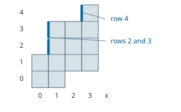

# 同步多数恢复时间的一个全尺度下界

在整数格点上，每个格点同时读取上、下、左、右四个邻居的颜色，取严格多数，平票时独立地以相同概率取黑或白。在白色背景上令正方形 $Q_N=\{0,\ldots,N-1\}^2$ 初始全黑，记 $T_N$ 为首次全白的轮数，永不恢复时取无穷。对最小轴平行包围正方形边长恰为 $N$ 的扰动，记最坏期望恢复时间为 $\tau(N)$。因为 $Q_N$ 本身就是其中一个初态，只需为它给出下界。

**命题。** 对每个整数 $N\ge1$，

$$
\tau(N)\ \ge\ \mathbb E T_N\ \ge\ \max\{N/2,\;N^2/4\,000\,000\}.
$$

以下给出相对于原论文加权下界证明的修订。三处改变分别在轮廓计数、从尾概率求期望，以及小方形的处理。这里的常数是一个显式保证。

### 每一行只需计一条朝西的边

沿用原论文的辅助连续时间过程。它在截角方形 $D_L=\{(x,y): |x|,|y|\le L,\ |x|+|y|\le L+1\}$ 内演化，保护区首度失守时冻结。令 $w(x,y)=L+2-|x|-|y|$，$V_t$ 为时刻 $t$ 已缺失格点的权重之和。在冻结前，已占格点集的每个非空行和列都是一个整数区间，整个集合由四邻路径连通。原证明将公平更新造成的加权面积瞬时漂移写成四个方向贡献之和的一半。每个方向的贡献是该方向凸角的权重和减去对应凹角的权重和。

西北凸角是一个北邻和西邻均为空的已占格点；与它配对的凹角是一个东邻和南邻均已占据的空格点。设 $v=(x,b)$ 是一个西北凸角。列是区间，故 $b$ 为该列的最高纵坐标。若前一列 $x-1$ 非空，记其最高纵坐标为 $a$。由连通性，两列在某一行 $c$ 上相邻，故 $c\le\min(a,b)$。若 $b\le a$，前一列从 $c$ 到 $a$ 都已占据，便包含 $v$ 的西邻，矛盾。因此 $a<b$。令 $z=(x-1,a+1)$，它在前一列的顶点正上方，所以为空，且南邻已占据。当前列从 $c$ 到 $b$ 均已占据，包含 $z$ 的东邻 $(x,a+1)$。这就给出了实际的凹角。每列最多有一个顶点，不同配对的横坐标也就不同。由 $|x-1|-|x|\le1$ 和 $|a+1|-|b|\le b-a-1$，两点的权重差满足

$$
w(v)-w(z)=|x-1|-|x|+|a+1|-|b|\le b-a .
$$

从第 $a+1$ 行至第 $b$ 行，格点 $(x,j)$ 都已占据，$(x-1,j)$ 都为空。于是这 $b-a$ 条朝西的边都在轮廓上。**同一行不可能为两个西北配对付费**：该行的已占格点构成一个区间，只有左端点有朝西的暴露边。因此所有西北配对的权重差之和至多为非空行数，即至多 $2L+1$。最左非空列至多留下一个未配对凸角，其权重至多 $L+2$。未配对凹角的权重非负，在求上界时可以略去。故西北贡献至多为 $3L+3$。

图中列坐标从 $0$ 到 $3$，最高格点的纵坐标依次为 $1,3,3,4$。两次上升分别用到纵坐标为 $2,3$ 和 $4$ 的边。这个例子只演示轮廓计数。

对其余三个方向分别反射坐标，得到相同的估计。四项相加并除以二，漂移上界由原证明的 $18L+12$ 降至 $6L+6$。每一方向内的计数已经足够，方向之间允许使用同一条边。

原论文的面积公式将漂移随时间的累积与清理造成的损失相加，后者的总预算为 $(L+2)(4L+2)$。故 $\mathbb E V_t\le(6L+6)t+(L+2)(4L+2)$。原时钟过程在 $t$ 前灭绝蕴含保护区在 $t$ 前或恰在 $t$ 失守。失守后冻结的形状保留至少 $H=L^3/12500$ 的缺失权重，所以 $H(1-C_{2L+1}(t))\le H\,\mathbb P(\text{至 }t\text{ 已失守})\le\mathbb E V_t$。对 $L\ge80,\ t\ge0$，这给出

$$
1-C_{2L+1}(t)\le
\frac{(6L+6)t+(L+2)(4L+2)}{L^3/12500}.
\tag{1}
$$

其中 $C_m(t)$ 是全黑边长 $m$ 方形在原速率一时钟过程中到时刻 $t$ 仍未灭绝的概率。

### 将整段生存概率相加

取 $L=\lfloor(N-1)/2\rfloor$，使边长 $2L+1$ 的方形可以放入 $Q_N$，记 $p_N(k)=\mathbb P(T_N>k)$。原论文的时钟比较和初态单调性给出

$$
p_N(k)\ge C_{2L+1}(8\log 2\,(k+1))
             -\tfrac65(2L+1)^2\,2^{-(k+1)} .
$$

先设 $N\ge2\,000\,000$，于是 $L\ge999\,999$。若 $2k\ge N$，则 $k\ge L$。令 $r=k+1-12$，有 $r\ge16, 2L+1\le3r$。由初等估计 $2^r\ge64r^2$ 可得比较误差至多 $1/1000$。在式（1） 中，$8\log2\le5.56$，且 $6L+6\le6.01L$。代入得时钟灭绝概率至多 $59/1000+420000(k+1)/L^2$：其中常数项来自清理预算，因 $12500(L+2)(4L+2)\le (59/1000)L^3$。若 $2k<N$，格点 $(k,k)$ 在前 $k$ 轮所能读取的初始格点全部在 $Q_N$ 内，故 $p_N(k)=1$。两段合起来得到每一轮都成立的估计

$$
p_N(k)\ge \frac{47}{50}-\frac{420000(k+1)}{L^2}.
\tag{2}
$$

取 $K=\lfloor L^2/450000\rfloor\ge1$。由 $420000/450000\le47/50$，第 $k$ 项至少为 $(47/50)(1-(k+1)/K)$。一个在第 $s$ 轮恢复的样本，恰好对 $k=0,\ldots,s-1$ 的生存指标各贡献一。仅累加 $K$ 项便得到

$$
\mathbb E T_N\ge\sum_{k=0}^{K-1}p_N(k)
       \ge\frac{47}{100}(K-1)
       \ge \frac{N^2}{4\,000\,000}.
$$

最后一步使用 $K>L^2/450000-1$ 和 $N\le2L+2$。具体地，将两者代入后，只需 $8L^2\ge360L+169200180$，这对 $L\ge999999$ 成立。有限项求和也适用于恢复时间取无穷的样本。

### 较小的正方形

对 $N\ge1$，取 $k=\lfloor(N-1)/2\rfloor$。格点 $(k,k)$ 在第 $k$ 轮仍为黑色，故对任意平票结果都有 $T_N\ge k+1=\lceil N/2\rceil$。当 $N\le2\,000\,000$ 时，$N/2\ge N^2/4\,000\,000$。这就补齐了对全部边长的结论。
