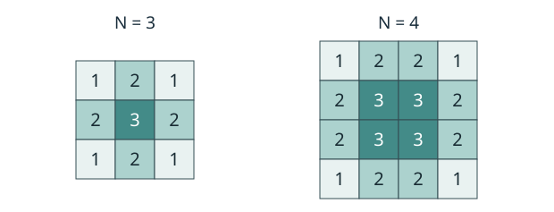
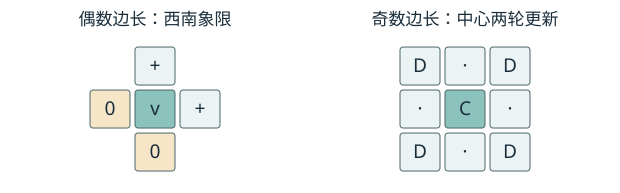

# 全占据方形的最早消亡时刻

在整数格上令 \(Q_N=\{0,\ldots,N-1\}^2\) 初始全为 \(1\)，其余点为 \(0\)。每轮同步取四邻多数，平票用独立公平硬币。以 \(T_N\) 表示首次全零的轮数，允许取 \(\infty\)。对每个 \(N\ge1\)，令
\[
m_N=1+2\left\lfloor\frac{N-1}{2}\right\rfloor.
\]
**每条轨迹都有 \(T_N\ge m_N\)，且 \(\mathbb P(T_N=m_N)\ge 2^{-2N^2}\)。** 因而分布最小支撑点在奇数边长时为 \(N\)，在偶数边长时为 \(N-1\)。这与期望为二次量级相容。

**逐格证明。** 对 \(v=(x,y)\in Q_N\) 定义
\[
d(v)=\min(x,N-1-x)+\min(y,N-1-y).
\]
这是到最近角点的格路距离。对任意硬币结果，若 \(d(v)\ge t\)，则第 \(t\) 轮后 \(v\) 仍为 \(1\)。用归纳法，若 \(d(v)\ge t+1\)，则 \(v\) 不是角点，至少有三个邻居在方形内，各自深度至少为 \(t\)。它们上一轮都为 \(1\)，故下一轮有严格多数。对 \(N=1\)，归纳步的前提为空。

现在令所有平票取零。此时第 \(t\) 轮的占据集恰为 \(\{v\in Q_N:d(v)\ge t\}\)。方形外任一点至多有一个邻居在方形内，始终为零。要证明反向包含，若第 \(t+1\) 轮某点为一，则上一轮至少有三个邻居为一，其中必含一对相对邻居。在这对邻居所在的坐标方向上，至少一个邻居朝向较近边界，其深度比中心点小一。该邻居按归纳假设的深度至少是 \(t\)，故中心点深度至少是 \(t+1\)。若中心点在这条坐标轴方向的端点，一对相对邻居不可能同时位于方形内。最大深度是 \(2\lfloor(N-1)/2\rfloor\)，所以该轨迹恰在 \(m_N\) 消亡。图中 \(N=3\) 的中心和 \(N=4\) 的中心四格都在第三轮消失。

**最早时刻具有正概率。** 对每个 \(v\in Q_N\)，只指定该点在第 \(d(v)+1\) 和 \(d(v)+2\) 轮的硬币为零。其余硬币任意。归纳验证所得轨迹与全零平票轨迹逐轮相同。在轮数 \(s\le d(v)\) 时该点由前述路径下界保证为一。在指定的两轮，输入和硬币与参照轨迹一致。当 \(s\ge d(v)+3\) 时，每个方形内邻居的深度至多为 \(d(v)+1<s-1\)，上一轮已全部为零。这样对 \(N^2\) 个格点各指定两枚独立硬币，所给事件的概率为 \(2^{-2N^2}\)。其他硬币结果也可能在同一时刻消亡，故得到的是原子概率的下界。

## 在最早一轮消亡的概率

记 \(q_N=\mathbb P(T_N=m_N)\)。若 \(N=2h\)，则 \(q_{2h}\le 2^{-4h^2}\)。若 \(N=2h+1,\ h\ge1\)，则 \(q_{2h+1}\le4\,2^{-h^2}\)。结合前述正概率下界，对所有 \(N\ge7\) 可统一写为
\[
2^{-2N^2}\le q_N\le2^{-\lfloor N^2/8\rfloor}.
\]
偶数边长时，\(N^2\ge\lfloor N^2/8\rfloor\)。奇数边长 \(N=2h+1\ge7\) 时，\(8(h^2-2)-(2h+1)^2=4h^2-4h-17\ge7\)，故 \(4\,2^{-h^2}=2^{-(h^2-2)}\le 2^{-\lfloor N^2/8\rfloor}\)。因此 \(-\log q_N=\Theta(N^2)\)。该结论只涉及分布在最早时刻的原子。

为说明概率上界，把方形西南侧的 \(h\times h\) 子方形用距西、南边界的坐标 \(0\le x,y<h\) 表示。称格点 \(v=(x,y)\) **准时消失**，若它在第 \(x+y+1\) 轮为零。在前一轮 \(x+y\)，其东、北邻居的深度至少为 \(x+y\)，因而必为一。要使 \(v\) 下一轮为零，西、南邻居此时必须同为零，且 \(v\) 在该轮的平票硬币必须为零。对仍在方形内的西邻或南邻，这恰是要求它准时消失。反复向西、南递推，从 \((i,j)\) 准时消失可推出矩形 \([0,i]\times[0,j]\) 内每个格点在其各自的首个可能消失轮都使用零硬币。其他三个角由反射得到同一结论。

对于 \(N=2h\)，四个角子方形互不相交，各自距相应角点最远的尖端格深度均为 \(2h-2\)。若 \(T_N=2h-1\)，这四个尖端都必须准时消失，于是全方形每个格点都有一枚硬币被指定为零。独立性给出 \(q_N\le2^{-N^2}\)。

对于 \(N=2h+1\)，中心深度为 \(2h\)，四个对角格的深度为 \(2h-2\)，它们分别是四个角子方形的尖端。若第 \(2h-1\) 轮四个对角格仍然全为一，则图右的中心也仍为一。第 \(2h\) 轮，中心的每个轴向邻居分别受到中心与两个对角格三个一的支持。第 \(2h+1\) 轮，中心仍为一。因此，若全方形在第 \(2h+1\) 轮消亡，则至少一个角尖端在第 \(2h-1\) 轮准时消失。对每个角，这强制 \(h^2\) 枚硬币为零。四角取并给出 \(4\,2^{-h^2}\)。例如 \(N=7\) 时，对一个给定角，九枚硬币全为零的概率是 \(1/512\)，故上界为 \(4/512=1/128\)。

## 对期望常数的影响

结合前篇[占据时间不等式 (2)](lower-tail.md)，对每个 \(N\ge1\) 有
\[
\mathbb E T_N\ \ge\ \max\{m_N,\ N^2/850000\}.
\]
数值核对如下。取 \(N\ge840000,\ L=\lfloor(N-1)/2\rfloor,\ r=\lfloor L/10\rfloor-1\)，则 \(L\ge419999\)。前篇中 \(H=r(r+1)(r+2)/6,\ D=8\log(2)(6L+6),\ B=(L+2)(4L+2)\)。由 \(r\ge0.099995L\) 得 \(H\ge L^3/6001\)。又有 \(H/N^3\le1,\ D\le33.28L,\ D+H/N^3\le33.29L\)。占据时间估计 (2) 的具体形式为
\[
\mathbb E T_N\ge\frac{H(1-1/N)-B-2D}{D+H/N^3}.
\]
其中 \(1-1/N\ge0.99999\)，且 \(2D\le66.56L\)。将这两项及上述对 \(H,D,B\) 的估计代入，交叉相乘后除以 \(L^3\)，只须验证
\[
\frac{0.99999}{6001}-\frac{(1+2/L)(4+2/L)}{L}-\frac{66.56}{L^2}
\ \ge\ \frac{33.29(2+2/L)^2}{850000}.
\]
此处用了 \(N\le2L+2\)。左端随 \(L\) 递增，右端递减；可在 \(L=419999\) 直接核对。对 \(100<N<840000\)，有 \(N(850000-N)\ge850000\)，故 \(N^2/850000\le N-1\le m_N\)。对 \(1\le N\le100\)，\(N^2/850000<1\le m_N\)。

渐近系数仍为前篇所证的 \(\liminf \mathbb E T_N/N^2\ge1/(1152000\log2)\)。
