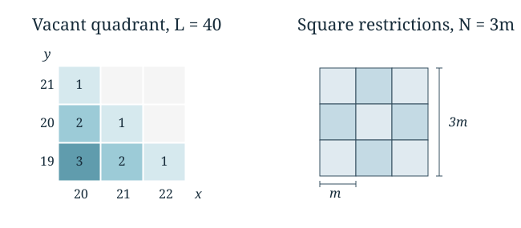

# 同步四邻多数规则的消亡下界与早消亡概率

在 \(\mathbb Z^2\) 上，初态为 \(Q_N=\{0,\ldots,N-1\}^2\) 的指标函数。每轮同时更新全部格点，取四个最近邻的严格多数值；平票时使用格点间、轮次间相互独立的公平硬币。\(T_N\) 是首次全零的轮数，未到达时取 \(\infty\)。\(F_N(k)=\mathbb P(T_N\le k)\)，\(p_N(k)=1-F_N(k)\)。扰动尺寸指最小轴平行包围正方形的边长，\(\tau(N)\) 为尺寸恰为 \(N\) 的最坏期望。下列下界直接对全占据方形成立，因而也对 \(\tau(N)\) 成立。

\[
\mathbb E T_N\ge \frac{N^2}{920000}\quad(N\ge1),\qquad
\liminf_{N\to\infty}\frac{\mathbb E T_N}{N^2}\ge\frac{1}{1152000\log 2}.
\]

记 \(c=(\log2)/64000000\)。原同步分布还满足
\[
 F_N(k)\le 2e^{-cN^2/(k+1)},\qquad
 \mathbb E\exp\!\left(\frac{cN^2}{2(T_N+1)}\right)\le3 .
\]
约定 \(1/(\infty+1)=0\)。因此任意满足 \(k_N=o(N^2)\) 的非负整数序列均有 \(F_N(k_N)\to0\)。这些分布下界只针对全占据方形；例如直径虽大但各点相距甚远的稀疏扰动可在一轮内消失。

## 早消亡事件的乘积估计

若 \(m\ge2\)、\(dm\le N\)，把 \(d^2\) 个互不相交的边长 \(m\) 方形放入 \(Q_N\)。在每个子方形中从全 \(1\) 出发，外侧固定为 \(0\)，只读取该子方形内的硬币。这些受限过程相互独立，每个的消亡分布为 \(F_m\)：方形外的格点至多有一个邻居在方形内，零延拓给出的轨迹恰与无限格点上的单方形轨迹一致。再用同一套硬币运行原来的大方形。局部更新对四个输入单调，所以每个受限过程的占据集始终包含于大过程的占据集。在第 \(k\) 轮大方形已经消亡，必有所有受限过程都已消亡。于是
\[
 F_N(k)\le F_m(k)^{d^2}.
\]
这一步对相邻子方形也成立。相互独立的是分别施加零边界的过程。

取 \(m=2000(\lfloor\sqrt{k}\rfloor+1)\)。以往证明给出了单块估计：对 \(m\ge2000000\)，令 \(\ell=\lfloor(m-1)/2\rfloor\)，则
\((47/50-p_m(k))\ell^2\le420000(k+1)\)。写 \(u=\lfloor\sqrt{k}\rfloor+1\)，有 \(\ell\ge999u,\ k+1\le u^2\)，代入即得 \(F_m(k)\le1/2\)。当 \(m<2000000\) 时 \(u\le999\)，于是 \(2k<m\)，中心在第 \(k\) 轮所依赖的初态都在方形内，此时 \(F_m(k)=0\)。图右当 \(N=3m\) 时九个子方形给出 \(F_N(k)\le2^{-9}\)。一般取 \(d=\lfloor N/m\rfloor\)。由 \(m^2\le16000000(k+1)\) 和 \(N<(d+1)m\) 得 \(N^2\le64000000(d^2+1)(k+1)\)，即得上述指数上界。

令 \(Y=cN^2/[2(T_N+1)]\)。对 \(t>0\)，事件 \(Y>t\) 蕴含 \(T_N+1<cN^2/(2t)\)。右端小于 \(1\) 时该事件为空，否则可在指数界中取 \(k=\lfloor cN^2/(2t)\rfloor-1\)，得到 \(\mathbb P(Y>t)\le 2e^{-2t}\)。对恒等式 \(e^Y-1=\int_0^Y e^t\,dt\) 取期望并交换非负积分，即得 \(\mathbb E e^Y\le1+2\int_0^\infty e^{-t}\,dt=3\)。

## 静态几何常数

下界的比较过程使用截角域 \(D_L=\{(x,y):|x|,|y|\le L,\ |x|+|y|\le L+1\}\)、权函数 \(w_L(v)=L+2-\|v\|_1\)，以及保护集 \(I_L\)，它由 \(\{10\|v\|_1\le9L\}\) 及其外四邻边界组成。称格点集行凸、列凸，是指它在每一行、每一列上的截面分别为空集或整数区间。沿用已有几何引理：行凸、列凸且四邻连通的集合 \(S\) 若缺少 \(x\in I_L\)，以 \(x\) 为顶点的四个严格象限中至少一个不含 \(S\) 中的格点。

取 \(r=\lfloor L/10\rfloor-1\)，\(L\ge10\)。在一个空象限中用正偏移 \(i,j\ge1\) 枚举格点，令 \(i+j=s+2,\ 0\le s<r\)。每层恰有 \(s+1\) 个点。由 \(\|x\|_1\le9L/10+1\) 和 \(1\le i,j\le r\)，各点位于 \(D_L\) 内，且权重至少为 \(r-s\)。因此任何保护失守形状的缺失权重至少为
\[
 H_L=\sum_{s=0}^{r-1}(s+1)(r-s)=\frac{r(r+1)(r+2)}6\sim\frac{L^3}{6000}.
\]
图左取 \(L=40\)、\(x=(19,18)\)。三层的权重总和分别为 \(3,4,3\)，故 \(H_{40}=10\)。

系数 \(1/6000\) 对这组静态假设是渐近最优的。取 \(L=20m\)，从 \(D_{20m}\) 删去 \(x,y\ge9m\) 的所有格点。剩余形状仍行凸、列凸且四邻连通，但缺少保护点 \((9m,9m)\)。被删除格点可写为 \((9m+i,9m+j)\)，其中 \(i,j\ge0,\ i+j\le2m+1\)。逐层求和得到总权重 \((2m+2)(2m+3)(2m+4)/6\)，除以 \((20m)^3\) 恰趋于 \(1/6000\)。这个构造确立静态极值。实际动力学以何种概率产生相近的首次失守形状，是另一个问题。

## 停止后的漂移与消亡概率

记 \(L=\lfloor(N-1)/2\rfloor\)，\(C_L(t)\) 为边长 \(2L+1\) 的全占据方形在独立速率一时钟逐点更新下，于物理时刻 \(t\) 仍非空的概率。为保持上述几何假设，已有比较过程在每次更新后按规则再删点，并在保护集首次失守时冻结。记 \(S(t)\) 为该过程的占据集，\(V(t)=\sum_{v\in D_L\setminus S(t)}w_L(v)\) 为其缺失权重。下面用到既有面积公式的三个性质：原时钟过程在 \(t\) 前消亡蕴含比较过程至 \(t\) 已失守；附加删点的累计加权贡献至多 \(B_L=(L+2)(4L+2)\)；在仍受保护时，原始更新造成的条件平均损失速率至多 \(A_L=6L+6\)。这些性质来自原过程的比较及面积公式，端点计数给出最后一个速率估计。

冻结后原始更新贡献为零。因而，在时间积分中应使用 \(A_L\) 乘以尚未失守的概率。该概率至多为 \(C_L(s)\)。面积公式使用跳跃前状态：对几乎所有物理时刻 \(s\)，它在原时钟概率下几乎处处等于时刻 \(s\) 的状态，故可以在积分中使用此概率。结合首次失守的静态代价，得到
\[
 H_L(1-C_L(t))\le \mathbb E V(t)
 \le A_L\int_0^t C_L(s)\,ds+B_L. \tag{1}
\]
直接用 \(C_L(s)\le1\) 替换积分中的生存概率，会在以下渐近期望系数中损失一个因子 \(2\)。

为了转回同步轮数，令 \(a=8\log2,\ D=aA_L,\ \delta=11L^2 2^{-L}\)。已有两种更新机制的比较，加上前 \(2k<N\) 轮的确定性生存，给出 \(C_L(a(k+1))\le p_N(k)+\delta\)。取 \(K=N^3\)，\(S_K=\sum_{j=0}^{K-1}p_N(j)\)。按长 \(a\) 的时间区间分割，单调性给出
\[
 \int_0^{a(K+1)} C_L(s)\,ds\le a(1+S_K+K\delta),\qquad
 p_N(K)\le S_K/K.
\]
对 \(N\ge250\)，有 \(K\delta\le1,\ \delta\le 1/N\)。将两式代入 (1) 得
\[
 H_L(1-S_K/K-\delta)\le B_L+D(1+S_K+K\delta)\le B_L+D(2+S_K).
\]
移项并用 \(\mathbb ET_N\ge S_K\)，得到可直接求值的有限尺寸下界
\[
 \mathbb E T_N\ \ge\
 \frac{H_L(1-1/N)-B_L-2D}{D+H_L/N^3}. \tag{2}
\]
这一步只使用有限项尾和，允许 \(T_N=\infty\)。当 \(N\to\infty\) 时，\(H_L/N^3\to1/48000,\ B_L/N^3\to0,\ D/N\to24\log2\)，故 (2) 给出开头的渐近系数。

为核对全尺度常数，设 \(n_0=460000,\ N\ge n_0\)。此时 \(H_L\ge L^3/6100\ge(N-2)^3/48800,\ B_L\le N(N+3),\ D\le24(N+1)\log2\)。在 (2) 中交叉相乘，并将 \(H_L/(920000N)\) 移到左侧。除以 \(N^3\) 后，只须验证
\[
\frac{(1-2/N)^3}{48800}\left(1-\frac{1+1/920000}{N}\right)
\ge \frac{1}{N}+\frac{3}{N^2}+
\frac{48(N+1)\log2}{N^3}+\frac{24(1+1/N)\log2}{920000}.
\]
左端随 \(N\) 增大，右端随 \(N\) 减小。在 \(N=n_0\) 取 \(\log2<0.694\)，左端大于 \(0.00002049\)，右端小于 \(0.00002029\)。其余尺寸由 \(T_N\ge\lceil N/2\rceil\) 补齐。

这里证明的是期望的下极限。确定同步消亡时间的渐近常数，仍须取得与之匹配的上界。就进一步提高下界而言，静态极值例排除了仅依靠行凸、列凸、四邻连通而提高 \(1/6000\) 的可能性。可检验的方向是估计实际首次失守形状的分布、改进沿存活路径的平均漂移，或减小从连续时间转到同步更新的时间系数。
