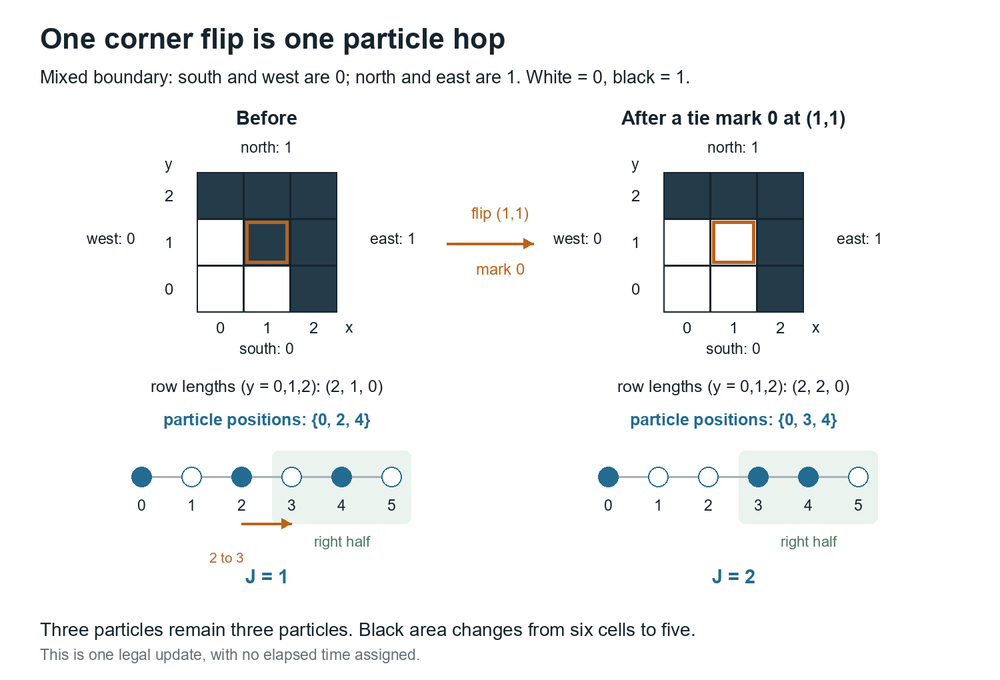
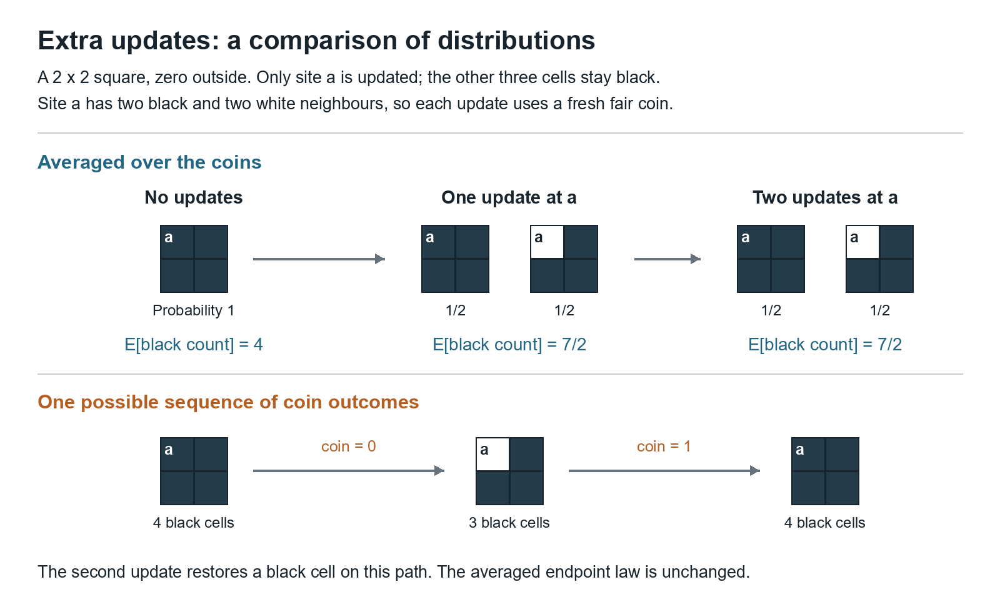
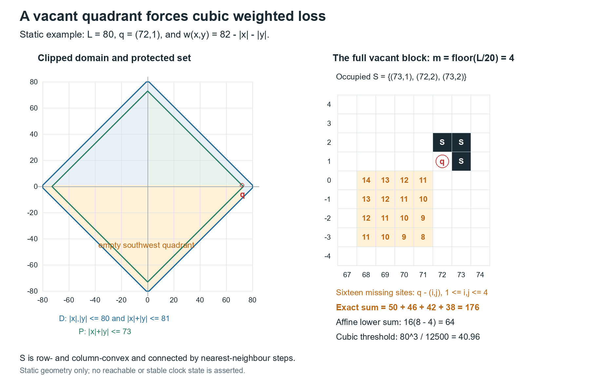
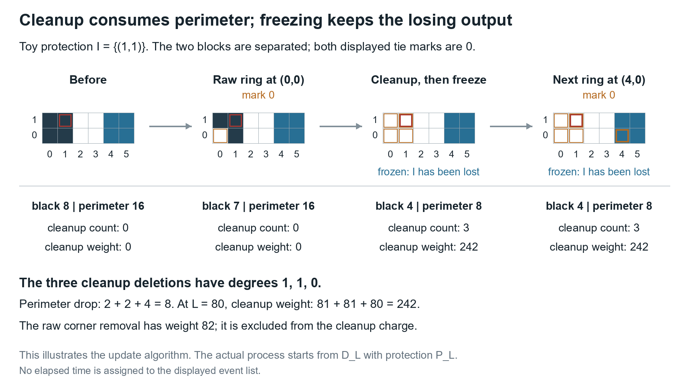
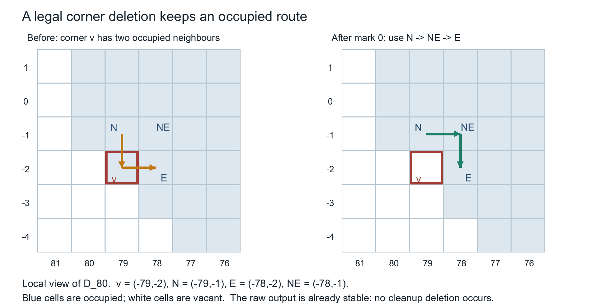
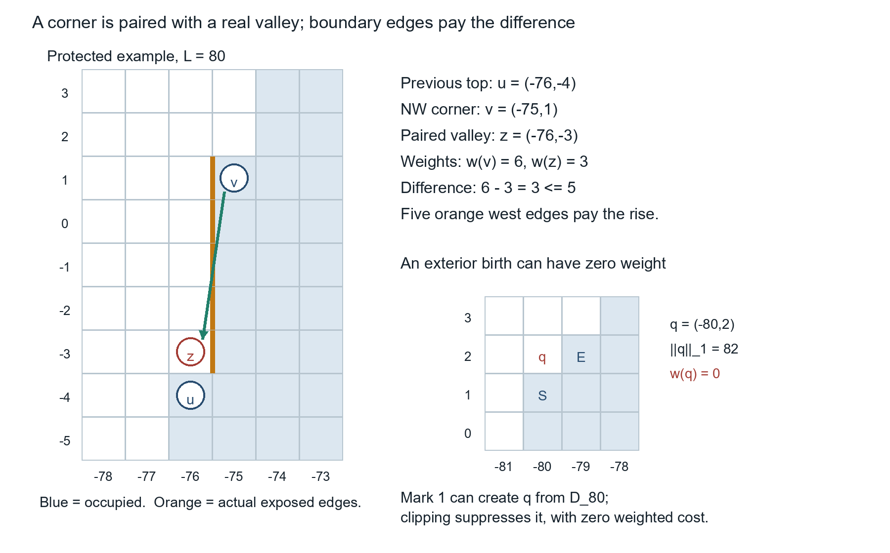

# Quadratic recovery for synchronous four-neighbour random majority dynamics

Working draft, revision 6 — 17 November 2026. Author information is intentionally unassigned.

**Local working draft; not submitted.** The argument below is accompanied by a frozen Lean development. The paper follows the original model and size convention throughout, and gives the geometric, clock-law and comparison arguments used in the proof. Its exposition, model correspondence and historical priority require independent specialist assessment; the formal artifact is not a substitute for that assessment.

Section 3 gives the finite Gibbs censoring argument, its zero-temperature limit, and the selected-task and conflict-rank constructions needed for the clock/synchronous comparison. Section 4 proves the staircase encoding, original-clock moment equations, covariance estimate and local-clearing bound in Lemma 4. Section 5 defines the clipped-domain geometry and proves the static cubic cost of protected loss. Section 6 constructs the modified and frozen process, proves its cleanup budget under the original clocks, preserves its geometric shape through protected loss, and bounds its signed weighted drift by pairing boundary corners with valleys. It concludes with the original-clock lower tail.

The six lemmas are proved below and assembled into the original synchronous expectation bound. The source dictionary records the corresponding artifact declarations, whose final theorem takes none of the intermediate extinction, censoring, covariance or coupling estimates as an external input. Neither this draft nor its internal AI checks constitutes human expert review.

## Abstract

We study synchronous majority dynamics on the infinite square lattice. Each site reads its four nearest neighbours, without reading its own state, and resolves a tie with an independent fair coin. Starting from a finite perturbation of either homogeneous configuration, measure the perturbation by the side length of its smallest translated axis-parallel enclosing square. The worst extended expected recovery time among deterministic initial configurations of size exactly $N$ satisfies
$$
\frac{N^2}{576000000}\leq\tau(N)\leq664066N^2
\qquad(N\geq500001).
$$
The upper bound alone holds for $N\geq16$, with a uniform geometric bound on its block tails. Retaining the block failure rate gives recovery by an explicit quadratic deadline with probability tending to one, as well as bounds on all fixed positive moments and a common interval of exponential moments. The filled square attains the worst extended expectation for every $N\geq2$. This is the quadratic order conjectured in Question 7.4 of Fatès, Marcovici and Taati. A weighted loss estimate supplies the lower bound. A staircase boundary, finite exclusion moments, and a local-clearing event supply the upper bound. An explicit comparison transfers estimates from marked-clock physical time to synchronous rounds. The proof is organized into six lemmas: normalization, clock/synchronous comparison, weighted slow extinction, mixed local clearing, retained-clock coupling, and restart. A source dictionary connects the statements to the Lean artifact.

## 1. The model and the original question

Let $\mathcal N=\{(1,0),(-1,0),(0,1),(0,-1)\}$ and define
$$
\Phi(u_1,u_2,u_3,u_4;\xi)=
\begin{cases}
1,&\sum_i u_i>2,\\
0,&\sum_i u_i<2,\\
\xi,&\sum_i u_i=2.
\end{cases}
$$
A configuration is a map $x:\mathbb Z^2\to\{0,1\}$. On the product probability space carrying independent Bernoulli$(1/2)$ variables $(\xi_{z,k})_{z\in\mathbb Z^2,k\geq1}$, set $X_0=x$ and
$$
X_{k+1}(z)=\Phi\bigl((X_k(z+v))_{v\in\mathcal N};\xi_{z,k+1}\bigr).
\tag{1}
$$
All sites read the preceding configuration. The centre site's own state is not among the four inputs.

For $b\in\{0,1\}$, put $A_b(x)=\{z:x(z)\ne b\}$. We consider initial configurations for which this set is finite for one of the two backgrounds $b$. For a finite set $A$, define
$$
d(A)=\min\{m\in\mathbb N:A\subset z+[0,m)^2
\text{ for some }z\in\mathbb Z^2\},
\qquad d(\varnothing)=0.
\tag{2}
$$
Thus a single exceptional site has size $1$, and a filled $N$ by $N$ square has size $N$. The size is not the number of exceptional sites. Write $\operatorname{size}(x)=d(A_b(x))$.

Let $\mathbf0$ and $\mathbf1$ be the homogeneous configurations. The recovery time and worst profile are
$$
T_x=\inf\{k\geq0:X_k\in\{\mathbf0,\mathbf1\}\},
\qquad
\tau(N)=\sup_{\operatorname{size}(x)=N}\mathbb E[T_x],
\tag{3}
$$
where $\inf\varnothing=\infty$ and the expectation takes values in $[0,\infty]$. For $N\geq2$, the supremum reduces to a finite maximum.

**Theorem 1 (quadratic recovery).** For every integer $N\geq500001$,
$$
\frac{N^2}{576000000}\leq\tau(N)\leq664066N^2.
\tag{4}
$$
The upper inequality holds for every $N\geq16$. Consequently $\tau(N)=\Theta(N^2)$.

**Theorem 2 (uniform block tail).** Put
$$
b_N=331776N^2+257.
$$
For every integer $N\geq16$, every deterministic finite perturbation $x$ of either homogeneous background with size exactly $N$, and every integer $j\geq0$,
$$
\mathbb P(T_x>jb_N)\leq2^{-j}.
\tag{4a}
$$
In particular, $T_x<\infty$ almost surely. The bound is uniform over the permitted initial configurations. Its proof uses conditional restart from the observed configuration; it does not require independence of successive survival events.

**Theorem 3 (retained block failure).** For an integer $N\geq16$, set
$$
a_N=\frac{32}{8N+1}+\frac{12}{5}N^2\,2^{-(1296N^2+1)}.
\tag{4b}
$$
Then $0\leq a_N\leq\min(1/2,5/N)$, so $a_N=O(N^{-1})$, and, for every initial configuration covered by Theorem 2 and every integer $j\geq0$,
$$
\mathbb P(T_x>jb_N)\leq a_N^j,\qquad
\mathbb E T_x\leq\frac{b_N}{1-a_N},\qquad
\tau(N)\leq\frac{b_N}{1-a_N}.
\tag{4c}
$$
In particular, the probability of recovery by the fixed quadratic deadline $331776N^2+257$ tends to one. The additive $257$ is retained in this deadline.

**Theorem 4 (moments and exponential integrability).** Put $c_0=332033$. For every fixed real $r>0$, define the finite constant
$$
C_r=c_0^r\sum_{j=0}^{\infty}(j+1)^{\lceil r\rceil}2^{-j}.
$$
For every $N\geq16$ and every initial configuration covered by Theorem 2,
$$
\mathbb E T_x^r\leq C_r N^{2r}.
\tag{4d}
$$
Moreover, if $0<\lambda<\log(2)/c_0$, then
$$
\mathbb E\exp(\lambda T_x/N^2)
\leq K_\lambda
:=1+\frac{e^{c_0\lambda}}{1-e^{c_0\lambda}/2}<\infty.
\tag{4e}
$$
The same constant is valid for all these $N$ and initial configurations. The interval is nonempty; for example $\lambda=1/(4c_0)$ is admissible. Both powers and exponentials are interpreted as $+\infty$ at an infinite recovery time. Finiteness is a consequence of the tail estimate, not an assumption on $T_x$.

The theorem concerns (1) under its actual product coin law. Its parameter is the exact size in (2). It is not a statement about an asynchronous clock, a finite torus, or a random initial perturbation.

Fatès, Marcovici and Taati [FMT22] define the enclosing-square size in §1.2, the worst expected profile in §4.1, and this fair-tie rule in §4.2. Their Proposition 4.1 gives a cubic upper bound. Question 7.4 conjectures the quadratic order in Theorem 1. A limited public-source search on 28 October 2026 did not identify an earlier proof for the same model. That search is not a certification of global priority or exhaustive coverage, and an unchanged arXiv version does not establish the problem's present public status.

A related two-dimensional zero-temperature Ising model already has quadratic extinction estimates [CMST10, Theorem 2]. Its sites update at independent rate-one Poisson clocks; [FMT22, Example 4.2] explicitly distinguishes it from the synchronous model. Physical clock time cannot simply be renamed as a number of parallel rounds.

The proof uses established ideas. Peres and Winkler [PW11] develop monotone-system censoring and comparisons of update schemes. Liu and Yin [LY24, Lemma 3.11] give Poisson-schedule dependency-depth bounds, crediting earlier work. The scope of this draft is the original-model quadratic theorem and its formal artifact. It makes no claim that censoring, exclusion encodings, heat estimates, or clock-chain bounds were invented in this project.

## 2. Six lemmas and the proof of the main theorem

Put $Q_m=\{0,\ldots,m-1\}^2$. A zero-boundary finite process uses zero outside $Q_m$. A configuration supported in $Q_m$ remains supported there: an exterior site has at most one neighbour inside the square and cannot become $1$. The finite synchronous process therefore has exactly the restricted infinite-lattice law.

Write
$$
p_m(k)=\mathbb P(T_{\mathbf1_{Q_m}}>k).
$$
For a separate clock experiment, give each site independent rate-one exponential gaps and independent fair marks, with the entire gap and mark fields independent. At a ring, update only that site using $\Phi$. Define
$$
C_m(t)=\mathbb P(\text{the zero-boundary clock process from }
\mathbf1_{Q_m}\text{ is nonzero at physical time }t).
\tag{5}
$$
Zero is absorbing, so $C_m$ is nonincreasing. We distinguish synchronous integer rounds, comparison layers, real clock time $t$, and an integer dependency-rank threshold $R$. The inequalities below connect them. In every mathematical statement, $m$ and $M$ are actual square side lengths, not the source's internal argument $n$.

**Lemma 1 (normalization and domination).** For $N\geq2$, $\tau(N)$ is the maximum of the extended finite-square expectations over side-$N$ patterns whose original size is exactly $N$. For every pattern $g$ on $Q_m$, common synchronous marks give
$$
T_g\leq T_{\mathbf1_{Q_m}}.
\tag{6}
$$

**Proof.** Translation reindexes the independent coin coordinates. Colour complementation replaces fair marks by their complements. Both operations preserve the product law, expected recovery time, and size. A finite perturbation can therefore be placed in $Q_N$ over the zero background. The square is invariant, so recovery to a homogeneous configuration means recovery to zero in this normalization. The other infinite homogeneous configuration cannot be reached from a state supported in $Q_N$.

The normalized set of patterns of exact size $N$ is finite and contains the filled square. This proves attainment. For fixed tie mark, $\Phi$ is nondecreasing in every neighbour input. Induction on rounds preserves order under common marks. Thus the trajectory from $g$ lies below that from the filled square, proving (6) also when a hitting time is infinite. $\square$

**Corollary 1 (an exact extremizer).** For every integer $N\geq2$,
$$
\tau(N)=\mathbb E T_{\mathbf1_{Q_N}}.
\tag{6a}
$$
Both sides are extended expectations. To prove the upper inequality, normalize any permitted initial configuration by translation and, when needed, colour complementation. Lemma 1 then compares its recovery time with that of the filled square on the same side-$N$ domain. Taking extended expectations and the supremum gives $\tau(N)\leq\mathbb E T_{\mathbf1_{Q_N}}$. For the reverse inequality, the filled square itself has size exactly $N$ and is one of the configurations in (3). Thus it gives $\mathbb E T_{\mathbf1_{Q_N}}\leq\tau(N)$. This proves equality without assuming finiteness or uniqueness of the maximizing initial configuration.

**Lemma 2 (clock/synchronous bridge).** For integers $m\geq2$ and $k\geq0$, set
$$
t_k=8\log2\,(k+1),\qquad R_k=128(k+1),\qquad
E_m(k)=\frac65m^2\,2^{-(k+1)}.
\tag{7}
$$
Then
$$
C_m(t_k)\leq p_m(k)+E_m(k),
\tag{8}
$$
$$
p_m(2R_k+1)\leq2C_m(t_k)+2E_m(k).
\tag{9}
$$
Section 3 proves this bridge from the finite-word censoring inequality and two explicit clock estimates.

**Lemma 3 (weighted lower tail).** Let $L\geq80$ be an integer and $t\geq0$. Then
$$
1-C_{2L+1}(t)\leq
\frac{(18L+12)t+(L+2)(4L+2)}{L^3/12500}.
\tag{10}
$$
For $L\geq250000$ and $0\leq t\leq L^2/1000000$, this gives $C_{2L+1}(t)\geq1/2$. Put
$$
q_L=\left\lfloor\frac{L^2}{8000000}\right\rfloor,
\qquad r_L=q_L-1.
\tag{11}
$$
Then, for every $L\geq250000$,
$$
p_{2L+1}(r_L)\geq1/4,\qquad
r_L\geq L^2/16000000.
\tag{12}
$$

**Proof.** A clipped process is frozen when a protected set first loses a site. Its weighted missing-area variable $V_t$ is nonnegative and satisfies
$$
\mathbb E V_t\leq(18L+12)t+(L+2)(4L+2).
\tag{13}
$$
Protected exit costs at least $L^3/12500$ weighted units, and extinction of the original clock process implies protected exit. Markov's inequality gives (10). The static cost comes from summing the varying weights over the full square of side $\lfloor L/20\rfloor$. Section 5.3 proves the exact affine sum and the floor estimate that yield $L^3/12500$.

The weight vanishes at exterior sites where clipping could suppress a birth. It cancels that correction in the drift. The separate cleanup estimate gives the finite budget in (13). The static threshold is (SG5); the completed-output freeze and original-clock comparison are (MM9)–(MM10). The cleanup budget and exact weighted balance are (PB21) and (WB4). Sections 6.4–6.6 establish shape preservation, the actual raw weighted rate, and (13).

We give the numerical and rounding details. For $L\geq250000$,
$$
18L+12\leq19L,\qquad (L+2)(4L+2)\leq5L^2.
$$
Consequently, at $t=L^2/1000000$,
$$
(18L+12)t+(L+2)(4L+2)
\leq\frac{19L^3}{1000000}+5L^2
\leq\frac{39L^3}{1000000}
\leq\frac12\frac{L^3}{12500}.
$$
The second inequality uses $L\geq250000$. Substitution in (10) proves the clock survival estimate, also for all earlier times by monotonicity.

Write $q=q_L$. Integer division gives
$$
8000000q\leq L^2<8000000(q+1),\qquad q\geq32.
$$
As $250000L\leq L^2$, these inequalities also give $L\leq32q+31\leq64(q-12)$. Set $s=q-12\geq16$. The elementary estimate $2^s\geq64s^2$ holds for every integer $s\geq16$: it holds at $16$, and its induction step follows from $2s^2\geq(s+1)^2$. Therefore
$$
64L^2\leq4096\,(64s^2)\leq4096\,2^s=2^q.
$$
Since $r_L+1=q$ and $\log2\leq1$,
$$
t_{r_L}=8\log2\,q\leq8q\leq L^2/1000000.
$$
Also $(2L+1)^2\leq9L^2$, so
$$
E_{2L+1}(r_L)
=\frac65(2L+1)^2\,2^{-q}
\leq\frac{54}{5}L^2\,2^{-q}
\leq\frac{27}{160}<\frac14.
$$
Subtract this scheduling error in (8) from the clock survival probability $1/2$. This proves $p_{2L+1}(r_L)\geq1/4$. Finally, $q+1\leq2(q-1)$ because $q\geq32$, whence
$$
L^2<8000000(q+1)\leq16000000(q-1)=16000000r_L.
$$
This proves (12), retaining the floor and the subtraction of one. No finite-extinction assumption has been used. $\square$

For the upper estimate, use a mixed-boundary clock process on $Q_M$. Its south and west exterior neighbours are $0$, and its north and east exterior neighbours are $1$. Precisely, outside $Q_M$ the extension is $0$ if either coordinate is negative and $1$ otherwise. A coordinatewise nondecreasing pattern remains so under its single-site updates.

Let $f:Q_M\to\{0,1\}$ denote the current mixed-boundary state, with $0$ white and $1$ black. Coordinates increase eastward and northward. Coordinatewise nondecreasing means that
$$
x\leq x',\ y\leq y'\quad\Longrightarrow\quad f(x,y)\leq f(x',y').
$$
Let $\lambda_y$ count the white cells of $f$ in row $y$, starting at the west. These lengths are nonincreasing in $y$. Encode the boundary by $M$ labelled particles on the path $\{0,\ldots,2M-1\}$ at positions
$$
P_r=r+\lambda_{M-1-r},\qquad0\leq r<M.
\tag{14}
$$
They are strictly increasing. A filled black square occupies the left $M$ slots; an all-white square occupies the right $M$ slots.

*Figure 1. A deterministic legal move for $M=3$. The row lengths $(\lambda_0,\lambda_1,\lambda_2)=(2,1,0)$ give particle positions $(0,2,4)$. Mark $0$ at the highlighted cell $(1,1)$ changes the lengths to $(2,2,0)$ and the positions to $(0,3,4)$, a hop across bond $2$--$3$. The right-half count $J$ changes from one to two. Particle number stays three while black area decreases by one. No elapsed time is assigned to this illustration.*

Let $\eta_i(t)$ be the occupancy indicator of slot $i$, and $\rho_i(t)=\mathbb E\eta_i(t)$. Put
$$
H(t)=\sum_{i=0}^{2M-1}(\rho_i(t)-1/2)^2,\qquad
J(t)=\sum_{i=M}^{2M-1}\eta_i(t).
\tag{15}
$$

**Lemma 4 (mixed local clearing).** Let $L\geq1$, $M=2L+1$, and let the mixed process start from a deterministic coordinatewise nondecreasing pattern. For $t\geq0$,
$$
H(t)\leq\frac M2 e^{-t/(4M^2)},\qquad
\operatorname{Var}J(t)\leq M/4.
\tag{16}
$$
At $t_{\mathrm{mix}}=16M^2$, $\mathbb E J(t_{\mathrm{mix}})\geq M/4$. For every integer $0\leq N\leq M/8$,
$$
\mathbb P(\text{the southwest }N\text{ by }N
\text{ block is not all white at }t_{\mathrm{mix}})
\leq16/M.
\tag{17}
$$

The positive-time energy identity and all-time path estimate underlying (16) are
$$
H'(t)=-D(t),\qquad H(t)\leq4M^2D(t),\qquad
D(t)=\sum_{i=0}^{2M-2}(\rho_{i+1}(t)-\rho_i(t))^2.
\tag{18}
$$
**Proof.** Section 4 derives the encoding, genuine moment equations, nonpositive off-diagonal covariance, and the energy and concentration estimates, ending with (17). $\square$

**Lemma 5 (retained-clock coupling).** Let $2\leq m\leq M$. Start a zero-boundary clock process on $Q_m$ from any pattern $g$, and the mixed process on $Q_M$ from the filled black square. Under the genuine larger product clock/mark law, they can be coupled so that, almost surely simultaneously for every $t\geq0$,
$$
X^{(m)}_t(v)\leq Y^{(M)}_t(v)\qquad(v\in Q_m).
\tag{19}
$$
The projected smaller sample has exactly its own product law. In particular,
$$
\mathbb P(X^{(m)}_t\ne\mathbf0)
\leq\mathbb P(Y^{(M)}_t\text{ is not white throughout }Q_m).
\tag{20}
$$
Section 7 gives a direct proof.

**Lemma 6 (blocks, restart, and expectation).** For $N\geq16$, set
$$
k_N=1296N^2,\qquad b_N=256(k_N+1)+1.
\tag{21}
$$
For every initial pattern $g$ on $Q_N$ and every integer $j\geq0$,
$$
\mathbb P(T_g>jb_N)\leq2^{-j},\qquad
\mathbb E T_g\leq2b_N\leq664066N^2.
\tag{22}
$$

**Proof.** Take $L=4N$ in Lemma 4, so $M=8N+1$ and $N\leq M/8$. Lemma 5 gives
$$
C_N(16(8N+1)^2)\leq16/(8N+1)\leq1/8.
$$
The scales satisfy
$$
16(8N+1)^2\leq1296N^2=k_N\leq t_{k_N},
\qquad E_N(k_N)\leq1/8.
$$
For the scheduling error, use $k_N+1\geq N$ and $64N^2\leq2^N$ for $N\geq16$ in (7). The clock survival term and the scheduling error are each at most $1/8$ before the factor two in (9). Monotonicity of $C_N$ then gives $p_N(b_N)\leq1/2$.

Condition on the past at a block boundary. Future coin coordinates retain their independent product law. Every remaining pattern is dominated by the filled square, so its conditional probability of surviving the next block is at most $1/2$. Induction proves the tail in (22). The successive survival events themselves need not be independent.

The infinite-time event is contained in $\{T_g>jb_N\}$ for every $j$, so its probability is at most $2^{-j}$ for every $j$ and is therefore zero. The extended tail-sum identity gives, without a prior integrability assumption,
$$
\mathbb E T_g=\sum_{s=0}^{\infty}\mathbb P(T_g>s)
\leq b_N\sum_{j=0}^{\infty}2^{-j}=2b_N.
$$
Finally $b_N=331776N^2+257\leq332033N^2$ for $N\geq1$. $\square$

**Assembly of Theorems 1 and 2.** Lemmas 1 and 6 give the upper bound and the uniform block tail in (4a), including initial perturbations of the other homogeneous background by colour complementation. For the lower bound take the filled square and
$$
L=\left\lfloor\frac{N-1}{2}\right\rfloor.
$$
For $N\geq500001$, integer division gives $L\geq250000$, $2L+1\leq N$ and $L\geq N/3$. The last inequality follows from $N\leq2L+2\leq3L$, since $L\geq2$. Place the side-$(2L+1)$ filled square inside $Q_N$ and apply common-mark monotonicity. Lemma 3 gives
$$
\mathbb E T_{\mathbf1_{Q_N}}
\geq r_L\,\mathbb P(T_{\mathbf1_{Q_N}}>r_L)
\geq r_L/4
\geq L^2/64000000
\geq N^2/576000000.
$$
These inequalities are valid for extended expectations. Corollary 1 identifies the left side with $\tau(N)$. Thus both bounds concern the original synchronous product law and the exact size convention (2).

### 2.1. The retained failure rate and distributional consequences

We prove Theorem 3 without weakening the estimates used in Lemma 6. With $M=8N+1$, the genuine larger mixed-clock local-clearing estimate and retained-sample comparison give
$$
C_N(16M^2)\leq16/M.
$$
The scheduling time $t_{k_N}$ is at least $16M^2$. Thus $C_N(t_{k_N})\leq16/M$. Substitution into the second direction (9) of the synchronous comparison yields
$$
p_N(b_N)\leq2\frac{16}{8N+1}
  +2\frac65N^2\,2^{-(k_N+1)}=a_N.
\tag{DF1}
$$
The two factors of two belong to that comparison. The clock probability is evaluated under its original product gap/mark law.

For $N\geq16$, $32/(8N+1)\leq1/4$ and $E_N(k_N)\leq1/8$, as proved in Lemma 6. Hence $0\leq a_N\leq1/2<1$. At every deterministic block boundary the observed pattern is below the filled square, and unused future marks are independent of the used marks and have their original law. Consequently
$$
\mathbb P(T_x>(j+1)b_N)\leq
 a_N\mathbb P(T_x>jb_N).
\tag{DF2}
$$
Induction proves (4c), including $j=0$. This conditional estimate does not assert independence of the successive survival events.

For any $T\in\{0,1,\ldots\}\cup\{\infty\}$ and positive integer $b$,
$$
T\leq b\sum_{j=0}^{\infty}\mathbf1_{\{T>jb\}}.
\tag{DF3}
$$
For finite $T$ this counts the blocks meeting the waiting interval; for $T=\infty$ both sides are infinite. Tonelli's theorem and (DF2) give
$$
\mathbb E T_x\leq b_N\sum_{j=0}^{\infty}a_N^j
=\frac{b_N}{1-a_N}.
$$
Take the supremum over exact-size initial configurations for the stated $\tau(N)$ bound. Finally, $k_N+1\geq N$ and
$$
0\leq\frac{12}{5}N^2 2^{-(k_N+1)}
\leq\frac{12}{5}N^2 2^{-N}\longrightarrow0.
$$
Together with $32/(8N+1)\to0$, this proves $a_N\to0$. Its explicit rate follows from $k_N+1\geq2N$ and $64N^2\leq2^N$ for $N\geq16$. Also $N\leq2^N$, so $(2^N)^2\geq64N^3$. Hence
$$
\frac{12}{5}N^2 2^{-(k_N+1)}
\leq\frac{12N^2}{5(2^N)^2}\leq\frac1N,
\qquad \frac{32}{8N+1}\leq\frac4N.
$$
This proves $a_N\leq5/N$ and the stated recovery-by-deadline conclusion.

For Theorem 4, we use only Theorem 2, so these moment conclusions do not depend on the refined $a_N$. First,
$$
\mathbb P(T_x=\infty)\leq\mathbb P(T_x>jb_N)\leq2^{-j}
\quad(j\geq0),
$$
which proves almost-sure finiteness by letting $j\to\infty$. We retain the original extended-valued random variable in the expectations below; its infinite-value event is now known to be null.

For any nondecreasing $F:\mathbb N\to[0,\infty]$, a finite positive $T$ belongs to exactly one interval $(jb_N,(j+1)b_N]$. Thus
$$
F(T)\leq F(0)+\sum_{j=0}^{\infty}
 F((j+1)b_N)\,\mathbf1_{\{T>jb_N\}}
\quad\text{almost surely}.
\tag{DF4}
$$
This also holds at $T=0$; the separate $F(0)$ term will matter for the exponential. Tonelli applies to its nonnegative summands without a prior moment assumption.

Take $F(t)=t^r$. Since $F(0)=0$ and $b_N\leq c_0N^2$,
$$
\mathbb E T_x^r
\leq b_N^r\sum_{j=0}^{\infty}(j+1)^r2^{-j}
\leq c_0^rN^{2r}\sum_{j=0}^{\infty}(j+1)^{\lceil r\rceil}2^{-j}.
$$
For $k=\lceil r\rceil$, the ratio of consecutive positive summands in the last series is
$$
\frac12\left(\frac{j+2}{j+1}\right)^k\longrightarrow\frac12<1.
$$
The ratio test proves $C_r<\infty$, for every fixed real $r>0$, and establishes (4d). For example, $r=1$ gives $\sum_{j\geq0}(j+1)2^{-j}=4$, so $C_1=4c_0$. Lemma 6 already gives the smaller first-moment constant $2c_0$; the single formula $C_r$ is used here to cover all positive real orders.

For the exponential choose $F(t)=e^{\lambda t/N^2}$. Now $F(0)=1$, and (DF4) gives
$$
\mathbb E e^{\lambda T_x/N^2}
\leq1+\sum_{j=0}^{\infty}e^{c_0\lambda(j+1)}2^{-j}
=1+\frac{e^{c_0\lambda}}{1-e^{c_0\lambda}/2}.
$$
The geometric sum converges precisely under the sufficient condition $c_0\lambda<\log2$ used here. Since $\log2\geq1/2$, the concrete positive choice $\lambda=1/(4c_0)$ satisfies it. This proves (4e). No step assumes a higher moment or exponential moment finite before proving it. $\square$

## 3. The clock/synchronous comparison in more detail

### 3.1. Checkerboard splitting

A colour scan updates every vertex of one checkerboard colour once with fresh independent fair marks. These vertices are nonadjacent, so their updates commute. Let $A_c(s)$ be the nonzero probability after $s$ alternating colour scans from the filled square, starting with colour $c$.

Fix a site-and-round mark field and run two checkerboard trajectories with opposite first colours. At slot $s\geq1$, an active vertex equals the synchronous value at round $s$, while an inactive vertex equals its synchronous value at round $s-1$. Induction proves this because every update reads only the opposite colour.

The synchronous state is reconstructed from the active-colour values of the two trajectories. Nonzero synchronous state therefore implies that at least one checkerboard trajectory is nonzero. A union bound, with the scan-censoring order from the filled square, gives
$$
p_m(2q+1)\leq2A_1(2q).
\tag{23}
$$
Here $1$ labels one checkerboard colour. One scan word can omit its last scan; the opposite-start word can omit its first scan. Both retained words have the same $2q$-scan kernel, up to commuting nonadjacent updates. The deletion inequality used for this step is stated below.

Conversely, synchronous zero at round $k$ forces both checkerboard trajectories to be zero after slot $k+1$, so
$$
A_c(k+1)\leq p_m(k).
\tag{24}
$$
The factor two in (23) does not use independence of the two checkerboard trajectories.

### 3.2. Censoring from the filled square

A finite update word is a list of sites, read from left to right; a site may occur repeatedly. From the filled square, deleting occurrences makes the endpoint stochastically larger. Here the words and deleted positions are fixed before the marks are sampled, and every occurrence uses a fresh independent fair tie mark. We prove a comparison of the averaged laws, without asserting an endpoint inequality for each fixed assignment of marks.

Fix an integer $m\geq2$, let $\Lambda=Q_m=\{0,\ldots,m-1\}^2$, and put $\Omega=\{0,1\}^{\Lambda}$. Extend every $x\in\Omega$ by $0$ outside $\Lambda$. The order is coordinatewise:
$x\leq y$ means $x(v)\leq y(v)$ for every $v$. Coordinatewise minimum and maximum make $\Omega$ a finite lattice. Its largest element is $\top=\mathbf1_\Lambda$. A real function $\varphi$ is increasing if $x\leq y$ implies $\varphi(x)\leq\varphi(y)$. For laws $\mu,\nu$ on $\Omega$, write $\mu\preceq\nu$ if
$$
\mu(\varphi):=\sum_{x\in\Omega}\mu(x)\varphi(x)
\leq\sum_{x\in\Omega}\nu(x)\varphi(x)=:\nu(\varphi)
\quad\text{for every increasing }\varphi.
\tag{C1}
$$

**A positive-temperature reference law.** Write $s_v=2x(v)-1\in\{-1,1\}$. Let $E_\Lambda$ be the set of unordered nearest-neighbour pairs inside $\Lambda$. Write $\deg_\Lambda(v)$ for the number of neighbours of $v$ inside $\Lambda$, and $b_v=4-\deg_\Lambda(v)$ for the number missing. Those missing spins are fixed at $-1$. Use the Hamiltonian
$$
H(x)=-\sum_{\{u,v\}\in E_\Lambda}s_us_v+\sum_{v\in\Lambda}b_vs_v,
\qquad
\pi_\beta(x)=\frac{e^{-\beta H(x)}}{Z_\beta},
\quad
Z_\beta=\sum_{x\in\Omega}e^{-\beta H(x)},\qquad\beta\geq0.
\tag{C2}
$$
Here $\beta$ is inverse temperature. The negative pair term favours alignment, so the interaction is ferromagnetic. The boundary term is the interaction with the fixed exterior $-1$ spins. All masses $\pi_\beta(x)$ are strictly positive.

Let $x^{v,a}$ mean $x$ with only its value at $v$ replaced by $a\in\{0,1\}$. Let $a_v(x)$ count the $1$ spins among the four neighbours of $v$, including the fixed exterior zeros, and set
$$
h_v(x)=\sum_{u\in\{v+(1,0),v-(1,0),v+(0,1),v-(0,1)\}}(2x(u)-1)=2a_v(x)-4.
$$
Only terms incident to $v$ change when its value is replaced. Each interior neighbour contributes $-2s_u$ to $H(x^{v,1})-H(x^{v,0})$, and the boundary term contributes $2b_v$. Thus
$$
H(x^{v,1})-H(x^{v,0})=-2h_v(x).
$$
The conditional probability of a $1$ at $v$ under $\pi_\beta$ is consequently
$$
p_{\beta,v}(x)
=\frac{e^{-\beta H(x^{v,1})}}
 {e^{-\beta H(x^{v,0})}+e^{-\beta H(x^{v,1})}}
=\frac1{1+e^{-2\beta h_v(x)}}.
\tag{C3}
$$
It depends only on the values away from $v$. The heat-bath update resamples $v$ from this conditional law:
$$
(K_{\beta,v}\varphi)(x)
=p_{\beta,v}(x)\varphi(x^{v,1})
 +(1-p_{\beta,v}(x))\varphi(x^{v,0}).
\tag{C4}
$$
Equivalently, $K_{\beta,v}(x,y)=0$ unless $x$ and $y$ agree away from $v$; otherwise it is
$e^{-\beta H(y)}/(e^{-\beta H(x^{v,0})}+e^{-\beta H(x^{v,1})})$.
These two possible endpoint probabilities sum to one.

The source calls the alignment score $-H$ its energy: its half of the sum over oriented interior edges is exactly the sum over $E_\Lambda$. Its Gibbs weight is $e^{\beta(-H)}$, so (C2) uses the same inverse temperature, without a change of scale.

**Why increasing densities survive updates.** If $x,y$ agree away from $v$, the denominators in their heat-bath probabilities coincide. Multiplying by the Gibbs mass gives
$$
\pi_\beta(x)K_{\beta,v}(x,y)
=\pi_\beta(y)K_{\beta,v}(y,x).
\tag{C5}
$$
If they do not agree away from $v$, both sides vanish. This is detailed balance; summing over $x$ also proves that $\pi_\beta$ is invariant under the update.

For any law $\mu$, define its density relative to $\pi_\beta$ by
$\rho(x)=\mu(x)/\pi_\beta(x)$. An increasing density means this ratio is increasing; it does not mean the masses $\mu(x)$ themselves are increasing. Its updated law is
$(\mu K_{\beta,v})(y)=\sum_x\mu(x)K_{\beta,v}(x,y)$. Detailed balance gives the exact density update
$$
\frac{(\mu K_{\beta,v})(y)}{\pi_\beta(y)}
=\sum_x\frac{\mu(x)}{\pi_\beta(x)}K_{\beta,v}(y,x)
=(K_{\beta,v}\rho)(y).
\tag{C6}
$$

We next verify that $K_{\beta,v}$ preserves increasing functions. If $x\leq y$, then $h_v(x)\leq h_v(y)$, hence
$p_{\beta,v}(x)\leq p_{\beta,v}(y)$ because $\beta\geq0$.
Also $x^{v,a}\leq y^{v,a}$ for either $a$, and
$\varphi(y^{v,0})\leq\varphi(y^{v,1})$. Therefore
$$
\begin{aligned}
K_{\beta,v}\varphi(x)
&\leq p_{\beta,v}(x)\varphi(y^{v,1})
 +(1-p_{\beta,v}(x))\varphi(y^{v,0})\\
&\leq p_{\beta,v}(y)\varphi(y^{v,1})
 +(1-p_{\beta,v}(y))\varphi(y^{v,0})
=K_{\beta,v}\varphi(y).
\end{aligned}
\tag{C7}
$$
The second difference is
$(p_{\beta,v}(y)-p_{\beta,v}(x))
(\varphi(y^{v,1})-\varphi(y^{v,0}))\geq0$.

For the initial law $\mu=\delta_\top$, which assigns probability one to $\top$, the density is zero except at $\top$, where it is $1/\pi_\beta(\top)>0$. It is increasing because no configuration lies strictly above $\top$. Equations (C6)–(C7) show inductively that the density after every finite prefix of updates is increasing.

**The one-update deletion calculation.** Suppose $\rho=\mu/\pi_\beta$ and $\varphi$ are increasing. Fix the values $z$ on $\Lambda\setminus\{v\}$ and denote the two completions by $z^0,z^1$. Put
$$
q_z=\pi_\beta(z^0)+\pi_\beta(z^1),\qquad
p_z=\frac{\pi_\beta(z^1)}{q_z},\qquad
\rho_i=\rho(z^i),\quad \varphi_i=\varphi(z^i).
$$
Conditionally on $z$, the value $x(v)$ is Bernoulli$(p_z)$ under $\pi_\beta$. At both completions, $K_{\beta,v}\varphi$ equals $(1-p_z)\varphi_0+p_z\varphi_1$, and the total $\mu$-mass of the two completions is $q_z[(1-p_z)\rho_0+p_z\rho_1]$. Consequently the $z$-contribution to $\mu(\varphi)-(\mu K_{\beta,v})(\varphi)$, divided by $q_z$, is
$$
\begin{aligned}
&[(1-p_z)\rho_0\varphi_0+p_z\rho_1\varphi_1]\\
&\quad-[(1-p_z)\rho_0+p_z\rho_1]
       [(1-p_z)\varphi_0+p_z\varphi_1]\\
&=p_z(1-p_z)(\rho_1-\rho_0)(\varphi_1-\varphi_0)\geq0.
\end{aligned}
\tag{C8}
$$
This is the covariance of $\rho$ and $\varphi$ under that two-point conditional law. Multiplying by $q_z$ and summing over all $z$ yields
$$
\mu(\varphi)-(\mu K_{\beta,v})(\varphi)
=\sum_zq_zp_z(1-p_z)(\rho_1-\rho_0)(\varphi_1-\varphi_0)\geq0.
\tag{C9}
$$
The sign uses $z^0\leq z^1$. Thus one update gives $\mu K_{\beta,v}\preceq\mu$ whenever the current density is increasing. The calculation is not an assertion about one realization of the updates.

To delete an update in the middle of a word, write that word as a prefix $P$, the chosen site $v$, and a suffix $S$. For a word $W=(v_1,\ldots,v_r)$, write
$K_{\beta,W}=K_{\beta,v_1}\cdots K_{\beta,v_r}$, with the empty word acting as the identity. In particular, $(K_{\beta,W}\varphi)(x)$ is the expected final observable when the sites are updated in that chronological order. Start from $\delta_\top$ and let $\mu=\delta_\top K_{\beta,P}$. Its density is increasing. Each update preserves increasing functions, so the suffix observable $\psi=K_{\beta,S}\varphi$ is increasing. Apply (C9) to $\psi$:
$$
(\delta_\top K_{\beta,P}K_{\beta,v}K_{\beta,S})(\varphi)
\leq(\delta_\top K_{\beta,P}K_{\beta,S})(\varphi).
\tag{C10}
$$
This also explains suffix preservation of stochastic order: if $\alpha\preceq\gamma$, then
$(\alpha K_{\beta,S})(\varphi)=\alpha(K_{\beta,S}\varphi)
\leq\gamma(K_{\beta,S}\varphi)$.
Deleting one occurrence at a time gives, for every subword $W'$ obtained by deletion from $W$,
$$
(K_{\beta,W}\varphi)(\top)\leq(K_{\beta,W'}\varphi)(\top)
\qquad(\beta\geq0,\ \varphi\text{ increasing}).
$$
At each deletion the increasing-density argument applies to the prefix of the current word, so the induction does not assume that its law is a prefix law of the original word. This proves finite-temperature censoring from the filled square.

**The finite-word zero-temperature limit.** From (C3),
$$
p_{\beta,v}(x)\longrightarrow p_{\infty,v}(x)=
\begin{cases}
1,&a_v(x)>2,\\
1/2,&a_v(x)=2,\\
0,&a_v(x)<2,
\end{cases}
\qquad \beta\longrightarrow\infty.
\tag{C11}
$$
Define $K_{\infty,v}$ by (C4) with $p_{\infty,v}$ in place of $p_{\beta,v}$, and form word operators in the same way. Hold the word $W=(v_1,\ldots,v_r)$, its length $r$, and the starting state $x_0$ fixed as $\beta$ increases. Its expected endpoint observable is the finite sum
$$
(K_{\beta,W}\varphi)(x_0)
=\sum_{x_1,\ldots,x_r\in\Omega}
 \left[\prod_{j=1}^r K_{\beta,v_j}(x_{j-1},x_j)\right]\varphi(x_r).
$$
Every factor has a limit by (C11). Taking limits in this finite sum gives $K_{\infty,W}\varphi(x_0)$, the expected endpoint under four-neighbour majority with fresh independent fair tie marks at every occurrence. Taking the limits of the two real numbers in the finite-temperature censoring inequality proves
$$
\mathbb E\varphi(X_{\mathrm{full}})
\leq\mathbb E\varphi(X_{\mathrm{deleted}})
\quad\text{for every increasing }\varphi,
\tag{25}
$$
when both words start from $\top$ and the second is obtained by deletion. This passes to the limit in fixed-word expectations; it requires no limiting density relative to a zero-temperature Gibbs law.

**A two-site calculation inside a square.** In $Q_2$, start with all four sites equal to $1$, choose adjacent sites $a=(0,0)$ and $b=(1,0)$, and use $\varphi(x)=x(b)$. Compare the full word $(a,b)$ with the subword $(b)$. Each site initially has two $1$ neighbours inside the square and two fixed exterior zeros. The first update in either word is therefore a fair tie.

For the full word, $a=1$ after its update with probability $1/2$. Conditional on this outcome, $b$ still sees a tie and is $1$ with probability $1/2$. If $a=0$, then $b$ sees only one $1$ neighbour and becomes $0$. Thus
$$
\mathbb E X_{\mathrm{full}}(b)=\tfrac12\cdot\tfrac12=\tfrac14,
\qquad
\mathbb E X_{\mathrm{deleted}}(b)=\tfrac12.
$$
At finite temperature the second branch instead sets $b$ to $1$ with probability $(1+e^{4\beta})^{-1}$, so the full expectation is
$\tfrac14+\tfrac1{2(1+e^{4\beta})}\leq\tfrac12$, tending to $\tfrac14$. This checks both the deletion direction and the factor $2\beta h$ in the heat-bath probability.

*Figure 2. A separate repeated-site example. Only the upper-left site a is updated in a zero-boundary two-by-two square. One update and two updates both leave it fair, so their endpoint laws agree. The particular marks 0 then 1 nevertheless restore a black cell. Censoring compares averaged endpoint laws; it is not an assertion that every additional update removes black cells.*

### 3.3. Scheduling on the original clock sample

It concerns a square of actual side length $m\geq2$, not a square of side $m+2$. All clock constructions below use the same original arrival streams. The two conclusions are
$$
\mathbb P(M_{m,c,k}>t)\leq m^2 8^{k+1}e^{-t/2},\qquad
\mathbb P(B_{m,t,q})\leq\frac{m^2}{5}e^{9t}2^{-q}\quad(q\geq1).
\tag{S1}
$$
Here $M_{m,c,k}$ is the time needed to select $k+1$ alternating colour layers, and $B_{m,t,q}$ means that the clock events up to time $t$ have a conflict rank at least $q$. We define both quantities below. We also prove the finite word rearrangements that connect them to colour scans. The final comparison of endpoint expectations uses the finite censoring lemma, proved in §3.2; the clock bounds themselves do not use censoring.

#### 3.3.1. The sample, its history, and strict next rings

Put $Q_m=\{0,\ldots,m-1\}^2$. Write $u\sim v$ when $u,v\in Q_m$ differ by one in exactly one coordinate. Every vertex has between two and four such neighbours. There is no identification of opposite edges. A vertex is even or odd according to the parity of its coordinate sum. Every neighbour has the opposite colour.

For every $v\in Q_m$ and $r\geq0$, sample mutually independent gaps $G_{v,r}$ with density $e^{-g}$ on $g>0$. The event with identity $(v,r)$ occurs at
$$
S_{v,r}=G_{v,0}+\cdots+G_{v,r}.
$$
Independently of all gaps, give every identity an independent fair mark $U_{v,r}\in\{0,1\}$. At its arrival, the event updates only $v$ by the paper's four-neighbour majority rule, using $U_{v,r}$ for a tie.

We use a single probability-one set of regular samples. All gaps are positive there. At each site, infinitely many gaps exceed one: the probability that the next $n$ gaps after any fixed index are all at most one is $(1-e^{-1})^n\to0$, and there are countably many starting indices. Hence every site's arrival sums diverge. Since the square has finitely many sites, every bounded time interval contains finitely many events. Finally, arrivals at distinct sites never coincide almost surely: each specified equality has probability zero because one of the two independent sums has a continuous density, and there are countably many pairs. These facts hold together on one regular set, for all time bounds.

For $s\geq0$, the common history $\mathcal F_s$ records all observations $\{S_{v,r}\leq u\}$ for $u\leq s$, at every site. In probability notation, it is the sigma-algebra generated by those events: the collection obtained by allowing complements and countable unions of observations. It does not reveal an unarrived gap or a future mark.

A nonnegative random time $R$, allowed to equal $\infty$, is a stopping time if $\{R\leq s\}\in\mathcal F_s$ for every $s$. Thus observing the history through $s$ suffices to decide whether $R$ has occurred. Its stopped history is
$$
\mathcal F_R=\{E:E\cap\{R\leq s\}\in\mathcal F_s\text{ for every }s\geq0\},
$$
with $E$ also required to be measurable in the full clock sample. This describes information available when the observation stops at $R$.

Let $N_v(R)$ be the first arrival at $v$ strictly after $R$, and set $N_v(\infty)=\infty$. If no such arrival exists, its value is also $\infty$. We retain these extended values until their almost-sure finiteness has been proved. A strict next ring is again a stopping time: for finite $s$,
$$
\{N_v(R)\leq s\}
=\bigcup_{r\geq0}\ \bigcup_{a\in\mathbb Q,\ 0\leq a\leq s}
 \{R\leq a\}\cap\{a<S_{v,r}\leq s\}.
\tag{S2}
$$
Each event on the right is known by time $s$. The identity follows by choosing a rational number between $R$ and an arrival strictly greater than $R$. On a regular sample, $N_v(R)$ is finite whenever $R$ is finite.

#### 3.3.2. Why a wait after a common-history stopping time is exponential

The fact needed later is stronger than the memoryless property at a fixed time:
$$
\mathbb P\bigl(E\cap\{N_v(R)-R>s\}\bigr)=e^{-s}\mathbb P(E)
\quad(E\in\mathcal F_R,\ s\geq0),
\tag{S3}
$$
provided $R$ is nonnegative, a stopping time, and finite almost surely. Differences in (S3) are taken on the full-measure set where both times are finite; assigning any value on the remaining null set changes no probability. Equation (S3) says both that the residual wait has the $\operatorname{Exp}(1)$ law and that it is independent of the entire stopped common history. We prove it from the gap coordinates.

**Fixed observation time.** First let $R=a\geq0$ be deterministic. At site $v$, partition regular samples according to the current gap index $r$: the preceding sum $b=G_{v,0}+\cdots+G_{v,r-1}$ satisfies $b\leq a<S_{v,r}=b+G_{v,r}$. For $r=0$, put $b=0$.

Fix every gap coordinate except $g=G_{v,r}$. On the region $b\leq a$ and $g>a-b$, changing $g$ changes no observation through time $a$. Earlier arrivals at $v$ are unchanged; the $r$th and all later arrivals at $v$ remain greater than $a$; other sites are unchanged. Therefore any event $E\in\mathcal F_a$ has a constant truth value as $g$ ranges over $(a-b,\infty)$. This statement holds first for the generating observations and then for their complements and countable unions, hence for all of $\mathcal F_a$.

On that fixed set of other coordinates, the event $N_v(a)-a>s$ asks for $g>a-b+s$. The gap coordinate has its original density $e^{-g}$, independently of the fixed coordinates. The two integrals over that coordinate are related by
$$
\int_{a-b+s}^{\infty}e^{-g}\,dg
=e^{-s}\int_{a-b}^{\infty}e^{-g}\,dg.
$$
Multiply by the common indicator of $E$, integrate the other independent coordinates, and sum over the disjoint current-gap indices. Their union has probability one by divergence of the arrival sums. This proves (S3) for deterministic $a$, relative to the common history of all sites, rather than only the history of site $v$.

**A time with countably many possible values.** If a finite stopping time $Q$ takes countably many values, then $E\cap\{Q=a\}\in\mathcal F_a$ for $E\in\mathcal F_Q$. Indeed $\{Q<a\}$ is a countable union of events $\{Q\leq b\}$ with rational $0\leq b<a$ (the union is empty when $a=0$), and the defining property of $\mathcal F_Q$ applies. Apply the deterministic result to each slice $E\cap\{Q=a\}$ and add. This proves (S3) for $Q$.

**An arbitrary almost-surely finite stopping time.** Put $\delta_n=2^{-n}$ and round $R$ upwards to the least nonnegative grid point $j\delta_n\geq R$, obtaining $Q_n$. Keep $Q_n=\infty$ where $R=\infty$. The event $\{Q_n\leq a\}$ is a union of events $\{R\leq j\delta_n\}$ with $j\delta_n\leq a$, so $Q_n$ is a stopping time. On $R<\infty$,
$$
R\leq Q_n<R+\delta_n.
$$
Also $\mathcal F_R\subseteq\mathcal F_{Q_n}$: intersecting $E\in\mathcal F_R$ with a grid slice of $Q_n$ gives a difference of events $E\cap\{R\leq j\delta_n\}$, each known by that grid time. Thus the countable-value result gives
$$
\mathbb P(E\cap\{N_v(Q_n)-Q_n>s\})=e^{-s}\mathbb P(E).
\tag{S4}
$$
For each regular sample with $R<\infty$, there is a positive distance from $R$ to its strict next ring. Eventually $Q_n$ lies before that same ring. Consequently $N_v(Q_n)=N_v(R)$ eventually, and
$$
N_v(Q_n)-Q_n\leq N_v(R)-R,\qquad
0\leq [N_v(R)-R]-[N_v(Q_n)-Q_n]<\delta_n.
$$
The strict survival indicators therefore converge to the indicator in (S3), even when $s=N_v(R)-R$: the approximating waits approach from below. Indicators are bounded by one, so bounded convergence in (S4) proves (S3). No right-continuity of a filtration or unproved stopping-time memoryless principle is being invoked.

Taking $E$ to be the whole space in (S3) gives the exponential tail. The intervals $(s,\infty)$ determine the law of a nonnegative real variable and generate its measurable events. Closure under complements and disjoint countable unions then extends the factorization from these intervals to every measurable event about the wait. This proves the stated independence.

#### 3.3.3. Selecting alternating layers without restarting clocks

Define extended completion and readiness times at every vertex by
$$
D_0(v)=0,\qquad
R_j(v)=\max_{u\sim v}D_j(u),\qquad
D_{j+1}(v)=N_v(R_j(v)).
\tag{S5}
$$
The neighbour maximum is nonempty. All $R_j(v)$ and $D_j(v)$ are stopping times: use finite maxima and (S2), inductively. On the single regular set, all are finite, by induction over $j$ and cofinality of each arrival stream. There are countably many pairs $(j,v)$, so these assertions hold simultaneously. Only now write
$$
W_j(v)=D_{j+1}(v)-R_j(v)>0
\tag{S6}
$$
on that set. Formula (S3) applies to each $R_j(v)$, and makes $W_j(v)$ exponential and independent of $\mathcal F_{R_j(v)}$.

Choose a first colour $c\in\{\text{even},\text{odd}\}$. Let $T_j(c)$ contain colour $c$ when $j$ is even and the opposite colour when $j$ is odd. The selected tasks of layer $j$ are the events at times $D_{j+1}(v)$ for $v\in T_j(c)$. The other completion times in (S5) only make the recurrence uniform; they are not additional retained updates. Define
$$
M_{m,c,k}=\max_{0\leq j\leq k}\ \max_{v\in T_j(c)}D_{j+1}(v).
\tag{S7}
$$
Thus $k=0$ means one selected layer, not zero layers.

A selected task at $v$ waits for all its interior neighbours' preceding-layer tasks and then takes the next ring already present in its original stream. Rings before readiness are skipped, not moved or resampled. Because neighbours have opposite colours, every predecessor of a task in $T_{j+1}(c)$ belongs to $T_j(c)$.

For any neighbour $u\sim v$ the recurrence gives
$$
D_j(u)\leq R_j(v)<D_{j+1}(v).
\tag{S8}
$$
Every selected task therefore has a later selected successor at some neighbour. Iterating this fact shows that the maximum in (S7) is the maximum of the final selected layer alone. This avoids a separate union bound over all $k+1$ layers.

The family of waits is not declared globally independent. Different tasks may inspect overlapping streams, or even select the same ring when the tasks are not both retained. The independence we will use is only along a predetermined legal path, with the history specified at each step.

#### 3.3.4. A fixed path, its moments, and the completion bound

A legal path of length $k+1$ is a list $(v_0,\ldots,v_k)$ such that $v_j\in T_j(c)$ and $v_j\sim v_{j+1}$. Vertices may repeat. Unfolding (S5) gives
$$
D_{k+1}(v_k)
=\max_{\substack{v_0\sim\cdots\sim v_k\\v_j\in T_j(c)}}
 \sum_{j=0}^k W_j(v_j),
\tag{S9}
$$
where the maximum fixes its terminal vertex $v_k$. To verify (S9), note that $D_1(v)=W_0(v)$, and substitute
$D_{j+1}(v)=W_j(v)+\max_{u\sim v}D_j(u)$ one layer at a time. The path weights are the actual delays from (S6), not new exponential coordinates.

Fix one such path in advance, independently of the sample. Its readiness times increase, and (S8) gives
$$
R_j(v_j)<D_{j+1}(v_j)\leq R_{j+1}(v_{j+1}).
$$
By the time $R_j(v_j)$ is observed, every preceding wait on this path is known: its two endpoints have already occurred. For stopping times $A\leq B$, information known at $A$ is also known at $B$: for $E\in\mathcal F_A$, the identity $E\cap\{B\leq s\}=(E\cap\{A\leq s\})\cap\{B\leq s\}$ proves $E\in\mathcal F_B$. A stopping time is itself known at its stopping history, so the two endpoints of every preceding wait, and their difference, are known at $R_j(v_j)$. Thus (S3), applied at $R_j(v_j)$, factors each new wait from any function of the preceding waits.

For $\theta<1$, a single exponential wait has moment
$$
\mathbb E e^{\theta W}=\int_0^\infty e^{\theta w}e^{-w}\,dw=(1-\theta)^{-1}.
$$
Successive factorization gives
$$
\mathbb E\exp\!\left(\theta\sum_{j=0}^k W_j(v_j)\right)
=(1-\theta)^{-(k+1)}.
\tag{S10}
$$
This also proves integrability: at each step nonnegative integration factors the previous product and a finite one-step moment. No separate assumption about exponential integrability of the path sum is needed. At $\theta=1/2$, Markov's inequality gives
$$
\mathbb P\left(\sum_{j=0}^kW_j(v_j)>t\right)
\leq 2^{k+1}e^{-t/2}.
$$
There are at most $m^2$ choices of terminal vertex and at most four predecessors at each of the $k$ edges. Hence there are at most $m^2 4^k$ paths. Combining this count, (S9), and the final-layer maximum proves the sharper bound
$$
\mathbb P(M_{m,c,k}>t)
\leq m^2 4^k2^{k+1}e^{-t/2}
\leq m^2 8^{k+1}e^{-t/2}.
\tag{S11}
$$
The last inequality is $4^k2^{k+1}=2\cdot8^k\leq8^{k+1}$. Independence between different paths is unnecessary for the union bound.

#### 3.3.5. Why the selected events execute as the fixed layer word

An event identity includes its site and original arrival index. Each retained task selects one such identity. Distinct retained tasks have distinct identities. To see the only nontrivial case, choose a neighbour $u$ of $v$ and apply (S8) twice:
$$
D_j(v)<D_{j+1}(u)<D_{j+2}(v).
\tag{S12}
$$
A site is retained only every other layer, so its retained completion times, and hence its arrival indices, strictly increase.

Two event occurrences conflict if their sites agree or are neighbours. Updates at distinct nonadjacent sites commute for every fixed mark assignment: each changes only its own coordinate and neither reads the coordinate changed by the other. Shared neighbours do not affect this statement, since those coordinates are only read.

Order retained events by increasing layer, in any fixed order inside a layer. For every conflicting pair this order agrees with physical time. At the same site, use (S12) repeatedly; the two layers differ by an even number. At neighbouring sites, the layer difference is odd; use (S8) once and then repeated two-step inequalities. Inside one layer the sites are distinct and nonadjacent, so no pair conflicts.

When $M_{m,c,k}\leq t$, all these identities occur in the full chronological clock list through $t$. Delete exactly the other identities. The remaining chronological list and the layer-ordered list have the same events, with the same order for each conflicting pair. They can be transformed into one another by swapping adjacent nonconflicting events. Here is a finite proof: move the first event of the target list leftwards to the first position of the current list. Every event it passes is reversed relative to the target order, so cannot conflict with it. Delete the now matching first position and repeat. Each swap commutes, so the two marked endpoints agree for every assignment of the original identity marks.

Consequently the retained word has exactly the kernel of $k+1$ complete alternating colour scans. This conclusion has retained the genuine clock identities and all their marks. It is stronger than an unlabelled permutation of sites.

#### 3.3.6. Computed conflict ranks give chronological witnesses

Fix a regular sample and $t\geq0$, and list all arrivals through $t$ in chronological order as $e_1,\ldots,e_\ell$. Compute their ranks in that order:
$$
\operatorname{rank}(e_i)=1+\max\bigl(\{\operatorname{rank}(e_h):h<i,
\ e_h\text{ conflicts with }e_i\}\cup\{0\}\bigr).
\tag{S13}
$$
Define $B_{m,t,q}$ to be the event that some computed rank is at least $q$. The empty event list has no positive rank and belongs to none of these events for $q\geq1$.

If $e_i$ has rank $r>1$, its maximum in (S13) is attained by an actual earlier conflicting event of rank $r-1$. Choose it and repeat. At rank one there is no positive predecessor to choose. Reversing the resulting list gives $r$ events in chronological order, with consecutive ranks $1,2,\ldots,r$ and consecutive sites equal or adjacent. This is a sublist of the actual chronological event list: it is obtained by deleting positions, not by reusing a site label at an invented time.

If $r\geq q\geq1$, retain the last $q$ events of this witness. Write their sites as $v_0,\ldots,v_{q-1}$ and their actual arrival times as $a_0<\cdots<a_{q-1}\leq t$. The first time is strictly positive. The truncated witness still ends at the original selected event; its first rank need not be one.

For a fixed spatial list $p=(v_0,\ldots,v_{q-1})$, define a greedy chain on the original streams:
$$
H_0=0,\qquad H_{j+1}=N_{v_j}(H_j),\qquad0\leq j<q.
\tag{S14}
$$
All $H_j$ are finite stopping times almost surely. The residual-wait result and successive factorization give, for every $a>0$,
$$
\mathbb E e^{-aH_q}=(1+a)^{-q},\qquad
\mathbb P(H_q\leq t)\leq e^{at}(1+a)^{-q}.
\tag{S15}
$$
The inequality is Markov applied to $e^{-aH_q}$; it includes equality at $t$. Repeated vertices cause no problem, because each wait is after the preceding chain stopping time in the same original stream.

Any specified chronological arrival witness dominates this greedy chain: $H_1\leq a_0$, and if $H_j\leq a_{j-1}<a_j$, the next arrival at $v_j$ after $H_j$ is no later than the specified arrival $a_j$. Hence $H_{j+1}\leq a_j$ by induction. The rank witness above therefore implies $H_q\leq t$ for its spatial list.

There are at most $m^2 5^{q-1}$ spatial lists with $q$ vertices and consecutive vertices equal or adjacent. Choose the first vertex, then one of five instructions at each step: stay, east, west, north, south. An instruction crossing the boundary stays at its current vertex. Every legal list has at least one such code; multiple codes for the same boundary step only reduce the number of distinct lists. There are $q-1$ spatial instructions and $q$ clock waits.

Choose $a=9$ in (S15), rather than a factorial estimate. Union over the deterministic finite family gives
$$
\begin{aligned}
\mathbb P(B_{m,t,q})
&\leq m^2 5^{q-1}e^{9t}10^{-q}\\
&=\frac{m^2}{5}e^{9t}2^{-q}\qquad(q\geq1).
\end{aligned}
\tag{S16}
$$
This derives both constants: $9$ is the chosen Laplace parameter, producing the factor $1/(1+9)=1/10$ per wait; $1/5$ comes from having one fewer spatial instruction than waits. No independence between spatial lists is asserted. For $q=0$, this derivation and its count convention do not apply.

#### 3.3.7. From actual ranks to exactly $2q$ full colour scans

Suppose every rank in the finite event list is at most $q$. Assign an event of rank $r\geq1$ to slot
$$
\sigma(e)=
\begin{cases}
2r-1,&\text{its site is even},\\
2r,&\text{its site is odd}.
\end{cases}
\tag{S17}
$$
If an earlier event conflicts with a later event, (S13) makes the later rank strictly larger. Its slot is therefore strictly larger too, even if the colours differ. Sort the labelled events by slot, keeping every site/ring identity and its mark. Every conflicting pair retains its chronological order, so the finite swapping argument in §3.3.5 proves equality of marked endpoints before and after sorting.

Events in one slot have the same colour and different sites. The different-site claim needs the rank recurrence: two occurrences at the same site conflict, so their ranks, and thus their slots, cannot be equal. Each slot batch is consequently a duplicate-free partial enumeration of one colour.

For each $s=1,\ldots,2q$, keep its actual batch as a prefix and append precisely the missing vertices of its colour, once each, in any fixed order. Empty batches are completed too. This produces $2q$ full colour scans, starting with even. The sorted actual site word is a sublist of this completed word. This is a constructed embedding: each original event still occupies its own position, and only the missing site occurrences are inserted.

On $B_{m,t,q}^{\mathrm c}$, all ranks are actually less than $q$, hence in particular at most $q$. We deliberately use that weaker bound to obtain the source's $2q$ scans. For $q=1$, the complement contains only the empty clock list, and the same completion inserts two full scans. The rank-tail estimate (S16) is stated only for $q\geq1$.

#### 3.3.8. A small example on four sites

Let $m=2$, name the even vertices $a=(0,0),d=(1,1)$ and the odd vertices $b=(1,0),c=(0,1)$, and start with the even colour. Consider these initial arrival times; later arrivals are irrelevant to the calculation:

| Site | First arrival | Second arrival | Third arrival |
|---|---:|---:|---:|
| $a$ | $0.4$ | $1.5$ | $2.7$ |
| $d$ | $0.7$ | $1.8$ | $2.9$ |
| $b$ | $0.2$ | $0.9$ | $2.2$ |
| $c$ | $0.3$ | $1.1$ | $2.4$ |

The first selected layer finishes at $D_1(a)=0.4,D_1(d)=0.7$. Both next tasks become ready at $0.7$, so their strict next rings are $D_2(b)=0.9,D_2(c)=1.1$. The third layer is ready at $1.1$, giving $D_3(a)=1.5,D_3(d)=1.8$. Therefore $M_{2,\mathrm{even},2}=1.8$.

The path $(d,c,d)$ has actual waits $0.7$, $1.1-0.7=0.4$, and $1.8-1.1=0.7$, whose sum is $1.8$. Its second visit to $d$ uses $d$'s original second ring. It does not draw a new gap starting at time $1.1$.

Through time $1.8$, the full event list has sites
$$
b,c,a,d,b,c,a,d
$$
with ranks $1,1,2,2,3,3,4,4$. The first two events do not conflict with each other, because their sites are diagonal. With the bound $r\leq4$, the actual nonempty slot batches are slot $2:(b,c)$, slot $3:(a,d)$, slot $6:(b,c)$ and slot $7:(a,d)$. Completing slots $1,4,5,8$ by their missing colour sites gives eight full scans. A chronological rank-four witness is the original event sublist at times $0.2,0.4,1.1,1.8$, with sites $(b,a,c,d)$. Every consecutive pair is adjacent, and the greedy chain for this fixed list finishes no later than $1.8$.

These are deterministic calculations for one list of arrivals, not a numerical estimate of an event probability. The displayed clocks can be checked directly against (S5), (S13), and (S17).

#### 3.3.9. Turning the embeddings into endpoint probabilities

Here is the precise use of finite censoring. For a deterministic finite site word $w$, let $K_w\varphi$ be the expectation of $\varphi$ after updating its occurrences with independent fair marks, starting from the filled square. The needed finite censoring lemma says: if $u$ is obtained by deleting occurrences from $w$, then
$$
K_w\varphi\leq K_u\varphi\quad\text{for increasing }\varphi.
\tag{S18}
$$
Section 3.2 proves this lemma for the zero-temperature fair-tie kernel. Sections 3.3.1–3.3.8 above are independent of (S18). The deductions in this section use (S18).

Condition on the entire gap sample first. The actual finite clock word through $t$ is then fixed. Its distinct event identities have independent fair marks, since the entire mark field is independent of the gap field. The same statement holds for the selected identities, even though their indices depend on gaps. Thus the mark-averaged expectation of the actual clock endpoint is exactly $K_w\varphi$ for that sample's chronological site word. Integrating over the original gap law gives the genuine clock endpoint expectation. We have not replaced its random length, arrival law, or ordering by a fixed finite schedule.

Let $A_c(s)$ be the nonzero probability after $s$ full alternating colour scans from the filled square, starting with colour $c$. Take $\varphi$ to be the indicator of a nonzero state, an increasing function taking values in $[0,1]$.

On $M_{m,c,k}\leq t$, delete the unselected actual identities. Section 3.3.5 identifies the resulting marked endpoint with $k+1$ full scans. Apply (S18) to the original chronological site word and this selected subword. On the exceptional event, both mark-averaged observables lie between zero and one. Integrating the resulting pointwise bound yields
$$
C_m(t)\leq A_c(k+1)+\mathbb P(M_{m,c,k}>t).
\tag{S19}
$$
On $B_{m,t,q}^{\mathrm c}$, first sort the actual identities into slots, without changing their marked endpoint. Section 3.3.7 embeds this sorted site word by deletion into $2q$ completed scans. The direction of (S18) is now
$K_{\text{completed scans}}\varphi\leq K_{\text{sorted clock}}\varphi$.
Each completed slot enumerates its entire colour exactly once, so its kernel is the fixed colour-scan kernel: distinct same-colour updates commute, and each uses an independent mark. Although the batch order depends on the gap sample, the complete scan expectation is always $A_{\mathrm{even}}(2q)$. Integrate and charge at most one on the exceptional event to obtain
$$
A_{\mathrm{even}}(2q)\leq C_m(t)+\mathbb P(B_{m,t,q}).
\tag{S20}
$$
Censoring compares mark-averaged expectations from the filled square. No pointwise ordering under one fixed mark assignment is used or needed for (S19) or (S20). The pointwise assertions used earlier were only equalities under commuting rearrangements.

At the paper's scales
$$
t_k=8\log2\,(k+1),\qquad R_k=128(k+1),
$$
the two tails are at most $m^2 2^{-(k+1)}$ and $(m^2/5)2^{-56(k+1)}$, respectively. Their union therefore costs at most
$$
E_m(k)=\frac65m^2 2^{-(k+1)}.
$$
Indeed $8^{k+1}e^{-t_k/2}=2^{-(k+1)}$ and
$e^{9t_k}2^{-R_k}=2^{(72-128)(k+1)}$.
Combining (S19)–(S20) with the paper's checkerboard relations
$A_c(k+1)\leq p_m(k)$ and $p_m(2q+1)\leq2A_{\mathrm{even}}(2q)$ gives Lemma 2. The factor two there is the two-phase union bound; it does not assert independence of the checkerboard trajectories.

#### 3.3.10. Correspondence with the source

The source parameter is $n=m-2$. Its `completion (j+1)` is $D_{j+1}$, and its zero-based `ready j` is $R_j$. Its `tasks n c j` is $T_j(c)$; its `squareMaximum n c k` is (S7). Task paths and clock event words are stored newest first in several source modules. Their reversal gives the chronological paths and event lists used here. In particular, a path at source level $k$ has $k+1$ vertices and waits, whereas a rank witness of threshold $q$ has $q$ vertices and waits.

The probabilistic estimates above concern the original product clock law. The final endpoint comparison uses the finite censoring lemma proved in §3.2 (S18). The corresponding declarations are listed in §9.

### 3.4. A finite-state observable identity under the original clocks

We use the following identity twice: for the mixed-square occupation field and for the modified process carrying its cleanup counter. We state it for the finite squares used in this paper, with arbitrary finite state space and deterministic initial state.

Let $L\geq1$, $V=\{-L,\ldots,L\}^2$, and $K=|V|=(2L+1)^2$. A translated square of the same side has the identical coordinate law. Let $\mathcal A$ be a nonempty finite set, let $y_0\in\mathcal A$, and let
$$
F_{v,b}:\mathcal A\longrightarrow\mathcal A
\qquad(v\in V,\ b\in\{0,1\})
$$
be fixed update maps. Execute the original rate-one gap field and independent fair identity marks of §3.3.1 from $y_0$. Write $Y(t)$ for its endpoint at physical time $t$, including events at $t$. For $G:\mathcal A\to\mathbb R$, define
$$
\mathcal LG(y)=\frac12\sum_{v\in V}\sum_{b=0}^1
  [G(F_{v,b}(y))-G(y)].
\tag{FM1}
$$
Then, for every $T\geq0$,
$$
\mathbb E G(Y(T))=G(y_0)+\int_0^T\mathbb E\mathcal LG(Y(s))\,ds.
\tag{FM6}
$$
All expectations use the original gap-and-mark product law. No equation for a proposed replacement process is assumed.

**Proof.** Let $\mathcal H_t$ record the arrivals through deterministic time $t$ and the marks of those arrivals, revealing no future gaps or unused marks. Construct an $\mathcal H_t$-measurable state on every sample as follows. If the arrived identities form a finite strictly chronological list, execute that list with its observed marks from $y_0$; otherwise return $y_0$. For each candidate list, the assertion that it contains exactly the arrived identities is a countable intersection of observed arrival or nonarrival assertions. Its order and its finitely many marks are observed too. There are countably many lists and finite mark vectors, and each fixes its execution result. Taking their unions therefore describes the event of each possible output state. This proves measurability without a test of future regularity. On the single regular probability-one set from §3.3.1 this representative agrees with actual execution simultaneously for every $t$.

The same construction is jointly measurable in $(t,\omega)$. For a candidate list, selecting exactly the events through $t$ amounts to measurable inequalities $s_e(\omega)\leq t$ or $s_e(\omega)>t$, together with its measurable order and marks. Replacing $\leq t$ by $<t$ constructs the jointly measurable strict pre-event representative $Y(t-)$.

Conditional on $\mathcal H_t$, the residual waits at the $K$ sites are independent rate-one exponentials, the later gaps retain their original laws, and the unused marks remain independent and fair. We justify the required joint assertion directly. Partition by the first unarrived gap index $r_v$ at each site. Fix the earlier gaps and their observed marks, and let $b_v\leq t$ be the last arrival at $v$, or $0$ if none has occurred. The current gaps satisfy $G_{v,r_v}>t-b_v$. With residuals $u_v=G_{v,r_v}-(t-b_v)>0$, their product density factors as
$$
\prod_{v\in V}e^{-(t-b_v+u_v)}
=\left(\prod_{v\in V}e^{-(t-b_v)}\right)
 \left(\prod_{v\in V}e^{-u_v}\right).
$$
The first factor is the mass of the survival constraints; after normalization the second is the independent residual density. Later gaps are unrestricted coordinates. On this fixed index slice, the unused mark identities are fixed and disjoint from the observed ones, so their joint law is the original fair product law.

For precision, take an observed-history event $D$ and a measurable condition $C$ on finitely many residual, later-gap and unused-mark coordinates, numbered from the first unarrived event at each site. On the fixed earlier-coordinate slice, the indicator of $D$ is unchanged while the current gaps vary above their survival thresholds. The density factorization separates this indicator from the probability of $C$. Integrating earlier coordinates and summing the index vectors gives
$$
\mathbb P(D\cap\{\text{future coordinates satisfy }C\})
=\mathbb P(D)\,\mu_{\mathrm{future}}(C),
$$
where $\mu_{\mathrm{future}}$ is the prescribed product law. This proves the finite joint conditional laws used next. It is a deterministic-time statement; no arbitrary-stopping-time assertion is needed here.

For $h>0$, exactly one arrival in $(t,t+h]$, at a specified site $v$ and with a specified mark $b$, has conditional probability
$$
\frac12\int_0^h e^{-s}e^{-(h-s)}e^{-(K-1)h}\,ds
=\frac h2e^{-Kh}.
\tag{FM2}
$$
The factors describe the residual wait, the exclusion of a second arrival at that site, and the exclusion of arrivals at all other sites. The no-arrival probability is $e^{-Kh}$. These disjoint cases imply
$$
\mathbb P(\text{at least two arrivals in }(t,t+h]\mid\mathcal H_t)
=1-e^{-Kh}(1+Kh)\leq\frac{K^2h^2}{2},
\tag{FM3}
$$
using $1-e^{-x}(1+x)=\int_0^x u e^{-u}\,du\leq x^2/2$. Arrivals that leave the state unchanged are still counted.

Put $B_G=\max_{y\in\mathcal A}|G(y)|$. On a one-arrival event the state is exactly $F_{v,b}(Y(t))$. The exact one-arrival contribution is $he^{-Kh}\mathcal LG(Y(t))$, and $|\mathcal LG|\leq2KB_G$. Replacing $e^{-Kh}$ by $1$ costs at most $2B_GK^2h^2$. On the multiple-arrival event the observable changes by at most $2B_G$, and (FM3) bounds the additional cost by $B_GK^2h^2$. Thus
$$
\mathbb E[G(Y(t+h))-G(Y(t))\mid\mathcal H_t]
=h\mathcal LG(Y(t))+R_{t,h},
\qquad |R_{t,h}|\leq3B_GK^2h^2.
\tag{FM4}
$$
The estimate is uniform in the observed state and in $t$; closure of every $F_{v,b}$ on $\mathcal A$ ensures that all its terms are defined.

For any $A:\mathcal A\to\mathbb R$, changes between $s<t$ require a ring in $(s,t]$. Therefore
$$
|\mathbb E A(Y(t))-\mathbb E A(Y(s))|
\leq2\|A\|_\infty(1-e^{-K(t-s)})
\leq2K\|A\|_\infty(t-s).
\tag{FM5}
$$
Apply this to $G$ and to the finite function $\mathcal LG$. Their mean functions are continuous. Divide $[0,T]$ into $n$ equal intervals, take expectations in (FM4), and sum. The total error is at most $3B_GK^2T^2/n$, and the main term is the left Riemann sum for $\mathbb E\mathcal LG(Y(s))$. Letting $n\to\infty$ proves (FM6). The fundamental theorem of calculus then gives
$$
\frac d{dt}\mathbb E G(Y(t))
=\mathbb E\mathcal LG(Y(t))\qquad(t>0),
\tag{FM7}
$$
with continuity at $0$.

On each regular trajectory, $Y(s-)$ and $Y(s)$ differ only at its countably many ring times. Thus bounded jointly measurable functions of these two states have equal time integrals. Fubini's theorem permits the same replacement inside time integrals of expectations. This is the strict-before/end-point correspondence needed for event scores in §6.2.3. $\square$

The argument proves the identity directly from the given clocks. Its finite-state formulation does not identify arbitrary processes by a matching formal generator. In the artifact, `MachineClockGenerator.expected_observable_dynkin_current` gives this current-state identity, building on the strict-past compensation in `MachineClockDynkin.expected_observable_dynkin`. The state type and observable are arbitrary finite ones, while the site type remains the finite square `DropletClockLaw.Vertex L`.

## 4. Proof of mixed local clearing

### 4.1. Staircase states and their finite update generator

We justify the particle representation used in Lemma 4, including the two endpoints of the particle path and the factor $1/2$ in its generator. Fix an actual square side $M\geq2$. Lemma 4 uses $M=2L+1\geq3$, but the correspondence below works for every $M\geq2$. The starting pattern may be any deterministic coordinatewise nondecreasing pattern; the filled black square is one such pattern.

**The mixed boundary and the shape.** Write $Q_M=\{0,\ldots,M-1\}^2$, with $x$ increasing eastward and $y$ northward. A cell has value $0$ when white and $1$ when black. Extend a pattern $f:Q_M\to\{0,1\}$ to the whole integer lattice by
$$
\widetilde f(x,y)=
\begin{cases}
f(x,y),&(x,y)\in Q_M,\\
0,&x<0\text{ or }y<0,\\
1,&\text{otherwise}.
\end{cases}
\tag{E4.1}
$$
Thus the west and south exterior neighbours are white, and the east and north exterior neighbours are black. The second case takes priority, including outside corners. At a ring, a cell reads its four neighbours in this extension, takes their strict majority, and uses the fair mark when two are white and two are black. The cell's old value is not an extra vote.

Call $f$ nondecreasing if $f(x,y)\leq f(x',y')$ whenever $x\leq x'$ and $y\leq y'$. Its extension (E4.1) is also nondecreasing. A black exterior site has nonnegative coordinates and at least one coordinate at least $M$, so every site northeast of it is black exterior. A black interior site forces black values northeast within $Q_M$ by assumption, and beyond $Q_M$ by the boundary rule. In row $y$, the white cells consequently form an initial segment. Let $\lambda_y$ be their number. Then
$$
f(x,y)=0\quad\Longleftrightarrow\quad x<\lambda_y,
\qquad
M\geq\lambda_0\geq\lambda_1\geq\cdots\geq\lambda_{M-1}\geq0.
\tag{E4.2}
$$
The lengths cannot increase as we move north: if a cell is white, every cell southwest of it is white. Conversely, every integer sequence satisfying these inequalities defines a unique nondecreasing pattern through (E4.2). This is the staircase shape we encode.

**Which cells can change?** A black cell has black north and east neighbours. It can become white only when both its south and west neighbours are white, and then only with mark $0$. Call it a removable black corner. If either south or west neighbour is black, at least three inputs are black, so neither mark changes the cell. A white cell has white south and west neighbours. It can become black only when both north and east neighbours are black, and then only with mark $1$. Call it an addable black corner. If either north or east neighbour is white, at least three inputs are white and neither mark changes the cell. These two cases exhaust all cells and both marks.

The row lengths locate the corners explicitly. In row $y$, a removable corner must be the first black cell, at $x=\lambda_y$; an addable corner must be the last white cell, at $x=\lambda_y-1$. The exact conditions and their effects are

| Changing cell in row $y$ | Condition | Changing mark | Row-length change |
|---|---|---|---|
| Black $(\lambda_y,y)$ | $\lambda_y<M$ and either $y=0$ or $\lambda_{y-1}>\lambda_y$ | $0$ | $\lambda_y\mapsto\lambda_y+1$ |
| White $(\lambda_y-1,y)$ | $\lambda_y>0$ and either $y=M-1$ or $\lambda_{y+1}<\lambda_y$ | $1$ | $\lambda_y\mapsto\lambda_y-1$ |

For the first row of the table, the west neighbour is white by (E4.2), or by the west boundary when $\lambda_y=0$. The south neighbour is white precisely under the listed condition, using the white south boundary at $y=0$. For the second row, the east neighbour is black by (E4.2), or by the east boundary when $\lambda_y=M$. The north neighbour is black precisely under its listed condition, using the black north boundary at $y=M-1$.

Each permitted row-length change preserves (E4.2). For an increase, the strict integer gap gives $\lambda_y+1\leq\lambda_{y-1}$ when $y>0$; at $y=0$, the condition $\lambda_0<M$ gives the upper bound $\lambda_0+1\leq M$. For a decrease, the strict gap gives $\lambda_y-1\geq\lambda_{y+1}$ when $y<M-1$; at $y=M-1$, positivity gives $\lambda_{M-1}-1\geq0$. The inequality on the other side of the changed row is preserved automatically. All other rows stay fixed. Thus every marked single-cell update preserves the staircase shape, and induction gives the same statement for every finite event word. Rate-one clocks on the finite square have only finitely many rings in every bounded interval almost surely, so this shape statement applies to every clock trajectory on that event.

**A bijection with exactly $M$ particles.** Label the rows from north to south by $r=M-1-y$ and place particle $r$ at
$$
P_r=r+\lambda_{M-1-r},\qquad r=0,\ldots,M-1.
\tag{E4.3}
$$
There are $2M$ slots, numbered $0,\ldots,2M-1$. The row bounds give $r\leq P_r\leq r+M\leq2M-1$, and consecutive particles satisfy
$$
P_{r+1}-P_r
=1+\lambda_{M-2-r}-\lambda_{M-1-r}\geq1.
\tag{E4.4}
$$
The particles are therefore distinct and ordered. In particular, their number is exactly $M$, regardless of the black area.

To see that no particle states are missing, start with any $M$ occupied slots and list them increasingly as $P_0<\cdots<P_{M-1}$. The $r$ particles to the left force $P_r\geq r$. The $M-1-r$ particles to the right force
$$
P_r\leq(2M-1)-(M-1-r)=M+r.
$$
Also $P_{r+1}-P_r\geq1$, so $(P_{r+1}-(r+1))-(P_r-r)\geq0$: the offsets $P_r-r$ are nondecreasing. Define
$$
\lambda_y=P_{M-1-y}-(M-1-y),\qquad
f(x,y)=\begin{cases}0,&x<\lambda_y,\\1,&x\geq\lambda_y.\end{cases}
\tag{E4.5}
$$
The bounds just proved show that these are ordinary nonnegative integer differences in $[0,M]$, and the reversed offsets give the decreasing lengths in (E4.2). Substitution into (E4.3) returns the given particle positions. Starting instead with a staircase, (E4.5) returns its original lengths and hence its original cells. Thus encoding and decoding undo one another. We have a bijection between nondecreasing square patterns and subsets of exactly $M$ slots in a path of length $2M$.

The all-black square has $\lambda_y=0$ and particles $\{0,\ldots,M-1\}$. The all-white square has $\lambda_y=M$ and particles $\{M,\ldots,2M-1\}$. Neither description treats particle number as black area.

**Corner flips are exactly the legal adjacent swaps.** Let $\eta_i=1$ when slot $i$ is occupied and $0$ otherwise. A legal right hop moves a particle from $i$ to a vacant slot $i+1$ within the path; equivalently it changes the adjacent pair $10$ to $01$. A legal left hop moves a particle to the vacant slot immediately to its left, changing $01$ to $10$.

For a removable corner in row $y$, only $\lambda_y$ increases, so only particle $r=M-1-y$ moves, from $P_r$ to $P_r+1$. For an addable corner, the same label moves from $P_r$ to $P_r-1$. We check both that the destinations are vacant and that every legal hop arises this way.

If $y>0$, the next particle to the right is the one for row $y-1$, and
$$
P_{r+1}-P_r=1+\lambda_{y-1}-\lambda_y.
$$
The slot $P_r+1$ is vacant exactly when $\lambda_{y-1}>\lambda_y$. This strict inequality also implies $\lambda_y<M$, since $\lambda_{y-1}\leq M$. If $y=0$, this is the last particle: its right destination exists exactly when
$$
P_{M-1}+1=M+\lambda_0<2M,
\quad\text{that is, }\lambda_0<M,
$$
and there is no particle farther right to block it. For either row position, the right hop exists and is vacant if and only if the black cell in the first row of the corner table can be removed.

For a left hop with $y<M-1$, the preceding particle represents row $y+1$, and
$$
P_r-P_{r-1}=1+\lambda_y-\lambda_{y+1}.
$$
The slot $P_r-1$ is vacant exactly when $\lambda_y>\lambda_{y+1}$. This also forces $\lambda_y>0$. If $y=M-1$, this is the first particle, at $P_0=\lambda_{M-1}$: the left destination exists exactly when $\lambda_{M-1}>0$, with no earlier particle to block it. For either row position, the left hop exists and is vacant if and only if the white cell in the second row of the corner table can become black. The left and right path endpoints therefore introduce no extra transitions and lose no boundary corners.

An unequal bond also identifies its corner uniquely. For a $10$ bond, its occupied left slot identifies one label $r$, then one row $y=M-1-r$ and the black cell $(\lambda_y,y)$. For a $01$ bond, its occupied right slot similarly identifies $(\lambda_y-1,y)$. Thus active corners and unequal adjacent bonds correspond one to one, with the correct orientation. No bond is counted twice.

**The actual fair update operator.** Write $U_v^a f$ for the original majority update at cell $v$ with mark $a\in\{0,1\}$, and $\operatorname{Enc}f=\eta$ for the occupation field. For any real function $F$ of the particle state, the finite marked-cell operator is
$$
\mathcal A(F\circ\operatorname{Enc})(f)
=\sum_{v\in Q_M}\left[
\frac{F(\operatorname{Enc}(U_v^0 f))+F(\operatorname{Enc}(U_v^1 f))}{2}
-F(\eta)\right].
\tag{E4.6}
$$
This is the infinitesimal drift of the actual marked-clock update. To check the coefficient, use independence and the memorylessness of the rate-one exponential gaps. With $M$ fixed and $h\downarrow0$, exactly one ring at a specified cell and no rings elsewhere in an interval of length $h$ has probability $he^{-M^2h}=h+O(h^2)$, whereas two or more total rings have probability $O(h^2)$. The mark at the single ring is independently fair. Every $F$ is bounded on this finite state space, so the multiple-ring contribution divided by $h$ tends to zero. Each named cell therefore has coefficient one in (E4.6). At an inactive cell both terms return $F(\eta)$. At an active corner, the mark equal to the old cell value leaves the state fixed, while the opposite mark performs its unique bond swap. If $\eta^{i,i+1}$ denotes $\eta$ with slots $i$ and $i+1$ exchanged, the one-to-one correspondence above turns (E4.6) into
$$
\boxed{\quad
\mathcal A(F\circ\operatorname{Enc})(f)
=\frac12\sum_{i=0}^{2M-2}
\bigl[F(\eta^{i,i+1})-F(\eta)\bigr].\quad}
\tag{E4.7}
$$
An equal pair contributes zero because its swap changes nothing. Each bond appears once, oriented from its smaller slot to its larger slot. Consequently every legal exchange has rate exactly $1/2$, with no additional factor for its two directions. There are no exchanges beyond the endpoints and no particle creation or removal. Equation (E4.7) is the finite symmetric exclusion update generator with this rate convention.

The calculation identifies the original marked update operator. It does not, by itself, establish a stochastic-law identification or the moment evolution used in Lemma 4. The moment argument that follows derives the expectation equations directly from the original independent gap and mark fields, using (E4.7) for their drift. This keeps the deterministic encoding and the probabilistic evolution as separate steps.

**A six-slot example.** For $M=3$, take
$$
(\lambda_0,\lambda_1,\lambda_2)=(2,1,0).
$$
The bottom, middle and top rows are respectively $001$, $011$ and $111$, read from west to east. Formula (E4.3) gives $(P_0,P_1,P_2)=(0,2,4)$, or $\eta=101010$ on slots $0,\ldots,5$. There are five unequal bonds; every one has exactly the indicated cell and changing mark:

| Bond | Pair before the update | Cell $(x,y)$ | Changing mark | New $(\lambda_0,\lambda_1,\lambda_2)$ |
|---|---|---|---|---|
| $0$--$1$ | $10$ | $(0,2)$ | $0$ | $(2,1,1)$ |
| $1$--$2$ | $01$ | $(0,1)$ | $1$ | $(2,0,0)$ |
| $2$--$3$ | $10$ | $(1,1)$ | $0$ | $(2,2,0)$ |
| $3$--$4$ | $01$ | $(1,0)$ | $1$ | $(1,1,0)$ |
| $4$--$5$ | $10$ | $(2,0)$ | $0$ | $(3,1,0)$ |

For example, $(1,1)$ is initially black, its north and east neighbours are black, and its south and west neighbours are white. Mark $0$ makes it white, changing the particle positions from $(0,2,4)$ to $(0,3,4)$ and the occupation word from $101010$ to $100110$. Mark $1$ leaves it fixed. Decoding the new positions directly gives $\lambda_0=4-2=2$, $\lambda_1=3-1=2$ and $\lambda_2=0-0=0$, recovering the listed square. After this flip, the reverse move at the same now-white cell uses mark $1$. The particle number remains three while the black area decreases from six cells to five. All five rows of the table can be checked in the same way from (E4.3) and (E4.5).

The mixed process is used at a fixed time, not at an absorbing all-white state. In an all-white mixed square, the northeast cell still sees black exterior neighbours to the north and east and white neighbours to the south and west. Its mark-$1$ update can make it black. This does not affect the encoding or Lemma 4: only the white-block event at the specified time is needed.

### 4.2. Actual clock moments and nonpositive covariance

This subsection starts after the staircase encoding and its corner calculation. Fix an integer $L\geq1$, actual mixed-square side $M=2L+1$, and a deterministic coordinatewise nondecreasing initial pattern, as in Lemma 4. Set
$$
I=\{0,\ldots,2M-1\},\qquad
E=\{(a,a+1):0\leq a<2M-1\}.
$$
Each undirected path edge is listed once. For $e=(a,a+1)$, let $\sigma_e:I\to I$ exchange $a$ and $a+1$ and fix every other slot. For an occupation field $\eta\in\{0,1\}^{I}$, define $\eta^e_i=\eta_{\sigma_e(i)}$. The corner calculation gives the following equality for every monotone square state $f$, its encoded occupation field $\eta$, and every real function $F$ on the finite occupation space:
$$
\begin{aligned}
&\sum_{v\in Q_M}\left\{
\frac{F(\eta(\Phi_v^0 f))+F(\eta(\Phi_v^1 f))}{2}
-F(\eta(f))\right\}\\
&\hspace{30mm}=\mathcal L F(\eta),\qquad
\mathcal L F(\eta)=\frac12\sum_{e\in E}[F(\eta^e)-F(\eta)].
\end{aligned}
\tag{MC1}
$$
Here $\Phi_v^b f$ means one actual mixed-boundary update at cell $v$ with mark $b$. The left side averages its two fair marks. Equation (MC1) specifies rate $1/2$ per listed bond; it does not yet prove an evolution equation for a random process.

We now prove that (MC1) governs the occupation field $\eta(t)$ obtained from the original independent cell clocks, at physical time $t$. In particular, we do not define its moments by an ordinary differential equation.

#### 4.2.1. Application of the finite-state observable identity

Use §3.4 on the side-$M=2L+1$ mixed square, translating its sites if necessary. Take $\mathcal A$ to be the finite set of coordinatewise nondecreasing square patterns, $y_0$ the specified deterministic initial pattern, and $F_{v,b}=\Phi_v^b$. The shape argument of §4.1 proves closure under both marks at every site. Its staircase map $f\mapsto\eta(f)$ is deterministic. Thus any function $F$ on the finite occupation space gives the observable $G(f)=F(\eta(f))$ on $\mathcal A$.

Equation (MC1) identifies the increment operator (FM1) of this observable with the exclusion operator $\mathcal LF$ evaluated at $\eta(f)$. Applying (FM6) therefore gives, under the original cell-clock and mark law,
$$
\mathbb E F(\eta(T))
=F(\eta(0))+\int_0^T\mathbb E\mathcal LF(\eta(s))\,ds.
\tag{MC6}
$$
The initial state is deterministic. By (FM5)–(FM7), the mean is continuous at $0$ and
$$
\frac d{dt}\mathbb E F(\eta(t))
=\mathbb E\mathcal LF(\eta(t))\qquad(t>0).
\tag{MC7}
$$
This application uses both the update-by-update encoding and the actual clock identity. A finite algebraic equality of operators alone would not supply the stochastic evolution equation.

#### 4.2.2. The genuine one- and two-point equations

Define the first moments and the distinct-slot second moments by
$$
\rho_i(t)=\mathbb E\eta_i(t),\qquad
g_{ij}(t)=\mathbb E[\eta_i(t)\eta_j(t)]\quad(i\ne j).
$$
Both factors in $g_{ij}$ use the same sample. Thus $g_{ij}=g_{ji}$ by commutativity of multiplication, without any independence assertion. Their initial values are
$$
\rho_i(0)=\eta_i(0),\qquad
g_{ij}(0)=\eta_i(0)\eta_j(0).
\tag{MC8}
$$
Every sample has exactly $M$ particles by the encoding, so finite linearity of expectation also gives $\sum_{i\in I}\rho_i(t)=M$.

For a real slot field $r$ and a real field $h$ on distinct ordered pairs, introduce
$$
(A r)_i=\frac12\sum_{e\in E}[r_{\sigma_e(i)}-r_i],
\qquad
(B h)_{ij}=\frac12\sum_{e\in E}
[h_{\sigma_e(i),\sigma_e(j)}-h_{ij}].
\tag{MC9}
$$
The pair operator uses the same edge on both indices. A swap is one-to-one, so $i\ne j$ implies $\sigma_e(i)\ne\sigma_e(j)$. Consequently $B$ is a finite operator on distinct pairs; it never calls for a diagonal value $h_{ii}$.

Apply (MC6) to $F(\eta)=\eta_i$ and to $F(\eta)=\eta_i\eta_j$. A swap changes these observables to $\eta_{\sigma_e(i)}$ and $\eta_{\sigma_e(i)}\eta_{\sigma_e(j)}$, respectively. Every summand is bounded, and the sums are finite. Expectation therefore passes through them, giving the actual integral equations
$$
\rho_i(T)=\eta_i(0)+\int_0^T(A\rho(s))_i\,ds,
\qquad
g_{ij}(T)=\eta_i(0)\eta_j(0)+\int_0^T(Bg(s))_{ij}\,ds.
\tag{MC10}
$$
Their components are continuous at $0$ and continuously differentiable for $t>0$, by (FM5), (MC6) and (MC7). In particular,
$$
\rho_i'=(A\rho)_i,
\qquad g_{ij}'=(Bg)_{ij}\quad(i\ne j).
\tag{MC11}
$$
Writing $k\sim i$ for adjacent slots of the path, the first equation is
$$
\rho_i'=\frac12\sum_{k\sim i}(\rho_k-\rho_i).
\tag{MC12}
$$
There is one neighbour at each endpoint and two at an interior slot. The second equation can be written
$$
g_{ij}'=
\frac12\sum_{\substack{k\sim i\\k\ne j}}(g_{kj}-g_{ij})
+\frac12\sum_{\substack{k\sim j\\k\ne i}}(g_{ik}-g_{ij}).
\tag{MC13}
$$
To justify the omitted connecting edge: if an edge joins $i$ and $j$, its single term in (MC9) is $(g_{ji}-g_{ij})/2=0$ by the proved symmetry. Every edge touching exactly one index appears once in (MC13); an edge touching neither contributes zero. No second moment is replaced by a product of first moments.

#### 4.2.3. The covariance equation and its source

Let
$$
\mathcal P=\{(i,j)\in I^2:i\ne j\},\qquad
q_{ij}(t)=g_{ij}(t)-\rho_i(t)\rho_j(t).
$$
This is the off-diagonal covariance. The map $(i,j)\mapsto(\sigma_e(i),\sigma_e(j))$ is a permutation of $\mathcal P$ and is its own inverse. We keep the full pair operator $B$ from (MC9). In particular, we do not discard an edge term by treating the two indices as independent walkers.

Subtract the product derivative in (MC11). With $r_{ij}=\rho_i\rho_j$, finite linearity gives
$$
q_{ij}'=(Bq)_{ij}-S_{ij},\qquad
S_{ij}=(A\rho)_i\rho_j+\rho_i(A\rho)_j-(Br)_{ij}.
\tag{MC14}
$$
We compute the source edge by edge. For one edge set $x=\rho_i$, $y=\rho_j$, $x_e=\rho_{\sigma_e(i)}$, and $y_e=\rho_{\sigma_e(j)}$. Its contribution to $S_{ij}$ is
$$
\frac{(x_e-x)y+x(y_e-y)-(x_e y_e-xy)}2
=-\frac{(x_e-x)(y_e-y)}2.
\tag{MC15}
$$
If the edge touches neither index or only one, at least one factor on the right vanishes. If it joins the distinct indices, $x_e=y$ and $y_e=x$, so its contribution is $(x-y)^2/2$. There is exactly one such listed edge when $|i-j|=1$, and none otherwise. Hence
$$
S_{ij}(t)=\frac12\,\mathbf 1_{\{|i-j|=1\}}
[\rho_i(t)-\rho_j(t)]^2\geq0.
\tag{MC16}
$$
Equations (MC14)--(MC16) contain all pair-transport terms and the complete source. For the connecting edge itself, $(Bq)_{ij}$ has term $(q_{ji}-q_{ij})/2=0$, since $q$ is symmetric. Its nonzero effect on the product of the two means is precisely the source in (MC16).

For a numerical check of that local calculation, take adjacent indices with $\rho_i=3/4$, $\rho_j=1/4$, and symmetric $g_{ij}=g_{ji}=1/8$ at an instant. The contribution of their connecting edge alone is $-1/4$ to $\rho_i'$, $1/4$ to $\rho_j'$, and zero to $g_{ij}'$. It contributes
$$
(-1/4)(1/4)+(3/4)(1/4)=1/8
$$
to $(\rho_i\rho_j)'$, and therefore $-1/8$ to $q_{ij}'$. This agrees with $-(3/4-1/4)^2/2=-1/8$. It is an algebra check on one edge, not a proposed full square state or a claim that other edges have no effect.

#### 4.2.4. A finite comparison proof, including time zero

For a real number $x$, write $x_+=\max\{x,0\}$ and define
$$
\mathcal E(t)=\sum_{(i,j)\in\mathcal P}[(q_{ij}(t))_+]^2.
$$
The function $x\mapsto(x_+)^2$ is continuously differentiable, including at $x=0$, with derivative $2x_+$. Thus $\mathcal E$ is continuous for $t\geq0$ and differentiable for $t>0$.

We check why pair transport cannot increase this energy. Fix a time and suppress it in the next two displays. Write $p=(i,j)$ and $\sigma_e p=(\sigma_e(i),\sigma_e(j))$. Because $\sigma_e$ is an involutive permutation of $\mathcal P$, reindexing the finite sum gives
$$
\begin{aligned}
\sum_{p\in\mathcal P}(q_p)_+(q_{\sigma_e p}-q_p)
&=-\frac12\sum_{p\in\mathcal P}
((q_{\sigma_e p})_+-(q_p)_+)(q_{\sigma_e p}-q_p)\\
&\leq0.
\end{aligned}
\tag{MC17}
$$
The inequality follows because $x\mapsto x_+$ is nondecreasing: the two factors in each product have the same sign. More explicitly, the sum on the left becomes $-\sum_p (q_{\sigma_e p})_+(q_{\sigma_e p}-q_p)$ after reindexing; adding these two expressions proves the equality.

Use (MC14), the factor $1/2$ in $B$, and $S_p\geq0$. For $t>0$,
$$
\begin{aligned}
\mathcal E'(t)
&=2\sum_{p\in\mathcal P}(q_p)_+[(Bq)_p-S_p]\\
&=\sum_{e\in E}\sum_{p\in\mathcal P}
(q_p)_+(q_{\sigma_e p}-q_p)
-2\sum_{p\in\mathcal P}(q_p)_+S_p
\leq0.
\end{aligned}
\tag{MC18}
$$
The deterministic initial state gives $q_{ij}(0)=0$ by (MC8), so $\mathcal E(0)=0$. For $0<s<t$, the mean value theorem and (MC18) imply $\mathcal E(t)\leq\mathcal E(s)$. Let $s\downarrow0$ and use continuity at zero. Then $0\leq\mathcal E(t)\leq0$. Every nonnegative summand vanishes, and we conclude
$$
\operatorname{Cov}(\eta_i(t),\eta_j(t))
=q_{ij}(t)\leq0\qquad(t\geq0,\ i\ne j).
\tag{MC19}
$$
The argument applies to the actual mixed clock process from each deterministic monotone initial pattern. It makes no assertion that different occupations are independent. The diagonal variance remains $\rho_i(1-\rho_i)$; it was never included among the comparison states.

### 4.3. From moments to a white block

We now prove the estimates in Lemma 4 using the actual moments derived in §4.2. The square side is $M$, the particle path has $n=2M$ slots, and each listed path bond has rate $1/2$. The initial staircase is deterministic; in Lemma 4, $M=2L+1$ with $L\geq1$. Write $u_i(t)=\rho_i(t)-1/2$ for $0\leq i<n$, and recall
$$
H(t)=\sum_{i=0}^{n-1}u_i(t)^2,\qquad
D(t)=\sum_{i=0}^{n-2}(u_{i+1}(t)-u_i(t))^2.
\tag{H1}
$$
There are always exactly $M$ particles, so $\sum_i u_i(t)=0$. These are expectations under the original clock and mark law. No assertion of independent particle occupations is used.

**Energy and the time scale.** The first-moment equation in §4.2 is
$u_i'=\tfrac12\sum_{j:\,|j-i|=1}(u_j-u_i)$, with only neighbours that belong to the path. Thus, for $t>0$,
$$
\begin{aligned}
H'(t)&=\sum_i u_i\sum_{j:\,|j-i|=1}(u_j-u_i)\\
&=\sum_{i=0}^{n-2}\bigl[u_i(u_{i+1}-u_i)+u_{i+1}(u_i-u_{i+1})\bigr]
=-D(t).
\end{aligned}
$$
The factor two from differentiating a square has cancelled the bond rate $1/2$. Each bond occurs once in $D$.

Here is a direct finite-path estimate. Suppress $t$ and use $\sum_j u_j=0$ to write
$$
u_i=\frac1n\sum_{j=0}^{n-1}(u_i-u_j),\qquad
u_i^2\leq\frac1n\sum_{j=0}^{n-1}(u_i-u_j)^2.
\tag{H2}
$$
For any $i,j$, telescope along the segment of the path between them. Cauchy–Schwarz gives
$$
(u_i-u_j)^2\leq |i-j|\sum_{a=\min(i,j)}^{\max(i,j)-1}(u_{a+1}-u_a)^2\leq nD.
$$
For $i=j$, the left side and the segment sum are zero. Substituting the bound into (H2) gives $u_i^2\leq nD$, and summing over $i$ proves
$$
H(t)\leq n^2D(t)=4M^2D(t).
\tag{H3}
$$
This is a deliberately loose Poincaré inequality: it bounds displacement from the mean by differences across adjacent slots.

Initially every $\rho_i(0)$ is either $0$ or $1$, so every $u_i(0)^2=1/4$ and $H(0)=M/2$. Equations (18) and (H3) imply
$$
\frac{d}{dt}\left(e^{t/(4M^2)}H(t)\right)\leq0\qquad(t>0).
$$
The moments, and hence $H$, are continuous at zero. Apply the mean value theorem on $[s,t]$ for $0<s<t$ and let $s$ decrease to zero. We obtain
$$
H(t)\leq\frac M2e^{-t/(4M^2)}\qquad(t\geq0).
\tag{H4}
$$
The quadratic time scale comes from the length $2M$ in (H3), rather than a change from clock time to parallel rounds.

**The count in the right half.** Let $I_+=\{M,\ldots,2M-1\}$ and $J(t)=\sum_{i\in I_+}\eta_i(t)$. Since this sum has $M$ terms, Cauchy–Schwarz gives
$$
\left|\mathbb E J(t)-\frac M2\right|^2
=\left|\sum_{i\in I_+}u_i(t)\right|^2
\leq M\sum_{i\in I_+}u_i(t)^2\leq MH(t).
\tag{H5}
$$
Set $t_*=16M^2$. Since $e^{-4}\leq1/8$, (H4) gives $H(t_*)\leq M/16$ and consequently
$$
\mathbb E J(t_*)\geq M/4.
\tag{H6}
$$
For example, the elementary series bound $e^4\geq1+4+4^2/2=13$ already justifies the numerical estimate on $e^{-4}$.

For the variance, expand the square of the finite sum under the same sample law:
$$
\operatorname{Var}J(t)
=\sum_{i\in I_+}\operatorname{Var}\eta_i(t)
+2\sum_{\substack{i,j\in I_+\\i<j}}\operatorname{Cov}(\eta_i(t),\eta_j(t)).
$$
The off-diagonal covariance theorem from §4.2 makes the second sum nonpositive. Since each $\eta_i$ is a zero-or-one variable, its variance is $\rho_i(1-\rho_i)$. Therefore
$$
\operatorname{Var}J(t)\leq\sum_{i\in I_+}\rho_i(t)(1-\rho_i(t))\leq M/4.
\tag{H7}
$$
In fact $0\leq J(t)\leq M$ and $0\leq\eta_i(t)\leq1$. Thus all first and second moments in the finite expansions are integrable, before any variance bound is used. The sign concerns distinct slots; the individual Bernoulli variances in (H7) remain nonnegative.

**Why many right-half particles clear a square.** Use the encoding $P_r=r+\lambda_{M-1-r}$ from (14). Put $d=M-1-r$. Then
$$
P_r\geq M\quad\Longleftrightarrow\quad\lambda_d\geq d+1
\quad\Longleftrightarrow\quad f(d,d)=0.
\tag{H8}
$$
Thus $J$ counts white diagonal cells of the staircase. Their indices form an initial segment of $\{0,\ldots,M-1\}$: if $f(d,d)=0$ and $0\leq a\leq d$, monotonicity gives $f(a,a)=0$. If $J\geq N\geq1$, the cell $(N-1,N-1)$ is white, and every site southwest of it is white by the same coordinatewise order. Hence the entire southwest $N$ by $N$ block is white.

For $1\leq N\leq M/8$, failure of this event implies $J(t_*)<N$ and, by (H6),
$$
|J(t_*)-\mathbb E J(t_*)|\geq M/8.
$$
Chebyshev's inequality and (H7) prove
$$
\mathbb P(\text{southwest }N\text{ by }N\text{ block is not all white at }t_*)
\leq\frac{M/4}{(M/8)^2}=\frac{16}{M}.
\tag{H9}
$$
For $N=0$ the block is empty and the failure probability is zero. This proves Lemma 4 at physical time $16M^2$. It is a fixed-time local event, with no absorption claim for the mixed-boundary process. The retained-clock comparison in §7 is needed to apply it to the smaller zero-boundary process.

## 5. Static geometry behind the weighted lower tail

The geometric question in Lemma 3 is why losing one protected site should cost a cubic amount of weighted missing area. One site's weight is only of order $L$. We will find a block with order $L^2$ missing sites and sum its varying weights exactly. The argument first applies to finite sets with specified convexity and connectivity properties; §6.4 then verifies those properties for the actual evolving and frozen outputs.

### 5.1. The domain, protection, and missing weight

Work on the integer lattice $\mathbb Z^2$. For $z=(z_1,z_2)$ write
$\|z\|_1=|z_1|+|z_2|$. Fix an integer $L\geq80$ and define
$$
D_L=\{z\in\mathbb Z^2:|z_1|\leq L,\ |z_2|\leq L,\ \|z\|_1\leq L+1\}.
\tag{SG1}
$$
Thus $D_L$ is a square clipped by a diamond. Define the inner protected diamond and its outer nearest-neighbour boundary by
$$
A_L=\{z\in\mathbb Z^2:10\|z\|_1\leq9L\},\qquad
\partial_{\rm out}A_L
=\{z\notin A_L:\|z-a\|_1=1\text{ for some }a\in A_L\},
$$
and put
$$
P_L=A_L\cup\partial_{\rm out}A_L.
\tag{SG2}
$$
Here nearest neighbours differ by one unit in exactly one coordinate. The outer boundary belongs to the protected set. If $q\in P_L$, then either $q\in A_L$ or $q$ is one nearest-neighbour step from some $a\in A_L$. In both cases the triangle inequality gives
$$
\|q\|_1\leq\frac9{10}L+1.
\tag{SG3}
$$
Since $L\geq80$, the right side is at most $L$, so $P_L\subseteq D_L$.

The weight and the weighted missing area of any finite set $S\subseteq\mathbb Z^2$ are
$$
w_L(z)=L+2-\|z\|_1,\qquad
V_L(S)=\sum_{z\in D_L\setminus S}w_L(z).
\tag{SG4}
$$
Every term in this sum is at least one, because $\|z\|_1\leq L+1$ on $D_L$. In particular, $V_L(S)\geq0$. We will bound it below by counting only a small block of missing sites.

Call $S$ row-convex if, whenever $(a,y),(b,y)\in S$ and $a\leq c\leq b$ are integers, $(c,y)\in S$. Define column-convexity by the corresponding condition on vertical lines. These conditions say that each nonempty row or column of $S$ is an interval of lattice sites. Say that $S$ is nearest-neighbour connected if any two of its sites can be joined by a finite path within $S$, each step changing one coordinate by $1$ or $-1$ and leaving the other coordinate fixed. A path of length zero is allowed. We also allow $S=\varnothing$; the condition on pairs of sites then holds vacuously.

**Static protected-loss lemma.** If $S$ is finite, row-convex, column-convex, and nearest-neighbour connected, then
$$
P_L\not\subseteq S
\quad\Longrightarrow\quad
V_L(S)\geq\frac{L^3}{12500}.
\tag{SG5}
$$
No assumption that $S\subseteq D_L$ is needed: $V_L(S)$ counts only missing sites inside $D_L$. The proof has two steps: locate an entirely empty quadrant at a missing protected point, then place a square block of missing sites inside it.

*Figure 3. Static geometry for $L=80$. The domain view shows $D_{80}$ and the protected set $P_{80}$, including the outer boundary of $A_{80}$. The local view uses $q=(72,1)$ and $S=\{(73,1),(72,2),(73,2)\}$. Its strict southwest quadrant contains the full $4$ by $4$ vacant block used in (SG7). The sixteen displayed weights sum to $176$, above both the affine lower sum $64$ and the cubic threshold $40.96$. This is a static configuration; it is not asserted to be a modified-trajectory state.*

### 5.2. A vacant site has an empty strict quadrant

For signs $\sigma,\tau\in\{-1,1\}$ define
$$
Q_{\sigma,\tau}(q)
=\{q+(\sigma a,\tau b):a,b\in\mathbb Z,\ a\geq1,\ b\geq1\}.
\tag{SG6}
$$
These are the four strict coordinate quadrants at $q=(q_1,q_2)$. For example, $Q_{-1,-1}(q)$ is strictly southwest of $q$. None contains $q$ or any site on its horizontal or vertical axes.

We claim that if $q\notin S$ and $S$ has the convexity and connectivity properties above, then at least one $Q_{\sigma,\tau}(q)$ is disjoint from $S$. If $S$ is empty, all four quadrants are empty. Assume henceforth that $S$ is nonempty.

Suppose first that the row through $q$ has no occupied site. If $S$ contained a site below that row and another above it, a nearest-neighbour path between them would have to meet that row: its second coordinate changes by at most one per step. This contradicts the empty row. All of $S$ therefore lies strictly on one side of that row, and both strict quadrants on the other side are empty. The same argument applies when the column through $q$ is empty, using the first coordinate of a path.

It remains to consider the case in which both the row and the column through $q$ meet $S$. Choose an occupied site $R$ on that row and an occupied site $U$ on that column. Neither is $q$. Reflect the whole configuration horizontally or vertically if necessary so that
$$
R=(r,q_2),\quad r>q_1,\qquad
U=(q_1,u),\quad u>q_2.
$$
Coordinate reflections preserve the two interval conditions and nearest-neighbour paths.

There is no occupied site $(a,q_2)$ with $a\leq q_1$. Such a site, together with $R$, would force $q$ into $S$ by row-convexity. Similarly, there is no occupied site $(q_1,b)$ with $b\leq q_2$, by column-convexity and $U$. Thus the west half of the row through $q$ and the south half of its column are both vacant, including $q$.

Suppose now that an occupied site lay strictly southwest of $q$. Connect it to $R$ by a nearest-neighbour path in $S$. The path starts with both coordinates strictly below those of $q$, whereas $R$ is outside this strict quadrant. Because a step changes only one coordinate by one unit, the first step leaving it must reach either
$(q_1,b)$ with $b<q_2$, or $(a,q_2)$ with $a<q_1$. Both kinds of sites have just been shown vacant. This is a contradiction. The strict southwest quadrant is therefore empty. Undoing the reflections yields an empty strict quadrant in the original configuration, proving the claim.

### 5.3. From an empty quadrant to the cubic bound

To prove (SG5), choose $q\in P_L\setminus S$. The preceding argument provides signs $\sigma,\tau$ with $Q_{\sigma,\tau}(q)\cap S=\varnothing$. Let
$$
m=\left\lfloor\frac L{20}\right\rfloor,\qquad
B=\{q+(\sigma i,\tau j):1\leq i,j\leq m\}.
\tag{SG7}
$$
The coordinate map is injective, so $|B|=m^2$. The empty strict quadrant makes $B$ disjoint from $S$.

We check that the entire larger block is still inside the clipped domain. For $z=q+(\sigma i,\tau j)$, (SG3) and $m\leq L/20$ give
$$
\|z\|_1\leq\frac9{10}L+1+i+j\leq L+1.
$$
For each coordinate separately,
$$
|z_1|\leq\|q\|_1+i\leq\frac{19}{20}L+1\leq L,
\qquad
|z_2|\leq\|q\|_1+j\leq\frac{19}{20}L+1\leq L,
$$
where $L\geq80$. Hence $B\subseteq D_L\setminus S$.

A pointwise lower weight of order $L$ is not needed at every far corner. Instead, the triangle inequality gives
$$
w_L(q+(\sigma i,\tau j))
\geq\frac L{10}+1-i-j.
$$
Sum this affine lower bound over the whole block. Since $\sum_{i=1}^m i=m(m+1)/2$,
$$
\begin{aligned}
\sum_{z\in B}w_L(z)
&\geq \sum_{i=1}^m\sum_{j=1}^m
     \left(\frac L{10}+1-i-j\right)\\
&=m^2\left(\frac L{10}+1\right)-m^2(m+1)
=m^2\left(\frac L{10}-m\right).
\end{aligned}
\tag{SG8}
$$
The floor costs only a fixed factor. Write $L=20m+r$ with $0\leq r\leq19$. Since $L\geq80$ implies $m\geq4$, we have $r\leq5m$, hence $m\geq L/25$. Also $m\leq L/20$, so $L/10-m\geq L/20$. All remaining missing weights in $D_L$ are nonnegative. Therefore
$$
V_L(S)\geq\sum_{z\in B}w_L(z)
\geq m^2\left(\frac L{10}-m\right)
\geq\frac{L^2}{625}\frac L{20}
=\frac{L^3}{12500}.
$$
This proves (SG5), including $S=\varnothing$. It is the full sum (SG8), rather than a larger minimum site weight, that yields the improved threshold.

### 5.4. A numerical check and the dynamical application

For the configuration in the figure, $\|q\|_1=73=9(80)/10+1$, so $q\in P_{80}$: it is adjacent to $(72,0)\in A_{80}$. The three sites of $S$ form an occupied nearest-neighbour path, and every occupied row and column is an interval. The east and north witnesses are $(73,1)$ and $(72,2)$, so the half-axis argument supplies the empty southwest quadrant.

Here $m=4$ and the full block consists of the sixteen sites
$$
B=\{(72-i,1-j):1\leq i,j\leq4\}.
$$
Their weights are $11+i-j$, with row sums $50,46,42,38$, totalling $176$. Formula (SG8) gives the lower estimate $m^2(L/10-m)=16(8-4)=64$, while the uniform cubic threshold is $80^3/12500=40.96$. Thus the exact sum, the affine lower sum, and the final threshold have the required order. The two end sites of $S$ have only one occupied neighbour, so $S$ is not stable in the two-neighbour sense used later. Stability is not a hypothesis of this static lemma, and this configuration is not asserted to be reachable by a modified trajectory.

The lemma proves the static cost of protected loss under its stated hypotheses. Section 6 defines the modified and frozen process and retains the completed losing output. Section 6.4 proves that this actual output has the required row and column convexity and connectedness. The weighted rate estimate and cleanup budget then allow §6.6 to apply (SG5) and derive the probability bound (10).

## 6. The modified process and the weighted lower tail

### 6.1. The modified update and the first protected loss

Section 5 identifies a static cost of losing protection. We now define the process to which that cost will be applied. Every arrival still uses its original site, arrival index and fair mark. The modification changes the response to an arrival: it suppresses updates outside $D_L$, and inside $D_L$ it follows one majority update by a deterministic deletion procedure. At the first protected loss, it retains the entire output of that procedure forever.

Throughout this subsection, $L\geq80$. We use $D_L$ and $P_L$ from §5 and the centred square
$$
E_L=\{-L,\ldots,L\}^2.
$$
A finite occupied set $S\subseteq\mathbb Z^2$ represents the configuration $\mathbf1_S$; every site outside $S$ has value $0$. Neighbours are the four sites in $v+\mathcal N$, as in (1).

#### The deletion procedure

Let
$$
d_S(v)=|(v+\mathcal N)\cap S|.
$$
Call $S$ stable for deletion if $d_S(v)\geq2$ for every $v\in S$. This condition concerns the deterministic cleanup only. A site with exactly two occupied neighbours may still be removed by an ordinary majority update with tie mark $0$.

A legal deletion removes an occupied site with $d_S(v)<2$. Continue making legal deletions until none is available, and denote the resulting set by $K(S)$. The name *2-core* means precisely this terminal set; no graph-theoretic background is required. Each deletion removes one site and no deletion adds a site, so every such procedure terminates after at most $|S|$ deletions. The answer is independent of the order of these legal deletions, provided the procedure continues until none is available.

Suppose $R\subseteq S$ is stable for deletion. It survives every legal deletion from $S$. Indeed, if a legal deletion tried to remove $v\in R$, the two neighbours of $v$ in $R$ would still be present, contradicting its current degree being less than two. This is an induction over the deletion sequence. Its terminal set $T$ is itself stable, and $T\subseteq S$. Given any other terminal output $U$, apply the preceding argument to the stable set $T$ along the deletion sequence ending at $U$. It gives $T\subseteq U$; reversing their roles gives $U\subseteq T$. Thus $T=U=K(S)$.

The same argument shows that $K(S)$ is the largest stable subset of $S$. It also proves
$$
K(S)\subseteq S,\qquad K(K(S))=K(S),\qquad
S\subseteq T\Longrightarrow K(S)\subseteq K(T).
\tag{MM1}
$$
For the last assertion, $K(S)$ is a stable subset of $T$, so maximality puts it inside $K(T)$.

There is an equivalent procedure that removes all currently legal sites at once. Set
$$
S^{(0)}=S,\qquad
S^{(j+1)}=\{v\in S^{(j)}:d_{S^{(j)}}(v)\geq2\}.
$$
If a round makes no change, every later round is identical. Otherwise it removes at least one site. After $|S|$ rounds either a fixed set has been reached or all sites have been removed; in both cases $S^{(|S|)}$ is stable. Every stable subset of $S$ survives all these rounds by the same degree argument. Consequently $S^{(|S|)}=K(S)$. This is the bounded iteration used in the source implementation. The preceding proof identifies it with every terminal sequence of legal single deletions.

A legal deletion also has the value prescribed by the genuine four-neighbour rule: fewer than two occupied inputs force $0$, for either tie mark. Each cleanup deletion therefore agrees with a genuine majority write that would set that site to $0$. The modified process inserts these writes deterministically, with no extra elapsed time, clock arrivals or random marks.

#### One event, then a finite word

For a site $v$ and mark $\xi\in\{0,1\}$, define the genuine raw write by
$$
W_{v,\xi}(S)=
\begin{cases}
S\cup\{v\},&\Phi((\mathbf1_S(v+u))_{u\in\mathcal N};\xi)=1,\\
S\setminus\{v\},&\Phi((\mathbf1_S(v+u))_{u\in\mathcal N};\xi)=0.
\end{cases}
\tag{MM2}
$$
The centre value is not an input. For a finite update domain $D$, write
$$
R^D_{v,\xi}(S)=
\begin{cases}W_{v,\xi}(S),&v\in D,\\ S,&v\notin D,\end{cases}
\qquad
M^D_{v,\xi}(S)=
\begin{cases}K(W_{v,\xi}(S)),&v\in D,\\ S,&v\notin D.\end{cases}
\tag{MM3}
$$
When the domain is fixed, we also write $e=(v,\xi)$, $R_e=R^D_{v,\xi}$ and $M_e=M^D_{v,\xi}$. An exterior event is the identity, including on an unstable input. Thus the exact definition does not run cleanup after an exterior event. On stable inputs it can also be written as $M^D_{v,\xi}(S)=K(R^D_{v,\xi}(S))$, because then $K(S)=S$.

Starting from $S\subseteq D$, both maps have output in $D$. For an interior event, the raw write can add only $v\in D$ and cleanup can only remove sites. For an exterior event, the set is unchanged. Moreover, $M^D$ preserves stability: an interior event ends with cleanup and an exterior event preserves the input.

The initial set $D_L$ is stable. When both coordinates of $z\in D_L$ are nonzero, the horizontal and vertical neighbours towards the origin lie in $D_L$. When one coordinate is zero, a step towards the origin in the other coordinate and a step along the zero coordinate give two distinct neighbours in $D_L$; at the origin use $(1,0)$ and $(0,1)$. The defining bounds $|z_i|\leq L$ and $\|z\|_1\leq L+1$ verify each inclusion. Thus the modified process from $D_L$ always remains a stable subset of $D_L$.

A marked finite word is an ordered list $(v_1,\xi_1),\ldots,(v_n,\xi_n)$. Its modified execution means applying $M^D_{v_1,\xi_1}$ first, then $M^D_{v_2,\xi_2}$, and so on. A prefix ends after a whole modified step, including all its cleanup deletions. This defines every finite endpoint without assuming a geometric invariant.

The finite-square implementation computes exactly this operation. The coordinate change $a\mapsto a-(L,L)$ maps $\{0,\ldots,2L\}^2$ bijectively to $E_L$ and preserves nearest-neighbour adjacency. Hence it preserves occupied-neighbour degrees, every pruning round, and $K$. The zero exterior supplies the missing inputs at the square boundary, so a boundary site still reads four inputs rather than using a majority among its fewer interior neighbours. Under this coordinate change, the finite operation “write one site, take the finite 2-core if the site is in the clipped mask, otherwise do nothing” is exactly (MM3), with the same supplied mark. Induction over the word gives equality of all finite endpoints. Both descriptions therefore use the original zero-boundary square and the original four-input threshold.

#### Freeze the completed output that loses protection

For an infinite marked event sequence, let $S_0=D_L$ and
$$
S_{n+1}=M^{D_L}_{v_{n+1},\xi_{n+1}}(S_n),\qquad
\nu=\inf\{n\geq0:P_L\not\subseteq S_n\},
\quad\inf\varnothing=\infty.
\tag{MM4}
$$
Here $P_L\subseteq D_L$ by §5, so the initial state has not lost protection. The index $n$ counts arrivals, not cleanup deletions. Define the frozen sequence recursively by $F_0=D_L$ and
$$
F_{n+1}=
\begin{cases}
M^{D_L}_{v_{n+1},\xi_{n+1}}(F_n),&P_L\subseteq F_n,\\
F_n,&P_L\not\subseteq F_n.
\end{cases}
\tag{MM5}
$$
Then $F_n=S_n$ before the first loss. If $\nu<\infty$, the step from $\nu-1$ to $\nu$ is still executed in full, and $F_n=S_\nu$ for every $n\geq\nu$. In particular, the retained state is the cleaned output that has already lost protection. If $\nu=\infty$, every step is executed and $F_n=S_n$ for all $n$. These assertions follow by induction from (MM5): while protection is present, the recursions coincide; once it is missing, the frozen state stays unchanged. We also write $\Psi_e(U)=M_e(U)$ if $P_L\subseteq U$, and $\Psi_e(U)=U$ otherwise, for the frozen update map in (MM5). Equivalently,
$$
P_L\subseteq F_n
\quad\Longleftrightarrow\quad
P_L\subseteq S_j\text{ for every }0\leq j\leq n.
\tag{MM6}
$$
This equivalence does not require the unfrozen sequence to keep missing a site after its first loss.

For a small calculation, let $C=\{0,1\}^2$, let $B=C+(4,0)$, and start from the stable eight-site set $C\cup B$. Use a mask containing both squares and the toy protected set $I=\{(1,1)\}$. At $(0,0)$ there are exactly two occupied neighbours. A raw write with mark $0$ removes that corner of $C$, leaving the three-site path
$$
(1,0)\;--\;(1,1)\;--\;(0,1).
$$
Its endpoints each have degree one. Delete $(1,0)$ and $(0,1)$, in either order; each has degree one when deleted. The remaining site $(1,1)$ has degree zero and is deleted. The four sites of $B$ retain degree two, so the completed modified output is $B$. It has lost $I$ and is frozen. A later mark-$0$ arrival at $(4,0)$ would clean $B$ to the empty set in the unfrozen process, while the frozen process remains $B$. This is a direct test of the rule on an arbitrary stable input with toy protection; it is not asserted to occur along the trajectory started from $D_L$ with its actual $P_L$.

#### Common-mark domination and the original clock law

Fix finite domains $D\subseteq E$ and inputs $S\subseteq T$ with $S\subseteq D$. The same mark makes the four-input majority map monotone. At an event in $D$, it gives
$$
M^D_{v,\xi}(S)\subseteq W_{v,\xi}(S)
\subseteq W_{v,\xi}(T)=R^E_{v,\xi}(T).
$$
At an event in $E\setminus D$, the smaller set stays $S$. The larger write changes only $v$, and $v\notin S$, so it cannot remove any member of $S$. At an event outside $E$, both sets stay unchanged. Thus, in all cases,
$$
M^D_{v,\xi}(S)\subseteq R^E_{v,\xi}(T).
\tag{MM7}
$$
Repeated application proves domination after every prefix of the same marked word. In particular, the unfrozen modified sequence from $D_L$ lies inside the genuine zero-boundary sequence from $E_L$ at every event index. The frozen sequence has the same comparison before loss and at the completed loss step, when it still equals the unfrozen sequence. We assert no comparison between the frozen state and the evolving original state after that step.

Now use the original rate-one gaps and identity-indexed fair marks from §3.3 on $E_L$. Work on its single probability-one set of regular samples, where all arrival times are positive, there are no simultaneous arrivals, and every bounded time interval contains finitely many arrivals. Enumerate the identities chronologically. If the $j$th identity is $(v_j,r_j)$, use exactly $\xi_j=U_{v_j,r_j}$ in (MM4) and (MM5). Cleanup neither changes that identity nor consumes or replaces its mark. Even an event suppressed by the mask remains in the common word. Therefore a fixed time $t$ selects a genuine finite prefix, with all its original sites, arrival indices and marks intact. This prefix property holds on the one regular set simultaneously for all $t\geq0$.

Let $N(t)$ be the number of arrivals through $t$, let $F_t=F_{N(t)}$, and let $X_t$ be the genuine zero-boundary clock process from $E_L$. Define the extended physical exit time
$$
\theta=\inf\{t\geq0:P_L\not\subseteq F_t\}\in[0,\infty].
\tag{MM8}
$$
If a loss occurs, it occurs at the first arrival whose completed modified output loses protection, and the frozen path remains at that output. Local finiteness excludes accumulation of arrivals at finite time. Consequently, on the common regular set, simultaneously for every $t\geq0$,
$$
\theta\leq t\quad\Longleftrightarrow\quad P_L\not\subseteq F_t.
\tag{MM9}
$$
If no loss occurs, $\theta=\infty$ and both sides are false for finite $t$.

Since $(0,0)\in P_L$, protection is nonempty. If $X_t=\varnothing$, domination forces the unfrozen modified set at the same prefix to be empty. That prefix therefore witnesses protected loss. By (MM6) and (MM9),
$$
\{X_t=\varnothing\}\subseteq\{\theta\leq t\},
\qquad
1-C_{2L+1}(t)\leq\mathbb P(\theta\leq t).
\tag{MM10}
$$
The centred square is a translate of $Q_{2L+1}$, so its original extinction probability is exactly the one in (5). This proof uses domination of the unfrozen process; it does not compare the frozen state with $X_t$ after exit. Neither protected loss nor original extinction is assumed to occur in finite time.

For probability statements one may define the frozen state on every sample using only observations through $t$. If the observed identities admit a complete finite strict chronological list, execute that list with its observed marks by (MM5); otherwise return $D_L$. Any two such lists are identical, because both contain precisely the arrived identities in strict time order. There are countably many candidate finite lists and finite mark vectors, and the event specifying each uses only observed arrivals and marks. Thus the state is measurable with respect to the observed past: determining it reveals no unused mark or future gap. On the common regular set this representative agrees with $F_t$ at every nonnegative real time. This supplies measurable endpoints without replacing the product clock law or making a separate exceptional-set choice for each $t$.

The construction so far preserves support and stability. The other properties needed for the static lemma are row-convexity, column-convexity and nearest-neighbour connectedness; §6.4 proves their preservation through the completed losing output. We first bound the amount removed by cleanup and derive its physical-time contribution, separately from the raw weighted rate.

*Figure 4. A toy test with protected set $I=\{(1,1)\}$, rather than the actual $P_L$. The dark left block is $C=\{0,1\}^2$, and the blue right block is $B=C+(4,0)$. The first actual arrival, at $(0,0)$ with mark $0$, includes both the raw panel and the three cleanup deletions; cleanup inserts no additional arrivals or elapsed time. The resulting $B$ has lost $I$ and is frozen, so the later arrival at $(4,0)$ has no effect. The ledger charges only cleanup, including the losing output, and excludes the raw removal of weight $82$ at $L=80$.*

### 6.2. Perimeter pays for every cleanup deletion

The initial boundary contains $8L+4$ unit edges. Every cleanup deletion consumes at least two of these perimeter units, and a raw majority update never replenishes them. Therefore there are at most $4L+2$ cleanup deletion occurrences. Each has weight at most $L+2$.

We prove these statements for every finite marked word, including the event that first loses protection. We then show, under the original clock law, that the expected accumulated weighted loss equals the time integral of the actual weighted cleanup rate. The resulting bound $(L+2)(4L+2)$ holds for every physical horizon $T\geq0$. The clock argument is needed: a bound on a finite-word loss alone does not identify its expected rate.

Fix an integer $L\geq80$. Throughout this section $D=D_L$, $P=P_L$, and $w=w_L$ are the objects of §5. Thus
$$
D=\{(x,y)\in\mathbb Z^2:|x|\leq L,\ |y|\leq L,\ |x|+|y|\leq L+1\},
\qquad w(x,y)=L+2-|x|-|y|.
\tag{PB1}
$$
We use $\operatorname{Per}$ for perimeter so that it cannot be confused with the protected set $P$. No row or column convexity, connectivity, or stability hypothesis is needed for the perimeter inequalities below.

#### 6.2.1. What a single change does to exposed edges

Represent each occupied site by its closed unit square. For a finite occupied set $U\subset\mathbb Z^2$, an exposed edge is a pair $(z,e)$ with $z\in U$, $e\in\{(1,0),(-1,0),(0,1),(0,-1)\}$, and $z+e\notin U$. Define
$$
\operatorname{Per}(U)
=\#\{(z,e):z\in U,\ z+e\notin U\}.
\tag{PB2}
$$
Each pair represents one actual unit side between an occupied and a vacant square. Each such side is counted once, from its occupied side. Holes contribute their exposed sides as well.

Write $d_U(v)$ for the number of occupied nearest neighbours of $v$. If $v\in U$ is deleted, its $4-d_U(v)$ previously exposed sides disappear, while its $d_U(v)$ sides shared with occupied neighbours become exposed on those neighbours. Therefore
$$
\operatorname{Per}(U\setminus\{v\})-\operatorname{Per}(U)
=2d_U(v)-4.
\tag{PB3}
$$
If $v\notin U$ is added, its $4-d_U(v)$ sides towards vacant neighbours become exposed, while the $d_U(v)$ previously exposed sides of occupied neighbours disappear. Thus
$$
\operatorname{Per}(U\cup\{v\})-\operatorname{Per}(U)
=4-2d_U(v).
\tag{PB4}
$$
These formulas apply to arbitrary finite $U$.

For a mark $e=(v,b)$, with $b\in\{0,1\}$, the raw majority rule writes $0$ when $d_U(v)<2$, writes $1$ when $d_U(v)>2$, and writes $b$ when $d_U(v)=2$. A raw deletion consequently has $d_U(v)\leq2$, and a raw birth has $d_U(v)\geq2$. Equations (PB3) and (PB4) show that either change has nonpositive perimeter increment. A write equal to the current value is the identity. In particular, both possible changes in a tie have zero perimeter increment; neither mark needs to be censored.

Use the maps of §6.1 in the following explicit form. The masked raw map $R_e$ performs this one majority write if $v\in D$, and is the identity if $v\notin D$. The modified map is
$$
M_e(U)=
\begin{cases}
C(R_e(U)),&v\in D,\\
U,&v\notin D,
\end{cases}
\tag{PB5}
$$
where $C(S)=K(S)$ is the canonical cleanup defined in §6.1: delete occupied sites of degree less than two until none remains. An exterior event is literally the identity, even on an unstable set $U$; it does not run cleanup on $U$.

During one cleanup, let $A_0,A_1,\ldots,A_k=C(A_0)$ be a legal sequence of single-site deletions. At each deletion the current degree is $0$ or $1$. Equation (PB3) gives
$$
\operatorname{Per}(A_{i+1})\leq\operatorname{Per}(A_i)-2.
$$
Summing yields
$$
\operatorname{Per}(C(A_0))+2k\leq\operatorname{Per}(A_0),
\qquad k=|A_0\setminus C(A_0)|.
\tag{PB6}
$$
The endpoint is the canonical cleanup from §6.1, while this inequality works for every legal deletion order leading to it. Combining raw nonincrease with (PB6), and putting
$$
n(U,e)=|R_e(U)\setminus M_e(U)|,
$$
we obtain
$$
\operatorname{Per}(M_e(U))+2n(U,e)\leq\operatorname{Per}(U).
\tag{PB7}
$$
For an exterior event both maps equal $U$, so $n(U,e)=0$.

#### 6.2.2. The initial perimeter and the finite-word budget

For $|y|\leq L$, the occupied sites of $D$ in row $y$ are exactly
$$
-r_L(y)\leq x\leq r_L(y),
\qquad r_L(y)=\min\{L,L+1-|y|\}.
$$
The two bounds on $x$ are $|x|\leq L$ and $|x|\leq L+1-|y|$, so their intersection is precisely this interval. Its radius is nonnegative when $|y|\leq L$; rows with $|y|>L$ are empty. Each of the $2L+1$ nonempty rows has exactly one exposed left side and one exposed right side. Interchanging the coordinates gives $2L+1$ nonempty interval columns, each with exactly one exposed bottom side and one exposed top side. These are all four possible directions of an exposed edge, with no overlap between directions. Hence
$$
\operatorname{Per}(D)=2(2L+1)+2(2L+1)=8L+4.
\tag{PB8}
$$

For any chronological marked word $e_1,\ldots,e_m$, first consider the unfrozen modified states $U_0=D$, $U_j=M_{e_j}(U_{j-1})$. Adding (PB7) for $j=1,\ldots,m$ puts $\operatorname{Per}(U_j)$ on the left of step $j$ and on the right of step $j+1$. These intermediate terms cancel, giving
$$
\operatorname{Per}(U_m)+2\sum_{j=1}^m n(U_{j-1},e_j)\leq8L+4.
$$
Since the final perimeter is nonnegative,
$$
\sum_{j=1}^m n(U_{j-1},e_j)\leq4L+2.
\tag{PB9}
$$
The word may have repeated sites and either mark at any event.

The first-loss-frozen update is
$$
\Psi_e(U)=
\begin{cases}
M_e(U),&P\subseteq U,\\
U,&P\not\subseteq U.
\end{cases}
\tag{PB10}
$$
It tests protection in the input state. Thus the update whose output first loses a protected site is executed in full, including its cleanup; that output is then retained. Define the charged deletion count by
$$
q(U,e)=\mathbf1_{\{P\subseteq U\}}n(U,e).
$$
For an active input, (PB7) applies. For a frozen input, $\Psi_e(U)=U$ and $q(U,e)=0$. Therefore
$$
\operatorname{Per}(\Psi_e(U))+2q(U,e)\leq\operatorname{Per}(U).
$$
Repeating the same telescope along $U_j=\Psi_{e_j}(U_{j-1})$, $U_0=D$, proves
$$
N_m:=\sum_{j=1}^m q(U_{j-1},e_j)\leq4L+2.
\tag{PB11}
$$
This includes the cleanup at the first losing event. It also covers a word that never loses protection, and any finite prefix of either kind.

For $U\subseteq D$, both $R_e(U)$ and $M_e(U)$ are subsets of $D$, and $M_e(U)\subseteq R_e(U)$. Define the literal weighted cleanup loss by
$$
\ell(U,e)
=\sum_{z\in R_e(U)\setminus M_e(U)}w(z)
=\sum_{z\in R_e(U)}w(z)-\sum_{z\in M_e(U)}w(z).
\tag{PB12}
$$
This excludes the raw majority write's own deletion; it charges only the sites subsequently removed by cleanup. At exterior events the difference set is empty, so $\ell(U,e)=0$. Since $1\leq w(z)\leq L+2$ on $D$,
$$
0\leq \ell(U,e)\leq(L+2)n(U,e).
$$
For the frozen process set $a(U,e)=\mathbf1_{\{P\subseteq U\}}\ell(U,e)$ and
$$
c_m=\sum_{j=1}^m a(U_{j-1},e_j),\qquad B_L=(L+2)(4L+2).
$$
Equations (PB11) and (PB12) give the pathwise bound
$$
0\leq c_m\leq(L+2)N_m\leq B_L.
\tag{PB13}
$$
The sums count deletion occurrences. If a site is removed by cleanup, is later born again by a raw write, and is removed by a later cleanup, its weight is charged again. We have not replaced these sums by the weight of a union of deleted sites.

Two small calculations check the constants. The geometric count (PB8) holds for every integer $L\geq0$, so we may test it at $L=2$ even though the lower-tail argument assumes $L\geq80$. At $L=2$, the row lengths of $D_2$ from bottom to top are $3,5,5,5,3$. Five interval rows contribute ten exposed left or right sides, and five interval columns contribute ten bottom or top sides. Thus $\operatorname{Per}(D_2)=20=8\cdot2+4$.

For a local cleanup example, take $A=\{(-1,0),(0,0),(1,0)\}$. Its perimeter is $8$: the six top or bottom sides and the two end sides. Delete the left endpoint, then the right endpoint, then the remaining centre. The current degrees are $1,1,0$, and the perimeters are $8,6,4,0$. Thus three deletions cost eight perimeter units, which is at least $2\cdot3$. With the weight $w_2(x,y)=4-|x|-|y|$, the deleted weights are $3,3,4$, totalling $10\leq4\cdot3$. This example checks the local perimeter and weight accounting; it is not asserted to be a reachable protected state from $D_L$.

#### 6.2.3. Turning the word budget into an actual clock-rate budget

The physical clocks run on the full centred square
$$
\Lambda_L=\{-L,-L+1,\ldots,L\}^2,\qquad K=|\Lambda_L|=(2L+1)^2.
$$
Each site has its original independent rate-one clock and independent fair marks, with the entire gap field independent of the entire mark field. These are the original coordinates used in §3.4. Events in $\Lambda_L\setminus D$ remain in the clock list; their state map is the identity and their cleanup charge is zero.

On the probability-one regular set, enumerate the genuine event identities in chronological order. Let their sites and original marks be $e_j$, and their times be $t_j$. Through every finite $T$ there are finitely many such events and no simultaneous events. Execute $\Psi_{e_j}$ and the counter update
$$
(U,c)\longmapsto
T_e(U,c):=(\Psi_e(U),c+a(U,e))
\tag{PB14}
$$
from $(D,0)$. The resulting state $Y(t)=(U(t),c(t))$ uses all events through $t$, including an event at $t$ if there is one. Direct induction on that actual list gives the identity
$$
c(T)=\sum_{j:t_j\leq T}
\mathbf1_{\{P\subseteq U(t_j-)\}}\ell(U(t_j-),e_j),
\qquad 0\leq c(T)\leq B_L.
\tag{PB15}
$$
Here $U(t_j-)$ means the state after all strictly earlier events. This is the actual cumulative cleanup loss, not a new counter with the same proposed mean.

The endpoint set $U(T)$ alone does not record earlier cleanup losses: a removed site may have returned. This is why we carry $c$ as a second state coordinate.

We next justify using the observable $F(U,c)=c$ in the original-clock argument. Let $\mathcal E$ be the set of pairs reachable from $(D,0)$ by all finite words in $\Lambda_L\times\{0,1\}$ under (PB14). All weights of sites in $D$ are positive integers. Thus every reachable counter is an integer, and (PB13) gives
$$
\mathcal E\subseteq\{U:U\subseteq D\}\times\{0,1,\ldots,B_L\}.
\tag{PB16}
$$
Both $L$ and $B_L$ are integers, so the right side is a finite set. The reachable set $\mathcal E$ is also closed under every $T_e$: append $e$ to a word reaching the given pair. The bound already proved for every word applies to the appended word as well. Hence no transition needs an artificial truncation of the counter, and no transition is defined by ignoring a possible overflow.

Apply §3.4 with $V=\Lambda_L$, $\mathcal A=\mathcal E$, deterministic initial state $(D,0)$, and update maps $F_{v,b}=T_{(v,b)}$. The finite-word bound (PB13) and closure in (PB16) are the required finite-state hypotheses. In particular, this application needs the reachable counter space; it would not be justified by treating an unbounded auxiliary counter as automatically bounded.

The history-measurable representative from §3.4 executes the observed finite list and otherwise returns $(D,0)$. It belongs to $\mathcal E$ on every sample and agrees with the actual augmented execution simultaneously at all times on the common regular set. Its jointly measurable strict-before version records the input of each actual event.

For $G:\mathcal E\to\mathbb R$, its increment operator is
$$
\mathcal L_{\mathcal E}G(x)
=\sum_{v\in\Lambda_L}\frac12\sum_{b=0}^1
 [G(T_{(v,b)}x)-G(x)].
\tag{PB17}
$$
The common identity (FM6), with the original physical-time law, now gives
$$
\mathbb E G(Y(T))
=G(D,0)+\int_0^T\mathbb E\mathcal L_{\mathcal E}G(Y(s))\,ds.
\tag{PB19}
$$
All state functions are bounded because $\mathcal E$ is finite. The strict-before and endpoint versions may be interchanged in these time integrals by the final paragraph of §3.4.

Take $G=F$, where $F(U,c)=c$. Its increment under $T_e$ is exactly $a(U,e)$. Exterior terms in (PB17) now vanish, so
$$
\mathcal L_{\mathcal E}F(U,c)=r_{\rm cl}(U),
\qquad
r_{\rm cl}(U)
=\mathbf1_{\{P\subseteq U\}}
\sum_{v\in D}\frac{\ell(U,(v,0))+\ell(U,(v,1))}{2}.
\tag{PB20}
$$
The indicator tests the input state, as in (PB10). The coefficient of each site is one, and the two marks have coefficient $1/2$ each. There is no division by $K$ or rescaling of physical time.

At an event time the cleanup score in (PB15) uses $U(s-)$; (PB19) uses $U(s)$. On every regular trajectory these states differ only at its countably many event times. The bounded rates therefore agree for Lebesgue-almost every $s$. For any reachable pair, appending one mark shows $0\leq a(U,e)\leq B_L$, so $0\leq r_{\rm cl}(U)\leq K B_L$. Both versions of the rate are thus bounded jointly measurable functions on each finite horizon. Their time integrals agree, and expectation can be interchanged with the time integral. Combining (PB13), (PB15), (PB19), and (PB20) proves
$$
\begin{aligned}
\int_0^T\mathbb E\,r_{\rm cl}(U(s-))\,ds
&=\mathbb E\sum_{j:t_j\leq T}
  \mathbf1_{\{P\subseteq U(t_j-)\}}\ell(U(t_j-),e_j)\\
&=\mathbb E c(T)
\leq(L+2)(4L+2),\qquad T\geq0.
\end{aligned}
\tag{PB21}
$$
The final inequality is uniform in $T$.

Equation (PB21) is the cleanup input for the weighted lower tail, under rate-one site clocks and fair marks in physical time. It pays for cleanup even at the first protected-loss output and counts every repeated deletion. It does not establish preservation of the geometric hypotheses needed to apply the static exit lemma, nor the separate raw weighted-drift estimate $18L+12$. Those obligations remain necessary before the lower-tail estimate (13) can be rederived.

The finite reachable weighted-counter construction above permits the application of the common original-clock identity in §3.4. The formal source also contains an event-by-event derivation of the same physical budget; the source correspondence is recorded in §9.

### 6.3. The actual weighted balance, with its raw term retained

The cleanup budget can now be inserted into the exact evolution of the missing weight. Keep $D=D_L$, $P=P_L$ and $w=w_L$ from §5. For $U\subseteq D$, write
$$
m(U)=\sum_{z\in U}w(z),\qquad
V(U)=m(D)-m(U)=V_L(U).
\tag{WB1}
$$
The second equality follows by partitioning $D$ into $U$ and $D\setminus U$. In particular, $V(U)\geq0$, and $V(D)=0$.

For one event $e=(v,b)$ with $v\in D$ and $P\subseteq U$, the literal cleanup loss is $\ell(U,e)=m(R_e(U))-m(M_e(U))$. Thus
$$
V(\Psi_e(U))-V(U)
=m(U)-m(R_e(U))+\ell(U,e).
\tag{WB2}
$$
The raw majority write and the subsequent cleanup are both included, but their contributions remain distinct. If $P\not\subseteq U$, the frozen event has zero increment. If $v\notin D$, both maps are the identity and both contributions are zero.

Define the actual masked raw rate by
$$
r_{\rm raw}(U)=\mathbf1_{\{P\subseteq U\}}
\sum_{v\in D}\frac12\sum_{b=0}^1
\bigl[m(U)-m(R_{(v,b)}(U))\bigr].
\tag{WB3}
$$
This is an explicit function of the present occupied set and the two genuine marks. This rate can have either sign: a raw birth increases $m$ and contributes negatively. The cleanup rate $r_{\rm cl}$ is the nonnegative function in (PB20).

Let $U(t)$ be the frozen occupied set from the original clock sample. Apply the actual finite-machine observable identity (PB19) to the bounded function $G(U,c)=V(U)$ on the reachable augmented state space. Averaging (WB2) over both marks and summing all physical sites gives its increment operator exactly as
$$
\mathcal L_{\mathcal E}G(U,c)=r_{\rm raw}(U)+r_{\rm cl}(U).
$$
Exterior site clocks remain in the experiment, with zero summands. Since the initial set is $D$, (PB19) proves the true-law balance
$$
\mathbb E V(U(T))
=\int_0^T\mathbb E r_{\rm raw}(U(s))\,ds
+\int_0^T\mathbb E r_{\rm cl}(U(s))\,ds,
\qquad T\geq0.
\tag{WB4}
$$
All the functions in this formula are bounded on a finite state space; their sample expectations and time integrals on every finite horizon exist. The physical cleanup estimate (PB21) now yields
$$
\mathbb E V(U(T))
\leq\int_0^T\mathbb E r_{\rm raw}(U(s))\,ds
+(L+2)(4L+2).
\tag{WB5}
$$
This inequality has no assumed drift bound or supplied moment equation. It follows from the literal original clocks, the finite observable calculation, and the proved cleanup budget.

The next two subsections prove the geometric facts needed to use this balance: the actual outputs keep row and column convexity and connectedness through the losing output, and the raw rate in (WB3) is at most $18L+12$ while protection remains. Section 6.6 then uses the static threshold and (MM10). The negative birth contribution stays inside the signed raw rate throughout this calculation.

### 6.4. Shape through the first protected loss

The static loss estimate needs a geometric property of the state that has just lost protection. We prove that property for the literal modified updates of §6.1, including all cleanup deletions in the losing event. The argument is deterministic: it applies to every marked event word.

Write $v=(x,y)$ and use
$$
N(v)=(x,y+1),\quad E(v)=(x+1,y),\quad
S(v)=(x,y-1),\quad W(v)=(x-1,y).
$$
Here $S(v)$ denotes the southern neighbour; the unadorned letter $S$ denotes an occupied set. Recall
$$
\begin{aligned}
D_L&=\{(x,y)\in\mathbb Z^2:|x|\le L,\ |y|\le L,\ |x|+|y|\le L+1\},\\
A_L&=\{(x,y)\in\mathbb Z^2:10(|x|+|y|)\le9L\},\\
P_L&=A_L\cup\partial_{\mathrm{out}}A_L,
\end{aligned}
$$
where $\partial_{\mathrm{out}}A_L$ consists of sites outside $A_L$ with a four-neighbour in $A_L$. Throughout this section $L$ is an integer with $L\ge2$; its application to Lemma 3 has $L\ge80$.

For any occupied set $S$, write $d_S(v)=|\{N(v),E(v),S(v),W(v)\}\cap S|$. A finite occupied set is *row convex* if each horizontal section is an integer interval, possibly empty, and *column convex* if the same holds for each vertical section. Thus, for example, occupation of $(a,y)$ and $(b,y)$ with $a\le b$ implies occupation of every $(c,y)$ with $a\le c\le b$. It is *four-connected* if any two occupied sites can be joined by a finite path of occupied sites whose successive sites differ by one horizontal or vertical unit. This condition is vacuous for the empty set. As in §6.1, stability means that every occupied site has at least two occupied four-neighbours. Set
$$
\operatorname{Shape}(S)
\quad\Longleftrightarrow\quad
\left\{\begin{array}{l}
S\text{ is row convex and column convex},\\
S\text{ is four-connected},\\
d_S(v)\ge2\text{ for every }v\in S.
\end{array}\right.
\tag{G1}
$$
The cleanup $K$ is exactly the terminal set of any finite sequence of legal single deletions, each of which removes an occupied site whose current degree is less than two. Section 6.1 proved that this terminal set is independent of the deletion order. For an event $e=(v,\xi)$ inside $D_L$, the modified update is $M_e(S)=K(W_{v,\xi}(S))$; outside $D_L$ it is $M_e(S)=S$. We use these exact maps below.

#### Initial state and possible raw changes

For a row at height $y$ with $|y|\le L$, put $a(y)=\min\{L,L+1-|y|\}$. Its occupied coordinates in $D_L$ are exactly
$$
-a(y),-a(y)+1,\ldots,a(y).
$$
Rows with $|y|>L$ are empty. Exchanging coordinates gives the same description of the columns. Consequently $D_L$ is row and column convex. Starting from any point of $D_L$, move each nonzero coordinate one unit at a time towards zero. Every such move decreases its absolute value and the sum of the two absolute values, so it remains in $D_L$. This gives an occupied path to the origin, and reversing one such path and concatenating with another joins any two occupied sites.

If both coordinates of a site of $D_L$ are nonzero, its horizontal and vertical neighbours towards the origin are distinct and remain in $D_L$. If exactly one coordinate is zero, use the neighbour towards the origin along the nonzero coordinate and the positive unit step along the zero coordinate. The first decreases the norm, while the second has norm at most $L+1$ and coordinate bounds at most $L$. At the origin use $(1,0)$ and $(0,1)$. These are two occupied neighbours in every case, proving stability.

For $z\in P_L$, the definition and the triangle inequality give $\|z\|_1\le9L/10+1<L+1$. Since this norm is an integer, $\|z\|_1\le L$, which also bounds both absolute coordinates. We have proved
$$
\operatorname{Shape}(D_L),\qquad P_L\subseteq D_L.
\tag{G2}
$$

Now let $S$ have Shape. A vacant site cannot have both $E(v)$ and $W(v)$ occupied: row convexity would then occupy $v$. Column convexity excludes simultaneous occupation of $N(v)$ and $S(v)$. Any three of the four neighbours contain an opposite pair, so a vacant site has degree at most two. At an occupied site stability gives degree at least two.

The four-input majority rule therefore has only the following possible changes:
$$
\begin{array}{c|c|c|c}
\text{current centre}&d_S(v)&\xi& W_{v,\xi}(S)\\ \hline
v\notin S&2&1&S\cup\{v\}\\
v\in S&2&0&S\setminus\{v\}\\
\text{all other cases}&&&S .
\end{array}
\tag{G3}
$$
For example, at degree two the new value is the supplied tie mark, while at an occupied site of degree greater than two it remains one. An event outside $D_L$ is the identity by the definition of the masked update, including its cleanup convention. An interior raw event that does not change $S$ also makes no modified change, because $S$ is already stable and $K(S)=S$.

#### Births and legal cleanup deletions

Suppose a vacant site of degree two is inserted. Its two occupied neighbours cannot be opposite, by the preceding argument. Thus one is horizontal and the other vertical. In the affected row, the new site is immediately next to the old occupied interval. The interval cannot continue past the vacant site, so insertion extends it by one endpoint. The same argument applies in the affected column. Every other section is unchanged. All old occupied paths remain, and the new site is joined to an old site by an occupied edge. Finally old degrees cannot decrease and the new site has two occupied neighbours. Hence
$$
\operatorname{Shape}(S\cup\{v\}),\qquad
K(S\cup\{v\})=S\cup\{v\}
\quad(v\notin S,\ d_S(v)=2).
\tag{G4}
$$

We will also need a fact that requires no protected-set assumption. Let $T$ be row and column convex and four-connected, and remove an occupied site $v$ with $d_T(v)<2$. There cannot be two occupied neighbours of $v$ along either coordinate axis. If removing $v=(x,y)$ split an occupied row interval, there would be surviving sites on both sides of $x$ in that row. Row convexity before deletion would then occupy both $(x-1,y)$ and $(x+1,y)$, contrary to the degree bound. The same argument in the column excludes a vertical gap. Thus the surviving rows and columns are still intervals.

For connectivity, take two surviving sites and an occupied path between them of shortest length. This path has no repeated site, since deleting a loop would shorten it. The deleted site cannot be an endpoint, and if it were an internal vertex then its preceding and following vertices would be two distinct occupied neighbours. That contradicts $d_T(v)<2$. The path therefore avoids $v$. Applying this argument at every legal deletion, and using termination and the characterization of $K$, proves
$$
\begin{aligned}
&T\text{ row convex, column convex and four-connected}\\
&\hspace{12mm}\Longrightarrow
K(T)\text{ row convex, column convex and four-connected}.
\end{aligned}
\tag{G5}
$$
This statement includes empty terminal sets. Stability is supplied at termination; it need not hold during cleanup.

#### Opposite neighbours at an occupied degree-two site

For the next two arguments assume
$$
\operatorname{Shape}(S),\qquad A_L\subseteq S\subseteq D_L.
$$
We first prove that an occupied degree-two site cannot have an opposite pair of occupied neighbours.

Suppose, to the contrary, that $v=(x,y)$ has only its eastern and western neighbours occupied. Its northern and southern neighbours are vacant. Column convexity then makes the occupied part of the column at $x$ the singleton $\{(x,y)\}$: any occupied site higher or lower would force the missing immediate neighbour between it and $v$.

If $10(|x|+1)\le9L$, both $(x,1)$ and $(x,-1)$ belong to $A_L\subseteq S$. These two different heights contradict the singleton column. Therefore
$$
9L<10(|x|+1).
$$
In particular $x\ne0$, since $L\ge2$.

Consider first $x>0$. For every occupied $u=(a,b)$ with $a>x$, the support condition gives
$$
|b|\le L+1-a\le L-x,\qquad
10|b|\le10L-10x<L+10\le9L.
$$
The strict inequality uses $9L<10(x+1)$; the last uses $L\ge2$. Thus $(0,b)\in A_L\subseteq S$. Row convexity between $(0,b)$ and $(a,b)$ occupies $(x,b)$. The singleton column forces $b=y$. We have established the universal statement: every occupied point strictly to the right of column $x$ has height $y$.

The assumed occupation of $E(v)$ ensures that this region contains an occupied point. Since $S$ is finite, choose $u=(a,y)\in S$ whose first coordinate is maximal. Then $a\ge x+1$. Its eastern neighbour is vacant by maximality. If its northern neighbour were occupied, that neighbour would still lie strictly to the right of column $x$, so the universal statement would force its height $y+1$ to equal $y$. This is impossible. The southern neighbour is excluded by the same universal statement, now forcing $y-1=y$. Only the western neighbour can remain occupied, giving $d_S(u)\le1$, contrary to stability.

The reflection $(a,b)\mapsto(-a,b)$ preserves $A_L$, $D_L$, occupied degrees and stability, and maps each row or column interval to an interval. It reduces $x<0$ to the positive case, exchanging east and west. Exchanging the two coordinates preserves the same hypotheses and swaps row and column convexity, reducing a northern/southern opposite pair to the horizontal case. Thus
$$
\begin{gathered}
v\in S,\ d_S(v)=2\\
\Longrightarrow\quad
\{E(v),W(v)\}\not\subseteq S,\qquad
\{N(v),S(v)\}\not\subseteq S .
\end{gathered}
\tag{G6}
$$
The protection and support assumptions are essential to this argument.

#### The occupied diagonal

We next show that a site whose only occupied neighbours are two adjacent neighbours has their common diagonal occupied. It suffices first to consider
$$
v=(x,y),\quad v,N(v),E(v)\in S,\quad
S(v),W(v)\notin S.
$$
Assume that $q=(x+1,y+1)$ is vacant. Protected points on the coordinate axes give four implications:
$$
\begin{array}{c|c}
\text{condition}&\text{necessary inequality}\\ \hline
x>0&9L<10|y|\\
y>0&9L<10|x|\\
x<0&9L<10|y+1|\\
y<0&9L<10|x+1|.
\end{array}
$$
Each row has a direct interval argument. If $x>0$ and $10|y|\le9L$, the protected site $(0,y)$ and $v$ force $(x-1,y)=W(v)$ to be occupied. If $y>0$ and $10|x|\le9L$, the protected site $(x,0)$ and $v$ force $(x,y-1)=S(v)$ to be occupied. 

If $x<0$ and $10|y+1|\le9L$, the protected site $(0,y+1)$ and $N(v)$ force $q$ to be occupied. If $y<0$ and $10|x+1|\le9L$, the protected site $(x+1,0)$ and $E(v)$ force $q$ to be occupied. In the last two cases $q$ may be the axis endpoint, which is itself protected.

Put $r=\lfloor9L/10\rfloor\ge1$. Because all the absolute coordinates are integers, each displayed strict inequality says that the indicated absolute coordinate is at least $r+1$. The definition of the floor gives $r>9L/10-1$, and therefore
$$
2r+2>\frac95 L\ge L+1\qquad(L\ge2).
$$
The following four cases contradict the support of one of the occupied neighbours:
$$
\begin{array}{c|c|c|c}
x&y&\text{forced bounds}&\text{occupied norm}\\ \hline
<0&<0&
-x-1\ge r+1,\ -y-1\ge r+1&
\|N(v)\|_1=(-x)+(-y-1)\ge2r+3\\
<0&>0&
-x\ge r+1,\ y+1\ge r+1&
\|N(v)\|_1=(-x)+(y+1)\ge2r+2\\
>0&<0&
x+1\ge r+1,\ -y\ge r+1&
\|E(v)\|_1=(x+1)+(-y)\ge2r+2\\
>0&>0&
x\ge r+1,\ y\ge r+1&
\|N(v)\|_1=x+(y+1)\ge2r+3 .
\end{array}
$$
Indeed $N(v),E(v)\in D_L$ must both have norm at most $L+1$.

The cases on the coordinate axes also give contradictions. If $y=0,x<0$, the third implication requires $1\ge r+1$; if $y=0,x>0$, the first requires $0\ge r+1$. If $x=0,y<0$, the fourth requires $1\ge r+1$; if $x=0,y>0$, the second requires $0\ge r+1$. Finally at $x=y=0$, the site $W(v)=(-1,0)$ is in $A_L$ because $L\ge2$, contradicting its vacancy. All nine sign possibilities have been covered, so the assumed vacant $q$ is impossible.

Reflections in the coordinate axes preserve protection, support, interval convexity and occupied membership. Reflecting horizontally, vertically, or in both axes maps any of the other three adjacent pairs to the northeastern pair just treated. Reflecting its occupied diagonal back gives
$$
\begin{array}{c|c}
\text{two occupied neighbours of }v&\text{occupied common diagonal}\\ \hline
N(v),E(v)&(x+1,y+1)\\
N(v),W(v)&(x-1,y+1)\\
S(v),E(v)&(x+1,y-1)\\
S(v),W(v)&(x-1,y-1).
\end{array}
\tag{G7}
$$

#### A death followed by cleanup

Let $S$ have Shape and satisfy $A_L\subseteq S\subseteq D_L$, and let an occupied degree-two site $v$ be removed by an interior event with mark zero. By (G6), its two occupied neighbours are adjacent. In particular $v$ cannot be an internal point of its occupied row or column interval, since that would require an opposite occupied pair. Removing $v$ therefore preserves row and column convexity.

For connectivity take two surviving occupied sites and a shortest occupied path between them in $S$. If it avoids $v$, it survives unchanged. Otherwise $v$ is internal and occurs just once. Its predecessor and successor are distinct and hence are precisely its two occupied neighbours. In the northeastern case, replace the segment
$$
N(v),\ v,\ E(v)
\quad\text{by}\quad
N(v),\ (x+1,y+1),\ E(v),
$$
or make the replacement in reverse order. The middle point is occupied by (G7), is distinct from $v$, and is a four-neighbour of each endpoint. The other three cases use the corresponding diagonal in (G7). The replacement is an occupied walk avoiding $v$; if it repeats another vertex, removing the intervening loop produces a path. Thus the raw erasure is four-connected.

Apply (G5) to the raw erasure. Cleanup preserves its interval convexity and connectivity and ends in a stable set. It cannot add a point outside $D_L$. We obtain
$$
\operatorname{Shape}\bigl(K(S\setminus\{v\})\bigr),\qquad
K(S\setminus\{v\})\subseteq D_L
\quad(v\in S,\ d_S(v)=2).
\tag{G8}
$$
Together, (G3), (G4) and (G8) show: if the input has Shape and satisfies $A_L\subseteq S\subseteq D_L$, then every complete modified event has Shape and remains supported in $D_L$.

For an explicit instance, take $L=80$ and perform the first modified update from $S=D_{80}$ at $v=(-79,-2)$ with mark zero. This is an actual allowed first event of the modified process. Its northern and eastern neighbours are $(-79,-1)$ and $(-78,-2)$; its southern and western neighbours have norm $82$ and lie outside $D_{80}$. The common diagonal is $(-78,-1)$, of norm $79$, so deleting $v$ leaves the two-edge occupied detour
$$
(-79,-1),\quad(-78,-1),\quad(-78,-2).
$$
The affected row changes from the integer interval $[-79,79]$ to $[-78,79]$, and the affected column changes from $[-2,2]$ to $[-1,2]$. Both occupied neighbours of $v$ have degree four before deletion and degree three afterwards; all other surviving degrees are unchanged. The raw erasure is already stable, so cleanup makes no further deletion. The deleted site has norm $81$, whereas $P_{80}$ has norm at most $73$, so this first event retains protection.

Figure 5. A legal first update from $D_{80}$, shown in a local window. The mark-zero write deletes $v=(-79,-2)$. Its occupied neighbours $N(v)=(-79,-1)$ and $E(v)=(-78,-2)$ stay connected through $q=(-78,-1)$; both drawn steps have length one. The southern and western neighbours are outside $D_{80}$. The raw output is already stable, so cleanup does nothing.

A separate small calculation illustrates a cleanup that does change the set. The toy square $C=\{0,1\}^2$ has degree two at every occupied site. After a mark-zero write at $(0,0)$, the raw output is the path $(0,1),(1,1),(1,0)$. Delete $(1,0)$, then $(0,1)$, then $(1,1)$: their degrees at deletion are respectively $1,1,0$. Thus $K(C\setminus\{(0,0)\})=\varnothing$. The rows and columns remain intervals and every surviving pair stays connected at each stage. This is a toy cleanup calculation, not a protected trajectory starting from $D_L$.

#### The completed losing output

Use precisely the sequences $S_n,F_n$ and the first-loss index $\nu$ of (MM4)--(MM5). We prove by induction that every frozen output has Shape and is supported in $D_L$. The initial case is (G2). If $P_L\subseteq F_n$, then $A_L\subseteq F_n$ and the complete next event preserves Shape and support by the result above. If $P_L\not\subseteq F_n$, the frozen recursion gives $F_{n+1}=F_n$, so the properties persist without any further geometric assumption. Therefore
$$
\operatorname{Shape}(F_n),\qquad F_n\subseteq D_L
\qquad\text{for every }n\ge0.
\tag{G9}
$$

If $\nu<\infty$, then $\nu\ge1$ by (G2). The input $F_{\nu-1}=S_{\nu-1}$ still contains $P_L$, so the step to $F_\nu=S_\nu$ executes its raw write and its entire cleanup. Its output has Shape by the protected-input argument, even though this output no longer contains $P_L$. Every later frozen output equals this same $S_\nu$. If there is no loss, every finite modified output is covered by the induction. No assertion about protection on an unfrozen path after its first loss is used.

On any common clock sample that is locally finite in the finite update square, the physical state $U(T)$ is the output of a finite completed event prefix. The same holds for the strict pre-event state, using the prefix of arrivals strictly before the given time. Applying (G9) to those prefixes proves Shape and support for the actual physical frozen states, including their retained first-losing output. On $\{\theta\le T\}$, where $\theta$ is the physical protected-loss time from (MM8), this is the state to which the static cubic loss estimate of §5 applies. After loss the frozen update is the identity, so its raw contribution to the frozen generator is zero; protection is needed only at the inputs of events that are executed.

### 6.5. The actual weighted raw rate

We now bound the signed mass loss caused by the majority write itself, before cleanup. A deletion has positive sign and a birth has negative sign. The bound comes from pairing occupied corners with vacant valleys in adjacent columns. The difference of their weights is paid by actual exposed unit edges. This will give
$$
Q_D(S)\leq 2(L+2)+2\operatorname{Per}(S)\leq18L+12.
\tag{R1}
$$
The cleanup loss remains the separate term already accounted for in (WB2)--(WB5).

Fix an integer $L\geq2$. For $v=(x,y)$, put $\|v\|_1=|x|+|y|$ and write
$$
\begin{gathered}
D=\{(x,y)\in\mathbb Z^2:|x|\leq L,\ |y|\leq L,\ |x|+|y|\leq L+1\},
\qquad E=\{-L,\ldots,L\}^2,\\
A=\{v:10\|v\|_1\leq9L\},\qquad
w(v)=L+2-\|v\|_1,\qquad m(B)=\sum_{v\in B}w(v).
\end{gathered}
\tag{R2}
$$
Here $B$ may be any finite set: $w$ is the literal signed function on the lattice. In particular $w\geq1$ on $D$, but it can be negative on $E$. Throughout the deterministic argument assume that $A\subseteq S\subseteq D$ and that $S$ has the four shape properties proved in the preceding subsection: every occupied row and column is an integer interval, any two occupied sites can be joined by four-neighbour steps in $S$, and every occupied site has at least two occupied neighbours.

We use two local conclusions already proved there. A vacant site has at most two occupied neighbours, and they cannot be an opposite pair. At an occupied site with exactly two occupied neighbours, those neighbours also cannot be opposite. The second conclusion uses the protected core $A$, stability, and support in $D$, as well as interval convexity. It is not a consequence of interval convexity alone.

Let $\rho_{v,b}(S)$ be the unmasked majority write at $v$, with tie mark $b\in\{0,1\}$: it writes $0$ for fewer than two occupied neighbours, $1$ for more than two, and $b$ for exactly two. All other sites retain their values. For $v\in D$, this is exactly the raw map $R_{(v,b)}$ of §6.1. Define
$$
q_S(v)=\frac{m(S)-m(\rho_{v,0}(S))
                    +m(S)-m(\rho_{v,1}(S))}{2},\qquad
Q_D(S)=\sum_{v\in D}q_S(v),\quad Q_E(S)=\sum_{v\in E}q_S(v).
\tag{R3}
$$
The factor $1/2$ averages the two actual fair marks. Each site clock has rate one; there is no division by the number of sites.

#### Extending the sum adds only zero-weight births

We first prove a support fact, without using the shape assumptions. Suppose $S\subseteq D$ and a site $z=(x,y)$ has at least two occupied neighbours. Then $|x|,|y|\leq L$. For example, if $x>L$, its north, south and east neighbours all have first coordinate greater than $L$, so at most its west neighbour can be occupied. This contradicts the assumed degree. The same argument at $x<-L$, $y>L$, and $y<-L$ leaves at most one possible occupied neighbour in each case.

One occupied neighbour $u$ also gives
$$
\|z\|_1\leq\|u\|_1+1\leq L+2.
$$
Consequently, if such a $z$ lies outside $D$, its coordinates are still in the square $E$, while its integer norm is greater than $L+1$ and at most $L+2$. Thus
$$
z\notin D,\quad d_S(z)\geq2
\quad\Longrightarrow\quad z\in E,\quad\|z\|_1=L+2,\quad w(z)=0.
\tag{R4}
$$
Here $d_S(z)$ counts the occupied north, east, south and west neighbours of $z$.

For clarity, the probability of a birth at a vacant site under a fair mark is
$$
\beta_S(z)=
\begin{cases}
0,&d_S(z)<2,\\
1/2,&d_S(z)=2,\\
1,&d_S(z)>2.
\end{cases}
$$
For $z\in E\setminus D$ the site is vacant, so $q_S(z)=-w(z)\beta_S(z)$. If its degree is below two, the birth probability is zero; otherwise (R4) makes its weight zero. Partitioning $E$ into $D$ and $E\setminus D$ proves the exact cancellation
$$
Q_D(S)=Q_E(S)+\sum_{z\in E\setminus D}w(z)\beta_S(z)=Q_E(S).
\tag{R5}
$$
The sum over $E$ is a calculation device: clocks outside $D$ still act by the identity in the masked experiment. Equality (R5) holds because their unmasked weighted contributions vanish. It does not assert that a birth outside $D$ is impossible. For example, for $S=D_{80}$ the vacant site $(-80,2)$ has occupied east and south neighbours $(-79,2)$ and $(-80,1)$. A mark $1$ births it in the unmasked update. Its weight is $82-80-2=0$, so that birth contributes no weighted correction.

#### Four corner and valley charges

The neighbour maps are $N(x,y)=(x,y+1)$, $E_+(x,y)=(x+1,y)$, $S_-(x,y)=(x,y-1)$, and $W(x,y)=(x-1,y)$. The subscripts distinguish the east and south maps from the square $E$ and the occupied set $S$. Define the northwest corner and valley sets by
$$
\begin{aligned}
\mathcal C_{\rm NW}&=\{v\in S:N(v)\notin S,\ W(v)\notin S\},\\
\mathcal V_{\rm NW}&=\{z\in E\setminus S:E_+(z)\in S,\ S_-(z)\in S\},\\
H_{\rm NW}(S)&=\sum_{v\in\mathcal C_{\rm NW}}w(v)
              -\sum_{z\in\mathcal V_{\rm NW}}w(z).
\end{aligned}
\tag{R6}
$$
The other three orientations use the following pairs. A corner is occupied and both listed neighbours are vacant; a valley is vacant and both listed neighbours are occupied.

| Orientation | Corner's vacant pair | Valley's occupied pair |
|:--|:--|:--|
| NW | north, west | east, south |
| NE | north, east | west, south |
| SW | south, west | east, north |
| SE | south, east | west, north |

Each charge $H$ is the sum of its corner weights minus the sum of its valley weights in $E$.

The local exclusions stated after (R2), together with stability, leave exactly four cases:

| Present site | Occupied degree | Mean raw mass loss $q_S(v)$ | Contribution to the four charges at $v$ |
|:--|:--|:--|:--|
| occupied | $2$, adjacent pair | $w(v)/2$ | $+w(v)$ in one corner orientation |
| occupied | $3$ or $4$ | $0$ | $0$ |
| vacant | $2$, adjacent pair | $-w(v)/2$ | $-w(v)$ in one valley orientation |
| vacant | $0$ or $1$ | $0$ | $0$ |

To check the first row, the degree-two occupied site is deleted only by mark $0$. Its other two, vacant neighbours form exactly one of the four corner pairs in the table. A site of degree at least three has fewer than two vacant neighbours and is unchanged by either mark. For a vacant degree-two site, only mark $1$ changes its value, and its two occupied neighbours select exactly one valley pair. A vacant site of degree at most one has neither a birth nor a valley pair. There are no further cases: a vacant degree of three would contain an opposite pair, and an occupied degree below two violates stability.

Thus twice the mean loss at each site is the sum of its four signed orientation contributions. Summing over $E$, which contains $S$, gives
$$
2Q_E(S)=H_{\rm NW}(S)+H_{\rm NE}(S)+H_{\rm SW}(S)+H_{\rm SE}(S).
\tag{R7}
$$
In particular, the negative birth terms have been included, with the same weight as in (R3).

#### A concrete pairing across adjacent columns

We prove $H_{\rm NW}(S)\leq L+2+\operatorname{Per}(S)$. The construction below needs column intervals, four-neighbour connectivity and support in $D$. If $S$ is empty, both sums are empty and the assertion holds. Otherwise let $I$ be the set of occupied column coordinates. It is an integer interval: on an occupied path between columns $a<b$, the first coordinate changes by at most one at each step and therefore visits every integer between $a$ and $b$.

For $x\in I$, let $h_x$ be the largest occupied height in that column. Column convexity makes its occupied heights a single interval, so any northwest corner in that column must be its unique top $v=(x,h_x)$.

Take a northwest corner outside the first occupied column. The preceding column $x-1$ is occupied. Set
$$
a=h_{x-1},\qquad b=h_x,\qquad
u=(x-1,a),\qquad v=(x,b).
$$
An occupied path from $u$ to $v$ must cross the vertical line between columns $x-1$ and $x$. To see the actual edge, follow the path until its first site whose first coordinate is at least $x$. The previous site has first coordinate $x-1$, the new site has coordinate $x$, and the step is horizontal. Hence for some integer $c$ both $(x-1,c)$ and $(x,c)$ are occupied, with $c\leq a,b$.

We claim $a<b$. If $b\leq a$, then $c\leq b\leq a$, and the interval in column $x-1$ contains $(x-1,b)$. This is $W(v)$, contradicting the definition of the corner. We may therefore pair $v$ with
$$
z=\pi(v)=(x-1,a+1).
\tag{R8}
$$
This is an actual vacant valley. It is vacant because it lies above the top $a$ of its column, and its south neighbour is $u\in S$. Its east neighbour $(x,a+1)$ is occupied: it lies between $(x,c)$ and $(x,b)$ in the current column, since $c\leq a<a+1\leq b$. Finally, its two occupied neighbours imply $z\in E$ by the coordinate argument preceding (R4). Thus $z$ belongs to exactly the valley set in (R6), even if $z\notin D$.

The pairing is injective. If $\pi(v)=\pi(v')$, their first coordinates give the same corner column $x$; each column has only one top, so $v=v'$. The only corners left unpaired are in the first occupied column, which again has one top. There is therefore at most one unpaired corner. Its total weight is at most $L+2$, since $w(v)=L+2-\|v\|_1\leq L+2$; with no unpaired corner the sum is zero.

*Figure 6. Left: the static protected shape (R12), with preceding top $u=(-76,-4)$, corner $v=(-75,1)$, and paired valley $z=(-76,-3)$. The five marked west sides belong to the occupied cells $(-75,j)$ for $j=-3,-2,-1,0,1$ and pay for $w(v)-w(z)=6-3=3\leq5$. No reachability claim is made for this example. Right: a different state, $S=D_{80}$, has the genuine exterior valley $(-80,2)$ of weight zero. Its possible unmasked birth does not affect (R5). Filled cells are occupied and outlined cells are vacant. Green arrows indicate the pairing, not updates or occupied paths.*

#### The payment uses exposed unit edges

For the pair above, $b>a$. The difference of the actual weights is
$$
\begin{aligned}
w(v)-w(z)
 &=|x-1|-|x|+|a+1|-|b|\\
 &\leq 1+(b-a-1)=b-a.
\end{aligned}
\tag{R9}
$$
The first bound follows from $|x-1|\leq|x|+1$. For the second, $a+1\leq b$ and the triangle inequality give
$$
|a+1|=|b-(b-a-1)|\leq|b|+(b-a-1).
$$
These inequalities cover all coordinate signs and the axes.

For each integer $j=a+1,\ldots,b$, the site $(x,j)$ is occupied by the same crossing and column-interval argument. Its west neighbour $(x-1,j)$ is vacant because $j>a$. Thus its west side is one of the genuine exposed edges counted by $\operatorname{Per}(S)$ in (PB2). There are exactly $b-a$ such unit edges. A second northwest corner must lie in a different column, so its paid west edges have different occupied source cells. The paid segments for this one orientation are disjoint. Therefore
$$
\sum_{v\ \mathrm{paired}}\bigl[w(v)-w(\pi(v))\bigr]
\leq\sum_{v\ \mathrm{paired}}(h_x-h_{x-1})
\leq\operatorname{Per}(S).
\tag{R10}
$$
In the middle sum, $x$ is the column coordinate of the summation corner $v=(x,h_x)$. The differences in the first sum keep their signs; the argument does not replace a negative difference by its absolute value.

Every valley counted in (R6) has nonnegative weight. Indeed, a valley in $D$ has weight at least one, while a valley outside $D$ has two occupied neighbours and hence weight zero by (R4). This assertion is only about valleys, not all of $E$. Since the paired valleys form an injective subset of all valleys, subtracting all valley weights gives an upper bound no larger than subtracting just the paired weights. Splitting the corners into paired and unpaired ones now gives
$$
\begin{aligned}
H_{\rm NW}(S)
&\leq \sum_{v\ \mathrm{unpaired}}w(v)
    +\sum_{v\ \mathrm{paired}}\bigl[w(v)-w(\pi(v))\bigr]\\
&\leq L+2+\operatorname{Per}(S).
\end{aligned}
\tag{R11}
$$

The numbers in Figure 6 come from the following finite set satisfying all the deterministic hypotheses. Take $L=80$ and
$$
S=\{(x,y)\in D_{80}:x\geq-76,\quad(x\geq-74\ \text{or}\ y\leq1),\quad
(x\geq-75\ \text{or}\ y\leq-4)\}.
\tag{R12}
$$
Its columns at $-76$ and $-75$ are respectively $[-5,-4]$ and $[-6,1]$; all columns at $x\geq-74$ retain their $D_{80}$ intervals. Every row is the intersection of a $D_{80}$ interval with a right half-line: its new lower bound is $-76$ for $y\leq-4$, $-75$ for $-3\leq y\leq1$, and $-74$ for $y\geq2$. Hence rows and columns remain intervals. Every occupied site in the two shortened columns can move east to the unchanged part $x\geq-74$. From there first move the horizontal coordinate towards zero, then the vertical coordinate towards zero. The horizontal coordinate never falls below $-74$, and no step increases either absolute coordinate or their sum, so each step remains in both $D_{80}$ and the unchanged part. This proves four-neighbour connectivity. In each column $-76,-75,-74$, every site has an occupied east neighbour and at least one vertical neighbour. At $x\geq-73$ the neighbours from $D_{80}$ are unchanged, so its degree remains at least two. Thus $S$ is stable. The protected band $P_{80}$ has $\|v\|_1\leq73$, so $x\geq-73$ there and the whole band is retained.

Now $a=-4$, $b=1$, and $b-a=5$. The corner and valley weights are $82-75-1=6$ and $82-76-3=3$. The five actual edge sources are $(-75,-3),(-75,-2),(-75,-1),(-75,0),(-75,1)$. A fair raw deletion at $v$ contributes $6/2=3$ to the site rate; a fair raw birth at $z$ contributes $-3/2$. Their combined contribution is $(6-3)/2=3/2\leq5/2$. The example verifies the deterministic estimate; no claim of reachability from $D_{80}$ by a marked word is needed or made.

#### The four orientations give the linear constant

Reflecting either coordinate preserves absolute values, $D$, $E$, $A$, neighbour relations, interval rows and columns, stability, connectivity, and exposed unit edges. It therefore preserves the weight and perimeter. Reflection sends each of the four orientation charges to a northwest charge of the reflected set. Apply (R11) in each reflected state, then use (R7):
$$
Q_E(S)\leq2(L+2)+2\operatorname{Per}(S).
\tag{R13}
$$
Each of the four charges has used its own valid upper bound $\operatorname{Per}(S)$; after summing and dividing by two this gives $2\operatorname{Per}(S)$. We have not asserted disjointness of payments across different orientations.

To bound the perimeter, every nonempty interval column has one exposed top side and one exposed bottom side, with no other exposed sides in these directions. Every nonempty interval row has one exposed left and one exposed right side. These four directions partition all exposed edges, including when $S$ is empty. Thus
$$
\begin{aligned}
\operatorname{Per}(S)
 &=2\bigl(\#\{\text{occupied columns}\}+\#\{\text{occupied rows}\}\bigr)\\
 &\leq2\bigl((2L+1)+(2L+1)\bigr)=8L+4.
\end{aligned}
\tag{R14}
$$
The final inequality uses $S\subseteq E$. Combining (R5), (R13), and (R14) proves (R1), since $2(L+2)+2(8L+4)=18L+12$.

Return to the frozen dynamics of §§6.1--6.3, where $L\geq80$. At an input retaining $P_L$, the actual shape theorem gives the four shape properties and $A_L\subseteq P_L\subseteq S\subseteq D_L$, so (R1) applies to the literal quantity (R3). At an input that has lost $P_L$, the frozen update is the identity and its raw rate is zero. Consequently the exact rate from (WB3) satisfies
$$
r_{\rm raw}(S)=\mathbf1_{\{P_L\subseteq S\}}Q_D(S)\leq18L+12
\tag{R15}
$$
on every actual frozen state. The output first losing protection is still retained in full, as proved in the shape subsection. It need not retain $A_L$ for this rate estimate: once $P_L$ is lost, the indicator in (R15) is zero. Inserting this bound, with the already separate cleanup term, into (WB5) gives
$$
\mathbb E V(U(T))\leq(18L+12)T+(L+2)(4L+2),\qquad T\geq0.
\tag{R16}
$$
The integration is over true elapsed time with the original rate-one clocks and fair marks. The bound on the raw contribution has now been derived from the actual state geometry; it is not an additional assumption in the weighted balance.

### 6.6. From the actual geometric bounds to the original clock tail

We can now finish Lemma 3. Fix an integer $L\geq80$. Let $U(t)$ be the frozen occupied set constructed in §6.1 from the original clocks on $E_L$, and let $\theta\in[0,\infty]$ be its first protected-loss time. Write
$$
a_L=18L+12,\qquad B_L=(L+2)(4L+2),\qquad h_L=\frac{L^3}{12500}>0.
\tag{LT1}
$$
Here $B_L$ is the already proved cleanup budget, while $a_L$ bounds the separate signed raw rate. Both retain the original rate-one clock scale.

The preservation result in §6.4 is a statement about every finite marked word. On the single regular set of clock samples from §6.1, the actual state at every finite time is the endpoint of such a word. It follows simultaneously for all $t\geq0$ that $U(t)$ is row-convex, column-convex, nearest-neighbour connected and stable, with $U(t)\subseteq D_L$. At a ring time its strict pre-event state is also the endpoint of a finite prefix and has the same properties. This passage uses one probability-one set, rather than choosing a new exceptional set for each time.

If $P_L\subseteq U(t)$, then $A_L\subseteq U(t)$, so the deterministic raw estimate of §6.5 applies to the actual set. If $P_L\not\subseteq U(t)$, the frozen rate (WB3) is zero. In either case,
$$
r_{\rm raw}(U(t))\leq a_L
\qquad\text{for every }t\geq0
\quad\text{on the same regular set}.
\tag{LT2}
$$
The same bound holds for the strict pre-event version in (PB21). No comparison with the evolving original process after freezing is needed here.

The time and sample integrals in (WB5) already exist, because their integrands are bounded functions of the finite reachable machine. Integrating (LT2), and retaining the cleanup budget from (PB21), gives
$$
\mathbb E V_L(U(T))
\leq\int_0^T\mathbb E r_{\rm raw}(U(s))\,ds+B_L
\leq a_LT+B_L,\qquad T\geq0.
\tag{LT3}
$$
Thus (13) is a consequence of the original gap-and-mark law and the geometric calculation. The raw term has been bounded, not discarded.

For each finite $T$, use the measurable endpoint event $E_T=\{P_L\not\subseteq U(T)\}$. By (MM9), this event agrees on the common probability-one regular set with $\{\theta\leq T\}$; the notation $\mathbb P(\theta\leq T)$ below means $\mathbb P(E_T)$. All probabilities in this step are therefore taken only for the already measurable endpoint event $E_T$. On $E_T$, the retained state is the completed output that first lost protection. Its row and column convexity and connectedness still hold: §6.4 included that losing output, although protection itself no longer holds there. Applying the static lemma (SG5) therefore gives $V_L(U(T))\geq h_L$. On the complementary event $V_L(U(T))\geq0$ by (SG4). Consequently the pointwise indicator bound is
$$
h_L\,\mathbf1_{E_T}\leq V_L(U(T))
\quad\text{almost surely}.
\tag{LT4}
$$
Both variables are measurable and integrable, as established for the frozen endpoint and its bounded missing weight in §6. Taking expectations and using (LT3) proves
$$
\mathbb P(\theta\leq T)\leq\frac{a_LT+B_L}{h_L}.
\tag{LT5}
$$
The estimate uses only the finite-horizon indicator (LT4); it assumes neither $\theta<\infty$ nor eventual extinction. If $\theta=\infty$, its indicator is zero at every finite $T$.

Finally (MM10) was proved under the very same clock and mark sample: extinction of the original zero-boundary process on $E_L$ implies protected loss by that time. Translation identifies $E_L$ with the square of side $2L+1$ used in (5). Hence
$$
1-C_{2L+1}(T)
\leq\mathbb P(\theta\leq T)
\leq\frac{(18L+12)T+(L+2)(4L+2)}{L^3/12500},
\qquad T\geq0.
\tag{LT6}
$$
This is (10). It is a statement about the original clock law in physical time. Lemma 2 and the explicit calculations after (10) transfer it to synchronous rounds; no time parameter has been renamed in this final step.

## 7. Proof of the retained-clock coupling

For every site $u\in Q_M$ and index $r\geq0$, sample independent gaps $G_{u,r}\sim\operatorname{Exp}(1)$ and marks $U_{u,r}\sim\operatorname{Bernoulli}(1/2)$, with the two entire fields independent. The event with identity $(u,r)$ has arrival time
$$
s_{u,r}=\sum_{\ell=0}^{r}G_{u,\ell}.
$$
For the smaller square retain exactly the coordinates $G_{v,r},U_{v,r}$ with $v\in Q_m$. Preserve the arrival index $r$.

The smaller field has its exact product law. Every finite collection of distinct retained identities is a collection of distinct larger coordinates with the prescribed independent distributions. Cylinder sets (events depending on only finitely many coordinates) determine this countable product law. Restriction acts separately on gap and mark fields, so it preserves their joint independence. No marks are resampled.

There is a single probability-one set on which all gaps are positive, every site's partial sums diverge, and arrivals at distinct sites never coincide. For divergence, fix a site and a starting index $r$. The probability that none of the next $n$ independent gaps exceeds one is $(1-e^{-1})^n$, which tends to zero. Thus the event that no gap after $r$ exceeds one has probability zero. Taking the countable union over $r$ shows that infinitely many gaps exceed one almost surely, so their partial sums diverge. Each cross-site arrival equality has probability zero, and there are countably many pairs. There are finitely many sites; thus every bounded time interval has finitely many events. These properties hold simultaneously for all time bounds, without intersecting uncountably many fixed-time null sets.

Fix a regular sample and $t\geq0$. The smaller chronological list is precisely the larger chronological list with all events outside $Q_m$ deleted. Arrival sums and indices are unchanged, and there are no ties to reorder. This proves the retained-word identity.

Suppose current states satisfy $x(v)\leq y(v)$ on $Q_m$. Extend $x$ by zero and $y$ by the mixed boundary. The first extension is below the second everywhere: inside $Q_m$ use the assumed order, and outside it the first extension is zero.

Read the finite larger event list in time order. An event outside $Q_m$ writes no restricted coordinate, so the order on $Q_m$ is preserved while the smaller state stays fixed. An event at $v\in Q_m$ is applied to both states with the same mark $U_{v,r}$. Their four neighbour inputs are ordered by the extension argument, so monotonicity of $\Phi$ preserves the order at $v$; other restricted coordinates are unchanged.

The initial order holds because the larger square is filled. Induction over events proves (19) at $t$. The same regular sample supports the argument for every $t$, proving its simultaneous-time form. If the larger endpoint is white throughout $Q_m$, the smaller endpoint is zero. Event containment and the exact projected law give (20). $\square$

This comparison does not assert that the mixed process is absorbed when its target block becomes white. Only the local endpoint event is needed.

## 8. Scope of the result

The lower argument needs a positive probability of surviving a quadratic number of rounds. The upper argument needs a uniform positive probability of clearing within a quadratic block. First and second moments suffice for the upper argument because the staircase geometry turns a particle-count threshold into a square of white sites.

The constants in (4) are not optimized. No leading constant, limiting extinction law, shape theorem, or stability from random perturbations is claimed. The retained failure rate gives (4c); Theorem 4 supplies fixed positive moments and exponential integrability on its stated interval. The filled square attains the exact worst extended expectation by (6a). The lower argument gives a positive survival probability for that witness; the geometric upper tail (4a) holds uniformly for every permitted deterministic perturbation of exact size $N$.

The two quantitative estimates are weighted slow extinction and mixed local clearing. The clock bridge and retained-clock coupling connect them to the original synchronous law. For the lower estimate, shape preservation activates the static loss threshold; the corner–valley boundary calculation controls the raw contribution, while the separate perimeter budget pays for cleanup.

## 9. Formal artifact and source dictionary

The strengthened main entry is [ImprovedOriginalLower.lean](../../exploration/phase2/lean/ImprovedOriginalLower.lean). Its declarations tau_quadratic_bounds and tau_theta_quadratic give (4) and its asymptotic form for OriginalRecoveryProfile.tau. The original frozen theorem remains in [OriginalQuadraticRecovery.lean](../../../formal/analysis/MathResearchAnalysis/OriginalQuadraticRecovery.lean); the upper coefficient is unchanged.

The paper's finite side $m$ corresponds to the source argument $n=m-2$. For a half-side parameter $L\geq1$, ClippedSquareCoordinates.parameter(L) is $2L-1$, so its actual side is $2L+1$. In the upper construction $L=4N$, the side is $8N+1$. Substituting $n=N$ into a finite-square source theorem would therefore use the wrong size.

| Paper statement | Source entry |
|---|---|
| Exact-$N$ normalization and expectation | [OriginalRecoveryProfile](../../../formal/analysis/MathResearchAnalysis/OriginalRecoveryProfile.lean): tau_eq_normalizedTau, expectedRecovery_finite_square |
| Lemma 2 | [SquareRecoveryTime](../../../formal/analysis/MathResearchAnalysis/SquareRecoveryTime.lean): two_way_clock_tail; [SchedulingFailure](../../../formal/analysis/MathResearchAnalysis/SchedulingFailure.lean): bad_tail |
| Censoring and clock word embeddings | [SquarePWCensoring](../../../formal/analysis/MathResearchAnalysis/SquarePWCensoring.lean): actualMajorityWordMean_censoring; [RankClockCensoring](../../../formal/analysis/MathResearchAnalysis/RankClockCensoring.lean) |
| Actual shape and weighted raw boundary | [ProtectedEvolution](../../../formal/analysis/MathResearchAnalysis/ProtectedEvolution.lean), [ProtectedCornerGeometry](../../../formal/analysis/MathResearchAnalysis/ProtectedCornerGeometry.lean), [WeightedRawContour](../../../formal/analysis/MathResearchAnalysis/WeightedRawContour.lean), [WeightedRawRate](../../../formal/analysis/MathResearchAnalysis/WeightedRawRate.lean) |
| Lemma 3 and strengthened lower bound | [FullBlockThreshold](../../exploration/lean/FullBlockThreshold.lean): fullBlock_exact_lower_bound, fullBlock_cubic_weight, original_clock_extinction_at_quadraticHorizon_le_half; [ImprovedOriginalLower](../../exploration/phase2/lean/ImprovedOriginalLower.lean): synchronous_tail_ge_quarter, rounds_quarter_ge_original_square, tau_quadratic_bounds |
| Common finite-state observable identity | [MachineClockGenerator](../../../formal/analysis/MathResearchAnalysis/MachineClockGenerator.lean): expected_observable_dynkin_current; [MachineClockDynkin](../../../formal/analysis/MathResearchAnalysis/MachineClockDynkin.lean): expected_observable_dynkin; the site type is the finite square DropletClockLaw.Vertex L |
| Lemma 4 | [MixedClockMoments](../../../formal/analysis/MathResearchAnalysis/MixedClockMoments.lean), [MixedMomentEvolution](../../../formal/analysis/MathResearchAnalysis/MixedMomentEvolution.lean), [MixedHeatDecay](../../../formal/analysis/MathResearchAnalysis/MixedHeatDecay.lean), [MixedRightCountMoments](../../../formal/analysis/MathResearchAnalysis/MixedRightCountMoments.lean), [MixedClearingProbability](../../../formal/analysis/MathResearchAnalysis/MixedClearingProbability.lean) |
| Lemma 5 and exact projected law | [ClockSampleRestriction](../../../formal/analysis/MathResearchAnalysis/ClockSampleRestriction.lean): projectSample_map; [ClockWordRestriction](../../../formal/analysis/MathResearchAnalysis/ClockWordRestriction.lean): reverse_word_map_eq_filter; [CrossSquareClockBound](../../../formal/analysis/MathResearchAnalysis/CrossSquareClockBound.lean) |
| Lemma 6 and final upper bound | [OriginalQuadraticUpper](../../../formal/analysis/MathResearchAnalysis/OriginalQuadraticUpper.lean): recovery_block_tail, finiteExpected_le_two_blocks, tau_quadratic_upper_bound |
| Exact filled-square extremizer and original-law block tail | [OriginalRecoveryResults](../lean/OriginalRecoveryResults.lean): tau_eq_full_square, original_recovery_block_tail |
| Accurate failure rate and restart | [SharpRecoveryTail](../lean/SharpRecoveryTail.lean): recovery_block_tail, finiteExpected_le, tau_le; [SharpFailureRate](../lean/SharpFailureRate.lean): failure_le_five_div, failure_isBigO_inv |
| Fixed positive moments and exponential interval | [RecoveryMoments](../lean/RecoveryMoments.lean): recovery_rpow_le, recovery_exponential_le, expConstant_lt_top |
| Original infinite-grid conclusions and the shared current-state formula | [OriginalConsequences](../lean/OriginalConsequences.lean): quadratic_bounds, original_sharp_block_tail, original_rpow_le, original_exponential_lt_top, finite_machine_dynkin |

The [original verification record](../../../formal/PROGRESS_2026-10-26_MAIN_THEOREM.md) reports a unified build and standard Lean kernel audit on 26 October 2026. It distinguishes 259 analysis sources built in that run from eight earlier core sources whose recorded fingerprints were rechecked. The analysis toolchain is Lean 4.35.0-rc4 with the recorded mathlib revision. The recorded axiom output contains propext, Classical.choice and Quot.sound.

The new interfaces preserve the original infinite-grid measure, both homogeneous backgrounds, exact enclosing-square size, and extended recovery time. The [revision validation record](../validation.json) separates the fresh project-source replay, the new-module builds and per-declaration axiom output, the source fingerprints, and the independent AI semantic check. It also records that the locked external Lean and mathlib dependencies are reused. The [source dictionary](revision-source-map.json) identifies the proof interfaces used in the revised sections. These checks are distinct from human specialist refereeing and historical-priority assessment.

## References

[FMT22] Nazim Fatès, Irène Marcovici and Siamak Taati. *Self-stabilisation of Cellular Automata on Tilings*. Fundamenta Informaticae **185**(1), 27–82, 2022. [Author PDF](https://marcovici.perso.math.cnrs.fr/Publications/Fates_Marcovici_Taati_FI2022.pdf); [DOI](https://doi.org/10.3233/FI-222103). [arXiv:2101.12682](https://arxiv.org/abs/2101.12682), v3 dated 5 March 2022.

[CMST10] Pietro Caputo, Fabio Martinelli, François Simenhaus and Fabio Lucio Toninelli. *“Zero” temperature stochastic 3D Ising model and dimer covering fluctuations: a first step towards interface mean curvature motion*. [arXiv:1007.3599v2](https://arxiv.org/html/1007.3599v2), 14 September 2010. The two-dimensional result is Theorem 2; the model uses continuous-time single-site clocks.

[PW11] Yuval Peres and Peter Winkler. *Can extra updates delay mixing?* [arXiv:1112.0603v1](https://arxiv.org/html/1112.0603v1), 2 December 2011. Relevant predecessors are the censoring inequality and the update-scheme comparisons in §3.

[LY24] Hongyang Liu and Yitong Yin. *Parallelize Single-Site Dynamics up to Dobrushin Criterion*. [arXiv:2111.04044v2](https://arxiv.org/html/2111.04044v2), 20 December 2024; first version 7 November 2021. Lemma 3.11 gives a dependency-depth tail and credits earlier sources.

